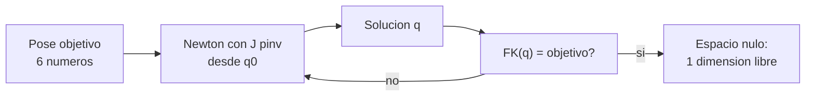

# B101-C02 — Cinemática inversa y redundancia de manipuladores

<!-- nav:top -->
[🏠 Programa](../../../../README.md) · [📚 Bloque B101](../../../tronco-comun/B101-manipuladores-roboticos-espaciales.md) · [← Anterior: B101-C01 — Transformaciones homogéneas y parametrización de eslabones (Denavit-Hartenberg)](../B101-C01-transformaciones-homogeneas-y-parametrizacion-de-eslabones-denavit-hartenberg/CLASE.md) · [Siguiente: B101-C03 — Singularidades y manipulabilidad de brazos robóticos →](../B101-C03-singularidades-y-manipulabilidad-de-brazos-roboticos/CLASE.md)
<!-- /nav -->

## 1. Ubicación, nivel y alcance

Clase 2 del bloque B101. Nivel N3. Resuelves la **cinemática inversa**: dada la posición y orientación deseadas del extremo, hallar los ángulos de las articulaciones. Trabajas con la solución analítica de un brazo planar de dos eslabones (dos soluciones), con un método numérico (Newton con pseudoinversa amortiguada) para el brazo sintético de 7 articulaciones y con el **espacio nulo** que da la redundancia. Todos los datos son **sintéticos**.

## 2. Por qué esta clase existe

El operador pide «lleva la herramienta allí» y el brazo debe decidir cuántos grados gira cada articulación. Hay ninguna, una, varias o infinitas soluciones. La decisión central: **¿cuál de las soluciones elijo y cómo sé que es válida?**

## 3. Lo que podrás hacer al terminar

1. Resolver la cinemática inversa analítica de un brazo planar de dos eslabones y reconocer las dos ramas (codo arriba y codo abajo).
2. Detectar un objetivo fuera de alcance.
3. Aplicar el método de Newton con pseudoinversa amortiguada a una pose de seis dimensiones.
4. Reconocer que un brazo de 7 articulaciones tiene un espacio nulo de dimensión 1 y moverse en él sin cambiar la pose.
5. Verificar toda solución con la cinemática directa.
6. Separar lo consultado (siete articulaciones, F2) de lo sintético.

La evidencia es la **ficha de soluciones inversas** del ejercicio 12 (sección 20).

## 4. Con qué llegas y cómo comprobarlo

1. ¿Qué es la cinemática directa?
2. ¿Qué es el jacobiano?
3. ¿Qué es el rango de una matriz?
4. ¿Qué es la pseudoinversa?
5. ¿Qué es una comprobación independiente?

<details>
<summary>Ver respuestas</summary>

1. De los ángulos a la pose del extremo (B101-C01). 2. La matriz que relaciona las velocidades articulares con la velocidad del extremo. 3. El número de filas o columnas linealmente independientes. 4. La inversa generalizada que da la solución de mínima norma de `J q̇ = v`. 5. Calcular lo mismo por otro camino y comparar.
</details>

Con cuatro o cinco aciertos, sigue; si no, repasa B101-C01 y el álgebra lineal (B10).

## 5. Un caso de contexto y casos de referencia

Un brazo de siete articulaciones, como los descritos en F1 (ERA) y F2 (manipulador de la estación), tiene una articulación más de las seis que hacen falta para fijar una pose. Esa articulación extra es lo que permite al operador esquivar un obstáculo sin mover el extremo. Aquí usamos el brazo **sintético** de B101-C01 y no las dimensiones de un brazo real.

## 6. Vocabulario

**Cinemática inversa:** de la pose del extremo a los ángulos. **Rama:** una de las soluciones discretas (codo arriba o abajo). **Redundancia:** más articulaciones que dimensiones de la tarea. **Espacio nulo:** movimientos articulares que no mueven el extremo. **Pseudoinversa amortiguada:** `Jᵀ(JJᵀ + λ²I)⁻¹`. **Error de pose:** posición y vector de rotación entre pose deseada y actual.

## 7. Modelo mental: de un objetivo a una familia de soluciones



*Descripción textual:* desde un valor inicial se corrige `q` hasta que la cinemática directa devuelva el objetivo; con siete articulaciones queda una dirección libre que no cambia la pose.

Analogía: sujetar una taza con el codo libre: la mano está fija y el codo puede subir o bajar. Límite: el espacio nulo real también está limitado por los topes articulares (B101-C04).

## 8. La explicación, paso a paso

### 8.1 Qué se sabe de los brazos reales

F1 y F2 respaldan que existen brazos de siete articulaciones; que sean redundantes para una tarea de seis dimensiones es consecuencia aritmética (7 − 6 = 1). Los algoritmos de la clase son estándar y no se consultaron en un libro (N2).

### 8.2 Solución analítica planar

Con `l₁ = 0,6` m, `l₂ = 0,5` m y objetivo `(0,55; 0,45)` m: `cos q₂ = (x² + y² − l₁² − l₂²)/(2 l₁ l₂) = −0,175`. Hay dos soluciones: `q₂ = +100,079°`, `q₁ = −4,558°` (codo abajo) y `q₂ = −100,079°`, `q₁ = 83,137°` (codo arriba). La cinemática directa de ambas devuelve `(0,550000; 0,450000)`. Si el objetivo está a 1,2 m, `|cos q₂| = 1,383 > 1`: sin solución, porque `l₁ + l₂ = 1,1` m.

### 8.3 Newton con pseudoinversa amortiguada

Se repite `q ← q + Jᵀ(JJᵀ + λ²I)⁻¹ e`, con `e` el error de pose (posición y vector de rotación) y `λ = 0,05`. Con 40 arranques al azar, los 40 convergen con error `< 10⁻⁸`. Las 40 soluciones son configuraciones articulares distintas (módulo 2π) que alcanzan la **misma pose**: pertenecen a la familia continua de una dimensión y a las ramas discretas del brazo.

### 8.4 El espacio nulo

`J` (6×7) tiene rango 6; el vector `n` de la última fila de `Vᵀ` (SVD) cumple `|J n| = 5,8×10⁻¹⁶`. Caminando por `n` con una corrección de pose, tras un desplazamiento articular de 1,942 rad el error de pose sigue siendo `4,5×10⁻¹¹`: el codo se movió y el extremo no. La pseudoinversa da la solución de mínima norma, ortogonal al espacio nulo: `q̇·n = −1,3×10⁻¹⁷`.

## 9. Magnitudes, símbolos y unidades

| Símbolo | Qué es | Unidad | Valor / nota |
|---|---|---|---|
| `q` | ángulos articulares | rad | 7 valores |
| `e` | error de pose | m (posición) y rad (rotación) | `< 10⁻⁸` |
| `J` | jacobiano | m/rad y adimensional | 6×7 |
| `λ` | amortiguamiento | — | 0,05 |
| `n` | dirección del espacio nulo | — | `|J n| ≈ 10⁻¹⁵` |

## 10. Convenciones y referencias

Marcos y D-H como en B101-C01. Pose objetivo generada con `q = [30, −40, 25, 60, −35, 50, 20]°` (sintética). Semilla 102. Tolerancias: error de pose `< 10⁻⁸`; `|J n| < 10⁻¹⁰`. Python 3.12.9, numpy 2.4.4. Todo dato es **sintético**.

## 11. De dónde sale lo que afirmamos

| ID | Fuente | Localizador | Respalda | Estado |
|---|---|---|---|---|
| F1 | Airbus, comunicado «Airbus-built European Robotic Arm ready for Space», Leiden, 5-07-2021 — https://www.airbus.com/sites/g/files/jlcbta136/files/4b7e903e07e8e840d723ad3d1796c9c9_EN-Airbus-SpS-Press-Release-Airbus-built-European-Robotic-Arm-ready-for-Space.pdf (consultada 2026-11-10; texto extraído del PDF con PyMuPDF) | página 1 | el European Robotic Arm (ERA) mide 11,3 m, tiene siete articulaciones, mueve 3 000 kg de forma rutinaria y hasta 8 000 kg en modo lento y opera con una precisión de 5 mm; puede «caminar» de un punto base a otro | Consultada (comunicado de prensa del fabricante: no es una especificación técnica) |
| F2 | Razvi, S. y Burns, S. H. (NASA JSC), «Evolution of the Space Station Robotic Manipulator», NASA NTRS 20070010589, 2007 — https://ntrs.nasa.gov/citations/20070010589 (consultada 2026-11-10) | resumen extendido (solo el resumen) | el manipulador de la estación (Canadarm2) tiene un diseño de 7 grados de libertad, con base cambiable que le permite desplazarse a puntos base | Consultada (solo el resumen; no se consultaron longitud ni carga) |
| — | Textos de robótica (Denavit y Hartenberg, 1955; Craig; Siciliano et al.; Spong et al.) | — | las matrices D-H, el jacobiano, la pseudoinversa y los mínimos cuadrados son resultados estándar que verifica cada laboratorio | No consultada en una fuente concreta |
| — | Longitud, masa y carga de Canadarm2; especificaciones de otros brazos (Kibo, Shuttle Arm) | — | — | No consultada |

Límites: ninguna fuente consultada da algoritmos de cinemática inversa ni topes articulares de un brazo real.

## 12. Cómo ver las soluciones

| Magnitud | Valor |
|---|---|
| planar: soluciones | 2 (codo abajo y arriba) |
| 7R: arranques que convergen | 40 de 40 |
| error de pose máximo | `1,35×10⁻⁸` |
| espacio nulo | dimensión 1; error tras 1,94 rad: `4,5×10⁻¹¹` |

Descripción larga: cada una de las 40 soluciones se verifica con la cinemática directa; la diferencia con el objetivo es menor que `10⁻⁸`.

## 13. Ejemplo trabajado: dos soluciones planares

**Paso 1 · Coseno.** `cos q₂ = (0,55² + 0,45² − 0,6² − 0,5²)/(2·0,6·0,5) = −0,175`.

**Paso 2 · Ramas.** `q₂ = ±arccos(−0,175) = ±100,079°`.

**Paso 3 · `q₁`.** `q₁ = atan2(y, x) − atan2(l₂ sin q₂, l₁ + l₂ cos q₂)`: `−4,558°` y `83,137°`.

**Paso 4 · Decisión.** Se verifica con la cinemática directa y se elige la rama que respete topes y obstáculos (B101-C04).

## 14. Distintas formas de resolver la inversa

**Analítica:** solución cerrada cuando la geometría lo permite (esta clase, caso planar). **Numérica:** iteración con el jacobiano (caso 7R). **Optimización con tareas secundarias:** usar el espacio nulo para un criterio adicional (límites, colisiones). Se complementan.

## 15. Práctica guiada

**Ejercicio 1 · con los pasos indicados.** Planar con `l₁ = l₂ = 1` m y objetivo `(1, 1)` m. *Pasos:* `cos q₂`, luego `q₁`.

<details><summary>Solución comentada</summary>

`cos q₂ = (2 − 2)/2 = 0`, `q₂ = ±90°`. `q₁ = 45° − atan2(±1, 1) = 0°` o `90°`: `(q₁, q₂) = (0°, 90°)` o `(90°, −90°)`.
</details>

**Ejercicio 2 · con una pista.** ¿Es alcanzable un punto a 0,05 m de la base con `l₁ = 0,6` y `l₂ = 0,5`? *Pista:* el alcance es un anillo.

<details><summary>Solución comentada</summary>

No: el anillo es `|l₁ − l₂| = 0,1 ≤ r ≤ 1,1` m.
</details>

**Ejercicio 3 · casi autónomo.** ¿Qué dimensión tiene el espacio nulo de un brazo de 7 articulaciones con `J` de rango 6?

<details><summary>Solución comentada</summary>

`7 − 6 = 1`.
</details>

## 16. Práctica autónoma, transferencia e integrador

**Ejercicio 4 · autónomo.** Con `l₁ = l₂ = 1` en `q = (0°, 90°)`, calcula `J` y el paso `Δq` para `Δx = (0,01; 0)`.

<details><summary>Solución comentada</summary>

`J = [−1 −1; 1 0]`. La segunda fila da `Δq₁ = 0` y la primera `−Δq₂ = 0,01`: `Δq = (0; −0,01)` rad.
</details>

**Ejercicio 5 · autónomo.** ¿Por qué la velocidad articular de la pseudoinversa es ortogonal al espacio nulo?

<details><summary>Solución comentada</summary>

Es la solución de mínima norma: está en el espacio fila de `J`, que es ortogonal al espacio nulo.
</details>

**Ejercicio 6 · autónomo.** Calcula la pseudoinversa de `J = [1 1]` y la solución para `v = 2`.

<details><summary>Solución comentada</summary>

`J⁺ = [0,5; 0,5]` y `q̇ = (1, 1)`.
</details>

**Ejercicio 7 · autónomo.** Un objetivo requiere girar 30° sobre `z`. ¿Cuánto vale el vector de rotación del error?

<details><summary>Solución comentada</summary>

`(0, 0, 0,5236)` rad: ángulo por eje.
</details>

**Ejercicio 8 · autónomo.** Tras caminar por el espacio nulo queda un error de `4,5×10⁻¹¹`: ¿por qué no es exactamente 0?

<details><summary>Solución comentada</summary>

Cada paso es una aproximación lineal; el término de segundo orden deriva y se corrige con un paso de Newton, que reduce el error pero no lo anula en aritmética finita.
</details>

**Ejercicio 9 · transferencia.** **Transferencia.** Hay una solución con el codo cerca de un panel y otra lejos. ¿Cuál eliges?

<details><summary>Solución comentada</summary>

La que mantenga distancia al obstáculo y respete los topes; se comprueba con la distancia entre cápsulas (B101-C04).
</details>

**Ejercicio 10 · transferencia.** **Transferencia.** Newton puro diverge cerca de una singularidad: ¿qué se hace?

<details><summary>Solución comentada</summary>

Se amortigua (`λ`), se limita el paso o se cambia de arranque (B101-C03).
</details>

**Ejercicio 11 · transferencia.** **Transferencia.** El método numérico «converge» a un objetivo inalcanzable. ¿Cómo lo detectas?

<details><summary>Solución comentada</summary>

Verificando siempre el error de pose final con la cinemática directa: si no es menor que la tolerancia, no hay solución, aunque la iteración haya terminado.
</details>

**Ejercicio 12 · integrador.** **Integrador.** Elabora tu *ficha de soluciones inversas*: el caso planar con sus dos ramas, el caso 7R con el número de arranques que convergen, el error máximo, la comprobación del espacio nulo y qué es consultado, no consultado y sintético.

<details><summary>Solución comentada</summary>

Secciones 8.2–8.4 y la salida del laboratorio.
</details>

## 17. Laboratorio: soluciones inversas y espacio nulo

El script [ik_redundancia.py](ik_redundancia.py) resuelve el caso planar, lanza 40 arranques de Newton amortiguado para el brazo de 7 articulaciones, cuenta las soluciones distintas, camina por el espacio nulo y compara la pseudoinversa; **comprueba** la cinemática directa de cada solución, `|J n| ≈ 0` y la ortogonalidad. Usa [b101_comun.py](../b101_comun.py).

**Datos:** pose y arranques **sintéticos**; sin constantes con fuente. **Predice antes de ejecutar:** ¿cuántos arranques convergen? (casi todos.) Ejecución del 2026-11-10 (Python 3.12.9, numpy 2.4.4):

```text
Python 3.12.9 | numpy 2.4.4
Datos SINTETICOS: brazo planar 2R (0.6, 0.5 m) y brazo de 7 articulaciones de B101-C01
Planar 2R, objetivo (0.55, 0.45) m: cos q2 = -0.175000
  codo abajo: q1 =   -4.558  q2 =  100.079 grados ; FK = (0.550000, 0.450000)
  codo arriba: q1 =   83.137  q2 = -100.079 grados ; FK = (0.550000, 0.450000)
Fuera de alcance: |r| = 1.2 m > l1 + l2 = 1.1 m -> sin solucion (|cos q2| = 1.383 > 1)
Objetivo de 6 dimensiones generado con q = [30 -40 25 60 -35 50 20] grados
Newton amortiguado desde 40 arranques: 40 convergen (error < 1e-8)
Configuraciones articulares distintas que alcanzan la MISMA pose: 40
  error de pose de cada una (max) = 1.35e-08
Rango de J = 6 ; |J n| = 5.81e-16 (espacio nulo de dimension 1)
Tras 2 rad de recorrido en el espacio nulo: error de pose = 4.49e-11 ; desplazamiento articular = 1.942 rad
pinv: |J qd - v| = 3.61e-17 ; |qd| = 0.0837 ; qd . n = -1.34e-17
Pruebas superadas.
```

```bash
python programa/clases/B101/B101-C02-cinematica-inversa-y-redundancia-de-manipuladores/ik_redundancia.py
```

**Límites:** sin topes articulares ni colisiones; una sola pose objetivo; los 40 arranques no son una enumeración de todas las soluciones.

## 18. Errores frecuentes y cómo corregirlos

**Creer que hay una única solución.** Hay ramas y, con redundancia, una familia continua (8.3)

**No verificar con la cinemática directa.** Comprueba siempre el error final (ejercicio 11)

**Presentar el brazo de la clase como uno real.** Revisa la sección 11

## 19. Cómo sabrás que vas bien

Tras la sección 8: ¿cuántas soluciones tiene un brazo planar de dos eslabones en el interior de su alcance? Si dudas, repasa el ejercicio 1. Tras el laboratorio: ¿qué comprueba `|J n|`? (ver sección 17).

## 20. Qué entregas y cómo se evalúa

El producto es tu **ficha de soluciones inversas** (ejercicio 12).

| Criterio | Inicial | En desarrollo | Logrado | Destacado |
|---|---|---|---|---|
| Conceptos | Los confunde | Parciales | Explica el método y su dominio | Explica los límites y las alternativas |
| Cálculo | Sin unidades | Con errores | Resultados con unidades y comprobados | Resuelve casos nuevos |
| Numérico | Sin comprobar | Un caso | Verifica con una comprobación independiente en varios casos | Interpreta las diferencias y los fallos |
| Fuentes | Sin fuente | Sin fecha | Fuentes con fecha y estado | Declara lo sintético y lo no consultado |
| Límites | No los nombra | Uno | Tres | Discute qué falta del modelo |

**Condiciones críticas (no se compensan con promedio):** rotular los datos como sintéticos; verificar cada resultado con una comprobación independiente; citar solo lo consultado.

## 21. Ética, seguridad y límites

Clase educativa: los resultados no sustituyen la planificación de movimientos de un brazo real, que además verifica límites, colisiones y singularidades. No enseña a operar hardware real. Accesibilidad: tablas equivalentes a las gráficas, fórmulas en texto, ejercicios sin conexión.

## 22. Para cerrar y seguir

Con siete articulaciones la inversa tiene una dirección libre y todas las soluciones se verifican con la cinemática directa. Queda una pregunta: ¿qué pasa cuando el jacobiano pierde rango y el brazo no puede moverse en una dirección?

**Glosario español–inglés.** cinemática inversa · *inverse kinematics*; redundancia · *redundancy*; espacio nulo · *null space*; pseudoinversa · *pseudoinverse*; codo arriba · *elbow up*; mínimos cuadrados amortiguados · *damped least squares*.

**Continuidad.** [B101-C03](../B101-C03-singularidades-y-manipulabilidad-de-brazos-roboticos/CLASE.md) trata las singularidades y la manipulabilidad.

**Referencias:** ver sección 11.

<!-- nav:bottom -->
---

[← Anterior: B101-C01 — Transformaciones homogéneas y parametrización de eslabones (Denavit-Hartenberg)](../B101-C01-transformaciones-homogeneas-y-parametrizacion-de-eslabones-denavit-hartenberg/CLASE.md) · [📚 Bloque B101](../../../tronco-comun/B101-manipuladores-roboticos-espaciales.md) · [Siguiente: B101-C03 — Singularidades y manipulabilidad de brazos robóticos →](../B101-C03-singularidades-y-manipulabilidad-de-brazos-roboticos/CLASE.md)
<!-- /nav -->
