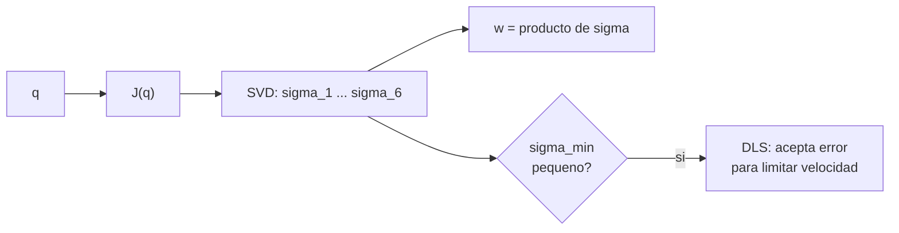

# B101-C03 — Singularidades y manipulabilidad de brazos robóticos

<!-- nav:top -->
[🏠 Programa](../../../../README.md) · [📚 Bloque B101](../../../tronco-comun/B101-manipuladores-roboticos-espaciales.md) · [← Anterior: B101-C02 — Cinemática inversa y redundancia de manipuladores](../B101-C02-cinematica-inversa-y-redundancia-de-manipuladores/CLASE.md) · [Siguiente: B101-C04 — Límites articulares, espacio de trabajo y evitación de colisiones →](../B101-C04-limites-articulares-espacio-de-trabajo-y-evitacion-de-colisiones/CLASE.md)
<!-- /nav -->

## 1. Ubicación, nivel y alcance

Clase 3 del bloque B101. Nivel N3. Analizas el **jacobiano** de un brazo: qué velocidades del extremo puede producir con velocidades articulares, dónde **pierde rango** (singularidad) y cómo se mide la cercanía con el índice de manipulabilidad y con los valores singulares. Cierras con los **mínimos cuadrados amortiguados**, que evitan velocidades articulares enormes. Todos los datos son **sintéticos**.

## 2. Por qué esta clase existe

Con el brazo casi estirado, pedirle un movimiento de 5 cm/s a lo largo de su eje exige velocidades articulares de varios rad/s. La decisión central: **¿cuán cerca de una singularidad estoy y qué error de seguimiento acepto para no exigir lo imposible?**

## 3. Lo que podrás hacer al terminar

1. Calcular el jacobiano geométrico de 6×7 y verificarlo por diferencias finitas.
2. Calcular el índice de manipulabilidad `w = √det(J Jᵀ)` y compararlo con el valor analítico de un brazo planar.
3. Leer los valores singulares y el número de condición.
4. Reconocer la singularidad de brazo estirado.
5. Aplicar mínimos cuadrados amortiguados y entender su costo (error de seguimiento).
6. Separar lo consultado de lo sintético y señalar que `w` mezcla unidades.

La evidencia es el **mapa de manipulabilidad** del ejercicio 12 (sección 20).

## 4. Con qué llegas y cómo comprobarlo

1. ¿Qué es el jacobiano?
2. ¿Qué es la descomposición en valores singulares (SVD)?
3. ¿Qué es el número de condición?
4. ¿Qué es una singularidad?
5. ¿Qué es una comprobación independiente?

<details>
<summary>Ver respuestas</summary>

1. La matriz de las derivadas del extremo respecto de las articulaciones. 2. `J = U Σ Vᵀ` con `Σ` diagonal (B10-C11). 3. `σ_max/σ_min`. 4. Una configuración donde `J` pierde rango. 5. Calcular lo mismo por otro camino y comparar.
</details>

Con cuatro o cinco aciertos, sigue; si no, repasa B101-C01, B101-C02 y la SVD.

## 5. Un caso de contexto y casos de referencia

Un brazo de siete articulaciones, como los de F1 y F2, se estira para alcanzar un punto lejano. Cuando el codo se acerca a 0°, la geometría pierde una dirección de movimiento. Aquí lo mostramos con el brazo **sintético**: el codo `q₄` baja de 90° a 0° con las demás articulaciones fijas.

## 6. Vocabulario

**Jacobiano geométrico:** `J(q)` de 6×7, con filas de velocidad lineal y angular. **Singularidad:** `rango(J) < 6`. **Manipulabilidad `w`:** `√det(J Jᵀ)`. **Valor singular `σ`:** semieje de la elipse de velocidades. **Número de condición:** `σ_max/σ_min`. **Amortiguamiento `λ`:** parámetro del método DLS.

## 7. Modelo mental: la elipse de velocidades



*Descripción textual:* el jacobiano se descompone en valores singulares; si el menor es pequeño, el brazo está cerca de una singularidad y conviene amortiguar.

Analogía: empujar una puerta casi alineada con las bisagras: poco movimiento por mucho esfuerzo. Límite: el jacobiano es una aproximación lineal; la pérdida de movilidad real depende también del recorrido finito.

## 8. La explicación, paso a paso

### 8.1 Qué se sabe de los brazos reales

F1 y F2 solo respaldan que existen brazos de siete articulaciones. Que su movilidad se degrada al estirarse es un resultado matemático que se verifica aquí con el modelo sintético; el índice de Yoshikawa (N3) no se consultó en su fuente original.

### 8.2 Brazo planar

Con `l₁ = 0,6`, `l₂ = 0,5` m, `w = l₁ l₂ |sin q₂|`. El laboratorio calcula `√det(J Jᵀ)` y lo compara: coinciden en seis cifras en `q₂ = 90°, 45°, 10°, 1°, 0°` (0,300000; 0,212132; 0,052094; 0,005236; 0). La singularidad planar es `q₂ = 0` o 180°.

### 8.3 Brazo de 7 articulaciones

El jacobiano analítico coincide con las diferencias finitas centrales (diferencia máxima `1,1×10⁻¹⁰`). Con `q = [0,3; −0,4; 0,2; q₄; −0,3; 0,5; 0,1]` rad:

| `q₄` (grados) | `w` | `σ_min` | `σ_max` | número de condición |
|---|---|---|---|---|
| 90 | 0,1791 | 0,2027 | 2,1032 | 10,4 |
| 60 | 0,1447 | 0,2141 | 2,2144 | 10,3 |
| 30 | 0,0657 | 0,1169 | 2,3089 | 19,7 |
| 10 | 0,01987 | 0,03905 | 2,3483 | 60,1 |
| 3 | 0,00594 | 0,01172 | 2,3563 | 201 |
| 1 | 0,001986 | 0,003910 | 2,3580 | 603 |
| 0 | 0 | `6×10⁻¹⁷` | 2,3587 | `4×10¹⁶` |

`w` decrece al estirar el codo y se anula en `q₄ = 0`: el brazo estirado es singular.

### 8.4 Mínimos cuadrados amortiguados

Con el codo a 2° (`σ_min = 0,0078`) y una velocidad de 0,05 en la dirección débil, la pseudoinversa exige `|q̇| = 6,396` rad/s con error 0. Con `q̇ = Jᵀ(JJᵀ + λ²I)⁻¹v`:

| `λ` | `|q̇|` (rad/s) | error de seguimiento |
|---|---|---|
| 0,01 | 2,426 | 0,031 |
| 0,05 | 0,153 | 0,0488 |
| 0,20 | 0,010 | 0,0499 |

Aumentar `λ` baja la velocidad articular a costa de no seguir la orden: con `λ = 0,2` casi no hay movimiento en esa dirección. Con `λ → 0` el método coincide con la pseudoinversa (diferencia relativa `1,6×10⁻⁸`).

## 9. Magnitudes, símbolos y unidades

| Símbolo | Qué es | Unidad | Valor / nota |
|---|---|---|---|
| `J` | jacobiano geométrico | m/rad (3 filas), adimensional (3 filas) | 6×7 |
| `w` | manipulabilidad | mezcla de unidades | tabla 8.3 |
| `σ` | valor singular | mezcla de unidades | tabla 8.3 |
| `λ` | amortiguamiento | igual que `σ` | 0,01 a 0,20 |
| `q̇` | velocidad articular | rad/s | 6,396 con pinv |

## 10. Convenciones y referencias

Marcos y D-H como en B101-C01; jacobiano en `{0}`. Semilla 103. Tolerancias: jacobiano frente a diferencias finitas `< 10⁻⁷`; `w` planar `< 10⁻¹²`. Los valores de `w` y `σ` **mezclan** posición (m/rad) y rotación (rad/rad): su valor numérico depende de las unidades. Todo dato es **sintético**.

## 11. De dónde sale lo que afirmamos

| ID | Fuente | Localizador | Respalda | Estado |
|---|---|---|---|---|
| F1 | Airbus, comunicado «Airbus-built European Robotic Arm ready for Space», Leiden, 5-07-2021 — https://www.airbus.com/sites/g/files/jlcbta136/files/4b7e903e07e8e840d723ad3d1796c9c9_EN-Airbus-SpS-Press-Release-Airbus-built-European-Robotic-Arm-ready-for-Space.pdf (consultada 2026-11-10; texto extraído del PDF con PyMuPDF) | página 1 | el European Robotic Arm (ERA) mide 11,3 m, tiene siete articulaciones, mueve 3 000 kg de forma rutinaria y hasta 8 000 kg en modo lento y opera con una precisión de 5 mm; puede «caminar» de un punto base a otro | Consultada (comunicado de prensa del fabricante: no es una especificación técnica) |
| F2 | Razvi, S. y Burns, S. H. (NASA JSC), «Evolution of the Space Station Robotic Manipulator», NASA NTRS 20070010589, 2007 — https://ntrs.nasa.gov/citations/20070010589 (consultada 2026-11-10) | resumen extendido (solo el resumen) | el manipulador de la estación (Canadarm2) tiene un diseño de 7 grados de libertad, con base cambiable que le permite desplazarse a puntos base | Consultada (solo el resumen; no se consultaron longitud ni carga) |
| — | Yoshikawa (1985), índice de manipulabilidad | — | la fórmula `w = √det(J Jᵀ)` se verifica en el laboratorio con el brazo planar | No consultada |
| — | Textos de robótica (Denavit y Hartenberg, 1955; Craig; Siciliano et al.; Spong et al.) | — | las matrices D-H, el jacobiano, la pseudoinversa y los mínimos cuadrados son resultados estándar que verifica cada laboratorio | No consultada en una fuente concreta |

Límites: ninguna fuente consultada da umbrales de manipulabilidad ni de singularidad.

## 12. Cómo ver la manipulabilidad

| Magnitud | Valor |
|---|---|
| `w` en `q₄ = 90°` | 0,1791 |
| `w` en `q₄ = 1°` | 0,001986 |
| `w` en `q₄ = 0°` | 0 |
| `|q̇|` con pinv a 2° | 6,396 rad/s |
| `|q̇|` con `λ = 0,05` | 0,153 rad/s |

Descripción larga: `w` cae casi proporcional a `sin q₄` al acercarse a 0 (0,01987 → 0,001986 al bajar de 10° a 1°).

## 13. Ejemplo trabajado: brazo planar en `q₂ = 30°`

**Paso 1 · Fórmula.** `w = l₁ l₂ |sin q₂|`.

**Paso 2 · Cálculo.** `0,6 × 0,5 × 0,5 = 0,15` m².

**Paso 3 · Verificación.** Con `q₁ = 0`, `J = [−0,25 −0,25; 1,033 0,433]` y `det J = (−0,25)(0,433) − (−0,25)(1,033) = 0,150`; en una `J` cuadrada `w = |det J|`, igual que la fórmula.

**Paso 4 · Decisión.** `w` baja a medida que `q₂ → 0`: se limita la velocidad con DLS antes de llegar.

## 14. Distintas formas de medir la cercanía

**Manipulabilidad `w`:** el volumen de la elipse (esta clase). **`σ_min`:** la dirección más débil. **Número de condición:** isotropía. Cada una responde a una pregunta distinta y ninguna es universal.

## 15. Práctica guiada

**Ejercicio 1 · con los pasos indicados.** Brazo planar `l₁ = 0,6`, `l₂ = 0,5` con `q₂ = 30°`: calcula `w`. *Pasos:* `l₁ l₂ sin q₂`.

<details><summary>Solución comentada</summary>

`0,6 × 0,5 × 0,5 = 0,15`.
</details>

**Ejercicio 2 · con una pista.** ¿Para qué valores de `q₂` el brazo planar es singular? *Pista:* `sin q₂ = 0`.

<details><summary>Solución comentada</summary>

`q₂ = 0` (estirado) y `q₂ = 180°` (plegado).
</details>

**Ejercicio 3 · casi autónomo.** Si `J = diag(2; 0,5)`, ¿cuánto valen `w` y el número de condición?

<details><summary>Solución comentada</summary>

`σ = 2; 0,5`: `w = 1` y condición 4.
</details>

## 16. Práctica autónoma, transferencia e integrador

**Ejercicio 4 · autónomo.** Con `σ = 0,01` y `λ = 0,1`, ¿cuál es la ganancia de DLS frente a la de la pseudoinversa?

<details><summary>Solución comentada</summary>

DLS: `σ/(σ² + λ²) = 0,01/0,0101 ≈ 0,99`; pseudoinversa: `1/σ = 100`.
</details>

**Ejercicio 5 · autónomo.** ¿Qué fracción de la velocidad pedida en esa dirección se obtiene con DLS?

<details><summary>Solución comentada</summary>

`σ²/(σ² + λ²) = 10⁻⁴/0,0101 ≈ 0,0099`, es decir, 1 %.
</details>

**Ejercicio 6 · autónomo.** ¿Qué dirección se pierde con el brazo estirado?

<details><summary>Solución comentada</summary>

La del eje del brazo: el extremo no puede acercarse ni alejarse más a lo largo de él con solo las articulaciones.
</details>

**Ejercicio 7 · autónomo.** `w` de un planar con `l₁ = l₂ = 1` en `q₂ = 90°`.

<details><summary>Solución comentada</summary>

`1 × 1 × 1 = 1`.
</details>

**Ejercicio 8 · autónomo.** Con `σ_max = 2,1` y `σ_min = 0,2027`, ¿cuál es el número de condición?

<details><summary>Solución comentada</summary>

`2,1032/0,2027 = 10,4`.
</details>

**Ejercicio 9 · transferencia.** **Transferencia.** El operador manda una línea recta a lo largo del brazo casi estirado. ¿Qué ocurre y cómo se evita?

<details><summary>Solución comentada</summary>

Las velocidades articulares crecen sin límite (pseudoinversa); se evita con DLS, saturación de velocidad y una alarma de `w` o `σ_min`.
</details>

**Ejercicio 10 · transferencia.** **Transferencia.** Un colega fija una alarma en `w < 0,02`. ¿Es un criterio válido?

<details><summary>Solución comentada</summary>

Solo para este modelo y estas unidades: `w` mezcla metros y radianes y depende del brazo; el umbral de un brazo real debe salir de su ingeniería.
</details>

**Ejercicio 11 · transferencia.** **Transferencia.** ¿Cómo eliges `λ`?

<details><summary>Solución comentada</summary>

Compromiso entre velocidad articular y error de seguimiento (tabla 8.4); suele hacerse variable con `σ_min`.
</details>

**Ejercicio 12 · integrador.** **Integrador.** Elabora tu *mapa de manipulabilidad*: la tabla de `w`, `σ_min` y condición al estirar el codo, el efecto de `λ` y qué es consultado, no consultado y sintético.

<details><summary>Solución comentada</summary>

Secciones 8.3–8.4 y la salida del laboratorio.
</details>

## 17. Laboratorio: manipulabilidad y amortiguamiento

El script [singularidades.py](singularidades.py) calcula `w` planar contra su fórmula, compara el jacobiano con diferencias finitas, barre el codo de 90° a 0° y aplica pseudoinversa y DLS; **comprueba** que `w` decrece, que se anula en 0°, que DLS reduce la velocidad y que `λ → 0` recupera la pseudoinversa. Usa [b101_comun.py](../b101_comun.py).

**Datos:** brazo y ángulos **sintéticos**; sin constantes con fuente. **Predice antes de ejecutar:** ¿cuánto vale `w` con el codo estirado? (0.) Ejecución del 2026-11-10 (Python 3.12.9, numpy 2.4.4):

```text
Python 3.12.9 | numpy 2.4.4
Datos SINTETICOS: planar 2R (0.6, 0.5 m) y brazo de 7 articulaciones de B101-C01
Planar 2R: w = sqrt(det(J J^T)) contra l1 l2 |sin q2|
  q2 =  90 grados: w = 0.300000  formula = 0.300000
  q2 =  45 grados: w = 0.212132  formula = 0.212132
  q2 =  10 grados: w = 0.052094  formula = 0.052094
  q2 =   1 grados: w = 0.005236  formula = 0.005236
  q2 =   0 grados: w = 0.000000  formula = 0.000000
Jacobiano analitico contra diferencias finitas (6x7): diferencia max = 1.12e-10
Brazo de 7 articulaciones, codo q4 de 90 grados a 0 (resto: q = [0.3 -0.4 0.2 q4 -0.3 0.5 0.1] rad)
  q4 [gr]   w            sigma_min     sigma_max    cond
     90    1.791e-01    2.027e-01      2.1032    1.04e+01
     60    1.447e-01    2.141e-01      2.2144    1.03e+01
     30    6.570e-02    1.169e-01      2.3089    1.97e+01
     10    1.987e-02    3.905e-02      2.3483    6.01e+01
      3    5.940e-03    1.172e-02      2.3563    2.01e+02
      1    1.986e-03    3.910e-03      2.3580    6.03e+02
      0    0.000e+00    6.384e-17      2.3587    3.69e+16
Codo a 2 grados, velocidad pedida 0.05 en el eje debil (sigma_min = 0.0078):
  pinv:      |qd| =    6.396 rad/s ; error = 1.46e-15
  DLS 0.01: |qd| =    2.426 rad/s ; error = 3.10e-02
  DLS 0.05: |qd| =    0.153 rad/s ; error = 4.88e-02
  DLS 0.20: |qd| =    0.010 rad/s ; error = 4.99e-02
  DLS con lambda -> 0 contra pinv: diferencia relativa = 1.64e-08
Pruebas superadas.
```

```bash
python programa/clases/B101/B101-C03-singularidades-y-manipulabilidad-de-brazos-roboticos/singularidades.py
```

**Límites:** análisis local (lineal); un solo tipo de singularidad estudiado; `w` mezcla unidades.

## 18. Errores frecuentes y cómo corregirlos

**Creer que la singularidad es solo un punto exacto.** El efecto empieza cerca (8.3)

**Usar `w` sin escalar unidades.** Revisa la sección 10

**Elegir `λ` sin mirar el error.** Compara con la tabla 8.4

## 19. Cómo sabrás que vas bien

Tras la sección 8: ¿qué le pasa a `q̇` con la pseudoinversa al acercarse a la singularidad? Si dudas, repasa el ejercicio 4. Tras el laboratorio: ¿qué recupera `λ → 0`? (ver sección 17).

## 20. Qué entregas y cómo se evalúa

El producto es tu **mapa de manipulabilidad** (ejercicio 12).

| Criterio | Inicial | En desarrollo | Logrado | Destacado |
|---|---|---|---|---|
| Conceptos | Los confunde | Parciales | Explica el método y su dominio | Explica los límites y las alternativas |
| Cálculo | Sin unidades | Con errores | Resultados con unidades y comprobados | Resuelve casos nuevos |
| Numérico | Sin comprobar | Un caso | Verifica con una comprobación independiente en varios casos | Interpreta las diferencias y los fallos |
| Fuentes | Sin fuente | Sin fecha | Fuentes con fecha y estado | Declara lo sintético y lo no consultado |
| Límites | No los nombra | Uno | Tres | Discute qué falta del modelo |

**Condiciones críticas (no se compensan con promedio):** rotular los datos como sintéticos; verificar cada resultado con una comprobación independiente; citar solo lo consultado.

## 21. Ética, seguridad y límites

Clase educativa: los umbrales de manipulabilidad son de ejemplo y dependen de las unidades y de la ponderación; no sustituyen los criterios de seguridad de un brazo real. No enseña a operar hardware real. Accesibilidad: tablas equivalentes a las gráficas, fórmulas en texto, ejercicios sin conexión.

## 22. Para cerrar y seguir

El brazo sintético pierde movilidad al estirar el codo (`w = 0` en 0°) y el amortiguamiento cambia error por velocidad. Queda una pregunta: además de las singularidades, ¿qué más limita dónde puede estar el brazo?

**Glosario español–inglés.** singularidad · *singularity*; manipulabilidad · *manipulability*; valor singular · *singular value*; número de condición · *condition number*; mínimos cuadrados amortiguados · *damped least squares*; jacobiano · *Jacobian*.

**Continuidad.** [B101-C04](../B101-C04-limites-articulares-espacio-de-trabajo-y-evitacion-de-colisiones/CLASE.md) trata los límites articulares, el espacio de trabajo y las colisiones.

**Referencias:** ver sección 11.

<!-- nav:bottom -->
---

[← Anterior: B101-C02 — Cinemática inversa y redundancia de manipuladores](../B101-C02-cinematica-inversa-y-redundancia-de-manipuladores/CLASE.md) · [📚 Bloque B101](../../../tronco-comun/B101-manipuladores-roboticos-espaciales.md) · [Siguiente: B101-C04 — Límites articulares, espacio de trabajo y evitación de colisiones →](../B101-C04-limites-articulares-espacio-de-trabajo-y-evitacion-de-colisiones/CLASE.md)
<!-- /nav -->
