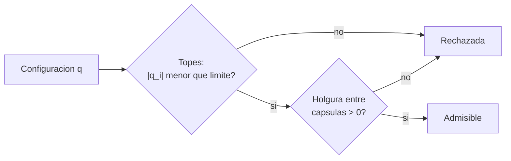

# B101-C04 — Límites articulares, espacio de trabajo y evitación de colisiones

<!-- nav:top -->
[🏠 Programa](../../../../README.md) · [📚 Bloque B101](../../../tronco-comun/B101-manipuladores-roboticos-espaciales.md) · [← Anterior: B101-C03 — Singularidades y manipulabilidad de brazos robóticos](../B101-C03-singularidades-y-manipulabilidad-de-brazos-roboticos/CLASE.md) · [Siguiente: B101-C05 — Calibración cinemática de manipuladores →](../B101-C05-calibracion-cinematica-de-manipuladores/CLASE.md)
<!-- /nav -->

## 1. Ubicación, nivel y alcance

Clase 4 del bloque B101. Nivel N3. Un brazo no puede ir a cualquier configuración: sus articulaciones tienen **topes**, su extremo solo llega a una región (el **espacio de trabajo**) y sus eslabones no deben chocar entre sí. Estimas el espacio de trabajo por Monte Carlo, calculas la distancia entre eslabones modelados como **cápsulas** y usas el espacio nulo para alejarte de los topes sin mover el extremo. Todos los datos son **sintéticos**.

## 2. Por qué esta clase existe

Una solución de cinemática inversa que exceda un tope o atraviese el propio brazo no sirve. La decisión central: **¿esta configuración es admisible: respeta los topes y deja holgura entre eslabones?**

## 3. Lo que podrás hacer al terminar

1. Estimar el espacio de trabajo con Monte Carlo y compararlo con el alcance geométrico.
2. Medir cómo los límites articulares reducen las celdas alcanzables.
3. Calcular la distancia mínima entre dos segmentos y verificarla con una malla densa.
4. Evaluar la holgura de autocolisión entre cápsulas.
5. Alejar el brazo de un tope con el espacio nulo sin cambiar la pose.
6. Separar lo consultado (existencia de ECSS-E-ST-33-01C *Mechanisms*) de lo sintético.

La evidencia es la **ficha de espacio de trabajo** del ejercicio 12 (sección 20).

## 4. Con qué llegas y cómo comprobarlo

1. ¿Qué es el espacio nulo (B101-C02)?
2. ¿Qué es el método de Monte Carlo?
3. ¿Qué es la distancia entre dos segmentos?
4. ¿Qué es un tope articular?
5. ¿Qué es una comprobación independiente?

<details>
<summary>Ver respuestas</summary>

1. Los movimientos articulares que no mueven el extremo. 2. Estimar con muestras aleatorias. 3. El mínimo de la distancia entre sus puntos. 4. El ángulo máximo o mínimo permitido. 5. Calcular lo mismo por otro camino y comparar.
</details>

Con cuatro o cinco aciertos, sigue; si no, repasa B101-C02.

## 5. Un caso de contexto y casos de referencia

F1 cuenta que el ERA tiene 11,3 m y puede «caminar» de un punto base a otro, lo que cambia el espacio de trabajo en cada base. El listado de ECSS (F3) incluye la norma ECSS-E-ST-33-01C Rev.2 *Mechanisms*; no se consultó su texto. Aquí el brazo es el **sintético** de B101-C01 con topes de ±170° y cápsulas de 0,08 m de radio, ambos inventados.

## 6. Vocabulario

**Espacio de trabajo:** conjunto de posiciones que alcanza el extremo. **Tope articular:** límite de ángulo. **Cápsula:** segmento con radio, modelo de un eslabón. **Holgura:** distancia entre cápsulas menos la suma de radios. **Autocolisión:** holgura negativa entre eslabones no adyacentes. **Centrado de articulaciones:** criterio `Σ (qᵢ/límite)²`.

## 7. Modelo mental: una configuración admisible



*Descripción textual:* una configuración se acepta solo si respeta los topes y deja holgura positiva entre los pares de eslabones no adyacentes.

Analogía: un brazo humano que no puede girar más allá de su articulación ni tocarse el hombro con la mano en todas las posturas. Límite: las cápsulas son una aproximación de la geometría real.

## 8. La explicación, paso a paso

### 8.1 Qué se sabe de los brazos reales

Solo se sabe, por F1, que el ERA cambia de punto base y que existen mecanismos normalizados (F3); topes, geometría y zonas prohibidas de un brazo real no se consultaron (N7).

### 8.2 Espacio de trabajo por Monte Carlo

Con 20 000 configuraciones uniformes en ±170°, la distancia del extremo a la base va de 0,031 m a 1,900 m (alcance geométrico 1,9 m, nunca superado) y se visitan 8 813 celdas de 0,1 m. Al reducir los topes, el número de celdas visitadas cae (muestras independientes de 20 000 por fila):

| límite (grados) | `|p|` máximo (m) | celdas de 0,1 m |
|---|---|---|
| ±170 | 1,897 | 8 722 |
| ±120 | 1,899 | 9 220 |
| ±90 | 1,899 | 6 766 |
| ±60 | 1,900 | 3 119 |

La cuenta no es monótona entre ±170° y ±120° (la distribución de los puntos cambia con los topes y hay ruido de muestreo; no se estudió cuál pesa más); lo que se ve con claridad es la caída con topes de ±90° y ±60°. El alcance máximo sigue siendo 1,9 m porque `q = 0` cae dentro de todos los límites.

### 8.3 Distancia entre segmentos

La distancia mínima entre dos segmentos se calcula con los puntos más cercanos acotados a `[0, 1]`. El laboratorio la compara con una malla de 400×400 puntos en 300 pares al azar: diferencia máxima `3,4×10⁻⁴` m, del orden del paso de la malla.

### 8.4 Autocolisión y evitación de topes

Con cápsulas de 0,08 m y los pares no adyacentes (base–antebrazo, base–mano, brazo–mano): de 5 000 configuraciones al azar, 460 (9,2 %) tienen holgura negativa y la peor es `−156,8` mm (base–antebrazo). El brazo estirado (`q = 0`) tiene 440,0 mm de holgura; con el codo a 170° y `q₆ = −60°` la holgura es `−55,8` mm.

Para alejarse de un tope se avanza por el espacio nulo en la dirección que baja el costo `Σ(qᵢ/límite)²`: de 2,526 a 2,329; la mayor razón `|qᵢ|/límite` baja de 0,941 a 0,857 y el error de pose queda en `1,5×10⁻¹³`.

## 9. Magnitudes, símbolos y unidades

| Símbolo | Qué es | Unidad | Valor / nota |
|---|---|---|---|
| `q_lim` | tope articular | rad | 170° (sintético) |
| `r` | radio de la cápsula | m | 0,08 (sintético) |
| holgura | `d − 2r` | m | tabla 8.4 |
| celdas | cubos de 0,1 m visitados | — | 8 722 a 3 119 |
| costo | `Σ (qᵢ/q_lim)²` | — | 2,526 → 2,329 |

## 10. Convenciones y referencias

Marcos y D-H como en B101-C01; los segmentos van entre los orígenes de los marcos (base, brazo, antebrazo, mano). Semilla 104. Tolerancias: distancia entre segmentos frente a malla `< 5×10⁻³` m; error de pose tras evitar topes `< 10⁻⁶`. Topes, radios y pares comprobados son **sintéticos**. Python 3.12.9, numpy 2.4.4.

## 11. De dónde sale lo que afirmamos

| ID | Fuente | Localizador | Respalda | Estado |
|---|---|---|---|---|
| F1 | Airbus, comunicado «Airbus-built European Robotic Arm ready for Space», Leiden, 5-07-2021 — https://www.airbus.com/sites/g/files/jlcbta136/files/4b7e903e07e8e840d723ad3d1796c9c9_EN-Airbus-SpS-Press-Release-Airbus-built-European-Robotic-Arm-ready-for-Space.pdf (consultada 2026-11-10; texto extraído del PDF con PyMuPDF) | página 1 | el European Robotic Arm (ERA) mide 11,3 m, tiene siete articulaciones, mueve 3 000 kg de forma rutinaria y hasta 8 000 kg en modo lento y opera con una precisión de 5 mm; puede «caminar» de un punto base a otro | Consultada (comunicado de prensa del fabricante: no es una especificación técnica) |
| F2 | Razvi, S. y Burns, S. H. (NASA JSC), «Evolution of the Space Station Robotic Manipulator», NASA NTRS 20070010589, 2007 — https://ntrs.nasa.gov/citations/20070010589 (consultada 2026-11-10) | resumen extendido (solo el resumen) | el manipulador de la estación (Canadarm2) tiene un diseño de 7 grados de libertad, con base cambiable que le permite desplazarse a puntos base | Consultada (solo el resumen; no se consultaron longitud ni carga) |
| F3 | ECSS, listado de normas activas — https://ecss.nl/standards/active-standards/ (consultada 2026-11-10) | solo títulos y fechas | existencia de ECSS-E-ST-33-01C Rev.2 *Mechanisms* (1-03-2019), ECSS-E-ST-10-11C *Human factors engineering* (31-07-2008) y ECSS-E-ST-10-09C *Reference coordinate system* (31-07-2008); el listado no incluye una norma de robótica | Consultada (solo títulos y fechas; el texto de las normas no se consultó) |
| — | Textos de robótica (Denavit y Hartenberg, 1955; Craig; Siciliano et al.; Spong et al.) | — | las matrices D-H, el jacobiano, la pseudoinversa y los mínimos cuadrados son resultados estándar que verifica cada laboratorio | No consultada en una fuente concreta |
| — | Normas de ECSS, NASA o de la estación sobre operaciones de brazos, cámaras y seguridad | — | — | No consultada (solo títulos de ECSS en F3) |

Límites: ninguna fuente consultada da topes ni geometría de un brazo real.

## 12. Cómo ver el espacio de trabajo

| Magnitud | Valor |
|---|---|
| alcance máximo observado | 1,900 m (geométrico 1,9 m) |
| celdas visitadas (±170°) | 8 722 a 8 813 |
| autocolisión (5 000 configuraciones) | 460 (9,2 %) |
| holgura del brazo estirado | 440,0 mm |

Descripción larga: el espacio de trabajo es aproximadamente una esfera hueca; la estimación por celdas crece con el número de muestras y por eso no es una medida exacta.

## 13. Ejemplo trabajado: holgura entre dos cápsulas

**Paso 1 · Distancia.** Dos segmentos paralelos a 0,20 m.

**Paso 2 · Radios.** Cada cápsula mide 0,08 m: suman 0,16 m.

**Paso 3 · Holgura.** `0,20 − 0,16 = 0,04` m.

**Paso 4 · Decisión.** Es positiva: no hay colisión, pero con 40 mm de margen conviene vigilarla.

## 14. Distintas formas de acotar el brazo

**Topes por articulación (esta clase):** intervalo `[qmin, qmax]`. **Zonas prohibidas en el espacio:** volúmenes alrededor de obstáculos. **Mallas de CAD:** geometría real con distancias exactas. La cápsula es la más barata y la menos fiel.

## 15. Práctica guiada

**Ejercicio 1 · con los pasos indicados.** Dos cápsulas de 0,08 m con segmentos a 0,20 m: ¿cuál es la holgura? *Pasos:* `d − 2r`.

<details><summary>Solución comentada</summary>

`0,20 − 0,16 = 0,04` m; no hay colisión.
</details>

**Ejercicio 2 · con una pista.** Área del espacio de trabajo de un planar con `l₁ = 0,6`, `l₂ = 0,5`. *Pista:* corona circular.

<details><summary>Solución comentada</summary>

`π(1,1² − 0,1²) = π × 1,2 = 3,77` m².
</details>

**Ejercicio 3 · casi autónomo.** Con `q = 160°` y tope de 170°, ¿cuál es el margen y la razón `|q|/límite`?

<details><summary>Solución comentada</summary>

Margen 10° = 0,1745 rad; razón `160/170 = 0,941`.
</details>

## 16. Práctica autónoma, transferencia e integrador

**Ejercicio 4 · autónomo.** Distancia entre los segmentos `(0; 0; 0)–(1; 0; 0)` y `(0; 0,3; 0)–(1; 0,3; 0)`.

<details><summary>Solución comentada</summary>

Son paralelos con separación en `y`: 0,3.
</details>

**Ejercicio 5 · autónomo.** Distancia entre `(0; 0; 0)–(1; 0; 0)` y `(2; 1; 0)–(3; 1; 0)`.

<details><summary>Solución comentada</summary>

Los puntos más cercanos son `(1; 0; 0)` y `(2; 1; 0)`: `√2 = 1,414`.
</details>

**Ejercicio 6 · autónomo.** Costo de centrado de `q = (85°, 0, …, 0)` con tope de 170°.

<details><summary>Solución comentada</summary>

`(85/170)² = 0,25`.
</details>

**Ejercicio 7 · autónomo.** Si se visitan 8 813 celdas de 0,1 m, ¿qué volumen es? ¿Cuánto es el de la esfera de 1,9 m?

<details><summary>Solución comentada</summary>

`8 813 × 0,001 = 8,81` m³; esfera: `4/3 π 1,9³ = 28,7` m³: las celdas visitadas son el 31 % del volumen de la esfera.
</details>

**Ejercicio 8 · autónomo.** ¿Por qué 20 000 muestras no prueban que una región es inalcanzable?

<details><summary>Solución comentada</summary>

Porque una muestra finita puede no visitar regiones pequeñas; el número de celdas crece con las muestras. Es una estimación, no una demostración.
</details>

**Ejercicio 9 · transferencia.** **Transferencia.** Con cápsulas inventadas, el 9,2 % de las configuraciones colisiona. ¿Vale ese porcentaje para un brazo real?

<details><summary>Solución comentada</summary>

No: depende de radios y topes sintéticos; un brazo real se evalúa con su geometría de vuelo (no consultada).
</details>

**Ejercicio 10 · transferencia.** **Transferencia.** ¿La cápsula es conservadora o no respecto de la forma real?

<details><summary>Solución comentada</summary>

Solo lo es si encierra la forma real; hay que elegir el radio con un margen y validarlo contra la malla.
</details>

**Ejercicio 11 · transferencia.** **Transferencia.** Con ±60° quedan 3 119 celdas frente a 8 722 con ±170°: ¿qué porcentaje se pierde?

<details><summary>Solución comentada</summary>

`1 − 3 119/8 722 = 0,64`, es decir, 64 % (con las salvedades del muestreo).
</details>

**Ejercicio 12 · integrador.** **Integrador.** Elabora tu *ficha de espacio de trabajo*: alcance, celdas por límite, tasa y peor caso de autocolisión, evitación de topes y qué es consultado, no consultado y sintético.

<details><summary>Solución comentada</summary>

Secciones 8.2–8.4 y la salida del laboratorio.
</details>

## 17. Laboratorio: espacio de trabajo y holguras

El script [espacio_trabajo.py](espacio_trabajo.py) estima el espacio de trabajo con 20 000 configuraciones, compara la distancia entre segmentos con una malla, evalúa la autocolisión de 5 000 configuraciones y aleja el brazo de un tope por el espacio nulo; **comprueba** el alcance máximo, la distancia entre segmentos y que el error de pose se conserva. Usa [b101_comun.py](../b101_comun.py). Tarda unos 20 segundos.

**Datos:** brazo, topes y radios **sintéticos**; sin constantes con fuente. **Predice antes de ejecutar:** ¿qué holgura tiene el brazo estirado? (440 mm.) Ejecución del 2026-11-10 (Python 3.12.9, numpy 2.4.4):

```text
Python 3.12.9 | numpy 2.4.4
Datos SINTETICOS: brazo de B101-C01, limites +-170 grados, capsulas de radio 0.08 m
Espacio de trabajo (Monte Carlo, 20000 configuraciones uniformes en los limites):
  |p| minimo = 0.031 m ; maximo = 1.900 m (alcance geometrico 1.9 m)
  celdas de 0.1 m visitadas = 8813 ; z de -1.9 a 1.90 m
  limites +-170 grados: |p| maximo = 1.897 m ; celdas de 0.1 m = 8722
  limites +-120 grados: |p| maximo = 1.899 m ; celdas de 0.1 m = 9220
  limites +- 90 grados: |p| maximo = 1.899 m ; celdas de 0.1 m = 6766
  limites +- 60 grados: |p| maximo = 1.900 m ; celdas de 0.1 m = 3119
Distancia entre segmentos: formula frente a malla de 400x400 (300 pares): diferencia max = 3.40e-04 m
Autocolision (5000 configuraciones): 460 con holgura < 0 (9.2 %) ; holgura minima = -156.8 mm en ('base', 'antebrazo')
Brazo estirado q = 0: holgura minima = 440.0 mm
Codo plegado a 170 grados: holgura minima = -55.8 mm (base-antebrazo)
Evitacion de limites: costo de centrado 2.526 -> 2.329 ; error de pose = 1.46e-13
  mayor |q_i|/limite: 0.941 -> 0.857
Pruebas superadas.
```

```bash
python programa/clases/B101/B101-C04-limites-articulares-espacio-de-trabajo-y-evitacion-de-colisiones/espacio_trabajo.py
```

**Límites:** cápsulas y no mallas; tres pares de eslabones; sin obstáculos externos; muestreo uniforme de articulaciones (no de posiciones).

## 18. Errores frecuentes y cómo corregirlos

**Tomar el alcance geométrico como alcance con topes.** Cuenta las celdas por límite (8.2)

**Olvidar la holgura positiva.** `d − 2r` (8.4)

**Presentar los radios inventados como los de un brazo real.** Revisa la sección 11

## 19. Cómo sabrás que vas bien

Tras la sección 8: ¿qué dos condiciones debe cumplir una configuración admisible? Si dudas, repasa el ejercicio 1. Tras el laboratorio: ¿qué compara la malla de 400×400? (ver sección 17).

## 20. Qué entregas y cómo se evalúa

El producto es tu **ficha de espacio de trabajo** (ejercicio 12).

| Criterio | Inicial | En desarrollo | Logrado | Destacado |
|---|---|---|---|---|
| Conceptos | Los confunde | Parciales | Explica el método y su dominio | Explica los límites y las alternativas |
| Cálculo | Sin unidades | Con errores | Resultados con unidades y comprobados | Resuelve casos nuevos |
| Numérico | Sin comprobar | Un caso | Verifica con una comprobación independiente en varios casos | Interpreta las diferencias y los fallos |
| Fuentes | Sin fuente | Sin fecha | Fuentes con fecha y estado | Declara lo sintético y lo no consultado |
| Límites | No los nombra | Uno | Tres | Discute qué falta del modelo |

**Condiciones críticas (no se compensan con promedio):** rotular los datos como sintéticos; verificar cada resultado con una comprobación independiente; citar solo lo consultado.

## 21. Ética, seguridad y límites

Clase educativa: los límites articulares y las cápsulas son de ejemplo; una evitación de colisiones real se valida con la geometría de vuelo y con los procedimientos de operación. No enseña a operar hardware real. Accesibilidad: tablas equivalentes a las gráficas, fórmulas en texto, ejercicios sin conexión.

## 22. Para cerrar y seguir

Con topes y holguras sabes qué configuraciones son admisibles; el espacio nulo permite alejarse de los topes sin mover el extremo. Queda una pregunta: ¿cómo se sabe que el brazo real tiene las longitudes y los ceros que supone el modelo?

**Glosario español–inglés.** espacio de trabajo · *workspace*; tope articular · *joint limit*; autocolisión · *self-collision*; cápsula · *capsule*; holgura · *clearance*; Monte Carlo · *Monte Carlo*.

**Continuidad.** [B101-C05](../B101-C05-calibracion-cinematica-de-manipuladores/CLASE.md) trata la calibración cinemática.

**Referencias:** ver sección 11.

<!-- nav:bottom -->
---

[← Anterior: B101-C03 — Singularidades y manipulabilidad de brazos robóticos](../B101-C03-singularidades-y-manipulabilidad-de-brazos-roboticos/CLASE.md) · [📚 Bloque B101](../../../tronco-comun/B101-manipuladores-roboticos-espaciales.md) · [Siguiente: B101-C05 — Calibración cinemática de manipuladores →](../B101-C05-calibracion-cinematica-de-manipuladores/CLASE.md)
<!-- /nav -->
