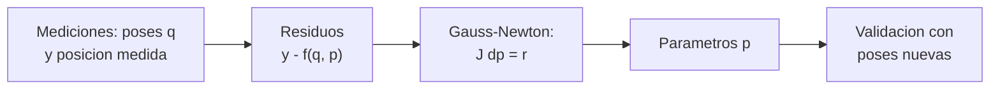

# B101-C05 — Calibración cinemática de manipuladores

<!-- nav:top -->
[🏠 Programa](../../../../README.md) · [📚 Bloque B101](../../../tronco-comun/B101-manipuladores-roboticos-espaciales.md) · [← Anterior: B101-C04 — Límites articulares, espacio de trabajo y evitación de colisiones](../B101-C04-limites-articulares-espacio-de-trabajo-y-evitacion-de-colisiones/CLASE.md) · [Siguiente: B101-C06 — Simulación de un brazo robótico espacial →](../B101-C06-simulacion-de-un-brazo-robotico-espacial/CLASE.md)
<!-- /nav -->

## 1. Ubicación, nivel y alcance

Clase 5 del bloque B101. Nivel N3. Un brazo real no tiene exactamente las longitudes y los ceros de su modelo. **Calibrar** es estimar esos parámetros cinemáticos a partir de mediciones de la posición del extremo. Aplicas Gauss-Newton con mediciones **sintéticas**, miras si los parámetros son identificables, validas con poses nuevas y comparas la incertidumbre teórica con un Monte Carlo.

## 2. Por qué esta clase existe

Un error de 0,5° en un ángulo cero produce centímetros en el extremo de un brazo de casi 2 m. La decisión central: **¿qué parámetros puedo estimar con las mediciones que tengo y con qué incertidumbre?**

## 3. Lo que podrás hacer al terminar

1. Definir un vector de parámetros cinemáticos (desfases de ángulo y errores de longitud).
2. Construir el jacobiano de identificación y leer su rango y sus valores singulares.
3. Estimar parámetros con Gauss-Newton y validar con poses no usadas.
4. Calcular la covarianza `σ²(JᵀJ)⁻¹` y compararla con un Monte Carlo.
5. Reconocer un parámetro no identificable.
6. Separar lo consultado de lo sintético.

La evidencia es el **informe de calibración** del ejercicio 12 (sección 20).

## 4. Con qué llegas y cómo comprobarlo

1. ¿Qué es la cinemática directa (B101-C01)?
2. ¿Qué es el método de mínimos cuadrados?
3. ¿Qué es la covarianza de un estimador?
4. ¿Qué es el rango de una matriz?
5. ¿Qué es una comprobación independiente?

<details>
<summary>Ver respuestas</summary>

1. De los ángulos a la pose del extremo. 2. Minimizar la suma de cuadrados de los residuos. 3. La dispersión esperada de las estimaciones. 4. El número de columnas independientes. 5. Calcular lo mismo por otro camino y comparar.
</details>

Con cuatro o cinco aciertos, sigue; si no, repasa B101-C01 y mínimos cuadrados (B13-C05).

## 5. Un caso de contexto y casos de referencia

F1 declara que el ERA opera «con una precisión de 5 mm» y es un comunicado de prensa: no dice cómo se logra ni si es en la punta. La calibración es una de las vías para acercarse a una precisión así. En la clase el brazo es el **sintético** de B101-C01, con errores inventados de unos 0,5° y 2 mm.

## 6. Vocabulario

**Parámetro cinemático:** longitud o ángulo cero del modelo. **Calibración:** estimarlos con mediciones. **Residuo:** medición menos predicción. **Gauss-Newton:** iteración que linealiza el modelo. **Identificable:** parámetro que cambia las mediciones. **Piso de ruido:** error que queda por el ruido de medida.

## 7. Modelo mental: de mediciones a parámetros



*Descripción textual:* se mide el extremo en muchas poses, se calculan los residuos respecto del modelo, se corrigen los parámetros y se valida con poses que no se usaron.

Analogía: afinar una guitarra comparando cada cuerda con un diapasón. Límite: aquí además hay que decidir si cada cuerda se puede afinar con lo que se mide.

## 8. La explicación, paso a paso

### 8.1 Qué se sabe de los brazos reales

Lo único consultado es F1: la cifra de 5 mm del ERA, de un comunicado, sin método. No se consultó ningún procedimiento ni resultado de calibración de un brazo real (N1).

### 8.2 Parámetros e identificabilidad

Los 10 parámetros son los desfases de las 7 articulaciones (`dθ₁…dθ₇`) y los errores de `d₁`, `d₃` y `d₅` (`dd₁`, `dd₃`, `dd₅`). La herramienta está a `(0,05; 0,02; 0,15)` m en `{7}`, fuera del eje `z₇`. Con 60 poses (180 ecuaciones), `J` tiene rango 10 (`σ_min = 0,405`, `σ_max = 10,192`): todos son identificables. Si la herramienta estuviera sobre el eje, `dθ₇` no cambiaría la posición (efecto `0` m): no sería identificable.

### 8.3 Resultado de la calibración

Errores verdaderos sintéticos: ángulos con σ = 0,5° y longitudes con σ = 2 mm; ruido de 0,2 mm por eje. Antes de calibrar, el RMS 3D en 40 poses de validación es **20,372 mm**. Después: **0,325 mm** en las 60 poses de calibración y **0,346 mm** en validación, que es el piso de ruido `0,2 √3 = 0,346` mm.

| parámetro | verdadero | estimado | error | `σ` teórica | |error|/`σ` |
|---|---|---|---|---|---|
| `dθ₁` (°) | −0,0317 | −0,0301 | 0,0016 | 0,0015 | 1,10 |
| `dθ₂` (°) | 0,6246 | 0,6288 | 0,0042 | 0,0016 | 2,66 |
| `dθ₃` (°) | 0,9940 | 0,9959 | 0,0019 | 0,0023 | 0,83 |
| `dθ₄` (°) | −0,0267 | −0,0328 | −0,0061 | 0,0024 | 2,58 |
| `dθ₅` (°) | −0,1196 | −0,1262 | −0,0066 | 0,0041 | 1,62 |
| `dθ₆` (°) | 0,5310 | 0,5375 | 0,0065 | 0,0038 | 1,71 |
| `dθ₇` (°) | 0,0292 | 0,1008 | 0,0716 | 0,0283 | 2,53 |
| `dd₁` (mm) | 1,6268 | 1,6079 | −0,0189 | 0,0280 | 0,68 |
| `dd₃` (mm) | 3,2028 | 3,2141 | 0,0112 | 0,0311 | 0,36 |
| `dd₅` (mm) | 1,1203 | 1,0909 | −0,0295 | 0,0297 | 0,99 |

Todos los errores están dentro de 4σ (la prueba del laboratorio); siete de diez están por debajo de 2σ. Es más disperso que lo esperable para diez errores independientes, pero los errores de parámetros están correlacionados y es una sola realización; la comprobación sistemática es el Monte Carlo.

### 8.4 Covarianza frente a Monte Carlo

En 100 repeticiones del ruido (a partir del estimado) la desviación observada de cada parámetro dividida por su σ teórica va de 0,78 a 1,05. La covarianza `σ²(JᵀJ)⁻¹` describe bien la dispersión (la prueba admite 0,7 a 1,4, por el tamaño finito de la muestra).

## 9. Magnitudes, símbolos y unidades

| Símbolo | Qué es | Unidad | Valor / nota |
|---|---|---|---|
| `p` | parámetros (10) | rad, m (grados y mm en las tablas) | tabla 8.3 |
| `σ` | ruido de medida por eje | m | 2×10⁻⁴ (sintético) |
| `J` | jacobiano de identificación | m/rad y m/m | 180×10 |
| RMS 3D | `√(media de |e|²)` | mm | 20,372 → 0,346 |
| `cov` | `σ²(JᵀJ)⁻¹` | según el parámetro | `σ_p` en tabla 8.3 |

## 10. Convenciones y referencias

Marcos y D-H como en B101-C01. Mediciones en `{0}`. Semilla 105. 60 poses de calibración y 40 de validación, uniformes en ±2 rad. Gauss-Newton con diferencias centrales de paso `10⁻⁶` y `lstsq` con corte de valores singulares. Tolerancia: validación `< 1,3` veces el piso de ruido; errores `< 4σ`. Errores verdaderos, ruido y herramienta son **sintéticos**.

## 11. De dónde sale lo que afirmamos

| ID | Fuente | Localizador | Respalda | Estado |
|---|---|---|---|---|
| F1 | Airbus, comunicado «Airbus-built European Robotic Arm ready for Space», Leiden, 5-07-2021 — https://www.airbus.com/sites/g/files/jlcbta136/files/4b7e903e07e8e840d723ad3d1796c9c9_EN-Airbus-SpS-Press-Release-Airbus-built-European-Robotic-Arm-ready-for-Space.pdf (consultada 2026-11-10; texto extraído del PDF con PyMuPDF) | página 1 | el European Robotic Arm (ERA) mide 11,3 m, tiene siete articulaciones, mueve 3 000 kg de forma rutinaria y hasta 8 000 kg en modo lento y opera con una precisión de 5 mm; puede «caminar» de un punto base a otro | Consultada (comunicado de prensa del fabricante: no es una especificación técnica) |
| F2 | Razvi, S. y Burns, S. H. (NASA JSC), «Evolution of the Space Station Robotic Manipulator», NASA NTRS 20070010589, 2007 — https://ntrs.nasa.gov/citations/20070010589 (consultada 2026-11-10) | resumen extendido (solo el resumen) | el manipulador de la estación (Canadarm2) tiene un diseño de 7 grados de libertad, con base cambiable que le permite desplazarse a puntos base | Consultada (solo el resumen; no se consultaron longitud ni carga) |
| — | Textos de robótica (Denavit y Hartenberg, 1955; Craig; Siciliano et al.; Spong et al.) | — | las matrices D-H, el jacobiano, la pseudoinversa y los mínimos cuadrados son resultados estándar que verifica cada laboratorio | No consultada en una fuente concreta |
| — | Longitud, masa y carga de Canadarm2; especificaciones de otros brazos (Kibo, Shuttle Arm) | — | — | No consultada |

Límites: ninguna fuente consultada da un método ni un resultado de calibración.

## 12. Cómo ver la calibración

| Magnitud | Valor |
|---|---|
| RMS antes (validación) | 20,372 mm |
| RMS después (validación) | 0,346 mm |
| piso de ruido | 0,346 mm |
| rango de `J` | 10 de 10 |
| Monte Carlo / teoría | 0,78 a 1,05 |

Descripción larga: el error se reduce unas 59 veces y queda en el piso de ruido; esto no demuestra que un brazo real se calibre igual.

## 13. Ejemplo trabajado: un modelo con un solo parámetro

**Paso 1 · Modelo.** `y = p x`, con `x = 2`, medición `y = 2,2` y `p₀ = 1`.

**Paso 2 · Residuo.** `r = 2,2 − 2 = 0,2`.

**Paso 3 · Paso.** `J = x = 2`; `Δp = r/J = 0,1`; `p = 1,1`.

**Paso 4 · Decisión.** El modelo es lineal: una iteración basta. Con la cinemática, que no es lineal, se itera hasta que el paso sea menor que `10⁻¹³`.

## 14. Distintas formas de calibrar

**Con posiciones (esta clase):** un instrumento mide el extremo. **Con pose completa:** posición y orientación. **Con lazos cerrados:** el brazo toca un punto conocido. Cada una identifica un subconjunto de parámetros distinto.

## 15. Práctica guiada

**Ejercicio 1 · con los pasos indicados.** Ruido de 0,2 mm por eje: ¿cuánto vale el piso de ruido 3D? *Pasos:* `σ√3`.

<details><summary>Solución comentada</summary>

`0,2 × 1,732 = 0,346` mm.
</details>

**Ejercicio 2 · con una pista.** 60 poses, 3 coordenadas cada una y 10 parámetros: ¿cuántas ecuaciones sobran? *Pista:* ecuaciones menos incógnitas.

<details><summary>Solución comentada</summary>

`180 − 10 = 170` (redundancia 18 a 1).
</details>

**Ejercicio 3 · casi autónomo.** Aplica un paso de Gauss-Newton a `y = p x` con `x = 2`, `y = 2,2`, `p₀ = 1`.

<details><summary>Solución comentada</summary>

`p = 1 + 0,2/2 = 1,1`.
</details>

## 16. Práctica autónoma, transferencia e integrador

**Ejercicio 4 · autónomo.** Con `x = (1, 2, 3)` y ruido de 0,1, ¿cuál es la desviación estándar de `p` en `y = p x`?

<details><summary>Solución comentada</summary>

`σ_p = σ/√Σx² = 0,1/√14 = 0,0267`.
</details>

**Ejercicio 5 · autónomo.** Si `d₃` real es 2 mm mayor y `q = 0`, ¿qué error aparece en el extremo?

<details><summary>Solución comentada</summary>

2 mm a lo largo de `z`: los eslabones están alineados.
</details>

**Ejercicio 6 · autónomo.** ¿Por qué `dθ₇` no es identificable con la herramienta sobre el eje `z₇`?

<details><summary>Solución comentada</summary>

Girar alrededor de `z₇` deja fijo todo punto del eje: la posición no cambia.
</details>

**Ejercicio 7 · autónomo.** En la tabla 8.3, ¿cuántos parámetros tienen |error|/`σ` menor que 2?

<details><summary>Solución comentada</summary>

Siete (1,10; 0,83; 1,62; 1,71; 0,68; 0,36; 0,99); tres superan 2 (2,66; 2,58; 2,53), sin pasar de 4.
</details>

**Ejercicio 8 · autónomo.** ¿Cuántas veces se reduce el RMS de validación?

<details><summary>Solución comentada</summary>

`20,372/0,346 = 58,9`, unas 59 veces.
</details>

**Ejercicio 9 · transferencia.** **Transferencia.** Calibraste en un laboratorio y el brazo opera con otra temperatura. ¿Qué precaución tomas?

<details><summary>Solución comentada</summary>

Los parámetros pueden cambiar con la temperatura y la carga (no consultado aquí): se vuelve a verificar con una medición de referencia y se declara el rango de validez.
</details>

**Ejercicio 10 · transferencia.** **Transferencia.** Las 60 poses se concentran en una región pequeña. ¿Qué pasa con `σ_min` de `J`?

<details><summary>Solución comentada</summary>

Baja: las columnas se parecen y algunos parámetros dejan de ser identificables; hay que variar las poses.
</details>

**Ejercicio 11 · transferencia.** **Transferencia.** ¿Cómo hacer identificable `dθ₇` si la herramienta está en el eje?

<details><summary>Solución comentada</summary>

Medir también la orientación o poner un punto de medición fuera del eje.
</details>

**Ejercicio 12 · integrador.** **Integrador.** Elabora tu *informe de calibración*: parámetros, rango de `J`, RMS antes y después, tabla de errores con `σ`, resultado del Monte Carlo y qué es consultado, no consultado y sintético.

<details><summary>Solución comentada</summary>

Secciones 8.2–8.4 y la salida del laboratorio.
</details>

## 17. Laboratorio: calibración por Gauss-Newton

El script [calibracion.py](calibracion.py) genera mediciones sintéticas con ruido, estima los 10 parámetros, valida con 40 poses nuevas, calcula la covarianza, la compara con 100 repeticiones y muestra que `dθ₇` no es identificable con una herramienta sobre el eje; **comprueba** el rango, el piso de ruido, las cotas de 4σ y la razón Monte Carlo. Usa [b101_comun.py](../b101_comun.py). Tarda cerca de un minuto.

**Datos:** errores, ruido y poses **sintéticos**; sin constantes con fuente. **Predice antes de ejecutar:** ¿a qué valor bajará el RMS de validación? (al piso de ruido, 0,346 mm.) Ejecución del 2026-11-10 (Python 3.12.9, numpy 2.4.4):

```text
Python 3.12.9 | numpy 2.4.4
Datos SINTETICOS: mediciones con ruido de 0.2 mm por eje; errores verdaderos inventados
Identificabilidad: rango de J (180x10) = 10 ; sigma_min = 0.405, sigma_max = 10.192
Antes de calibrar: RMS 3D en validacion = 20.372 mm
Despues: RMS en calibracion = 0.325 mm ; en validacion = 0.346 mm ; piso de ruido = 0.346 mm
parametro   verdadero   estimado    error      sigma     |err|/sigma
dtheta1     -0.0317    -0.0301     0.0016    0.0015    1.10   [gr]
dtheta2      0.6246     0.6288     0.0042    0.0016    2.66   [gr]
dtheta3      0.9940     0.9959     0.0019    0.0023    0.83   [gr]
dtheta4     -0.0267    -0.0328    -0.0061    0.0024    2.58   [gr]
dtheta5     -0.1196    -0.1262    -0.0066    0.0041    1.62   [gr]
dtheta6      0.5310     0.5375     0.0065    0.0038    1.71   [gr]
dtheta7      0.0292     0.1008     0.0716    0.0283    2.53   [gr]
dd1          1.6268     1.6079    -0.0189    0.0280    0.68   [mm]
dd3          3.2028     3.2141     0.0112    0.0311    0.36   [mm]
dd5          1.1203     1.0909    -0.0295    0.0297    0.99   [mm]
Monte Carlo de 100 repeticiones: desviacion observada / sigma teorica: min = 0.78, max = 1.05
Con la herramienta sobre el eje z7, el efecto de dtheta7 en la posicion es 0.0e+00 m: no es identificable
Pruebas superadas.
```

```bash
python programa/clases/B101/B101-C05-calibracion-cinematica-de-manipuladores/calibracion.py
```

**Límites:** solo posiciones; ruido gaussiano independiente; sin holguras, flexión ni efectos térmicos; 10 de los parámetros posibles.

## 18. Errores frecuentes y cómo corregirlos

**Validar con las mismas poses de la calibración.** Usa poses nuevas (8.3)

**Suponer que todos los parámetros son identificables.** Mira el rango y `σ_min` (8.2)

**Presentar los resultados como los de un brazo real.** Revisa la sección 11

## 19. Cómo sabrás que vas bien

Tras la sección 8: ¿cuál es el mejor RMS que puedes esperar? Si dudas, repasa el ejercicio 1. Tras el laboratorio: ¿qué compara el Monte Carlo? (ver sección 17).

## 20. Qué entregas y cómo se evalúa

El producto es tu **informe de calibración** (ejercicio 12).

| Criterio | Inicial | En desarrollo | Logrado | Destacado |
|---|---|---|---|---|
| Conceptos | Los confunde | Parciales | Explica el método y su dominio | Explica los límites y las alternativas |
| Cálculo | Sin unidades | Con errores | Resultados con unidades y comprobados | Resuelve casos nuevos |
| Numérico | Sin comprobar | Un caso | Verifica con una comprobación independiente en varios casos | Interpreta las diferencias y los fallos |
| Fuentes | Sin fuente | Sin fecha | Fuentes con fecha y estado | Declara lo sintético y lo no consultado |
| Límites | No los nombra | Uno | Tres | Discute qué falta del modelo |

**Condiciones críticas (no se compensan con promedio):** rotular los datos como sintéticos; verificar cada resultado con una comprobación independiente; citar solo lo consultado.

## 21. Ética, seguridad y límites

Clase educativa: la calibración de un brazo real se hace con instrumentos de medida trazables y los procedimientos del fabricante; los errores y el ruido de esta clase son inventados. No enseña a operar hardware real. Accesibilidad: tablas equivalentes a las gráficas, fórmulas en texto, ejercicios sin conexión.

## 22. Para cerrar y seguir

Con diez parámetros identificables y 60 poses, el error del modelo baja de 20 mm al piso de ruido de 0,35 mm. Queda una pregunta: ¿cómo se mueve el brazo cuando su base no está fija?

**Glosario español–inglés.** calibración · *calibration*; parámetro cinemático · *kinematic parameter*; residuo · *residual*; identificabilidad · *identifiability*; piso de ruido · *noise floor*; covarianza · *covariance*.

**Continuidad.** [B101-C06](../B101-C06-simulacion-de-un-brazo-robotico-espacial/CLASE.md) trata la simulación de un brazo robótico espacial.

**Referencias:** ver sección 11.

<!-- nav:bottom -->
---

[← Anterior: B101-C04 — Límites articulares, espacio de trabajo y evitación de colisiones](../B101-C04-limites-articulares-espacio-de-trabajo-y-evitacion-de-colisiones/CLASE.md) · [📚 Bloque B101](../../../tronco-comun/B101-manipuladores-roboticos-espaciales.md) · [Siguiente: B101-C06 — Simulación de un brazo robótico espacial →](../B101-C06-simulacion-de-un-brazo-robotico-espacial/CLASE.md)
<!-- /nav -->
