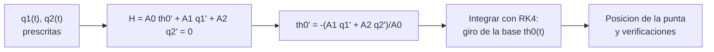

# B101-C06 — Simulación de un brazo robótico espacial

<!-- nav:top -->
[🏠 Programa](../../../../README.md) · [📚 Bloque B101](../../../tronco-comun/B101-manipuladores-roboticos-espaciales.md) · [← Anterior: B101-C05 — Calibración cinemática de manipuladores](../B101-C05-calibracion-cinematica-de-manipuladores/CLASE.md) · [Siguiente: B101-C07 — Control de fuerza e impedancia en manipulación →](../B101-C07-control-de-fuerza-e-impedancia-en-manipulacion/CLASE.md)
<!-- /nav -->

## 1. Ubicación, nivel y alcance

Clase 6 del bloque B101. Nivel N3. Simulas un brazo planar de dos eslabones montado en una **base libre** (sin fuerzas externas): al mover el brazo, la base **gira** para conservar el momento angular. Usas dos conservaciones (centro de masa fijo y momento angular nulo) para obtener el giro de la base y compruebas que un lazo cerrado en el espacio articular deja un giro neto, que no depende de la velocidad. Todos los datos son **sintéticos**.

## 2. Por qué esta clase existe

En una estación o un satélite pesado la base casi no se mueve; en un satélite pequeño, sí. La decisión central: **¿cuánto se mueve la base al mover el brazo y cómo afecta eso a la posición del extremo?**

## 3. Lo que podrás hacer al terminar

1. Plantear la conservación del centro de masa y del momento angular de un sistema con base libre.
2. Obtener la velocidad de giro de la base a partir de `H = 0`.
3. Integrar con Runge-Kutta de cuarto orden una trayectoria articular prescrita.
4. Reconocer el giro neto de la base por un lazo articular cerrado y que es una fase geométrica (independiente de la velocidad).
5. Verificar con una cantidad calculada por otro camino (velocidades por diferencias de la trayectoria).
6. Separar lo consultado (el manipulador de la estación tiene base cambiable, F2) de lo sintético.

La evidencia es el **registro de simulación** del ejercicio 12 (sección 20).

## 4. Con qué llegas y cómo comprobarlo

1. ¿Qué es el momento angular?
2. ¿Qué es el centro de masa?
3. ¿Qué se conserva sin fuerzas externas?
4. ¿Qué es la integración de Runge-Kutta?
5. ¿Qué es una comprobación independiente?

<details>
<summary>Ver respuestas</summary>

1. `H = Σ m r × v + Σ I ω`. 2. El promedio de las posiciones ponderado por la masa. 3. El momento lineal y el angular. 4. Un método de integración numérica de orden 4. 5. Calcular lo mismo por otro camino y comparar.
</details>

Con cuatro o cinco aciertos, sigue; si no, repasa mecánica del sólido rígido y B101-C01.

## 5. Un caso de contexto y casos de referencia

F2 resume que el manipulador de la estación tiene una base cambiable y puede desplazarse por la estación; la masa de la estación es enorme frente a la del brazo, y por eso su base se considera casi fija (cifras no consultadas). Aquí hacemos lo contrario: una base de 500 kg con eslabones de 40 y 30 kg, **sintéticos**, para que el efecto sea visible.

## 6. Vocabulario

**Base libre:** base sin fuerzas externas. **Acoplamiento:** el movimiento del brazo mueve la base. **Fase geométrica:** giro neto de un lazo cerrado en el espacio articular. **Lazo:** trayectoria que vuelve al punto de partida. **RK4:** integrador de cuarto orden. **Momento angular `H`:** conservado, aquí nulo.

## 7. Modelo mental: el brazo y la base se reparten el giro



*Descripción textual:* se prescriben las articulaciones, la ecuación `H = 0` da la velocidad de la base y se integra; después se verifican el centro de masa y el momento angular.

Analogía: un gato que cae se gira moviendo sus extremidades sin apoyo. Límite: el gato no tiene un solo eje ni un modelo plano.

## 8. La explicación, paso a paso

### 8.1 Qué se sabe de los brazos reales

Solo F2: el manipulador de la estación tiene un diseño de 7 grados de libertad y base cambiable. Masas, inercias y la dinámica real no se consultaron; el modelo de base libre de la clase es estándar y se verifica con sus conservaciones (N5).

### 8.2 El modelo

Base de 500 kg con `I₀ = 300` kg m², hombro a 0,6 m de su centro; eslabón 1 de 40 kg y 1,5 m; eslabón 2 de 30 kg y 1,2 m (varillas uniformes, `I = m l²/12`). Masa total 570 kg. Con el centro de masa del sistema fijo en el origen, la posición de la base queda determinada por los ángulos. El momento angular se expresa como `H = A₀θ̇₀ + A₁q̇₁ + A₂q̇₂`, con los `Aᵢ` por derivadas numéricas de las posiciones, y `H = 0` da `θ̇₀`.

### 8.3 Lazos cerrados en el espacio articular

Un rectángulo en `(q₁, q₂)` centrado en `(40°, 60°)`, 3 s por lado, devuelve las articulaciones a su sitio, pero deja un giro neto en la base:

| lado del lazo (grados) | giro neto de la base (grados) |
|---|---|
| 20 | 0,2555 |
| 40 | 0,9886 |
| 60 | 2,1058 |

El giro crece casi con el **área** del lazo (de 20° a 40°, el área se multiplica por 4 y el giro por 3,87). Si se recorre en sentido contrario, el giro es `−0,9886°`. Si se recorre al doble de lentitud (6 s por lado), la diferencia es `1,8×10⁻¹¹` rad: no depende de la velocidad. Ida y vuelta por el mismo camino: giro neto `2,1×10⁻¹¹` rad (cero).

### 8.4 Verificaciones y efecto en la punta

Con el lazo de 40°: el centro de masa del sistema se mantiene en `2,7×10⁻¹⁷` m; el momento angular recalculado con velocidades por **diferencias de la trayectoria** (independiente de los `Aᵢ`) queda en `1,8×10⁻⁴` kg m²/s como máximo. El giro máximo de la base durante el lazo es 3,857°, y la punta se desplaza hasta 64,8 mm respecto de la misma trayectoria con la base fija.

## 9. Magnitudes, símbolos y unidades

| Símbolo | Qué es | Unidad | Valor / nota |
|---|---|---|---|
| `M₀, I₀` | masa e inercia de la base | kg, kg m² | 500; 300 |
| `m₁, l₁; m₂, l₂` | eslabones | kg, m | 40; 1,5 y 30; 1,2 |
| `θ₀` | giro de la base | rad (grados en las tablas) | 3,857° máximo |
| `H` | momento angular | kg m²/s | 0 por conservación |
| `dt` | paso de RK4 | s | 0,005 |

## 10. Convenciones y referencias

Movimiento plano; sin gravedad ni fuerzas externas; ángulos absolutos `φ₁ = θ₀ + q₁`, `φ₂ = φ₁ + q₂`; origen en el centro de masa del sistema. Perfil de cada tramo: polinomio de quinto grado (posición y velocidad suaves). Tolerancias: centro de masa `< 10⁻¹²` m; `|H|` recalculado `< 5×10⁻³` kg m²/s; fase geométrica `< 10⁻⁶` rad. Masas e inercias son **sintéticas**. Python 3.12.9, numpy 2.4.4.

## 11. De dónde sale lo que afirmamos

| ID | Fuente | Localizador | Respalda | Estado |
|---|---|---|---|---|
| F2 | Razvi, S. y Burns, S. H. (NASA JSC), «Evolution of the Space Station Robotic Manipulator», NASA NTRS 20070010589, 2007 — https://ntrs.nasa.gov/citations/20070010589 (consultada 2026-11-10) | resumen extendido (solo el resumen) | el manipulador de la estación (Canadarm2) tiene un diseño de 7 grados de libertad, con base cambiable que le permite desplazarse a puntos base | Consultada (solo el resumen; no se consultaron longitud ni carga) |
| — | Vafa y Dubowsky; Umetani y Yoshida (robots espaciales de base libre) | — | la fase geométrica se verifica con la conservación del momento angular del laboratorio | No consultada |
| — | Textos de robótica (Denavit y Hartenberg, 1955; Craig; Siciliano et al.; Spong et al.) | — | las matrices D-H, el jacobiano, la pseudoinversa y los mínimos cuadrados son resultados estándar que verifica cada laboratorio | No consultada en una fuente concreta |
| — | Longitud, masa y carga de Canadarm2; especificaciones de otros brazos (Kibo, Shuttle Arm) | — | — | No consultada |

Límites: ninguna fuente consultada da masas, inercias ni la dinámica de un brazo real.

## 12. Cómo ver la simulación

| Magnitud | Valor |
|---|---|
| giro neto (lazo de 40°) | 0,9886° |
| diferencia entre 3 s y 6 s por lado | `1,8×10⁻¹¹` rad |
| `|r_cm|` máximo | `2,7×10⁻¹⁷` m |
| `|H|` recalculado máximo | `1,8×10⁻⁴` kg m²/s |
| desplazamiento de la punta (libre frente a fija) | 64,8 mm |

Descripción larga: la base gira sin que nadie la empuje; el giro neto es una propiedad del camino en el espacio de articulaciones, no del tiempo que se tarda.

## 13. Ejemplo trabajado: un solo giro relativo

**Paso 1 · Datos.** Base con `I₀ = 300`, brazo con `I = 30` alrededor del mismo eje, `q̇ = 0,1` rad/s, `H = 0`.

**Paso 2 · Ecuación.** `I₀ θ̇₀ + I(θ̇₀ + q̇) = 0`.

**Paso 3 · Despeje.** `θ̇₀ = −I q̇/(I₀ + I) = −30 × 0,1/330 = −0,00909` rad/s.

**Paso 4 · Decisión.** La base gira en sentido opuesto y mucho menos que el brazo; con una base más pesada, menos aún.

## 14. Distintas formas de simular

**Cinemática con `H = 0` (esta clase):** las articulaciones se prescriben. **Dinámica con pares:** se integran las ecuaciones de movimiento con un modelo de motor. **Jacobiano generalizado:** variante que incorpora el movimiento de la base en la cinemática. Cada una exige más datos que la anterior.

## 15. Práctica guiada

**Ejercicio 1 · con los pasos indicados.** Resuelve el ejemplo 13 con `q̇ = 0,2` rad/s. *Pasos:* `−I q̇/(I₀ + I)`.

<details><summary>Solución comentada</summary>

`−30 × 0,2/330 = −0,0182` rad/s.
</details>

**Ejercicio 2 · con una pista.** Base de 500 kg en el origen y brazo de 70 kg con su centro en `x = 2` m: ¿dónde está el centro de masa del sistema? *Pista:* promedio ponderado.

<details><summary>Solución comentada</summary>

`70 × 2/570 = 0,2456` m.
</details>

**Ejercicio 3 · casi autónomo.** Si el centro del brazo se mueve 4 m en `+x` y el centro de masa del sistema no se mueve, ¿cuánto se mueve la base?

<details><summary>Solución comentada</summary>

`−4 × 70/570 = −0,491` m.
</details>

## 16. Práctica autónoma, transferencia e integrador

**Ejercicio 4 · autónomo.** ¿Por qué se conservan el centro de masa y el momento angular?

<details><summary>Solución comentada</summary>

Porque no hay fuerzas ni pares externos: el momento lineal y el angular totales son constantes y, con el sistema inicialmente en reposo, nulos.
</details>

**Ejercicio 5 · autónomo.** Compara el giro del lazo de 40° con el de 20°: ¿qué cociente esperas por el área y cuál se obtuvo?

<details><summary>Solución comentada</summary>

Área ×4; el cociente medido fue `0,9886/0,2555 = 3,87`.
</details>

**Ejercicio 6 · autónomo.** Entre los lazos de 40° y 60°, ¿qué cociente de áreas y qué cociente de giros?

<details><summary>Solución comentada</summary>

Áreas `(60/40)² = 2,25`; giros `2,1058/0,9886 = 2,13`: casi proporcional, no exacto.
</details>

**Ejercicio 7 · autónomo.** ¿Qué fracción de la masa total es el brazo?

<details><summary>Solución comentada</summary>

`70/570 = 0,123`, es decir, el 12,3 %.
</details>

**Ejercicio 8 · autónomo.** ¿Cuánto vale el giro neto de ir por un camino y volver por el mismo?

<details><summary>Solución comentada</summary>

Cero (en la simulación `2,1×10⁻¹¹` rad).
</details>

**Ejercicio 9 · transferencia.** **Transferencia.** En una nave real hay ruedas de reacción y propulsores. ¿Qué cambia en este modelo?

<details><summary>Solución comentada</summary>

Hay pares externos: `H` ya no es nula ni constante y hay que modelarlos; el modelo de la clase supone un sistema aislado.
</details>

**Ejercicio 10 · transferencia.** **Transferencia.** Con una base 100 veces más inerte, ¿qué esperas del giro de la base?

<details><summary>Solución comentada</summary>

Mucho menor, aproximadamente en proporción inversa a la inercia total (estimación; no se simuló).
</details>

**Ejercicio 11 · transferencia.** **Transferencia.** La punta se desplaza 64,8 mm respecto de la base fija. ¿Qué implica para una captura?

<details><summary>Solución comentada</summary>

Que un plan hecho con la base fija se equivocaría decenas de milímetros; hay que incluir el movimiento de la base o corregir con medición.
</details>

**Ejercicio 12 · integrador.** **Integrador.** Elabora tu *registro de simulación*: modelo, lazos y giros, comprobación de la independencia de la velocidad, verificaciones de `r_cm` y `H` y qué es consultado, no consultado y sintético.

<details><summary>Solución comentada</summary>

Secciones 8.3–8.4 y la salida del laboratorio.
</details>

## 17. Laboratorio: brazo planar con base libre

El script [base_libre.py](base_libre.py) integra el giro de la base para tres lazos, el lazo inverso, el lazo lento y un camino de ida y vuelta, y verifica el centro de masa y el momento angular con velocidades por diferencias; **comprueba** el giro neto no nulo, la inversión de signo, la independencia de la velocidad y las conservaciones. Usa [b101_comun.py](../b101_comun.py). Tarda unos 35 segundos.

**Datos:** masas, inercias y trayectorias **sintéticas**; sin constantes con fuente. **Predice antes de ejecutar:** ¿qué giro neto tiene un camino de ida y vuelta? (cero.) Ejecución del 2026-11-10 (Python 3.12.9, numpy 2.4.4):

```text
Python 3.12.9 | numpy 2.4.4
Datos SINTETICOS: base libre 500 kg, eslabones 40 kg x 1.5 m y 30 kg x 1.2 m, plano, sin fuerzas externas
Lazo rectangular cerrado en el espacio articular (q1, q2) centrado en (40, 60) grados; T = 3 s por lado
  lado 20 grados: giro neto de la base =   0.2555 grados (las articulaciones vuelven a su sitio: dq = 0.0e+00)
  lado 40 grados: giro neto de la base =   0.9886 grados (las articulaciones vuelven a su sitio: dq = 0.0e+00)
  lado 60 grados: giro neto de la base =   2.1058 grados (las articulaciones vuelven a su sitio: dq = 0.0e+00)
Lazo invertido (lado 40): giro =  -0.9886 grados (opuesto al del lazo directo:   0.9886)
Mismo lazo al doble de lentitud (6 s por lado): giro =   0.9886 grados -> diferencia = 1.8e-11 rad
Ida y vuelta por el mismo camino: giro neto = 2.1e-11 rad (debe ser 0)
Centro de masa del sistema: |r_cm| maximo = 2.7e-17 m (debe ser 0)
Momento angular recalculado con velocidades por diferencias de la trayectoria: |H| maximo = 1.79e-04 kg m2/s
Giro maximo de la base durante el lazo = 3.857 grados
Diferencia maxima de posicion de la punta (base libre frente a base fija): 64.8 mm
Pruebas superadas.
```

```bash
python programa/clases/B101/B101-C06-simulacion-de-un-brazo-robotico-espacial/base_libre.py
```

**Límites:** plano; sin pares externos, gravedad, fricción ni flexibilidad; trayectorias prescritas, no controladas.

## 18. Errores frecuentes y cómo corregirlos

**Suponer que la base no se mueve.** Calcula el acoplamiento (8.3)

**Creer que el giro depende de la velocidad.** Es una fase geométrica (8.3)

**Presentar las masas inventadas como las de una nave real.** Revisa la sección 11

## 19. Cómo sabrás que vas bien

Tras la sección 8: ¿por qué un lazo articular cerrado puede girar la base? Si dudas, repasa el ejercicio 4. Tras el laboratorio: ¿qué compara el momento angular recalculado? (ver sección 17).

## 20. Qué entregas y cómo se evalúa

El producto es tu **registro de simulación del brazo con base libre** (ejercicio 12).

| Criterio | Inicial | En desarrollo | Logrado | Destacado |
|---|---|---|---|---|
| Conceptos | Los confunde | Parciales | Explica el método y su dominio | Explica los límites y las alternativas |
| Cálculo | Sin unidades | Con errores | Resultados con unidades y comprobados | Resuelve casos nuevos |
| Numérico | Sin comprobar | Un caso | Verifica con una comprobación independiente en varios casos | Interpreta las diferencias y los fallos |
| Fuentes | Sin fuente | Sin fecha | Fuentes con fecha y estado | Declara lo sintético y lo no consultado |
| Límites | No los nombra | Uno | Tres | Discute qué falta del modelo |

**Condiciones críticas (no se compensan con promedio):** rotular los datos como sintéticos; verificar cada resultado con una comprobación independiente; citar solo lo consultado.

## 21. Ética, seguridad y límites

Clase educativa: la simulación es un modelo plano y simplificado; no reemplaza el modelo dinámico validado ni las verificaciones de un brazo y una nave reales. No enseña a operar hardware real. Accesibilidad: tablas equivalentes a las gráficas, fórmulas en texto, ejercicios sin conexión.

## 22. Para cerrar y seguir

Con la base libre, mover el brazo gira la base; un lazo de 40° deja 0,99° y 64,8 mm de diferencia en la punta, sin depender de la velocidad. Queda una pregunta: ¿qué ocurre cuando el extremo toca algo y hay que controlar la fuerza?

**Glosario español–inglés.** base libre · *free-floating base*; momento angular · *angular momentum*; centro de masa · *center of mass*; fase geométrica · *geometric phase*; lazo cerrado · *closed loop*; paso de integración · *time step*.

**Continuidad.** [B101-C07](../B101-C07-control-de-fuerza-e-impedancia-en-manipulacion/CLASE.md) trata el control de fuerza e impedancia.

**Referencias:** ver sección 11.

<!-- nav:bottom -->
---

[← Anterior: B101-C05 — Calibración cinemática de manipuladores](../B101-C05-calibracion-cinematica-de-manipuladores/CLASE.md) · [📚 Bloque B101](../../../tronco-comun/B101-manipuladores-roboticos-espaciales.md) · [Siguiente: B101-C07 — Control de fuerza e impedancia en manipulación →](../B101-C07-control-de-fuerza-e-impedancia-en-manipulacion/CLASE.md)
<!-- /nav -->
