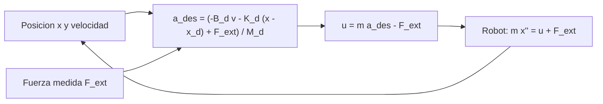

# B101-C07 — Control de fuerza e impedancia en manipulación

<!-- nav:top -->
[🏠 Programa](../../../../README.md) · [📚 Bloque B101](../../../tronco-comun/B101-manipuladores-roboticos-espaciales.md) · [← Anterior: B101-C06 — Simulación de un brazo robótico espacial](../B101-C06-simulacion-de-un-brazo-robotico-espacial/CLASE.md) · [Siguiente: B101-C08 — Gemelo digital para ensayo de reparaciones robóticas →](../B101-C08-gemelo-digital-para-ensayo-de-reparaciones-roboticas/CLASE.md)
<!-- /nav -->

## 1. Ubicación, nivel y alcance

Clase 7 del bloque B101. Nivel N3. Hasta aquí el brazo se movió sin tocar nada. Cuando el extremo hace **contacto** (insertar, apretar, capturar) hay que controlar no solo la posición sino la **fuerza**. El **control de impedancia** hace que el extremo se comporte como una masa, un resorte y un amortiguador deseados. Lo simulas en una dimensión frente a una pared elástica, con datos **sintéticos**.

## 2. Por qué esta clase existe

Si un brazo muy rígido empuja una pieza que está 5 mm más lejos de lo que cree, aplica una fuerza grande. La decisión central: **¿qué rigidez y qué amortiguamiento le doy al extremo para que el contacto sea suave y la fuerza predecible?**

## 3. Lo que podrás hacer al terminar

1. Escribir la dinámica deseada `M_d ẍ + B_d ẋ + K_d (x − x_d) = F_ext`.
2. Calcular la fuerza de contacto permanente `K_d k_e x_d/(K_d + k_e)` y verificarla en la simulación.
3. Elegir `B_d` para amortiguamiento crítico y verificar el sobreimpulso de un sistema de segundo orden.
4. Calcular una cota de la fuerza pico en un impacto.
5. Reconocer el efecto del paso de integración.
6. Separar lo consultado (la precisión de 5 mm del ERA, F1) de lo sintético.

La evidencia es la **ficha de impedancia** del ejercicio 12 (sección 20).

## 4. Con qué llegas y cómo comprobarlo

1. ¿Qué es una ley de Newton para una masa con una fuerza?
2. ¿Qué es la rigidez de un resorte?
3. ¿Qué es el factor de amortiguamiento `ζ`?
4. ¿Qué es un sistema de segundo orden?
5. ¿Qué es una comprobación independiente?

<details>
<summary>Ver respuestas</summary>

1. `m a = F`. 2. La fuerza por unidad de deformación (N/m). 3. `B/(2√(K M))`. 4. Un sistema con ecuación diferencial de orden 2. 5. Calcular lo mismo por otro camino y comparar.
</details>

Con cuatro o cinco aciertos, sigue; si no, repasa control clásico (B16).

## 5. Un caso de contexto y casos de referencia

F1 dice que el ERA «opera con una precisión de 5 mm» y que puede mover masas de 3 000 kg hasta 8 000 kg; esas cifras no permiten saber qué fuerzas de contacto puede ejercer. En la clase, una masa efectiva **sintética** de 20 kg toca una pared de 5 000 N/m situada en `x = 0`, con un objetivo `x_d = +0,02` m dentro de la pared.

## 6. Vocabulario

**Impedancia:** relación entre el movimiento y la fuerza. **Rigidez deseada `K_d`:** N/m. **Amortiguamiento `B_d`:** N s/m. **Inercia deseada `M_d`:** kg. **Fuerza externa `F_ext`:** fuerza de la pared sobre el extremo. **Sobreimpulso:** exceso máximo sobre el valor final. **Fuerza pico:** máximo de la fuerza de contacto.

## 7. Modelo mental: un resorte virtual



*Descripción textual:* el controlador calcula la aceleración que tendría la masa deseada y ordena al actuador la fuerza que la produce, restando la fuerza medida.

Analogía: tocar una puerta con un resorte entre la mano y el dedo: se puede empujar con suavidad. Límite: el resorte es virtual; el actuador, el sensor y el retardo reales no son ideales.

## 8. La explicación, paso a paso

### 8.1 Qué se sabe de los brazos reales

F1: precisión de 5 mm y masas de 3 000 y 8 000 kg para el ERA (comunicado del fabricante). Cualquier dato de fuerza, rigidez o sensor de un brazo real no se consultó. La teoría de impedancia (N4) es estándar y se verifica con las soluciones analíticas del laboratorio.

### 8.2 Fuerza permanente

En contacto, la pared ejerce `−k_e x` y el equilibrio cumple `K_d (x − x_d) = −k_e x`, de donde `x_eq = K_d x_d/(K_d + k_e)` y `F = k_e x_eq = K_d k_e x_d/(K_d + k_e)`. La simulación (`m = M_d = 20` kg, `dt = 1` ms) coincide:

| `K_d` (N/m) | `B_d` (N s/m) | `F` permanente (N) | `F` fórmula (N) | `F` pico (N) | `x` final (mm) |
|---|---|---|---|---|---|
| 200 | 126,49 | 3,846 | 3,846 | 13,785 | 0,769 |
| 1 000 | 282,84 | 16,667 | 16,667 | 28,939 | 3,333 |
| 5 000 | 632,46 | 50,000 | 50,000 | 55,154 | 10,000 |

Menor rigidez deseada, menor fuerza: con `K_d = 200` N/m la fuerza es 13 veces menor que con 5 000 N/m para la misma posición ordenada.

### 8.3 Amortiguamiento

En espacio libre (sin pared), con `ζ = 1` (`B_d = 2√(K_d M_d)`) no hay sobreimpulso (menos de 1 µm) y el extremo llega a 20,0000 mm. Con `ζ = 0,3` el sobreimpulso relativo es 0,3719 y la fórmula `exp(−πζ/√(1 − ζ²)) = 0,3723`.

### 8.4 Impacto y paso de integración

Un impacto a 0,05 m/s contra la pared (`K_d = 1 000`) da una fuerza pico menor que la cota sin amortiguamiento `k_e (x_eq + √(x_eq² + M_d v_c²/(K_d + k_e)))`, donde `v_c` es la velocidad al tocar:

| `ζ` | `v_c` (m/s) | `F` pico (N) | cota (N) |
|---|---|---|---|
| 0,3 | 0,0641 | 34,35 | 41,58 |
| 1,0 | 0,0553 | 23,33 | 39,75 |
| 2,0 | 0,0435 | 17,01 | 37,54 |

Más amortiguamiento, menos fuerza pico. Con `K_d = 5 000`, el máximo de `|x|` es 0,050 m con `dt = 1` ms y 0,043 m con 20 ms: en este caso ambos pasos son estables (no se exploró dónde deja de serlo).

## 9. Magnitudes, símbolos y unidades

| Símbolo | Qué es | Unidad | Valor / nota |
|---|---|---|---|
| `m, M_d` | masa efectiva y deseada | kg | 20 (sintético) |
| `K_d` | rigidez deseada | N/m | 200 a 5 000 |
| `B_d` | amortiguamiento | N s/m | `2ζ√(K_d M_d)` |
| `k_e` | rigidez de la pared | N/m | 5 000 (sintético) |
| `F` | fuerza de contacto | N | tablas 8.2 y 8.4 |

## 10. Convenciones y referencias

Una dimensión, eje `x` hacia la pared; la fuerza de contacto se cuenta positiva cuando empuja el extremo contra su objetivo. Euler semiimplícito con `dt = 1` ms (también 20 ms). Sensor de fuerza ideal, sin retardo, sin fricción ni holguras. Tolerancias: fuerza permanente `< 0,1 %`; sobreimpulso `< 0,01`; fuerza pico `≤` cota. Todo dato es **sintético**. Python 3.12.9, numpy 2.4.4.

## 11. De dónde sale lo que afirmamos

| ID | Fuente | Localizador | Respalda | Estado |
|---|---|---|---|---|
| F1 | Airbus, comunicado «Airbus-built European Robotic Arm ready for Space», Leiden, 5-07-2021 — https://www.airbus.com/sites/g/files/jlcbta136/files/4b7e903e07e8e840d723ad3d1796c9c9_EN-Airbus-SpS-Press-Release-Airbus-built-European-Robotic-Arm-ready-for-Space.pdf (consultada 2026-11-10; texto extraído del PDF con PyMuPDF) | página 1 | el European Robotic Arm (ERA) mide 11,3 m, tiene siete articulaciones, mueve 3 000 kg de forma rutinaria y hasta 8 000 kg en modo lento y opera con una precisión de 5 mm; puede «caminar» de un punto base a otro | Consultada (comunicado de prensa del fabricante: no es una especificación técnica) |
| — | Hogan (1985), control de impedancia | — | la dinámica deseada de segundo orden se verifica con su solución analítica | No consultada |
| — | Textos de robótica (Denavit y Hartenberg, 1955; Craig; Siciliano et al.; Spong et al.) | — | las matrices D-H, el jacobiano, la pseudoinversa y los mínimos cuadrados son resultados estándar que verifica cada laboratorio | No consultada en una fuente concreta |
| — | Normas de ECSS, NASA o de la estación sobre operaciones de brazos, cámaras y seguridad | — | — | No consultada (solo títulos de ECSS en F3) |

Límites: ninguna fuente consultada da rigideces de contacto ni parámetros de control de un brazo real.

## 12. Cómo ver el contacto

| Magnitud | Valor |
|---|---|
| fuerza con `K_d = 1 000` | 16,667 N (fórmula 16,667) |
| sobreimpulso con `ζ = 0,3` | 0,3719 (fórmula 0,3723) |
| pico con `ζ = 0,3` y `ζ = 2` | 34,35 N y 17,01 N |

Descripción larga: la fuerza permanente crece con `K_d` y se acerca a `k_e x_d = 100` N cuando `K_d` es mucho mayor que `k_e`, es decir, cuando el brazo se comporta como un control de posición rígido.

## 13. Ejemplo trabajado: la fuerza con `K_d = 1 000` N/m

**Paso 1 · Rigidez en serie.** `K_d k_e/(K_d + k_e) = 1 000 × 5 000/6 000 = 833,3` N/m.

**Paso 2 · Fuerza.** `F = 833,3 × 0,02 = 16,67` N.

**Paso 3 · Comprobación.** La simulación da 16,667 N.

**Paso 4 · Decisión.** Si el límite de fuerza del componente fuera de 10 N, `K_d` debe bajar (ejercicio 5).

## 14. Distintas formas de controlar el contacto

**Impedancia (esta clase):** se regula la relación movimiento–fuerza. **Admitancia:** se mide la fuerza y se genera un movimiento. **Fuerza directa:** se regula la fuerza con un lazo propio. Se elige según la rigidez del entorno y del brazo.

## 15. Práctica guiada

**Ejercicio 1 · con los pasos indicados.** Fuerza permanente con `K_d = 1 000`, `k_e = 5 000` y `x_d = 0,02`. *Pasos:* rigidez en serie por `x_d`.

<details><summary>Solución comentada</summary>

`16,67` N.
</details>

**Ejercicio 2 · con una pista.** ¿Cuánto vale `ζ` con `M_d = 20`, `K_d = 1 000` y `B_d = 282,84`? *Pista:* `B/(2√(K M))`.

<details><summary>Solución comentada</summary>

`282,84/(2 × 141,42) = 1`.
</details>

**Ejercicio 3 · casi autónomo.** Fuerza con `K_d = 200`.

<details><summary>Solución comentada</summary>

`200 × 5 000/5 200 = 192,3` N/m; por 0,02: `3,85` N.
</details>

## 16. Práctica autónoma, transferencia e integrador

**Ejercicio 4 · autónomo.** Sobreimpulso de un sistema de segundo orden con `ζ = 0,5`.

<details><summary>Solución comentada</summary>

`exp(−π × 0,5/√0,75) = exp(−1,814) = 0,163`.
</details>

**Ejercicio 5 · autónomo.** ¿Qué `K_d` da 10 N con `x_d = 0,02` y `k_e = 5 000`?

<details><summary>Solución comentada</summary>

`10 = K_d × 100/(K_d + 5 000)` → `K_d = 555,6` N/m.
</details>

**Ejercicio 6 · autónomo.** `B_d` crítico con `M_d = 20` y `K_d = 500`.

<details><summary>Solución comentada</summary>

`2√(500 × 20) = 200` N s/m.
</details>

**Ejercicio 7 · autónomo.** ¿Qué fuerza se obtiene cuando `K_d → ∞` y cuando `K_d → 0`?

<details><summary>Solución comentada</summary>

`K_d → ∞`: `k_e x_d = 100` N (posición rígida). `K_d → 0`: 0 N.
</details>

**Ejercicio 8 · autónomo.** Si la velocidad de contacto se reduce a la mitad y `x_eq` fuera 0, ¿cómo cambia la cota de fuerza pico?

<details><summary>Solución comentada</summary>

La cota `k_e √(M_d/(K_d + k_e)) v_c` es proporcional a `v_c`: se reduce a la mitad.
</details>

**Ejercicio 9 · transferencia.** **Transferencia.** La pared está 5 mm más cerca de lo previsto. ¿Cuánto cambia la fuerza con `K_d = 5 000` frente a `K_d = 200`?

<details><summary>Solución comentada</summary>

Rigideces en serie: 2 500 y 192,3 N/m; por 0,005 m: 12,5 N y 0,96 N. El control blando tolera los errores de posición (como los de B101-C05).
</details>

**Ejercicio 10 · transferencia.** **Transferencia.** El laboratorio usa un sensor de fuerza ideal. ¿Qué podría cambiar con un sensor real?

<details><summary>Solución comentada</summary>

Ruido, retardo y ancho de banda pueden degradar el amortiguamiento y hasta desestabilizar el lazo; no se simuló.
</details>

**Ejercicio 11 · transferencia.** **Transferencia.** En microgravedad no hay peso que compensar, pero la masa de la carga sigue contando. ¿Qué parámetro hay que actualizar?

<details><summary>Solución comentada</summary>

La masa efectiva `m` del extremo con la carga, que entra en `u = m a_des − F_ext`.
</details>

**Ejercicio 12 · integrador.** **Integrador.** Elabora tu *ficha de impedancia*: la tabla de fuerzas permanentes y pico, el amortiguamiento elegido, la comprobación del sobreimpulso y qué es consultado, no consultado y sintético.

<details><summary>Solución comentada</summary>

Secciones 8.2–8.4 y la salida del laboratorio.
</details>

## 17. Laboratorio: contacto con una pared elástica

El script [impedancia.py](impedancia.py) simula tres rigideces deseadas, el amortiguamiento en espacio libre, el impacto y dos pasos de integración; **comprueba** la fuerza permanente, la ausencia de sobreimpulso con `ζ = 1`, la fórmula del sobreimpulso y la cota de fuerza pico. Usa [b101_comun.py](../b101_comun.py).

**Datos:** masas, rigideces y velocidades **sintéticas**; sin constantes con fuente. **Predice antes de ejecutar:** ¿qué fuerza da `K_d = 5 000`? (50 N.) Ejecución del 2026-11-10 (Python 3.12.9, numpy 2.4.4):

```text
Python 3.12.9 | numpy 2.4.4
Datos SINTETICOS: m = 20 kg, k_e = 5000 N/m, x_d = +0.02 m, sensor de fuerza ideal
Kd [N/m]  Bd [N s/m]  F_perm [N]  F_formula [N]  F_pico [N]  x_final [mm]
     200      126.49       3.846          3.846      13.785        0.769
    1000      282.84      16.667         16.667      28.939        3.333
    5000      632.46      50.000         50.000      55.154       10.000
Espacio libre con zeta = 1: x_final = 20.0000 mm (objetivo 20 mm) ; sobreimpulso = -0.00 micras
Espacio libre con zeta = 0.3: sobreimpulso relativo = 0.3719 ; formula exp(-pi zeta / sqrt(1 - zeta^2)) = 0.3723
Impacto a 0.05 m/s contra la pared (Kd = 1000):
  zeta = 0.3: v_contacto = 0.0641 m/s ; F_pico =    34.35 N ; cota sin amortiguamiento =    41.58 N
  zeta = 1.0: v_contacto = 0.0553 m/s ; F_pico =    23.33 N ; cota sin amortiguamiento =    39.75 N
  zeta = 2.0: v_contacto = 0.0435 m/s ; F_pico =    17.01 N ; cota sin amortiguamiento =    37.54 N
Paso dt =    1 ms, Kd = 5000: |x| maximo = 0.050 m (estable)
Paso dt =   20 ms, Kd = 5000: |x| maximo = 0.043 m (estable)
Pruebas superadas.
```

```bash
python programa/clases/B101/B101-C07-control-de-fuerza-e-impedancia-en-manipulacion/impedancia.py
```

**Límites:** una dimensión; pared lineal; sensor ideal; sin fricción ni holguras; sin saturación del actuador.

## 18. Errores frecuentes y cómo corregirlos

**Usar `K_d` muy alto «para ser preciso».** La fuerza depende de la posición ordenada (8.2)

**Olvidar el amortiguamiento en el impacto.** Mira la fuerza pico (8.4)

**Presentar el sensor ideal como realista.** Revisa la sección 10

## 19. Cómo sabrás que vas bien

Tras la sección 8: ¿de qué dos rigideces depende la fuerza permanente? Si dudas, repasa el ejercicio 1. Tras el laboratorio: ¿con qué se compara la fuerza permanente? (ver sección 17).

## 20. Qué entregas y cómo se evalúa

El producto es tu **ficha de impedancia** (ejercicio 12).

| Criterio | Inicial | En desarrollo | Logrado | Destacado |
|---|---|---|---|---|
| Conceptos | Los confunde | Parciales | Explica el método y su dominio | Explica los límites y las alternativas |
| Cálculo | Sin unidades | Con errores | Resultados con unidades y comprobados | Resuelve casos nuevos |
| Numérico | Sin comprobar | Un caso | Verifica con una comprobación independiente en varios casos | Interpreta las diferencias y los fallos |
| Fuentes | Sin fuente | Sin fecha | Fuentes con fecha y estado | Declara lo sintético y lo no consultado |
| Límites | No los nombra | Uno | Tres | Discute qué falta del modelo |

**Condiciones críticas (no se compensan con promedio):** rotular los datos como sintéticos; verificar cada resultado con una comprobación independiente; citar solo lo consultado.

## 21. Ética, seguridad y límites

Clase educativa: el sensor de fuerza ideal, la pared lineal y las masas son simplificaciones; el contacto real exige límites de fuerza, detección de fallas y procedimientos verificados. No enseña a operar hardware real. Accesibilidad: tablas equivalentes a las gráficas, fórmulas en texto, ejercicios sin conexión.

## 22. Para cerrar y seguir

Con `K_d = 1 000` N/m el contacto da 16,7 N y con `ζ = 2` el pico baja a 17 N. Queda una pregunta: ¿cómo se ensaya una reparación entera antes de hacerla con el hardware real?

**Glosario español–inglés.** control de impedancia · *impedance control*; rigidez · *stiffness*; amortiguamiento · *damping*; sobreimpulso · *overshoot*; fuerza de contacto · *contact force*; admitancia · *admittance*.

**Continuidad.** [B101-C08](../B101-C08-gemelo-digital-para-ensayo-de-reparaciones-roboticas/CLASE.md) trata el gemelo digital para ensayo de reparaciones.

**Referencias:** ver sección 11.

<!-- nav:bottom -->
---

[← Anterior: B101-C06 — Simulación de un brazo robótico espacial](../B101-C06-simulacion-de-un-brazo-robotico-espacial/CLASE.md) · [📚 Bloque B101](../../../tronco-comun/B101-manipuladores-roboticos-espaciales.md) · [Siguiente: B101-C08 — Gemelo digital para ensayo de reparaciones robóticas →](../B101-C08-gemelo-digital-para-ensayo-de-reparaciones-roboticas/CLASE.md)
<!-- /nav -->
