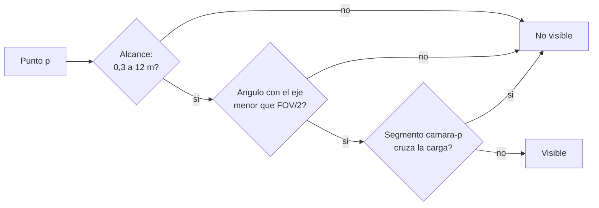

# B101-C09 — Coordinación visual y cámaras en operaciones con manipulador

<!-- nav:top -->
[🏠 Programa](../../../../README.md) · [📚 Bloque B101](../../../tronco-comun/B101-manipuladores-roboticos-espaciales.md) · [← Anterior: B101-C08 — Gemelo digital para ensayo de reparaciones robóticas](../B101-C08-gemelo-digital-para-ensayo-de-reparaciones-roboticas/CLASE.md) · [Siguiente: B101-C10 — Simulación de una tarea tripulada con manipulador →](../B101-C10-simulacion-de-una-tarea-tripulada-con-manipulador/CLASE.md)
<!-- /nav -->

## 1. Ubicación, nivel y alcance

Clase 9 del bloque B101. Nivel N3 (rol del operador humano). Quien dirige un brazo suele hacerlo a través de **cámaras**. Calculas qué parte de una zona de trabajo ve cada cámara con un campo de visión circular, qué **puntos ciegos** deja una carga que ocluye y qué tamaño de pixel se logra en el objeto. Todos los datos y la escena son **sintéticos**.

## 2. Por qué esta clase existe

Si el operador no ve el punto de contacto, depende de la imaginación. La decisión central: **¿qué cámaras necesito y dónde para que la zona de trabajo se vea, con qué resolución y sin puntos ciegos críticos?**

## 3. Lo que podrás hacer al terminar

1. Decidir si un punto es visible: dentro del campo de visión, del alcance y sin oclusión.
2. Verificar el ángulo y la oclusión con una segunda vía de cálculo.
3. Calcular la cobertura de una zona de trabajo por cámara y por combinaciones.
4. Localizar puntos ciegos.
5. Calcular el tamaño de pixel en el objeto y el ángulo de triangulación entre cámaras.
6. Separar lo consultado (existencia de ECSS-E-ST-10-11C *Human factors engineering*) de lo sintético.

La evidencia es el **mapa de cobertura de cámaras** del ejercicio 12 (sección 20).

## 4. Con qué llegas y cómo comprobarlo

1. ¿Qué es un campo de visión?
2. ¿Qué es el producto escalar y qué ángulo da?
3. ¿Qué es la oclusión?
4. ¿Qué es el tamaño de pixel en el objeto?
5. ¿Qué es una comprobación independiente?

<details>
<summary>Ver respuestas</summary>

1. El cono de direcciones que ve la cámara. 2. `a·b = |a||b| cos θ`. 3. Un objeto que se interpone en la línea de vista. 4. La longitud del objeto que cubre un pixel. 5. Calcular lo mismo por otro camino y comparar.
</details>

Con cuatro o cinco aciertos, sigue; si no, repasa geometría vectorial (B10).

## 5. Un caso de contexto y casos de referencia

F1 recuerda que el ERA se maneja en tiempo real y lleva cámaras infrarrojas para inspeccionar la estación. El listado de ECSS (F3) incluye ECSS-E-ST-10-11C *Human factors engineering*, cuyo texto no se consultó. La escena de la clase es **sintética**: una caja de trabajo de 2 × 2 × 1 m centrada en el origen, una carga esférica de 0,4 m de radio en el centro que ocluye, y tres cámaras de 60° de campo de visión circular.

## 6. Vocabulario

**Campo de visión (FOV):** ángulo total del cono de la cámara. **Eje óptico:** dirección central. **Oclusión:** interposición de un objeto. **Punto ciego:** punto que ninguna cámara ve. **Tamaño de pixel en el objeto (GSD):** `2 d tan(θ)/N`. **Ángulo de triangulación:** ángulo entre las líneas de vista de dos cámaras.

## 7. Modelo mental: una prueba de visibilidad en tres pasos



*Descripción textual:* un punto es visible si está dentro del alcance, dentro del cono y sin que la carga corte el segmento que lo une a la cámara.

Analogía: una linterna que ilumina un cono y deja sombra detrás de una caja. Límite: aquí la cámara es un cono ideal sin iluminación ni deslumbramiento.

## 8. La explicación, paso a paso

### 8.1 Qué se sabe de los brazos reales

F1: el ERA tiene cámaras infrarrojas y puede controlarse desde el interior o el exterior de la estación. De cuántas cámaras, con qué campo de visión y dónde, no se consultó nada (N7). La ley de Fitts y otros resultados de factores humanos no se consultaron (N6); F3 solo confirma que existe una norma de factores humanos.

### 8.2 Comprobaciones de la geometría

El ángulo por `arccos` del producto escalar coincide con `atan2(|v × w|, v·w)` en 500 pares (diferencia máxima `10⁻¹³` grados). La oclusión exacta (distancia del centro al segmento menor que el radio) coincide con un muestreo de 4 000 puntos del segmento en 500 segmentos: 0 desacuerdos.

### 8.3 Cobertura

La zona se discretiza en 4 851 puntos (21 × 21 × 11, paso 0,1 m); 4 598 quedan fuera de la carga. Cobertura por cámara (sobre esos puntos): base 88,6 %, codo 89,7 %, mano 85,5 %. Mejores combinaciones:

| número de cámaras | mejor combinación | cobertura |
|---|---|---|
| 1 | codo | 89,7 % |
| 2 | base y codo | 98,5 % |
| 3 | base, codo y mano | 99,1 % |

Quedan 42 puntos ciegos (0,9 %) con las tres cámaras, en `x` de −0,1 a 0,4 m y `z` de −0,5 a 0,4 m, es decir, tras la carga. 4 421 puntos (96,2 %) los ven al menos dos cámaras.

### 8.4 Resolución y triangulación

Con 1 920 pixeles y 60° de campo, el tamaño de pixel en el objeto `2 d tan 30°/1 920` es 0,601 mm a 1 m; 1,203 mm a 2 m; 3,007 mm a 5 m y 6,014 mm a 10 m. El ángulo entre las líneas de vista de las cámaras *base* y *codo* hacia el origen es 77,2°, mayor que el criterio **ilustrativo** de 30° para triangular.

## 9. Magnitudes, símbolos y unidades

| Símbolo | Qué es | Unidad | Valor / nota |
|---|---|---|---|
| FOV | campo de visión | grados | 60 (sintético) |
| alcance | mínimo y máximo | m | 0,3 y 12 |
| `r` | radio de la carga | m | 0,4 |
| `N` | pixeles del ancho | — | 1 920 |
| GSD | tamaño de pixel en el objeto | mm/pixel | 0,601 a 6,014 |

## 10. Convenciones y referencias

Marco de referencia: `{0}` en el centro de la caja, `z` hacia arriba, dextrógiro. Cámaras fijas con posición y eje dados (base `(−3, 0, 1,5)` m, codo `(0, −3,5, 2)` m, mano `(0, 0, 2,2)` m, **sintéticas**). Semilla 109. Tolerancias: ángulos `< 10⁻⁶` grados; desacuerdos de oclusión `≤ 1` en 500. Python 3.12.9, numpy 2.4.4.

## 11. De dónde sale lo que afirmamos

| ID | Fuente | Localizador | Respalda | Estado |
|---|---|---|---|---|
| F1 | Airbus, comunicado «Airbus-built European Robotic Arm ready for Space», Leiden, 5-07-2021 — https://www.airbus.com/sites/g/files/jlcbta136/files/4b7e903e07e8e840d723ad3d1796c9c9_EN-Airbus-SpS-Press-Release-Airbus-built-European-Robotic-Arm-ready-for-Space.pdf (consultada 2026-11-10; texto extraído del PDF con PyMuPDF) | página 1 | el European Robotic Arm (ERA) mide 11,3 m, tiene siete articulaciones, mueve 3 000 kg de forma rutinaria y hasta 8 000 kg en modo lento y opera con una precisión de 5 mm; puede «caminar» de un punto base a otro | Consultada (comunicado de prensa del fabricante: no es una especificación técnica) |
| F3 | ECSS, listado de normas activas — https://ecss.nl/standards/active-standards/ (consultada 2026-11-10) | solo títulos y fechas | existencia de ECSS-E-ST-33-01C Rev.2 *Mechanisms* (1-03-2019), ECSS-E-ST-10-11C *Human factors engineering* (31-07-2008) y ECSS-E-ST-10-09C *Reference coordinate system* (31-07-2008); el listado no incluye una norma de robótica | Consultada (solo títulos y fechas; el texto de las normas no se consultó) |
| — | Fitts (1954) y literatura de factores humanos y telerrobótica | — | la forma `MT = a + b log₂(2D/W)` se cita sin consultar; `a` y `b` son sintéticos | No consultada |
| — | Normas de ECSS, NASA o de la estación sobre operaciones de brazos, cámaras y seguridad | — | — | No consultada (solo títulos de ECSS en F3) |

Límites: ninguna fuente consultada da la ubicación, el campo de visión o los criterios de cobertura de cámaras de un brazo real.

## 12. Cómo ver la cobertura

| Magnitud | Valor |
|---|---|
| cobertura con una cámara (codo) | 89,7 % |
| con dos (base y codo) | 98,5 % |
| con tres | 99,1 % |
| puntos ciegos con tres | 42 (0,9 %) |

Descripción larga: la segunda cámara aporta 8,8 puntos porcentuales y la tercera solo 0,6; los puntos ciegos se concentran detrás de la carga.

## 13. Ejemplo trabajado: ¿ve la cámara de la mano este punto?

**Paso 1 · Geometría.** Cámara en `(0, 0, 2,2)` apuntando a `−z`; punto `(1, 0, 0,7)`.

**Paso 2 · Ángulo.** Rayo `(1, 0, −1,5)`: `θ = atan(1/1,5) = 33,7°`.

**Paso 3 · Comparación.** `33,7° > 30°` (semicampo): fuera del campo.

**Paso 4 · Decisión.** No es visible con esta cámara; se busca otra o se reorienta.

## 14. Distintas formas de dar vista al operador

**Cámaras fijas (esta clase):** posiciones conocidas. **Cámaras sobre el brazo:** la cobertura cambia con la configuración. **Vista sintética:** una imagen del modelo que complementa la cámara. Se combinan según la tarea.

## 15. Práctica guiada

**Ejercicio 1 · con los pasos indicados.** Tamaño de pixel en el objeto a 3 m con 60° y 1 920 pixeles. *Pasos:* `2 d tan 30°/N`.

<details><summary>Solución comentada</summary>

`2 × 3 × 0,5774/1 920 = 1,804` mm/pixel.
</details>

**Ejercicio 2 · con una pista.** Cámara en `(0, 0, 2,2)` apuntando a `−z`; ¿ve el punto `(1, 0, 0,7)` con 60° de campo? *Pista:* ángulo con el eje.

<details><summary>Solución comentada</summary>

`atan(1/1,5) = 33,7° > 30°`: no.
</details>

**Ejercicio 3 · casi autónomo.** ¿Ve una cámara en `(−2, 0, 0)` el punto `(2, 0, 0)` con una esfera de 0,4 m en el origen?

<details><summary>Solución comentada</summary>

No: la distancia del centro de la esfera al segmento es 0, menor que 0,4: está ocluido.
</details>

## 16. Práctica autónoma, transferencia e integrador

**Ejercicio 4 · autónomo.** Ángulo de triangulación entre dos cámaras con líneas de vista `(1, 0, 0)` y `(0, 1, 0)`.

<details><summary>Solución comentada</summary>

`arccos(0) = 90°`.
</details>

**Ejercicio 5 · autónomo.** ¿Cuánto aporta la segunda cámara a la cobertura?

<details><summary>Solución comentada</summary>

`98,5 − 89,7 = 8,8` puntos porcentuales.
</details>

**Ejercicio 6 · autónomo.** ¿Cuántos pixeles de ancho hacen falta para que un detalle de 2 mm ocupe 2 pixeles a 5 m con 60° de campo?

<details><summary>Solución comentada</summary>

Pixel de 1 mm: `N = 2 × 5 × 0,5774/0,001 = 5 774`.
</details>

**Ejercicio 7 · autónomo.** ¿Qué porcentaje de los puntos libres son ciegos con las tres cámaras?

<details><summary>Solución comentada</summary>

`42/4 598 = 0,91 %`.
</details>

**Ejercicio 8 · autónomo.** ¿Por qué la cámara de la mano cubre menos (85,5 %)?

<details><summary>Solución comentada</summary>

Mira hacia abajo a 2,2 m: en el plano superior de la caja (`z = 0,5`, a 1,7 m) su cono tiene 0,98 m de radio y las esquinas están a 1,41 m: quedan fuera.
</details>

**Ejercicio 9 · transferencia.** **Transferencia.** Una cámara va sobre el brazo. ¿Qué cambia respecto de las cámaras fijas?

<details><summary>Solución comentada</summary>

Su posición y su eje dependen de la configuración articular (cinemática directa): la cobertura se recalcula por pose.
</details>

**Ejercicio 10 · transferencia.** **Transferencia.** El modelo no incluye iluminación. ¿Qué puede ocurrir en órbita?

<details><summary>Solución comentada</summary>

Sombras duras y deslumbramiento pueden hacer invisible un punto «cubierto» geométricamente; no se modeló ni se consultó.
</details>

**Ejercicio 11 · transferencia.** **Transferencia.** ¿Puedes citar un requisito de la norma ECSS-E-ST-10-11C?

<details><summary>Solución comentada</summary>

No: solo se consultó su título y fecha (F3). Habría que leer la norma.
</details>

**Ejercicio 12 · integrador.** **Integrador.** Elabora tu *mapa de cobertura de cámaras*: la cobertura por cámara y por combinación, los puntos ciegos, el tamaño de pixel a tres distancias y qué es consultado, no consultado y sintético.

<details><summary>Solución comentada</summary>

Secciones 8.3–8.4 y la salida del laboratorio.
</details>

## 17. Laboratorio: cobertura y puntos ciegos

El script [camaras.py](camaras.py) verifica la geometría (ángulos y oclusión), calcula la cobertura por cámara y por combinación, los puntos ciegos, el tamaño de pixel y el ángulo de triangulación; **comprueba** que más cámaras no reducen la cobertura y que el ángulo de triangulación supera 30°. Usa [b101_comun.py](../b101_comun.py).

**Datos:** escena y cámaras **sintéticas**; sin constantes con fuente. **Predice antes de ejecutar:** ¿qué región queda ciega? (tras la carga.) Ejecución del 2026-11-10 (Python 3.12.9, numpy 2.4.4):

```text
Python 3.12.9 | numpy 2.4.4
Datos SINTETICOS: caja de trabajo 2x2x1 m, carga esferica de 0.4 m, camaras de 60 grados, 1920 pixeles
Angulo por arccos del producto escalar frente a atan2 de |v x w| (500 pares): diferencia max = 1.02e-13 grados
Oclusion esfera-segmento exacta frente a muestreo de 4000 puntos (500 segmentos): desacuerdos = 0
Puntos de la malla: 4851 ; fuera de la carga: 4598
Cobertura de la zona de trabajo (puntos fuera de la carga):
  camara base :  88.6 %
  camara codo :  89.7 %
  camara mano :  85.5 %
  mejor combinacion de 1: codo              ->  89.7 %
  mejor combinacion de 2: base, codo        ->  98.5 %
  mejor combinacion de 3: base, codo, mano  ->  99.1 %
Puntos ciegos con las 3 camaras: 42 (0.9 %) ; vistos por al menos 2: 4421 (96.2 %)
  los puntos ciegos se extienden de x = -0.1 a 0.4 m, z = -0.5 a 0.4 m
Tamano de pixel en el objeto = 2 d tan(theta) / N (theta = 30 grados, N = 1920):
  d =  1.0 m:  0.601 mm/pixel
  d =  2.0 m:  1.203 mm/pixel
  d =  5.0 m:  3.007 mm/pixel
  d = 10.0 m:  6.014 mm/pixel
Angulo entre las lineas de vista de 'base' y 'codo' hacia el origen = 77.2 grados (criterio ilustrativo de triangulacion: >= 30)
Pruebas superadas.
```

```bash
python programa/clases/B101/B101-C09-coordinacion-visual-y-camaras-en-operaciones-con-manipulador/camaras.py
```

**Límites:** cámaras fijas; cono ideal; una sola carga esférica; sin iluminación, brillos ni distorsión de lente.

## 18. Errores frecuentes y cómo corregirlos

**Olvidar la oclusión.** Un punto en el cono puede no verse (8.3)

**Confundir el campo total con el semicampo.** Compara con `FOV/2` (8.2)

**Presentar las cámaras de ejemplo como las de un brazo real.** Revisa la sección 11

## 19. Cómo sabrás que vas bien

Tras la sección 8: ¿qué tres condiciones debe cumplir un punto para ser visible? Si dudas, repasa el ejercicio 2. Tras el laboratorio: ¿qué comprueba el muestreo de 4 000 puntos? (ver sección 17).

## 20. Qué entregas y cómo se evalúa

El producto es tu **mapa de cobertura de cámaras** (ejercicio 12).

| Criterio | Inicial | En desarrollo | Logrado | Destacado |
|---|---|---|---|---|
| Conceptos | Los confunde | Parciales | Explica el método y su dominio | Explica los límites y las alternativas |
| Cálculo | Sin unidades | Con errores | Resultados con unidades y comprobados | Resuelve casos nuevos |
| Numérico | Sin comprobar | Un caso | Verifica con una comprobación independiente en varios casos | Interpreta las diferencias y los fallos |
| Fuentes | Sin fuente | Sin fecha | Fuentes con fecha y estado | Declara lo sintético y lo no consultado |
| Límites | No los nombra | Uno | Tres | Discute qué falta del modelo |

**Condiciones críticas (no se compensan con promedio):** rotular los datos como sintéticos; verificar cada resultado con una comprobación independiente; citar solo lo consultado.

## 21. Ética, seguridad y límites

Clase educativa: los ángulos, alcances y criterios de cobertura son de ejemplo; la vista del operador de un brazo real se diseña y verifica con los requisitos de factores humanos y de la operación. No enseña a operar hardware real. Accesibilidad: tablas equivalentes a las gráficas, fórmulas en texto, ejercicios sin conexión.

## 22. Para cerrar y seguir

Con dos cámaras bien situadas se ve el 98,5 % de la zona y quedan puntos ciegos detrás de la carga. Queda una pregunta: ¿qué pasa cuando un operador humano, con retardo, dirige una captura con estas vistas?

**Glosario español–inglés.** campo de visión · *field of view*; punto ciego · *blind spot*; oclusión · *occlusion*; cobertura · *coverage*; triangulación · *triangulation*; factores humanos · *human factors*.

**Continuidad.** [B101-C10](../B101-C10-simulacion-de-una-tarea-tripulada-con-manipulador/CLASE.md) trata la simulación de una tarea tripulada con manipulador.

**Referencias:** ver sección 11.

<!-- nav:bottom -->
---

[← Anterior: B101-C08 — Gemelo digital para ensayo de reparaciones robóticas](../B101-C08-gemelo-digital-para-ensayo-de-reparaciones-roboticas/CLASE.md) · [📚 Bloque B101](../../../tronco-comun/B101-manipuladores-roboticos-espaciales.md) · [Siguiente: B101-C10 — Simulación de una tarea tripulada con manipulador →](../B101-C10-simulacion-de-una-tarea-tripulada-con-manipulador/CLASE.md)
<!-- /nav -->
