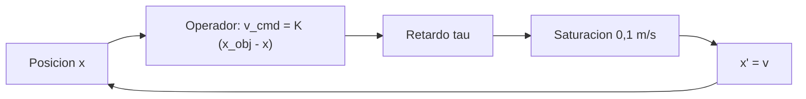

# B101-C10 — Simulación de una tarea tripulada con manipulador

<!-- nav:top -->
[🏠 Programa](../../../../README.md) · [📚 Bloque B101](../../../tronco-comun/B101-manipuladores-roboticos-espaciales.md) · [← Anterior: B101-C09 — Coordinación visual y cámaras en operaciones con manipulador](../B101-C09-coordinacion-visual-y-camaras-en-operaciones-con-manipulador/CLASE.md) · [Siguiente: B102-C01 — Dinámica multicuerpo de rovers y manipuladores →](../../../tronco-comun/B102-movilidad-de-robots-planetarios.md#b102-c01)
<!-- /nav -->

## 1. Ubicación, nivel y alcance

Clase 10 del bloque B101. Nivel N3 (rol del operador humano). Simulas una **captura** dirigida por un operador al que modelas de forma mínima: un retardo de reacción más comunicación y una ganancia sobre el error que ve. Con ello estudias la estabilidad del lazo (`K τ < π/2`), el éxito de la captura frente al retardo, la estrategia «mover y esperar» y la ley de Fitts. Todos los datos son **sintéticos** y los umbrales son **ilustrativos**.

## 2. Por qué esta clase existe

Cuanto más tarda en llegar la imagen y la orden, más difícil es corregir. La decisión central: **¿con qué retardo total y qué ganancia el operador puede capturar con éxito y cuándo conviene pasar a «mover y esperar»?**

## 3. Lo que podrás hacer al terminar

1. Modelar el lazo de un operador con retardo `τ` y ganancia `K`.
2. Verificar el criterio de estabilidad `K τ < π/2` por simulación.
3. Estimar por Monte Carlo la tasa de éxito de una captura según el retardo.
4. Comparar el control continuo con «mover y esperar».
5. Calcular un tiempo de movimiento con la forma de la ley de Fitts (con constantes sintéticas).
6. Separar lo consultado (existencia de ECSS-E-ST-10-11C) de lo no consultado y de lo sintético, y no presentar el modelo como una persona.

La evidencia es el **informe de la tarea tripulada simulada** del ejercicio 12 (sección 20).

## 4. Con qué llegas y cómo comprobarlo

1. ¿Qué es un retardo puro?
2. ¿Qué es un lazo de realimentación?
3. ¿Qué es un criterio de estabilidad?
4. ¿Qué es el método de Monte Carlo?
5. ¿Qué es una comprobación independiente?

<details>
<summary>Ver respuestas</summary>

1. Una salida que repite la entrada tras un tiempo `τ`. 2. Un sistema que corrige según lo que mide de su propia salida. 3. Una condición sobre los parámetros que separa respuestas acotadas de crecientes. 4. Estimar con muestras aleatorias. 5. Calcular lo mismo por otro camino y comparar.
</details>

Con cuatro o cinco aciertos, sigue; si no, repasa control clásico (B16) y B101-C09.

## 5. Un caso de contexto y casos de referencia

F1 recuerda que el ERA puede controlarse en tiempo real o preprogramarse, desde dentro o fuera de la estación. El listado de ECSS (F3) incluye ECSS-E-ST-10-11C *Human factors engineering*; no se consultó su contenido. En la clase, un operador **sintético** debe llevar el extremo a 5 m de su posición inicial y quedarse a menos de 0,05 m con menos de 0,02 m/s, con un límite de velocidad de 0,1 m/s (todos **ilustrativos**).

## 6. Vocabulario

**Retardo total `τ`:** reacción más comunicación. **Ganancia `K`:** velocidad ordenada por metro de error (1/s). **Mover y esperar:** pasos cortos con espera de la imagen. **Inversión de orden:** cambio de signo de la orden. **Captura exitosa:** dentro de las tolerancias de posición y velocidad. **Ley de Fitts:** `MT = a + b log₂(2D/W)`.

## 7. Modelo mental: el operador como retardo y ganancia



*Descripción textual:* el operador ve el error, ordena una velocidad proporcional, la orden llega con retardo `τ`, se limita y mueve el extremo.

Analogía: conducir mirando un espejo con un segundo de atraso. Límite: una persona real aprende, anticipa y no es un sistema lineal.

## 8. La explicación, paso a paso

### 8.1 Qué se sabe de los sistemas reales

F1: el ERA se opera en tiempo real o preprogramado. F3: existe la norma ECSS de factores humanos. No se consultaron tiempos de reacción, retardos de comunicación, tareas de captura ni la ley de Fitts (N6, N7): sus valores aquí son sintéticos.

### 8.2 Estabilidad: `K τ < π/2`

Para `ẋ = −K x(t − τ)` sin saturación, la solución decae si `K τ < π/2 = 1,571` y crece si no. La simulación (x₀ = 1, 300 s) lo confirma:

| `K` (1/s) | `τ` (s) | `K τ` | amplitud final / inicial | resultado |
|---|---|---|---|---|
| 0,5 | 2,0 | 1,00 | `4,9×10⁻¹⁷` | estable |
| 0,5 | 3,0 | 1,50 | `9,5×10⁻²` | estable |
| 0,5 | 3,4 | 1,70 | `6,1×10¹` | inestable |
| 1,0 | 1,0 | 1,00 | `7,0×10⁻³³` | estable |

### 8.3 Captura frente al retardo

Con `K = 0,4` 1/s, objetivo a 5 m, `v_max = 0,1` m/s, temblor de 2 mm/s y 100 ensayos por fila:

| `τ` (s) | `K τ` | éxito (%) | tiempo a ±0,05 m (s) | inversiones de orden |
|---|---|---|---|---|
| 0,3 | 0,12 | 100 | 51,3 | 0,0 |
| 0,8 | 0,32 | 100 | 51,0 | 0,0 |
| 1,5 | 0,60 | 100 | 51,1 | 2,0 |
| 2,5 | 1,00 | 100 | 52,0 | 6,0 |
| 4,0 | 1,60 | 0 | 53,5 | 9,0 |

El tiempo está dominado por el límite de velocidad (5 m/0,1 m/s = 50 s). Con `τ = 4` s, `K τ = 1,6 > π/2`: el lazo oscila y ninguna captura termina dentro de las tolerancias, aunque el extremo pase por la ventana (el tiempo de la última fila es el del primer paso). Las inversiones de orden crecen con el retardo: 0, 0, 2, 6, 9 (indicador de más correcciones, no una medida validada de carga de trabajo).

### 8.4 Mover y esperar, y la ley de Fitts

Diez pasos de 0,5 m a 0,1 m/s (5 s) con espera de `τ + 1` s tardan 63,0 s con `τ = 0,3`; 75,0 s con 1,5 s y 100,0 s con 4,0 s. El control continuo tarda 51,3 s y 51,1 s en los dos primeros casos y falla en el tercero: «mover y esperar» es más lento pero **funciona con retardos grandes**.

Con la forma `MT = a + b log₂(2D/W)` y constantes **sintéticas** `a = 0,2` s, `b = 0,15` s/bit (la ley y sus constantes reales no se consultaron): `D = 0,5` m y `W = 0,10` m dan 3,32 bits y 0,70 s; `D = 2` y `W = 0,10`, 5,32 bits y 1,00 s; `D = 2` y `W = 0,05`, 6,32 bits y 1,15 s; `D = 5` y `W = 0,05`, 7,64 bits y 1,35 s. Reducir `W` a la mitad suma 1 bit.

## 9. Magnitudes, símbolos y unidades

| Símbolo | Qué es | Unidad | Valor / nota |
|---|---|---|---|
| `K` | ganancia del operador | 1/s | 0,4 |
| `τ` | retardo total | s | 0,3 a 4,0 |
| `v_max` | límite de velocidad | m/s | 0,1 (ilustrativo) |
| tolerancias | posición y velocidad | m, m/s | 0,05 y 0,02 (ilustrativas) |
| `a, b` | constantes de Fitts | s, s/bit | 0,2; 0,15 (sintéticas) |

## 10. Convenciones y referencias

Una dimensión, eje `x` hacia el objetivo. Paso de integración 0,02 s; duración 120 s. Semilla 110. El temblor es ruido gaussiano de 2 mm/s en la velocidad. Éxito: `|x − x_obj| ≤ 0,05` m y `|v| ≤ 0,02` m/s al final. Todo parámetro del operador y de la tarea es **sintético**; la forma de la ley de Fitts se cita sin consultar. Python 3.12.9, numpy 2.4.4.

## 11. De dónde sale lo que afirmamos

| ID | Fuente | Localizador | Respalda | Estado |
|---|---|---|---|---|
| F1 | Airbus, comunicado «Airbus-built European Robotic Arm ready for Space», Leiden, 5-07-2021 — https://www.airbus.com/sites/g/files/jlcbta136/files/4b7e903e07e8e840d723ad3d1796c9c9_EN-Airbus-SpS-Press-Release-Airbus-built-European-Robotic-Arm-ready-for-Space.pdf (consultada 2026-11-10; texto extraído del PDF con PyMuPDF) | página 1 | el European Robotic Arm (ERA) mide 11,3 m, tiene siete articulaciones, mueve 3 000 kg de forma rutinaria y hasta 8 000 kg en modo lento y opera con una precisión de 5 mm; puede «caminar» de un punto base a otro | Consultada (comunicado de prensa del fabricante: no es una especificación técnica) |
| F3 | ECSS, listado de normas activas — https://ecss.nl/standards/active-standards/ (consultada 2026-11-10) | solo títulos y fechas | existencia de ECSS-E-ST-33-01C Rev.2 *Mechanisms* (1-03-2019), ECSS-E-ST-10-11C *Human factors engineering* (31-07-2008) y ECSS-E-ST-10-09C *Reference coordinate system* (31-07-2008); el listado no incluye una norma de robótica | Consultada (solo títulos y fechas; el texto de las normas no se consultó) |
| — | Fitts (1954) y literatura de factores humanos y telerrobótica | — | la forma `MT = a + b log₂(2D/W)` se cita sin consultar; `a` y `b` son sintéticos | No consultada |
| — | Normas de ECSS, NASA o de la estación sobre operaciones de brazos, cámaras y seguridad | — | — | No consultada (solo títulos de ECSS en F3) |

Límites: ninguna fuente consultada da tiempos de reacción, retardos, tolerancias de captura ni constantes de la ley de Fitts.

## 12. Cómo ver la captura

| Magnitud | Valor |
|---|---|
| límite de estabilidad | `K τ = π/2 = 1,571` |
| éxito con `τ ≤ 2,5` s (`K = 0,4`) | 100 % |
| éxito con `τ = 4,0` s | 0 % |
| mover y esperar con `τ = 4,0` s | 100,0 s |

Descripción larga: el éxito cambia de 100 % a 0 % al pasar de `K τ = 1,0` a `1,6`; entre medias no se simuló.

## 13. Ejemplo trabajado: el límite de retardo

**Paso 1 · Criterio.** `K τ < π/2`.

**Paso 2 · Datos.** `K = 0,4` 1/s.

**Paso 3 · Despeje.** `τ_max = (π/2)/0,4 = 3,93` s.

**Paso 4 · Decisión.** Con `τ = 4,0` s se supera el límite: el control continuo no es admisible y hay que pasar a mover y esperar o bajar `K`.

## 14. Distintas formas de dirigir la captura

**Control continuo (esta clase):** el operador corrige todo el tiempo. **Mover y esperar:** pasos y observación. **Supervisión:** el operador da una meta y el sistema la ejecuta. La elección depende del retardo y de la tolerancia.

## 15. Práctica guiada

**Ejercicio 1 · con los pasos indicados.** ¿Es estable el lazo con `K = 0,4` y `τ = 2,5`? *Pasos:* `K τ` frente a `π/2`.

<details><summary>Solución comentada</summary>

`K τ = 1,0 < 1,571`: estable.
</details>

**Ejercicio 2 · con una pista.** ¿Qué `τ` máximo admite `K = 0,4`? *Pista:* `(π/2)/K`.

<details><summary>Solución comentada</summary>

`1,571/0,4 = 3,93` s.
</details>

**Ejercicio 3 · casi autónomo.** ¿Cuánto tarda la captura a 5 m con un límite de 0,1 m/s?

<details><summary>Solución comentada</summary>

`5/0,1 = 50` s como mínimo (la simulación da 51 a 52 s).
</details>

## 16. Práctica autónoma, transferencia e integrador

**Ejercicio 4 · autónomo.** Calcula `MT` con la forma de Fitts para `D = 2` m y `W = 0,1` m con `a = 0,2` y `b = 0,15`.

<details><summary>Solución comentada</summary>

`ID = log₂(40) = 5,32` bits; `MT = 0,2 + 0,15 × 5,32 = 1,00` s.
</details>

**Ejercicio 5 · autónomo.** ¿Cuánto cambia `MT` al reducir `W` a la mitad?

<details><summary>Solución comentada</summary>

Suma 1 bit: `+0,15` s.
</details>

**Ejercicio 6 · autónomo.** Tiempo de mover y esperar con `τ = 2` s, diez pasos de 5 s y 1 s de observación.

<details><summary>Solución comentada</summary>

`10 × (5 + 2 + 1) = 80` s.
</details>

**Ejercicio 7 · autónomo.** ¿Qué `K` máximo admite `τ = 1,0` s?

<details><summary>Solución comentada</summary>

`(π/2)/1,0 = 1,571` 1/s.
</details>

**Ejercicio 8 · autónomo.** ¿Por qué crecen las inversiones de orden con el retardo?

<details><summary>Solución comentada</summary>

La imagen llega vieja: el operador se pasa y corrige en sentido contrario más veces.
</details>

**Ejercicio 9 · transferencia.** **Transferencia.** El retardo total son la reacción y la comunicación. ¿Cómo las sumas y por qué importa?

<details><summary>Solución comentada</summary>

`τ = τ_reacción + τ_comunicación` (más el de imagen); `τ` entra en `K τ`. Los valores reales no se consultaron.
</details>

**Ejercicio 10 · transferencia.** **Transferencia.** ¿De dónde saldrían las tolerancias reales de captura?

<details><summary>Solución comentada</summary>

Del diseño de la interfaz de captura y de las reglas de la misión; los valores de la clase (0,05 m y 0,02 m/s) son ilustrativos.
</details>

**Ejercicio 11 · transferencia.** **Transferencia.** ¿Son las inversiones de orden una medida de carga de trabajo?

<details><summary>Solución comentada</summary>

No validada: es un indicador simple del modelo; la carga de trabajo real se mide con instrumentos propios de factores humanos (no consultados).
</details>

**Ejercicio 12 · integrador.** **Integrador.** Elabora tu *informe de la tarea tripulada simulada*: criterio de estabilidad verificado, tabla de éxito frente al retardo, comparación con mover y esperar, tiempos con la forma de Fitts y qué es consultado, no consultado y sintético.

<details><summary>Solución comentada</summary>

Secciones 8.2–8.4 y la salida del laboratorio.
</details>

## 17. Laboratorio: captura con retardo

El script [captura_tripulada.py](captura_tripulada.py) verifica el criterio `K τ < π/2`, simula 100 capturas por retardo, compara con «mover y esperar» y calcula los tiempos con la forma de Fitts; **comprueba** el criterio de estabilidad, el éxito frente al retardo, la ventaja de mover y esperar con retardo grande y que reducir `W` suma un bit. Usa [b101_comun.py](../b101_comun.py). Tarda unos 45 segundos.

**Datos:** operador, retardos, umbrales y constantes de Fitts **sintéticos**; sin constantes con fuente. **Predice antes de ejecutar:** ¿tiene éxito la captura con `τ = 4,0` s y `K = 0,4`? (no.) Ejecución del 2026-11-10 (Python 3.12.9, numpy 2.4.4):

```text
Python 3.12.9 | numpy 2.4.4
Datos SINTETICOS: operador como retardo + ganancia ; umbrales de captura ilustrativos
Estabilidad de x' = -K x(t - tau) (sin saturacion, x0 = 1): crece o decae segun K tau frente a pi/2 = 1.571
  K = 0.5 /s, tau = 2.0 s: K tau = 1.00 -> amplitud final / inicial =  4.86e-17 (estable)
  K = 0.5 /s, tau = 3.0 s: K tau = 1.50 -> amplitud final / inicial =  9.49e-02 (estable)
  K = 0.5 /s, tau = 3.4 s: K tau = 1.70 -> amplitud final / inicial =  6.11e+01 (inestable)
  K = 1.0 /s, tau = 1.0 s: K tau = 1.00 -> amplitud final / inicial =  7.00e-33 (estable)
Captura simulada (100 ensayos por fila, objetivo a 5 m, K = 0.4 /s, vmax = 0.1 m/s):
  retardo [s]   K tau   exito [%]   tiempo a +-0.05 m [s]   inversiones de orden
         0.3    0.12      100.0                  51.3          0.0
         0.8    0.32      100.0                  51.0          0.0
         1.5    0.60      100.0                  51.1          2.0
         2.5    1.00      100.0                  52.0          6.0
         4.0    1.60        0.0                  53.5          9.0
Estrategia 'mover y esperar': 10 pasos de 0.5 m a 0.1 m/s (5 s) y espera tau + 1 s de observacion, frente al control continuo
  retardo 0.3 s: mover y esperar =   63.0 s ; control continuo =  51.3 s
  retardo 1.5 s: mover y esperar =   75.0 s ; control continuo =  51.1 s
  retardo 4.0 s: mover y esperar =  100.0 s ; control continuo = falla (K tau > 1.57 con saturacion)
Ley de Fitts (forma consultada en la literatura: NO consultada aqui; a = 0.2 s, b = 0.15 s/bit SINTETICOS):
  D = 0.5 m, W = 0.10 m: ID =  3.32 bits ; MT =  0.70 s
  D = 2.0 m, W = 0.10 m: ID =  5.32 bits ; MT =  1.00 s
  D = 2.0 m, W = 0.05 m: ID =  6.32 bits ; MT =  1.15 s
  D = 5.0 m, W = 0.05 m: ID =  7.64 bits ; MT =  1.35 s
Pruebas superadas.
```

```bash
python programa/clases/B101/B101-C10-simulacion-de-una-tarea-tripulada-con-manipulador/captura_tripulada.py
```

**Límites:** una dimensión; operador lineal; retardo constante; sin visión, iluminación ni fallas; sin dinámica del brazo.

## 18. Errores frecuentes y cómo corregirlos

**Subir la ganancia para «ir más rápido» con retardo.** Respeta `K τ < π/2` (8.2)

**Presentar el operador modelado como una persona.** Revisa la sección 7

**Citar los umbrales como requisitos.** Son ilustrativos (sección 10)

## 19. Cómo sabrás que vas bien

Tras la sección 8: ¿qué le pasa al lazo cuando `K τ` pasa de `π/2`? Si dudas, repasa el ejercicio 2. Tras el laboratorio: ¿qué compara la tabla de mover y esperar? (ver sección 17).

## 20. Qué entregas y cómo se evalúa

El producto es tu **informe de la tarea tripulada simulada** (ejercicio 12).

| Criterio | Inicial | En desarrollo | Logrado | Destacado |
|---|---|---|---|---|
| Conceptos | Los confunde | Parciales | Explica el método y su dominio | Explica los límites y las alternativas |
| Cálculo | Sin unidades | Con errores | Resultados con unidades y comprobados | Resuelve casos nuevos |
| Numérico | Sin comprobar | Un caso | Verifica con una comprobación independiente en varios casos | Interpreta las diferencias y los fallos |
| Fuentes | Sin fuente | Sin fecha | Fuentes con fecha y estado | Declara lo sintético y lo no consultado |
| Límites | No los nombra | Uno | Tres | Discute qué falta del modelo |

**Condiciones críticas (no se compensan con promedio):** rotular los datos como sintéticos; verificar cada resultado con una comprobación independiente; citar solo lo consultado.

## 21. Ética, seguridad y límites

Clase educativa: el operador modelado como retardo y ganancia no representa a una persona real; los umbrales de captura son ilustrativos y la clase no sustituye el entrenamiento ni los procedimientos de operación. No enseña a operar hardware real. Accesibilidad: tablas equivalentes a las gráficas, fórmulas en texto, ejercicios sin conexión.

## 22. Para cerrar y seguir

Con `K = 0,4` 1/s, la captura simulada funciona hasta `τ = 2,5` s y falla con 4,0 s, donde solo mover y esperar la completa (100 s). Con esto se cierra el bloque: de la matriz de un eslabón a una captura dirigida con retardo, siempre con datos sintéticos y verificados por otra vía.

**Glosario español–inglés.** operador · *operator*; retardo · *delay*; ganancia · *gain*; mover y esperar · *move and wait*; ley de Fitts · *Fitts's law*; captura · *capture*.

**Continuidad.** Con esta clase termina el bloque B101; sigue el bloque [B102 — Movilidad de robots planetarios](../../../tronco-comun/B102-movilidad-de-robots-planetarios.md).

**Referencias:** ver sección 11.

<!-- nav:bottom -->
---

[← Anterior: B101-C09 — Coordinación visual y cámaras en operaciones con manipulador](../B101-C09-coordinacion-visual-y-camaras-en-operaciones-con-manipulador/CLASE.md) · [📚 Bloque B101](../../../tronco-comun/B101-manipuladores-roboticos-espaciales.md) · [Siguiente: B102-C01 — Dinámica multicuerpo de rovers y manipuladores →](../../../tronco-comun/B102-movilidad-de-robots-planetarios.md#b102-c01)
<!-- /nav -->
