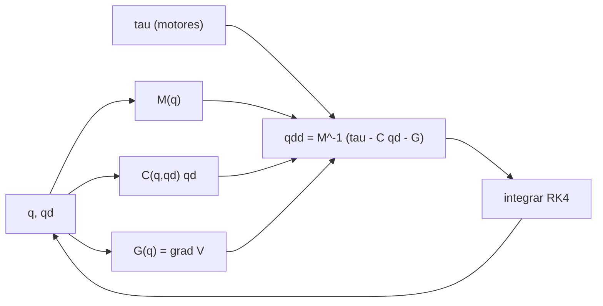

# B102-C01 — Dinámica multicuerpo de rovers y manipuladores

<!-- nav:top -->
[🏠 Programa](../../../../README.md) · [📚 Bloque B102](../../../tronco-comun/B102-movilidad-de-robots-planetarios.md) · [← Anterior: B101-C10 — Simulación de una tarea tripulada con manipulador](../../B101/B101-C10-simulacion-de-una-tarea-tripulada-con-manipulador/CLASE.md) · [Siguiente: B102-C02 — Terramecánica: tracción y hundimiento en suelos sueltos →](../B102-C02-terramecanica-traccion-y-hundimiento-en-suelos-sueltos/CLASE.md)
<!-- /nav -->

## 1. Ubicación, nivel y alcance

Clase 1 del bloque B102. Nivel N3. Un brazo de rover es una cadena de cuerpos articulados: lo que hay que mover, con qué par y con qué inercia depende de la configuración. Aquí formulas las ecuaciones de Lagrange de un brazo plano de dos eslabones, `M(q) q̈ + C(q, q̇) q̇ + G(q) = τ`, las integras y compruebas que conservan la energía, y ves cómo la gravedad cambia los pares y los tiempos. Usas la mecánica de B05 y el análisis estructural de B84 solo como idioma previo. El brazo y el contacto son sintéticos y no corresponden a ningún rover.

## 2. Por qué esta clase existe

Un manipulador de un rover se diseña y se ensaya en la Tierra, pero trabaja en Marte o en la Luna. La decisión central: **¿qué par necesita cada articulación en otro cuerpo, y qué cambia además del par?** La respuesta separa lo que escala con `g` (el par de gravedad) de lo que no (la matriz de masa).

## 3. Lo que podrás hacer al terminar

1. Escribir la matriz de masa de un brazo de dos eslabones y comprobar que es simétrica y definida positiva.
2. Calcular el par de gravedad de cada articulación y escalarlo entre cuerpos.
3. Integrar la dinámica con Runge–Kutta de cuarto orden y medir la deriva de la energía.
4. Mostrar que el movimiento libre en otro cuerpo es el de la Tierra con el tiempo escalado por `√g`.
5. Modelar un contacto unilateral con penalización y comparar la penetración estática con `m g/k`.
6. Separar lo consultado (gravedades) de lo ilustrativo (masas, longitudes, rigidez de contacto).

La evidencia es la **ficha dinámica de un brazo en la Tierra y en Marte** del ejercicio 12 (sección 20).

## 4. Con qué llegas y cómo comprobarlo

1. ¿Qué es un momento de inercia y en qué unidades se mide?
2. ¿Qué es un par (torque) y cómo se relaciona con la fuerza?
3. ¿Qué dice la segunda ley de Newton para una masa?
4. ¿Qué es una verificación por segunda vía?
5. ¿Qué es un dato sintético?

<details>
<summary>Ver respuestas</summary>

1. La resistencia de un cuerpo a cambiar su giro; kg·m². 2. Fuerza por brazo de palanca, en N·m. 3. `F = m a`. 4. Calcular lo mismo con otro método y comparar. 5. Un dato generado para el ejemplo, no medido.
</details>

Con cuatro o cinco aciertos, sigue; si no, repasa los prerrequisitos.

## 5. Un caso de contexto y casos de referencia

Un brazo de dos barras uniformes (`l₁ = 1,0 m`, `m₁ = 4 kg`; `l₂ = 0,8 m`, `m₂ = 3 kg`) extendido en horizontal necesita un par de hombro de `60,801 N·m` en la Tierra, `23,126 N·m` en Marte y `10,044 N·m` en la Luna. Es el **ejemplo conductor**. Todo es **ilustrativo**: ninguna cifra describe un rover real.

## 6. Vocabulario

Las **coordenadas generalizadas** `q = (q₁, q₂)` son los ángulos de las articulaciones, medidos desde la horizontal. La **matriz de masa** `M(q)` es simétrica y definida positiva y recoge la inercia. El término de **Coriolis y centrífugo** `C(q, q̇) q̇` aparece al girar varias articulaciones a la vez. El **par de gravedad** `G(q)` es el gradiente de la energía potencial. Un **contacto de penalización** reacciona con una fuerza `k·penetración + c·velocidad` cuando hay interpenetración.

## 7. Modelo mental: una cadena de péndulos con gravedad regulable



*Descripción textual:* de los ángulos y velocidades salen la matriz de masa, el término de Coriolis y el par de gravedad; con el par de los motores dan la aceleración, que el integrador convierte de nuevo en ángulos y velocidades.

Analogía: un columpio doble pesa menos en la Luna, pero su inercia es la misma; por eso tarda más en balancearse. Límite: el modelo es plano, sin rozamiento articular ni flexibilidad de los eslabones.

## 8. La explicación, paso a paso

### 8.1 Matriz de masa

Con barras uniformes, `l_c = l/2` e `I = m l²/12`: `a = I₁ + I₂ + m₁ l_c1² + m₂ (l₁² + l_c2²) = 4,9733 kg·m²`, `b = m₂ l₁ l_c2 = 1,2 kg·m²` y `d = I₂ + m₂ l_c2² = 0,64 kg·m²`. La matriz es `M = [[a + 2b cos q₂, d + b cos q₂], [d + b cos q₂, d]]`. Con el brazo estirado (`q₂ = 0`) vale `[[7,3733; 1,8400]; [1,8400; 0,6400]]` y con el codo a 90° `[[4,9733; 0,6400]; [0,6400; 0,6400]]`: doblar el codo reduce la inercia vista desde el hombro.

### 8.2 Par de gravedad

`G₁ = (m₁ l_c1 + m₂ l₁) g cos q₁ + m₂ l_c2 g cos(q₁ + q₂)` y `G₂ = m₂ l_c2 g cos(q₁ + q₂)`. Con el brazo horizontal: `G₁ = 6,2 g` y `G₂ = 1,2 g`.

| Cuerpo | `g` (m/s²) | `τ₁` (N·m) | `τ₂` (N·m) |
|---|---|---|---|
| Tierra | 9,80665 | 60,8012 | 11,7680 |
| Marte | 3,73 | 23,1260 | 4,4760 |
| Luna | 1,62 | 10,0440 | 1,9440 |

El laboratorio comprueba `G` contra el gradiente de la energía por diferencias finitas: error `5,27 × 10⁻¹⁰ N·m`.

### 8.3 Integración y energía

Sin rozamiento ni motores, la energía `E = ½ q̇ᵀ M q̇ + V` se conserva. Con RK4 y `dt = 1 ms`, la deriva relativa en 5 s es `6,43 × 10⁻⁹`.

### 8.4 Qué cambia con la gravedad

`g` solo entra en `G`. Si se escala el tiempo con `√g`, las ecuaciones de un movimiento soltado desde el reposo son idénticas: `q(t; g) = q(t √(g/g₀); g₀)`. El laboratorio simula Marte con el paso `dt √(g_T/g_M)` y obtiene los mismos ángulos con diferencia máxima `7,83 × 10⁻¹³ rad`. La primera inversión de `q̇₁` ocurre a `1,473 s` en la Tierra y `2,388 s` en Marte: cociente `1,6212` frente a `√(g_T/g_M) = 1,6215` (la diferencia viene del paso de tiempo de la medición).

### 8.5 Contacto

Una masa de 5 kg sobre un contacto de penalización `k = 2,0 × 10⁴ N/m` termina en reposo con una penetración `m g/k`: `2,4517 mm` en la Tierra, `0,9325 mm` en Marte y `0,4050 mm` en la Luna. La misma rigidez deja menos hundimiento donde el peso es menor.

## 9. Magnitudes, símbolos y unidades

| Símbolo | Qué es | Unidad | Valor / nota |
|---|---|---|---|
| `M` | matriz de masa | kg·m² | 7,3733 (q₂ = 0) |
| `G` | par de gravedad | N·m | 60,80 (Tierra, hombro) |
| `E` | energía mecánica | J | se conserva sin rozamiento |
| `g` | gravedad | m/s² | 9,80665; 3,73; 1,62 |
| `k` | rigidez del contacto | N/m | 2,0 × 10⁴ (ilustrativa) |
| `c` | amortiguamiento del contacto | N·s/m | 60 (ilustrativo) |

## 10. Convenciones y referencias

Gravedades de las fichas de la NASA/NSSDC (Marte, Luna) y `gₙ` del NIST (Tierra). Plano vertical, ángulos desde la horizontal, eje `x` horizontal y eje `y` hacia arriba, sin rozamiento articular. Barras uniformes, masas, longitudes y parámetros de contacto ilustrativos.

## 11. De dónde sale lo que afirmamos

| ID | Fuente | Localizador | Respalda | Estado |
|---|---|---|---|---|
| S1 | NASA/NSSDC, Mars Fact Sheet — https://nssdc.gsfc.nasa.gov/planetary/factsheet/marsfact.html (consultada 2026-11-10) | fila «Surface gravity (mean)» | g media de Marte = 3,73 m/s² | Consultada |
| S2 | NASA/NSSDC, Moon Fact Sheet — https://nssdc.gsfc.nasa.gov/planetary/factsheet/moonfact.html (consultada 2026-11-10) | fila «Surface gravity» | g de la Luna = 1,62 m/s² | Consultada |
| S3 | NIST, CODATA 2022, standard acceleration of gravity — https://physics.nist.gov/cgi-bin/cuu/Value?gn (consultada 2026-11-10) | valor `gₙ` | `gₙ` = 9,806 65 m/s² (exacto por definición) | Consultada |
| — | Ecuaciones de Lagrange y método de Runge–Kutta de cuarto orden | — | las verifica el laboratorio con una segunda vía | No consultada en una fuente concreta |

Límites: las masas, longitudes y rigidez de contacto no se consultaron; el laboratorio no representa ningún rover ni manipulador real.

## 12. Cómo ver la dinámica de un brazo

| Magnitud | Valor |
|---|---|
| `M₁₁` con `q₂ = 0` | 7,3733 kg·m² |
| `τ₁` en Marte | 23,126 N·m |
| deriva de energía en 5 s | 6,43 × 10⁻⁹ |
| cociente de tiempos Marte/Tierra | 1,6212 |
| penetración en Marte | 0,9325 mm |

Descripción larga: el par de gravedad cae en proporción a `g`, la inercia no cambia y los tiempos de movimiento libre crecen con `1/√g`.

## 13. Ejemplo trabajado: el par de hombro en Marte

**Paso 1 · Coeficiente.** `G₁/g = m₁ l_c1 + m₂ l₁ + m₂ l_c2 = 2 + 3 + 1,2 = 6,2 kg·m`.

**Paso 2 · Par.** `τ₁ = 6,2 × 3,73 = 23,126 N·m`.

**Paso 3 · Comparación.** `23,126/60,801 = 0,3804 = 3,73/9,80665`.

## 14. Distintas formas de describir un brazo

**Por geometría:** `l₁`, `l₂`, `q`. **Por inercia:** `M(q)`. **Por par estático:** `G(q)`. **Por energía:** `T + V`. **Por tiempo:** la escala `1/√g`.

## 15. Práctica guiada

**Ejercicio 1 · con los pasos indicados.** Calcula `a`, `b` y `d` del brazo. *Pasos:* `I = m l²/12`, `l_c = l/2` y las fórmulas de 8.1.

<details><summary>Solución comentada</summary>

`I₁ = 0,3333`, `I₂ = 0,16`; `a = 0,3333 + 0,16 + 1 + 3,48 = 4,9733`; `b = 3 × 1 × 0,4 = 1,2`; `d = 0,16 + 0,48 = 0,64`.
</details>

**Ejercicio 2 · con una pista.** Predice `τ₂` en Marte con el brazo horizontal. *Pista:* `G₂ = m₂ l_c2 g`.

<details><summary>Solución comentada</summary>

`3 × 0,4 × 3,73 = 4,476 N·m`; coincide con el laboratorio.
</details>

**Ejercicio 3 · casi autónomo.** ¿Por qué el movimiento libre en Marte es el de la Tierra con el tiempo escalado?

<details><summary>Solución comentada</summary>

`g` solo multiplica a `G` y `M`, `C` no dependen de `g`; con `τ' = t √g` desaparece.
</details>

## 16. Práctica autónoma, transferencia e integrador

**Ejercicio 4 · autónomo.** `τ₁` en la Luna con el brazo horizontal.

<details><summary>Solución comentada</summary>

`6,2 × 1,62 = 10,044 N·m`.
</details>

**Ejercicio 5 · autónomo.** Calcula `det M` con `q₂ = 0` y concluye si `M` es definida positiva.

<details><summary>Solución comentada</summary>

`7,3733 × 0,64 − 1,84² = 4,7189 − 3,3856 = 1,3333 > 0` y `M₁₁ > 0`: sí.
</details>

**Ejercicio 6 · autónomo.** ¿Qué rigidez de contacto limita a 1 mm la penetración de 5 kg en la Tierra?

<details><summary>Solución comentada</summary>

`k = m g/δ = 5 × 9,80665/0,001 ≈ 4,9 × 10⁴ N/m`.
</details>

**Ejercicio 7 · autónomo.** Si la primera inversión tarda `1,473 s` en la Tierra, ¿cuánto tardará en la Luna?

<details><summary>Solución comentada</summary>

`1,473 × √(9,80665/1,62) = 1,473 × 2,460 ≈ 3,62 s`.
</details>

**Ejercicio 8 · autónomo.** ¿Qué configuración del brazo (`q₂ = 0` o `90°`) tiene mayor inercia en el hombro y por qué?

<details><summary>Solución comentada</summary>

`q₂ = 0`: `M₁₁ = 7,3733` frente a `4,9733`; la masa del segundo eslabón está más lejos del eje.
</details>

**Ejercicio 9 · transferencia.** **Transferencia.** El brazo sostiene una herramienta de 2 kg en el extremo (a 0,8 m del codo). ¿Cuánto par adicional en el hombro y en el codo en Marte, con el brazo horizontal?

<details><summary>Solución comentada</summary>

`τ₁: 2 × 3,73 × 1,8 = 13,43 N·m`; `τ₂: 2 × 3,73 × 0,8 = 5,97 N·m`.
</details>

**Ejercicio 10 · transferencia.** **Transferencia.** El brazo se ensaya en la Tierra con una descarga de peso para imitar Marte. ¿Qué fracción del peso hay que descargar y qué no se imita?

<details><summary>Solución comentada</summary>

`1 − 3,73/9,80665 = 0,62` (62 %). La inercia (`M`, `C`) no cambia con la descarga: la dinámica rápida no se imita.
</details>

**Ejercicio 11 · transferencia.** **Transferencia.** Un colega afirma que el brazo oscila igual en Marte porque la masa es la misma. ¿Qué responderías?

<details><summary>Solución comentada</summary>

El periodo crece con `1/√g`: unas 1,62 veces más largo.
</details>

**Ejercicio 12 · integrador.** **Integrador.** Elabora tu *ficha dinámica de un brazo en la Tierra y en Marte*: `M` para dos configuraciones, tabla de pares de gravedad, deriva de energía, escalado temporal y lista de qué es consultado e ilustrativo.

<details><summary>Solución comentada</summary>

Secciones 8.1–8.5 y la salida del laboratorio.
</details>

## 17. Laboratorio: brazo de dos eslabones en la Tierra, Marte y la Luna

El script [multicuerpo.py](multicuerpo.py) calcula `M` y `G`, comprueba `G` contra el gradiente de `V`, integra con RK4, verifica el escalado temporal con `√g` y simula un contacto de penalización (**comprueba** deriva de energía < 1e-6, escalado < 1e-9 y penetración frente a `m g/k`). La caída para el contacto parte de 0,02 m y dura 12 s.

**Datos:** gravedades de la NASA/NSSDC y del NIST (consultadas); masas, longitudes y contacto **ilustrativos**. **Predice antes de ejecutar:** ¿cuánto tardará Marte en la primera inversión si la Tierra tarda 1,473 s? (2,39 s). **Ejecución del 2026-11-10 (Python 3.12.9):**

```text
Python 3.12.9 (biblioteca estandar)
Brazo ILUSTRATIVO: l1 = 1.0 m, l2 = 0.8 m, m1 = 4.0 kg, m2 = 3.0 kg (barras uniformes)
M(q2=0) = [[7.3733, 1.8400], [1.8400, 0.6400]] kg m2
M(q2=90 deg) = [[4.9733, 0.6400], [0.6400, 0.6400]] kg m2
Par de gravedad con el brazo extendido en horizontal (q1 = q2 = 0):
 cuerpo   g [m/s2]  tau1 [N m]  tau2 [N m]
Tierra    9.80665     60.8012     11.7680
Marte     3.73000     23.1260      4.4760
Luna      1.62000     10.0440      1.9440
G analitico frente a grad V (diferencias finitas): error maximo = 5.27e-10 N m
Deriva de energia en 5 s (Tierra, dt = 1 ms): 6.43e-09
Escalado temporal Tierra/Marte (t ~ 1/sqrt(g)): diferencia maxima de angulos = 7.83e-13 rad
Tiempo hasta la 1a inversion de q1: Tierra 1.473 s, Marte 2.388 s; cociente 1.6212; sqrt(gT/gM) = 1.6215
Contacto de penalizacion (masa 5 kg, k = 2.0e4 N/m): penetracion estatica
  Tierra  y =  -2.4517 mm ; m g / k =  -2.4517 mm ; error relativo = 2.3e-15
  Marte   y =  -0.9325 mm ; m g / k =  -0.9325 mm ; error relativo = 1.7e-15
  Luna    y =  -0.4050 mm ; m g / k =  -0.4050 mm ; error relativo = 1.5e-15
Pruebas superadas.
```

```bash
python programa/clases/B102/B102-C01-dinamica-multicuerpo-de-rovers-y-manipuladores/multicuerpo.py
```

**Límites:** plano, barras uniformes, sin rozamiento ni motores; el contacto de penalización es un modelo numérico, no un suelo.

## 18. Errores frecuentes y cómo corregirlos

**Creer que la inercia cambia con la gravedad.** Se corrige con 8.4: `g` solo entra en `G`

**Usar el par de la Tierra para dimensionar motores en Marte.** Se corrige con 8.2

**Olvidar el término de Coriolis.** Se corrige con 8.3: la energía no se conserva sin él

**Presentar el brazo sintético como el de un rover real.** Se corrige con la sección 10

## 19. Cómo sabrás que vas bien

Tras la sección 8: ¿qué `τ₁` esperabas en la Luna y cuál obtuviste? Si dudas, repasa el ejemplo 13. Tras el laboratorio: ¿qué comprueba? (ver la sección 17).

## 20. Qué entregas y cómo se evalúa

El producto es tu **ficha dinámica de un brazo en la Tierra y en Marte** (ejercicio 12).

| Criterio | Inicial | En desarrollo | Logrado | Destacado |
|---|---|---|---|---|
| Conceptos | Los confunde | Parciales | Distingue `M`, `C` y `G` | Explica los límites |
| Cálculo | Sin unidades | Con errores | Tablas completas con unidades | Calcula casos nuevos |
| Numérico | Sin comprobar | Un caso | Deriva de energía y escalado | Interpreta las diferencias |
| Fuentes | Sin fuente | Sin fecha | Fuentes con fecha y estado | Declara lo ilustrativo y lo no consultado |
| Límites | No los nombra | Uno | Tres | Discute qué falta del modelo |

**Condiciones críticas (no se compensan con promedio):** rotular el brazo y el contacto como ilustrativos; no presentarlo como un rover real; citar solo lo consultado.

## 21. Ética, seguridad y límites

Clase educativa: los modelos son simplificados y sus datos son sintéticos o ilustrativos; ningún resultado describe un rover, un suelo ni un terreno reales ni sustituye al análisis de ingeniería ni a los procedimientos de una misión. Accesibilidad: tablas equivalentes a las gráficas, fórmulas en texto, ejercicios sin conexión.

## 22. Para cerrar y seguir

Un brazo de 4 kg y 3 kg necesita `60,8 N·m` de par de hombro en la Tierra y `23,1 N·m` en Marte, con la misma inercia. Queda una pregunta: ¿qué fuerza puede transmitir una rueda al suelo suelto sobre el que se apoya el rover?

**Glosario español–inglés.** matriz de masa · *mass matrix*; par de gravedad · *gravity torque*; coordenadas generalizadas · *generalized coordinates*; contacto de penalización · *penalty contact*; deriva de energía · *energy drift*.

**Continuidad.** B102-C02 estudia la terramecánica: tracción y hundimiento en suelos sueltos.

**Referencias:** ver sección 11.

<!-- nav:bottom -->
---

[← Anterior: B101-C10 — Simulación de una tarea tripulada con manipulador](../../B101/B101-C10-simulacion-de-una-tarea-tripulada-con-manipulador/CLASE.md) · [📚 Bloque B102](../../../tronco-comun/B102-movilidad-de-robots-planetarios.md) · [Siguiente: B102-C02 — Terramecánica: tracción y hundimiento en suelos sueltos →](../B102-C02-terramecanica-traccion-y-hundimiento-en-suelos-sueltos/CLASE.md)
<!-- /nav -->
