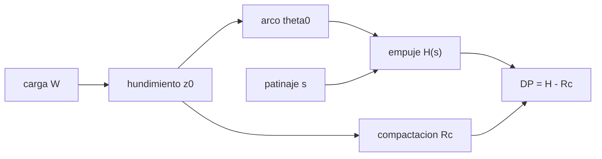

# B102-C02 — Terramecánica: tracción y hundimiento en suelos sueltos

<!-- nav:top -->
[🏠 Programa](../../../../README.md) · [📚 Bloque B102](../../../tronco-comun/B102-movilidad-de-robots-planetarios.md) · [← Anterior: B102-C01 — Dinámica multicuerpo de rovers y manipuladores](../B102-C01-dinamica-multicuerpo-de-rovers-y-manipuladores/CLASE.md) · [Siguiente: B102-C03 — Deslizamiento y estimación de patinaje →](../B102-C03-deslizamiento-y-estimacion-de-patinaje/CLASE.md)
<!-- /nav -->

## 1. Ubicación, nivel y alcance

Clase 2 del bloque B102. Nivel N3. Una rueda sobre suelo suelto no rueda sobre una superficie dura: se hunde, comprime el suelo y lo cizalla para avanzar. Aquí calculas, con el modelo de presión-hundimiento de Bekker y el criterio de Mohr–Coulomb, cuánto se hunde una rueda rígida, cuánto empuje genera y cuál es su tracción neta (tiro de barra) en función del patinaje. Usas la mecánica de la clase B102-C01 y la movilidad sobre regolito de B97-C06 como contexto. El suelo y el rover son sintéticos y no describen ningún suelo real.

## 2. Por qué esta clase existe

La tracción de un rover en regolito no sale de un coeficiente de rozamiento único. La decisión central: **¿cuánta fuerza neta de empuje queda para tirar del vehículo, una vez descontada la resistencia que crea el propio hundimiento, y cómo depende del patinaje y de la gravedad?**

## 3. Lo que podrás hacer al terminar

1. Calcular la presión que ejerce un suelo suelto en función del hundimiento (Bekker).
2. Resolver el hundimiento de una rueda rígida para una carga dada.
3. Calcular el empuje con la cizalladura de Mohr–Coulomb y el patinaje.
4. Obtener el tiro de barra `DP = H − Rc` y leer la curva frente al patinaje.
5. Comparar la Tierra, Marte y la Luna a igual rover y suelo.
6. Separar lo consultado (gravedades) de lo ilustrativo (suelo, rueda, masa).

La evidencia es la **curva de tracción de barra frente al patinaje** del ejercicio 12 (sección 20).

## 4. Con qué llegas y cómo comprobarlo

1. ¿Qué es una presión y en qué unidades se mide?
2. ¿Qué es el ángulo de fricción de un suelo?
3. ¿Qué es el patinaje de una rueda?
4. ¿Qué es la cohesión de un suelo?
5. ¿Qué es una verificación por segunda vía?

<details>
<summary>Ver respuestas</summary>

1. Fuerza por unidad de área; pascal (Pa = N/m²). 2. El ángulo cuya tangente es el coeficiente de rozamiento interno. 3. `s = 1 − v/(r ω)`, la fracción de giro que no se convierte en avance. 4. La resistencia al corte con presión normal nula, en Pa. 5. Calcular lo mismo con otro método y comparar.
</details>

Con cuatro o cinco aciertos, sigue; si no, repasa los prerrequisitos.

## 5. Un caso de contexto y casos de referencia

Un rover de 1000 kg con seis ruedas de `R = 0,25 m` y `b = 0,20 m` sobre un suelo ilustrativo se hunde `51,5 mm` en la Tierra, `24,1 mm` en Marte y `12,6 mm` en la Luna, y con un patinaje de 0,2 genera un tiro de barra de `0,2845` veces el peso por rueda en Marte. Es el **ejemplo conductor**. Todo es **ilustrativo**: el suelo no es un regolito medido.

## 6. Vocabulario

La **ley de presión-hundimiento** de Bekker es `p = k z^n`. El **ángulo de contacto** `θ₀ = arccos(1 − z₀/R)` fija el arco en que la rueda toca el suelo. La **resistencia de cizalla** de Mohr–Coulomb es `τ_máx = c + σ tan φ`; con el desplazamiento de cizalla `j` queda `τ = τ_máx (1 − e^(−j/K))`. El **empuje** `H` es la integral de `τ` en el arco; la **resistencia por compactación** `Rc = b k z₀^(n+1)/(n+1)` es el trabajo de hundir la rueda; el **tiro de barra** es `DP = H − Rc`.

## 7. Modelo mental: una rueda que cava su propio escalón



*Descripción textual:* la carga fija el hundimiento y este el arco de contacto; con el patinaje se obtiene el empuje; restando la resistencia por compactación queda el tiro de barra.

Analogía: caminar por arena seca; cuanto más te hundes, más cuesta cada paso, pero más suelo empujas hacia atrás. Límite: el suelo es homogéneo, la rueda rígida y no hay `bulldozing`.

## 8. La explicación, paso a paso

### 8.1 Presión y hundimiento

Con `k = 8,0 × 10⁵ Pa/mⁿ` y `n = 0,8`, a un hundimiento de `24,124 mm` corresponde `p = 4,06 × 10⁴ Pa`. El hundimiento de una rueda se obtiene resolviendo `W = b R ∫₀^θ₀ p(z(θ)) cos θ dθ` con `z(θ) = R (cos θ − cos θ₀)`. El laboratorio lo resuelve por bisección: el error al recuperar `W` desde `z₀` es `2,11 × 10⁻¹⁵` (relativo).

### 8.2 Tres cuerpos

| Cuerpo | `W` (N) | `z₀` (mm) | `θ₀` (°) | `Rc` (N) | `H(s = 0,2)` (N) | `DP/W` |
|---|---|---|---|---|---|---|
| Tierra | 1634,4 | 51,486 | 37,434 | 426,469 | 873,520 | 0,2735 |
| Marte | 621,7 | 24,124 | 25,378 | 108,961 | 285,806 | 0,2845 |
| Luna | 270,0 | 12,626 | 18,287 | 33,974 | 105,557 | 0,2651 |

La carga por rueda es `M g/6`. La resistencia por compactación relativa `Rc/W` es `0,261` en la Tierra, `0,175` en Marte y `0,126` en la Luna: se hunde menos y gasta menos en hundirse.

### 8.3 Empuje y cizalladura

El desplazamiento de cizalla es `j = R [(θ₀ − θ) − (1 − s)(sin θ₀ − sin θ)]`. En el límite de patinaje total el empuje se satura en `H_máx = b R ∫ (c + σ tan φ) cos θ dθ = 380,35 N` en Marte. La curva de tracción de barra en Marte es:

| `s` | `H` (N) | `DP` (N) | `DP/W` |
|---|---|---|---|
| 0,00 | 99,973 | −8,988 | −0,0145 |
| 0,05 | 173,050 | 64,089 | 0,1031 |
| 0,10 | 223,958 | 114,997 | 0,1850 |
| 0,20 | 285,806 | 176,845 | 0,2845 |
| 0,30 | 318,682 | 209,721 | 0,3374 |
| 0,50 | 348,672 | 239,711 | 0,3856 |
| 0,80 | 364,401 | 255,440 | 0,4109 |
| 0,99 | 368,773 | 259,812 | 0,4179 |

Con patinaje nulo el empuje no basta para vencer la compactación: `DP < 0`. El empuje crece rápido al principio y se aplana: a `s = 0,99` es el 97 % de `H_máx`.

### 8.4 Verificación

La cuadratura de Simpson con `N = 400` y con `N = 4000` difiere en `5,11 × 10⁻⁹` relativo; el hundimiento crece con la carga pero menos que ella: `20,363`, `34,972` y `60,428 mm` para `500`, `1000` y `2000 N`.

### 8.5 Qué cambia con la gravedad

El peso por rueda escala con `g`, el hundimiento y la compactación no lo hacen proporcionalmente: el cociente `DP/W` apenas cambia (`0,27`–`0,28`), pero la resistencia relativa `Rc/W` cae con `g`.

## 9. Magnitudes, símbolos y unidades

| Símbolo | Qué es | Unidad | Valor / nota |
|---|---|---|---|
| `k`, `n` | parámetros de presión-hundimiento | Pa/mⁿ, — | 8,0 × 10⁵; 0,8 (ilustrativos) |
| `c`, `φ` | cohesión y ángulo de fricción | Pa, ° | 1000; 30 (ilustrativos) |
| `K` | módulo de cizalladura | m | 0,01 (ilustrativo) |
| `z₀` | hundimiento | m | 0,0241 (Marte) |
| `H`, `Rc`, `DP` | empuje, compactación y tiro de barra | N | 285,8; 109,0; 176,8 (Marte, s = 0,2) |
| `s` | patinaje | — | 0 a 1 |

## 10. Convenciones y referencias

Gravedades de la NASA/NSSDC (Marte, Luna) y `gₙ` del NIST (Tierra). Marco de la rueda con `x` en el avance, esfuerzos en Pa y fuerzas en N, fuerza por rueda con carga `M g/6`. Esfuerzo normal radial, suelo homogéneo, rueda rígida, sin `bulldozing`. Los parámetros del suelo y del rover son ilustrativos.

## 11. De dónde sale lo que afirmamos

| ID | Fuente | Localizador | Respalda | Estado |
|---|---|---|---|---|
| S1 | NASA/NSSDC, Mars Fact Sheet — https://nssdc.gsfc.nasa.gov/planetary/factsheet/marsfact.html (consultada 2026-11-10) | fila «Surface gravity (mean)» | g media de Marte = 3,73 m/s² | Consultada |
| S2 | NASA/NSSDC, Moon Fact Sheet — https://nssdc.gsfc.nasa.gov/planetary/factsheet/moonfact.html (consultada 2026-11-10) | fila «Surface gravity» | g de la Luna = 1,62 m/s² | Consultada |
| S3 | NIST, CODATA 2022, standard acceleration of gravity — https://physics.nist.gov/cgi-bin/cuu/Value?gn (consultada 2026-11-10) | valor `gₙ` | `gₙ` = 9,806 65 m/s² (exacto por definición) | Consultada |
| — | Ley de presión-hundimiento de Bekker, criterio de Mohr–Coulomb y modelo de cizalladura de Janosi–Hanamoto | — | las verifica el laboratorio con una segunda vía | No consultada en una fuente concreta |

Límites: los textos de terramecánica (Bekker, Wong, Janosi y Hanamoto) no se consultaron; los parámetros del suelo no son los de ningún regolito real.

## 12. Cómo ver la tracción de una rueda

| Magnitud | Valor |
|---|---|
| `z₀` en Marte | 24,124 mm |
| `Rc/W` en Marte | 0,175 |
| `DP/W` con `s = 0,2` en Marte | 0,2845 |
| `H_máx` en Marte | 380,35 N |
| cuadratura `N` = 400 frente a 4000 | 5,11 × 10⁻⁹ |

Descripción larga: el empuje crece y se satura con el patinaje; el hundimiento y la compactación bajan con la gravedad y el tiro de barra relativo cambia poco.

## 13. Ejemplo trabajado: el tiro de barra en Marte con s = 0,1

**Paso 1 · Carga.** `W = 1000 × 3,73/6 = 621,7 N`.

**Paso 2 · Hundimiento.** `z₀ = 24,124 mm`; `Rc = 108,961 N`.

**Paso 3 · Empuje.** `H(0,1) = 223,958 N`.

**Paso 4 · Tiro de barra.** `DP = 223,958 − 108,961 = 114,997 N`, `DP/W = 0,185`.

## 14. Distintas formas de describir la interacción rueda-suelo

**Por presión:** `p(z)`. **Por geometría:** `θ₀` y la longitud de contacto. **Por esfuerzo cortante:** `τ(j)`. **Por fuerza:** `H`, `Rc`, `DP`. **Por eficiencia:** `DP/W` frente a `s`.

## 15. Práctica guiada

**Ejercicio 1 · con los pasos indicados.** Calcula la presión `p` a `z = 24,124 mm` con `k = 8,0 × 10⁵` y `n = 0,8`. *Pasos:* `z^0,8` y multiplicar por `k`.

<details><summary>Solución comentada</summary>

`0,024124^0,8 = 0,0508`; `p = 8,0 × 10⁵ × 0,0508 ≈ 4,06 × 10⁴ Pa`.
</details>

**Ejercicio 2 · con una pista.** Estima `Rc` en Marte. *Pista:* `Rc = b k z₀^(n+1)/(n+1)`.

<details><summary>Solución comentada</summary>

`0,2 × 8,0 × 10⁵ × 0,024124^1,8/1,8 ≈ 109 N`; coincide con `108,96 N`.
</details>

**Ejercicio 3 · casi autónomo.** ¿Por qué `DP` es negativo con `s = 0`?

<details><summary>Solución comentada</summary>

Con patinaje casi nulo casi no hay desplazamiento de cizalla: `H` es solo 100 N frente a `Rc = 109 N`.
</details>

## 16. Práctica autónoma, transferencia e integrador

**Ejercicio 4 · autónomo.** `τ_máx = c + σ tan φ` con `σ = 4,06 × 10⁴ Pa`.

<details><summary>Solución comentada</summary>

`1000 + 4,06 × 10⁴ × 0,5774 ≈ 2,45 × 10⁴ Pa`.
</details>

**Ejercicio 5 · autónomo.** ¿Qué fracción del peso es `DP` con `s = 0,1` en Marte?

<details><summary>Solución comentada</summary>

`114,997/621,7 = 0,185`.
</details>

**Ejercicio 6 · autónomo.** ¿Cuánto crece el hundimiento al duplicar la carga de 500 a 1000 N?

<details><summary>Solución comentada</summary>

`34,972/20,363 = 1,72`: menos que el doble.
</details>

**Ejercicio 7 · autónomo.** Si el hundimiento se redujera a la mitad, ¿en qué factor cae `Rc`?

<details><summary>Solución comentada</summary>

`Rc ∝ z₀^1,8`: factor `2^(−1,8) = 0,287`.
</details>

**Ejercicio 8 · autónomo.** ¿Qué fracción de `H_máx` es `H(s = 0,99)` en Marte?

<details><summary>Solución comentada</summary>

`368,773/380,35 = 0,970`.
</details>

**Ejercicio 9 · transferencia.** **Transferencia.** El mismo rover tiene `Rc/W = 0,261` en la Tierra y `0,175` en Marte. ¿Qué implica para el consumo de energía por metro?

<details><summary>Solución comentada</summary>

El trabajo por metro contra la compactación es `Rc`, que cae de 426 N a 109 N por rueda: gasta menos energía en hundirse, aunque su peso también es menor.
</details>

**Ejercicio 10 · transferencia.** **Transferencia.** Dos pruebas de placa dan `z = 10 mm` a `20 kPa` y `z = 18 mm` a `40 kPa`. ¿Qué `n` y `k` se obtienen?

<details><summary>Solución comentada</summary>

`n = ln 2/ln 1,8 = 1,179`; `k = 20 000/0,01^1,179 ≈ 4,6 × 10⁶ Pa/mⁿ`.
</details>

**Ejercicio 11 · transferencia.** **Transferencia.** Un colega usa los parámetros de esta clase para predecir el hundimiento de un rover en Marte. ¿Qué le dirías?

<details><summary>Solución comentada</summary>

Son ilustrativos y no proceden de ninguna medición: solo sirven para ver tendencias.
</details>

**Ejercicio 12 · integrador.** **Integrador.** Elabora tu *curva de tracción de barra frente al patinaje*: tabla de `H`, `Rc`, `DP` y `DP/W` para Marte, comparación con la Tierra y la Luna, comprobación de cuadratura y lista de qué es consultado e ilustrativo.

<details><summary>Solución comentada</summary>

Secciones 8.2–8.5 y la salida del laboratorio.
</details>

## 17. Laboratorio: rueda rígida en la Tierra, Marte y la Luna

El script [terramecanica.py](terramecanica.py) resuelve el hundimiento por bisección, integra el empuje con Simpson, calcula `Rc` y `DP` y la curva en Marte (**comprueba** cuadratura < 1e-6, carga recuperada < 1e-9, `H(s)` creciente y acotado por `H_máx`, hundimiento creciente con la carga).

**Datos:** gravedades de la NASA/NSSDC y del NIST (consultadas); suelo, rueda y masa **ilustrativos**. **Predice antes de ejecutar:** ¿`DP` será positivo con `s = 0`? (no: −9 N en Marte). **Ejecución del 2026-11-10 (Python 3.12.9):**

```text
Python 3.12.9 (biblioteca estandar)
Suelo y rover ILUSTRATIVOS: k = 8.0e+05 Pa/m^n, n = 0.8, c = 1000 Pa, phi = 30 deg, K = 0.01 m; R = 0.25 m, b = 0.2 m
 cuerpo   W [N]   z0 [mm]  theta0 [deg]  Rc [N]  H(s=0.2) [N]  DP(0.2)/W
Tierra   1634.4   51.486      37.434  426.469      873.520     0.2735
Marte     621.7   24.124      25.378  108.961      285.806     0.2845
Luna      270.0   12.626      18.287   33.974      105.557     0.2651
Curva de traccion de barra en Marte (W = 621.7 N, z0 = 24.124 mm, H_max = 380.35 N):
  s      H [N]    DP [N]   DP/W
 0.00    99.973    -8.988 -0.0145
 0.05   173.050    64.089  0.1031
 0.10   223.958   114.997  0.1850
 0.20   285.806   176.845  0.2845
 0.30   318.682   209.721  0.3374
 0.50   348.672   239.711  0.3856
 0.80   364.401   255.440  0.4109
 0.99   368.773   259.812  0.4179
Cuadratura N=400 frente a N=4000: diferencia relativa maxima de H = 5.11e-09
Carga recuperada desde z0 frente a W: error relativo maximo = 2.11e-15
z0 para W = 500, 1000, 2000 N: 20.363, 34.972, 60.428 mm
Pruebas superadas.
```

```bash
python programa/clases/B102/B102-C02-terramecanica-traccion-y-hundimiento-en-suelos-sueltos/terramecanica.py
```

**Límites:** suelo homogéneo, esfuerzo normal radial, sin `bulldozing`, sin variación del módulo de cizalladura con la profundidad; el modelo da tendencias, no predicciones.

## 18. Errores frecuentes y cómo corregirlos

**Usar un coeficiente de rozamiento único.** Se corrige con 8.3: el empuje depende del patinaje

**Olvidar la resistencia por compactación.** Se corrige con 8.2 y 8.3

**Esperar `DP` positivo sin patinaje.** Se corrige con 8.3

**Tomar los parámetros del suelo como los de Marte.** Se corrige con la sección 10

## 19. Cómo sabrás que vas bien

Tras la sección 8: ¿qué `DP/W` esperabas en Marte con `s = 0,2` y cuál obtuviste? Si dudas, repasa el ejemplo 13. Tras el laboratorio: ¿qué comprueba? (ver la sección 17).

## 20. Qué entregas y cómo se evalúa

El producto es tu **curva de tracción de barra frente al patinaje** (ejercicio 12).

| Criterio | Inicial | En desarrollo | Logrado | Destacado |
|---|---|---|---|---|
| Conceptos | Los confunde | Parciales | Distingue `H`, `Rc` y `DP` | Explica los límites |
| Cálculo | Sin unidades | Con errores | Tablas completas con unidades | Calcula casos nuevos |
| Numérico | Sin comprobar | Un caso | Cuadratura y carga recuperada | Interpreta las diferencias |
| Fuentes | Sin fuente | Sin fecha | Fuentes con fecha y estado | Declara lo ilustrativo y lo no consultado |
| Límites | No los nombra | Uno | Tres | Discute qué falta del modelo |

**Condiciones críticas (no se compensan con promedio):** rotular el suelo y el rover como ilustrativos; no presentar la curva como predicción de un regolito real; citar solo lo consultado.

## 21. Ética, seguridad y límites

Clase educativa: los modelos son simplificados y sus datos son sintéticos o ilustrativos; ningún resultado describe un rover, un suelo ni un terreno reales ni sustituye al análisis de ingeniería ni a los procedimientos de una misión. Accesibilidad: tablas equivalentes a las gráficas, fórmulas en texto, ejercicios sin conexión.

## 22. Para cerrar y seguir

Un rover de 1000 kg se hunde `24 mm` por rueda en Marte con este suelo ilustrativo y obtiene un tiro de barra de `0,28 W` con `s = 0,2`. Queda una pregunta: ¿cómo se estima ese patinaje durante la marcha?

**Glosario español–inglés.** presión-hundimiento · *pressure-sinkage*; tiro de barra · *drawbar pull*; patinaje · *slip*; resistencia por compactación · *compaction resistance*; cohesión · *cohesion*.

**Continuidad.** B102-C03 estudia el deslizamiento y la estimación del patinaje.

**Referencias:** ver sección 11.

<!-- nav:bottom -->
---

[← Anterior: B102-C01 — Dinámica multicuerpo de rovers y manipuladores](../B102-C01-dinamica-multicuerpo-de-rovers-y-manipuladores/CLASE.md) · [📚 Bloque B102](../../../tronco-comun/B102-movilidad-de-robots-planetarios.md) · [Siguiente: B102-C03 — Deslizamiento y estimación de patinaje →](../B102-C03-deslizamiento-y-estimacion-de-patinaje/CLASE.md)
<!-- /nav -->
