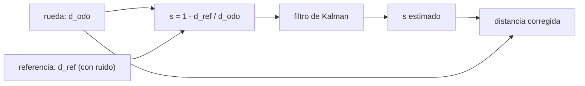

# B102-C03 — Deslizamiento y estimación de patinaje

<!-- nav:top -->
[🏠 Programa](../../../../README.md) · [📚 Bloque B102](../../../tronco-comun/B102-movilidad-de-robots-planetarios.md) · [← Anterior: B102-C02 — Terramecánica: tracción y hundimiento en suelos sueltos](../B102-C02-terramecanica-traccion-y-hundimiento-en-suelos-sueltos/CLASE.md) · [Siguiente: B102-C04 — Suspensión rocker-bogie y mecánica de rovers →](../B102-C04-suspension-rocker-bogie-y-mecanica-de-rovers/CLASE.md)
<!-- /nav -->

## 1. Ubicación, nivel y alcance

Clase 3 del bloque B102. Nivel N3. La odometría de ruedas supone que cada vuelta avanza una circunferencia; sobre suelo suelto no es así, y la diferencia es el patinaje. Aquí estimas el patinaje comparando la distancia que dicen las ruedas con una referencia independiente, lo filtras con un filtro de Kalman escalar y corriges la distancia recorrida, con su incertidumbre. Usas el modelo de tracción de B102-C02 como causa del patinaje. Los datos son sintéticos: no hay ninguna medición de un rover.

## 2. Por qué esta clase existe

Un rover que cree haber avanzado 315 m cuando solo avanzó 270 m llega al sitio equivocado. La decisión central: **¿cómo se estima el patinaje en línea, con qué incertidumbre y cuánto mejora la distancia corregida?**

## 3. Lo que podrás hacer al terminar

1. Calcular el patinaje `s = 1 − d_ref/d_odo` de cada época.
2. Deducir la incertidumbre del patinaje crudo a partir del ruido de la referencia.
3. Diseñar un filtro de Kalman escalar para un patinaje que varía como paseo aleatorio.
4. Comparar la varianza del filtro con la de la ecuación de Riccati estacionaria.
5. Corregir la distancia recorrida y expresar el error resultante.
6. Separar lo consultado (escala de la rueda) de lo sintético (ruido, patinaje, referencia).

La evidencia es la **informe de patinaje con su incertidumbre** del ejercicio 12 (sección 20).

## 4. Con qué llegas y cómo comprobarlo

1. ¿Qué es la odometría de ruedas?
2. ¿Qué es la desviación típica?
3. ¿Qué es un paseo aleatorio?
4. ¿Qué es una semilla fija y por qué se usa?
5. ¿Qué es un dato sintético?

<details>
<summary>Ver respuestas</summary>

1. Estimar el avance a partir del giro de las ruedas y su radio. 2. Una medida de dispersión de un error aleatorio, en las unidades de la magnitud. 3. Una variable que en cada paso suma un incremento aleatorio. 4. Un valor que reproduce la misma secuencia pseudoaleatoria. 5. Un dato generado para el ejemplo, no medido.
</details>

Con cuatro o cinco aciertos, sigue; si no, repasa los prerrequisitos.

## 5. Un caso de contexto y casos de referencia

Con ruedas de radio `0,2625 m` girando a `0,2 rad/s`, cada época de 20 s suma `1,05 m` de odometría. Una referencia visual sintética con ruido de `0,02 m` da un patinaje crudo con `σ = 0,0190`; el filtro lo reduce a `σ = 0,0083`. Es el **ejemplo conductor**. Todo es **sintético**: ninguna cifra es una medición.

## 6. Vocabulario

El **patinaje** `s = 1 − d_ref/d_odo` compara la distancia de una referencia con la de la odometría. La **referencia independiente** puede ser odometría visual, IMU con integración o seguimiento de un objeto fijo. El **filtro de Kalman escalar** estima `s` con el modelo `s_k = s_(k−1) + w`, `z_k = s_k + v`. La **ecuación de Riccati** da la varianza estacionaria del filtro `P`.

## 7. Modelo mental: un cuentakilómetros comparado con un mojón



*Descripción textual:* la distancia de las ruedas y la de la referencia dan un patinaje ruidoso; el filtro lo suaviza y con él se corrige la distancia de las ruedas.

Analogía: comparar el cuentakilómetros de un coche con los mojones de la carretera. Límite: el patinaje se modela como paseo aleatorio con ruido gaussiano; en un terreno real cambia de golpe y su ruido no es gaussiano.

## 8. La explicación, paso a paso

### 8.1 Patinaje crudo

La odometría de cada época es `d_odo = r ω Δt = 0,2625 × 0,2 × 20 = 1,05 m`. Con una referencia de ruido `σ_v = 0,02 m`, `s = 1 − d_vo/d_odo` tiene `σ_s = σ_v/d_odo = 0,0190`. El laboratorio mide `0,01899` en 20 series de 2000 épocas frente a `0,01905` teórica.

### 8.2 Filtro de Kalman escalar

Estado `s`, paseo aleatorio con `q = (0,004)²` por época y medida con `R = (σ_v/d_odo)²`. Paso de predicción `P⁻ = P + q`; ganancia `K = P⁻/(P⁻ + R)`; actualización `ŝ ← ŝ + K (z − ŝ)`, `P = (1 − K) P⁻`. La varianza estacionaria `P` sale de iterar la ecuación de Riccati: `6,861 × 10⁻⁵`, y el laboratorio mide `6,856 × 10⁻⁵` (cociente `0,999`). La desviación del patinaje se reduce de `0,0190` a `0,0083`: `2,29` veces.

### 8.3 Distancia corregida

En 300 épocas la odometría sin corregir da `315,00 m` y la distancia verdadera es `270,46 m`: error `+44,537 m`. Corregida con el patinaje crudo, el error es `−0,152 m`; con el filtrado, `+0,179 m`. Ambas correcciones reducen el error entre 250 y 290 veces. En esta realización la corrección filtrada no mejora a la cruda: la distancia es una suma y los errores aleatorios de cada época se compensan, así que la mejora del filtro se nota en la estimación del patinaje época a época, no tanto en el total.

### 8.4 Qué se verifica

Sin ruido el estimador recupera el patinaje con error `5,55 × 10⁻¹⁷`: valida el código. La cercanía entre Monte Carlo y teoría valida la estadística; no valida que un rover real tenga ruido gaussiano.

### 8.5 Qué no resuelve

El patinaje depende del suelo (C02) y de la pendiente (C07). Si la referencia falla (arena sin textura, oscuridad), no hay estimación: hay que declararlo y usar un valor por defecto con su incertidumbre.

## 9. Magnitudes, símbolos y unidades

| Símbolo | Qué es | Unidad | Valor / nota |
|---|---|---|---|
| `d_odo` | distancia de odometría por época | m | 1,05 |
| `d_ref` | distancia de la referencia | m | sintética |
| `s` | patinaje | — | 0,10 a 0,45 (sintético) |
| `σ_v` | ruido de la referencia | m | 0,02 (ilustrativo) |
| `q` | varianza del paseo aleatorio | — | (0,004)² |
| `P` | varianza del filtro | — | 6,86 × 10⁻⁵ |

## 10. Convenciones y referencias

Radio de rueda y velocidad máxima como escala de la página de Mars 2020 (NASA). Distancias en m a lo largo del avance y patinaje adimensional. Datos sintéticos con semilla `20261110`; ruido gaussiano y paseo aleatorio ilustrativos.

## 11. De dónde sale lo que afirmamos

| ID | Fuente | Localizador | Respalda | Estado |
|---|---|---|---|---|
| S1 | NASA, Mars 2020 Perseverance Rover Components — https://science.nasa.gov/mission/mars-2020-perseverance/rover-components/ (consultada 2026-11-10) | secciones «Wheels», «Body» y descripción del rocker-bogie | seis ruedas con motor propio; ruedas de 52,5 cm de diámetro; masa 1025 kg; rocker-bogie con pivote diferencial; cruza obstáculos del tamaño de una rueda; diseñado para 45° de inclinación en cualquier dirección y evitación de más de 30°; velocidad máxima 152 m/h en terreno llano duro | Consultada |
| — | Filtro de Kalman escalar y ecuación de Riccati | — | las verifica el laboratorio con una segunda vía | No consultada en una fuente concreta |

Límites: el ruido, el patinaje y la referencia no se consultaron; no se estima el patinaje de un rover real.

## 12. Cómo ver la estimación del patinaje

| Magnitud | Valor |
|---|---|
| `d_odo` por época | 1,05 m |
| `σ_s` cruda | 0,0190 |
| `σ_s` filtrada | 0,0083 (mejora 2,29) |
| varianza filtrada / Riccati | 0,999 |
| error de distancia sin corregir | +44,537 m |

Descripción larga: el filtro reduce el ruido del patinaje a menos de la mitad y cualquier corrección evita casi todo el error acumulado de la odometría.

## 13. Ejemplo trabajado: el patinaje de una época

**Paso 1 · Odometría.** `d_odo = 0,2625 × 0,2 × 20 = 1,05 m`.

**Paso 2 · Referencia.** Una referencia mide `0,90 m`.

**Paso 3 · Patinaje.** `s = 1 − 0,90/1,05 = 0,1429`.

**Paso 4 · Incertidumbre.** `σ_s = 0,02/1,05 = 0,0190`: el patinaje es `0,143 ± 0,019`.

## 14. Distintas formas de describir el patinaje

**Por época:** `s_k`. **Por tramo:** media de `s_k`. **Por distancia:** `1 − d_verdadera/d_odo`. **Por filtro:** `ŝ ± √P`.

## 15. Práctica guiada

**Ejercicio 1 · con los pasos indicados.** Calcula `d_odo` para `r = 0,2625 m`, `ω = 0,2 rad/s` y `Δt = 20 s`. *Pasos:* `r ω` y multiplica por `Δt`.

<details><summary>Solución comentada</summary>

`0,0525 m/s × 20 s = 1,05 m`.
</details>

**Ejercicio 2 · con una pista.** Calcula `s` si la referencia da 0,90 m. *Pista:* `s = 1 − d_ref/d_odo`.

<details><summary>Solución comentada</summary>

`1 − 0,90/1,05 = 0,1429`.
</details>

**Ejercicio 3 · casi autónomo.** ¿Qué `σ_s` produce un ruido de referencia de 0,02 m?

<details><summary>Solución comentada</summary>

`σ_v/d_odo = 0,02/1,05 = 0,0190`.
</details>

## 16. Práctica autónoma, transferencia e integrador

**Ejercicio 4 · autónomo.** Patinaje medio de las 300 épocas: odometría 315,00 m y verdad 270,46 m.

<details><summary>Solución comentada</summary>

`1 − 270,46/315,00 = 0,1414`.
</details>

**Ejercicio 5 · autónomo.** ¿Cuál es la desviación del patinaje filtrado si la varianza es `6,856 × 10⁻⁵`?

<details><summary>Solución comentada</summary>

`√(6,856 × 10⁻⁵) = 0,00828`; la mejora `0,01899/0,00828 = 2,29`.
</details>

**Ejercicio 6 · autónomo.** Si el ruido de la referencia se duplica a 0,04 m, ¿cuánto vale `σ_s` crudo?

<details><summary>Solución comentada</summary>

`0,04/1,05 = 0,0381`: se duplica.
</details>

**Ejercicio 7 · autónomo.** Si la época pasa de 20 s a 40 s, ¿cómo cambia `σ_s` crudo con `σ_v = 0,02 m`?

<details><summary>Solución comentada</summary>

`d_odo = 2,10 m` y `σ_s = 0,0095`: se reduce a la mitad.
</details>

**Ejercicio 8 · autónomo.** ¿Por qué en 8.3 el patinaje filtrado no mejora la distancia total respecto del crudo?

<details><summary>Solución comentada</summary>

La distancia es una suma de épocas; los errores aleatorios del patinaje crudo se compensan casi por completo. El filtro reduce el error de cada época.
</details>

**Ejercicio 9 · transferencia.** **Transferencia.** La odometría dice 100 m y el patinaje medio es 0,1414. ¿Cuánto avanzó realmente el rover?

<details><summary>Solución comentada</summary>

`100 × (1 − 0,1414) = 85,9 m`.
</details>

**Ejercicio 10 · transferencia.** **Transferencia.** La referencia visual no tiene textura en una zona de arena lisa. ¿Qué haces con el patinaje?

<details><summary>Solución comentada</summary>

Se declara que no hay estimación, se mantiene el último valor con una incertidumbre creciente (`P` crece `q` por época) o un valor por defecto rotulado.
</details>

**Ejercicio 11 · transferencia.** **Transferencia.** ¿Puedes sustituir el sensor por el modelo de tracción de C02 para estimar `s`?

<details><summary>Solución comentada</summary>

No: sus parámetros son ilustrativos; el modelo sirve para la tendencia, no como medida.
</details>

**Ejercicio 12 · integrador.** **Integrador.** Elabora tu *informe de patinaje con su incertidumbre*: patinaje crudo y filtrado con su desviación, distancia corregida, comparación con Riccati y lista de qué es sintético y qué consultado.

<details><summary>Solución comentada</summary>

Secciones 8.1–8.5 y la salida del laboratorio.
</details>

## 17. Laboratorio: estimación de patinaje con odometría y referencia

El script [patinaje.py](patinaje.py) genera un patinaje verdadero como paseo aleatorio, una referencia ruidosa, el estimador crudo y el filtro de Kalman, corrige la distancia y repite 20 series de 2000 épocas (**comprueba** error sin ruido < 1e-12, desviación cruda dentro del 5 % de la teórica y varianza filtrada dentro del 10 % de Riccati).

**Datos:** escala de la rueda de la NASA (consultada); ruido, patinaje y referencia **sintéticos** con semilla `20261110`. **Predice antes de ejecutar:** ¿en cuánto bajará la desviación del patinaje con el filtro? (unas 2,3 veces). **Ejecución del 2026-11-10 (Python 3.12.9):**

```text
Python 3.12.9 (biblioteca estandar)
Datos SINTETICOS: d_odo por epoca = 1.0500 m; sigma_s cruda esperada = sigma_v/d_odo = 0.0190; semilla 20261110
Distancia en 300 epocas: odometria sin corregir = 315.00 m ; verdadera = 270.46 m
  error odometria sin corregir = +44.537 m
  error con patinaje crudo     = -0.152 m
  error con patinaje filtrado  = +0.179 m
Monte Carlo (20 x 2000 epocas): desviacion cruda = 0.01899 ; teorica = 0.01905
  varianza filtrada = 6.856e-05 ; Riccati estacionaria = 6.861e-05 ; cociente = 0.999
  mejora del error de patinaje (desviacion): 2.29 veces
Sin ruido: error maximo del estimador = 5.55e-17
Pruebas superadas.
```

```bash
python programa/clases/B102/B102-C03-deslizamiento-y-estimacion-de-patinaje/patinaje.py
```

**Límites:** ruido gaussiano, paseo aleatorio y referencia perfectamente alineada; no hay errores de escala ni de sincronización.

## 18. Errores frecuentes y cómo corregirlos

**Tomar la odometría como distancia real.** Se corrige con 8.3

**Confundir el ruido de la referencia con el patinaje.** Se corrige con 8.1

**Pensar que el filtro mejora el total.** Se corrige con 8.3

**Presentar el patinaje sintético como medido.** Se corrige con la sección 10

## 19. Cómo sabrás que vas bien

Tras la sección 8: ¿qué `σ_s` esperabas y cuál obtuviste? Si dudas, repasa el ejemplo 13. Tras el laboratorio: ¿qué comprueba? (ver la sección 17).

## 20. Qué entregas y cómo se evalúa

El producto es tu **informe de patinaje con su incertidumbre** (ejercicio 12).

| Criterio | Inicial | En desarrollo | Logrado | Destacado |
|---|---|---|---|---|
| Conceptos | Los confunde | Parciales | Distingue odometría, referencia y patinaje | Explica los límites |
| Cálculo | Sin unidades | Con errores | Tablas completas con unidades | Calcula casos nuevos |
| Numérico | Sin comprobar | Un caso | Monte Carlo y Riccati | Interpreta las diferencias |
| Fuentes | Sin fuente | Sin fecha | Fuentes con fecha y estado | Declara lo sintético y lo no consultado |
| Límites | No los nombra | Uno | Tres | Discute qué falta del modelo |

**Condiciones críticas (no se compensan con promedio):** rotular el ruido y el patinaje como sintéticos; no presentar un patinaje estimado como medido; citar solo lo consultado.

## 21. Ética, seguridad y límites

Clase educativa: los modelos son simplificados y sus datos son sintéticos o ilustrativos; ningún resultado describe un rover, un suelo ni un terreno reales ni sustituye al análisis de ingeniería ni a los procedimientos de una misión. Accesibilidad: tablas equivalentes a las gráficas, fórmulas en texto, ejercicios sin conexión.

## 22. Para cerrar y seguir

Con una referencia de `0,02 m`, el patinaje se conoce con `±0,019` por época y `±0,008` filtrado; la odometría sin corregir se equivocó `44,5 m` en `315 m`. Queda una pregunta: ¿cómo se reparte el peso sobre las ruedas de la suspensión?

**Glosario español–inglés.** patinaje · *slip*; odometría · *odometry*; filtro de Kalman · *Kalman filter*; paseo aleatorio · *random walk*; referencia independiente · *independent reference*.

**Continuidad.** B102-C04 estudia la suspensión rocker-bogie y la mecánica de los rovers.

**Referencias:** ver sección 11.

<!-- nav:bottom -->
---

[← Anterior: B102-C02 — Terramecánica: tracción y hundimiento en suelos sueltos](../B102-C02-terramecanica-traccion-y-hundimiento-en-suelos-sueltos/CLASE.md) · [📚 Bloque B102](../../../tronco-comun/B102-movilidad-de-robots-planetarios.md) · [Siguiente: B102-C04 — Suspensión rocker-bogie y mecánica de rovers →](../B102-C04-suspension-rocker-bogie-y-mecanica-de-rovers/CLASE.md)
<!-- /nav -->
