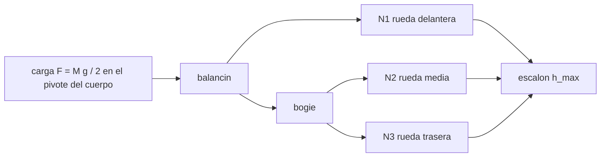

# B102-C04 — Suspensión rocker-bogie y mecánica de rovers

<!-- nav:top -->
[🏠 Programa](../../../../README.md) · [📚 Bloque B102](../../../tronco-comun/B102-movilidad-de-robots-planetarios.md) · [← Anterior: B102-C03 — Deslizamiento y estimación de patinaje](../B102-C03-deslizamiento-y-estimacion-de-patinaje/CLASE.md) · [Siguiente: B102-C05 — Distribución de cargas y estabilidad ante vuelco →](../B102-C05-distribucion-de-cargas-y-estabilidad-ante-vuelco/CLASE.md)
<!-- /nav -->

## 1. Ubicación, nivel y alcance

Clase 4 del bloque B102. Nivel N3. La suspensión rocker-bogie reparte el peso entre seis ruedas sin muelles y mantiene todas en contacto con el suelo. Aquí planteas su estática plana, calculas la carga de cada rueda según la posición del pivote del cuerpo, obtienes la altura de escalón que la rueda delantera puede superar con una tracción dada y ves cómo el diferencial promedia el cabeceo del cuerpo. Usas la estática de B05-C05 y las cargas por rueda de B102-C02. La geometría es sintética y no pertenece a ningún rover real.

## 2. Por qué esta clase existe

Un rover cruza rocas sin muelles ni amortiguadores. La decisión central: **¿dónde colocar el pivote del cuerpo para repartir la carga, y qué escalón puede subir una rueda con la tracción disponible?** La respuesta separa lo que depende de `g` (las cargas) de lo que no (la altura de escalón).

## 3. Lo que podrás hacer al terminar

1. Plantear el equilibrio de fuerzas y momentos de un balancín y su bogie.
2. Calcular las cargas de las tres ruedas de un lado y la posición de reparto igual.
3. Comprobar el sistema con una segunda vía (fórmula cerrada).
4. Calcular la altura de escalón máxima de la rueda delantera con un coeficiente de tracción dado.
5. Calcular el ángulo del balancín y el cabeceo del cuerpo con el diferencial.
6. Separar lo consultado (gravedades, descripción del mecanismo) de lo ilustrativo (geometría, tracción).

La evidencia es la **ficha de suspensión con cargas por rueda** del ejercicio 12 (sección 20).

## 4. Con qué llegas y cómo comprobarlo

1. ¿Qué es un diagrama de cuerpo libre?
2. ¿Cuándo está un cuerpo en equilibrio estático?
3. ¿Qué es un coeficiente de tracción?
4. ¿Qué es una función trigonométrica inversa?
5. ¿Qué es una verificación por segunda vía?

<details>
<summary>Ver respuestas</summary>

1. Un esquema de un cuerpo con todas las fuerzas externas que actúan sobre él. 2. Cuando la suma de fuerzas y la de momentos son nulas. 3. La razón entre la fuerza horizontal máxima y la carga vertical, adimensional. 4. La que devuelve un ángulo a partir de una razón, como `acos` o `atan`. 5. Calcular lo mismo con otro método y comparar.
</details>

Con cuatro o cinco aciertos, sigue; si no, repasa los prerrequisitos.

## 5. Un caso de contexto y casos de referencia

Con la geometría ilustrativa y el pivote en `+0,0667 m`, cada rueda de un lado lleva `M g/6`: `1634,44 N` en la Tierra, `621,67 N` en Marte y `270,00 N` en la Luna. Con un coeficiente de tracción de `0,40`, la rueda delantera supera un escalón de `5,75 cm`, igual en los tres cuerpos. Es el **ejemplo conductor**. Todo es **ilustrativo**: no es la geometría de ningún rover.

## 6. Vocabulario

El **balancín** (rocker) une la rueda delantera con el pivote del cuerpo y con el bogie. El **bogie** lleva las ruedas media y trasera. El **diferencial** conecta ambos balancines con el cuerpo de modo que el cabeceo del cuerpo es el promedio de los de los dos lados. La **carga por rueda** `N` es la fuerza normal. El **escalón máximo** se obtiene de `F_h = N₁ tan α` con `cos α = (r − h)/r`.

## 7. Modelo mental: una balanza de tres platillos



*Descripción textual:* la carga del cuerpo llega al balancín; este reparte entre la rueda delantera y el bogie, que reparte entre la media y la trasera; las tres cargas fijan el escalón máximo.

Analogía: una palanca con otra palanca colgada de ella. Límite: el modelo es plano, sin masa de la suspensión y con una rueda rígida; no incluye la tracción propia en la arista del escalón.

## 8. La explicación, paso a paso

### 8.1 Estática de un lado

Las incógnitas son `N₁` (delantera), `N₂` (media) y `N₃` (trasera). Ecuaciones: `N₁ + N₂ + N₃ = F`, momento nulo respecto del pivote del cuerpo y momento nulo del bogie respecto de su pivote. Con la rueda delantera en `+0,60 m`, el pivote rocker-bogie en `−0,20 m` y el bogie a `±0,35 m`, la solución cerrada es `N₁ = F (x_P − x_B)/(x₁ − x_B)`; el resto se reparte a partes iguales entre las ruedas del bogie.

### 8.2 Reparto igual

Para `N₁ = F/3` hace falta `x_P = (x₁ + 2 x_B)/3 = +0,0667 m`.

| Cuerpo | `F` por lado (N) | `x_P` (m) | `N₁` (N) | `N₂` = `N₃` (N) | `N₁/F` |
|---|---|---|---|---|---|
| Tierra | 4903,32 | +0,0667 | 1634,44 | 1634,44 | 0,333 |
| Tierra | 4903,32 | +0,2000 | 2451,66 | 1225,83 | 0,500 |
| Marte | 1865,00 | +0,0667 | 621,67 | 621,67 | 0,333 |
| Marte | 1865,00 | +0,2000 | 932,50 | 466,25 | 0,500 |
| Luna | 810,00 | +0,0667 | 270,00 | 270,00 | 0,333 |
| Luna | 810,00 | +0,2000 | 405,00 | 202,50 | 0,500 |

La solución por eliminación gaussiana y la fórmula cerrada difieren en `9,27 × 10⁻¹⁷` (relativo).

### 8.3 Escalón máximo

La rueda delantera de radio `r = 0,2625 m` sube un escalón `h` cuando el empuje `F_h` que le llega de las otras ruedas lo permite. Equilibrio de la rueda: `F_h = N₁ tan α` con `cos α = (r − h)/r`. Con empuje disponible `μ (N₂ + N₃)` y `μ = 0,40`: `tan α = μ (N₂ + N₃)/N₁`.

| `x_P` (m) | `α` (°) | `h_máx` (cm) | `h/r` | `h/diámetro` |
|---|---|---|---|---|
| +0,0667 | 38,660 | 5,752 | 0,2191 | 0,1096 |
| +0,2000 | 21,801 | 1,877 | 0,0715 | 0,0358 |

El reparto igual triplica el escalón. Como las cargas y el empuje escalan con `g`, el escalón es el mismo en la Tierra, Marte y la Luna.

### 8.4 Diferencial

Si la rueda delantera sube `h`, el balancín gira `θ = asin(h/(x₁ − x_B))` alrededor del bogie; el pivote sube `(x_P − x_B) sin θ`, y el diferencial reparte el movimiento entre los dos lados: el cabeceo del cuerpo es `θ/2` y su subida la mitad.

| `h` (m) | balancín (°) | cabeceo del cuerpo (°) | subida del cuerpo (cm) |
|---|---|---|---|
| 0,05 | 3,583 | 1,792 | 0,833 |
| 0,10 | 7,181 | 3,590 | 1,667 |
| 0,20 | 14,478 | 7,239 | 3,333 |
| 0,30 | 22,024 | 11,012 | 5,000 |

### 8.5 Lo que el modelo no capta

La descripción de la NASA indica que el rover puede cruzar obstáculos del tamaño de una rueda; el escalón de 5,75 cm de este modelo es mucho menor porque solo considera el empuje de las otras ruedas y no la tracción de la propia rueda en la arista, ni las garras. Es un cálculo conservador, no el límite de un rover real.

## 9. Magnitudes, símbolos y unidades

| Símbolo | Qué es | Unidad | Valor / nota |
|---|---|---|---|
| `N₁`, `N₂`, `N₃` | cargas de las ruedas de un lado | N | 1634,44 (Tierra, reparto igual) |
| `F` | carga del cuerpo por lado | N | `M g/2` |
| `x_P` | posición del pivote del cuerpo | m | +0,0667 (reparto igual) |
| `μ` | coeficiente de tracción disponible | — | 0,40 (ilustrativo) |
| `r` | radio de rueda | m | 0,2625 (escala consultada) |
| `h` | altura de escalón | m | 0,0575 (máximo) |

## 10. Convenciones y referencias

Gravedades de las fichas de la NASA/NSSDC (Marte, Luna) y `gₙ` del NIST (Tierra). Descripción del mecanismo, diámetro de rueda y masa de la página de Mars 2020 de la NASA (solo como escala). Plano vertical, `x` hacia delante, terreno plano, suspensión sin masa. Geometría, masa de 1000 kg y `μ` ilustrativos.

## 11. De dónde sale lo que afirmamos

| ID | Fuente | Localizador | Respalda | Estado |
|---|---|---|---|---|
| S1 | NASA/NSSDC, Mars Fact Sheet — https://nssdc.gsfc.nasa.gov/planetary/factsheet/marsfact.html (consultada 2026-11-10) | fila «Surface gravity (mean)» | g media de Marte = 3,73 m/s² | Consultada |
| S2 | NASA/NSSDC, Moon Fact Sheet — https://nssdc.gsfc.nasa.gov/planetary/factsheet/moonfact.html (consultada 2026-11-10) | fila «Surface gravity» | g de la Luna = 1,62 m/s² | Consultada |
| S3 | NIST, CODATA 2022, standard acceleration of gravity — https://physics.nist.gov/cgi-bin/cuu/Value?gn (consultada 2026-11-10) | valor `gₙ` | `gₙ` = 9,806 65 m/s² (exacto por definición) | Consultada |
| S4 | NASA, Mars 2020 Perseverance Rover Components — https://science.nasa.gov/mission/mars-2020-perseverance/rover-components/ (consultada 2026-11-10) | secciones «Wheels», «Body» y descripción del rocker-bogie | seis ruedas con motor propio; ruedas de 52,5 cm de diámetro; masa 1025 kg; rocker-bogie con pivote diferencial; cruza obstáculos del tamaño de una rueda; diseñado para 45° de inclinación en cualquier dirección y evitación de más de 30°; velocidad máxima 152 m/h en terreno llano duro | Consultada |
| — | Estática de cuerpos rígidos (equilibrio de fuerzas y momentos) | — | las verifica el laboratorio con una segunda vía | No consultada en una fuente concreta |

Límites: la geometría y la tracción no se consultaron; el modelo es plano y no incluye la tracción en la arista; no representa a ningún rover.

## 12. Cómo ver la suspensión rocker-bogie

| Magnitud | Valor |
|---|---|
| pivote de reparto igual | +0,0667 m |
| `N₁` en Marte (reparto igual) | 621,67 N |
| `h_máx` (reparto igual) | 5,752 cm |
| `h_máx` (pivote en +0,2 m) | 1,877 cm |
| cabeceo con `h` = 0,20 m | 7,239° |

Descripción larga: el reparto igual da a cada rueda un sexto del peso, las cargas escalan con `g` y el escalón máximo no depende de ella.

## 13. Ejemplo trabajado: el escalón de la rueda delantera

**Paso 1 · Cargas.** Con reparto igual, `N₁ = N₂ = N₃ = F/3`.

**Paso 2 · Razón.** `tan α = 0,40 × 2/1 = 0,80`.

**Paso 3 · Ángulo.** `α = 38,66°`.

**Paso 4 · Escalón.** `h = 0,2625 (1 − cos 38,66°) = 0,0575 m`.

## 14. Distintas formas de describir una suspensión

**Por cargas:** `N₁, N₂, N₃`. **Por geometría:** posiciones de pivotes y ruedas. **Por capacidad:** `h_máx`. **Por movimiento:** ángulos del balancín y del cuerpo.

## 15. Práctica guiada

**Ejercicio 1 · con los pasos indicados.** Calcula `x_P` para reparto igual. *Pasos:* `(x₁ + 2 x_B)/3` con `x₁ = 0,6` y `x_B = −0,2`.

<details><summary>Solución comentada</summary>

`(0,6 − 0,4)/3 = +0,0667 m`.
</details>

**Ejercicio 2 · con una pista.** `N₁` en Marte con reparto igual. *Pista:* `F = M g/2` y `N₁ = F/3`.

<details><summary>Solución comentada</summary>

`1000 × 3,73/2 = 1865`; `1865/3 = 621,67 N`.
</details>

**Ejercicio 3 · casi autónomo.** Calcula `tan α` y `α` con `μ = 0,40` y reparto igual.

<details><summary>Solución comentada</summary>

`tan α = 0,4 × 2 = 0,8`; `α = 38,66°`.
</details>

## 16. Práctica autónoma, transferencia e integrador

**Ejercicio 4 · autónomo.** `h_máx` con `α = 38,66°` y `r = 0,2625 m`.

<details><summary>Solución comentada</summary>

`0,2625 (1 − 0,7809) = 0,0575 m`.
</details>

**Ejercicio 5 · autónomo.** Con el pivote en `+0,2 m` (`N₁ = F/2`), ¿cuál es `tan α`?

<details><summary>Solución comentada</summary>

`0,4 × 1/1 = 0,4`; `α = 21,80°`; `h = 1,88 cm`.
</details>

**Ejercicio 6 · autónomo.** ¿Qué `μ` hace falta para subir `h = 0,10 m` con reparto igual?

<details><summary>Solución comentada</summary>

`cos α = 0,619`; `α = 51,75°`; `tan α = 1,268`; `μ = 1,268/2 = 0,634`.
</details>

**Ejercicio 7 · autónomo.** Ángulo del balancín y cabeceo del cuerpo para `h = 0,15 m` (`x₁ − x_B = 0,8 m`).

<details><summary>Solución comentada</summary>

`asin(0,15/0,8) = 10,81°`; cabeceo `5,40°`.
</details>

**Ejercicio 8 · autónomo.** ¿En qué `x_P` quedaría `N₁ = 0,4 F`?

<details><summary>Solución comentada</summary>

`x_P = x_B + 0,4 (x₁ − x_B) = −0,2 + 0,32 = +0,12 m`.
</details>

**Ejercicio 9 · transferencia.** **Transferencia.** ¿Por qué el escalón máximo es igual en Marte y en la Tierra?

<details><summary>Solución comentada</summary>

Las cargas `N` y el empuje `μ (N₂ + N₃)` escalan con `g`; la razón `tan α` no depende de ella.
</details>

**Ejercicio 10 · transferencia.** **Transferencia.** La NASA describe que el rover cruza obstáculos del tamaño de una rueda y este modelo da 5,75 cm. ¿Se contradicen?

<details><summary>Solución comentada</summary>

No: el modelo es conservador (solo empuje de las otras ruedas, sin tracción en la arista ni garras) y su geometría es sintética.
</details>

**Ejercicio 11 · transferencia.** **Transferencia.** Un ingeniero ensaya la suspensión en la Tierra con el rover descargado de peso para imitar Marte. ¿Qué debe conservar para que el ensayo de escalón sea representativo?

<details><summary>Solución comentada</summary>

El reparto de cargas y la razón empuje/carga: con `g` distinta el escalón es el mismo si ambos escalan igual.
</details>

**Ejercicio 12 · integrador.** **Integrador.** Elabora tu *ficha de suspensión con cargas por rueda*: tabla de `N₁, N₂, N₃` para dos posiciones del pivote y tres cuerpos, escalón máximo, efecto del diferencial y lista de qué es consultado e ilustrativo.

<details><summary>Solución comentada</summary>

Secciones 8.1–8.5 y la salida del laboratorio.
</details>

## 17. Laboratorio: estática de un balancín con bogie

El script [rocker_bogie.py](rocker_bogie.py) resuelve las cargas por eliminación gaussiana y con la fórmula cerrada, calcula el escalón máximo con dos posiciones del pivote y el efecto del diferencial (**comprueba** suma de cargas = `F`, momento nulo, Gauss frente a fórmula < 1e-9 y escalón igual en los tres cuerpos).

**Datos:** gravedades de la NASA/NSSDC y del NIST (consultadas); geometría, masa y tracción **ilustrativas**. **Predice antes de ejecutar:** ¿qué `N₁/F` tendrá el pivote en +0,20 m? (0,500). **Ejecución del 2026-11-10 (Python 3.12.9):**

```text
Python 3.12.9 (biblioteca estandar)
Geometria ILUSTRATIVA: rueda delantera +0.60 m, pivote rocker-bogie -0.20 m, bogie +0.15 / -0.55 m; pivote del cuerpo para cargas iguales = +0.0667 m
 cuerpo   g [m/s2]  F lado [N]  pivote [m]   N1 [N]   N2 [N]   N3 [N]  N1/F
Tierra    9.80665     4903.32    +0.0667   1634.44   1634.44   1634.44  0.333
Tierra    9.80665     4903.32    +0.2000   2451.66   1225.83   1225.83  0.500
Marte     3.73000     1865.00    +0.0667    621.67    621.67    621.67  0.333
Marte     3.73000     1865.00    +0.2000    932.50    466.25    466.25  0.500
Luna      1.62000      810.00    +0.0667    270.00    270.00    270.00  0.333
Luna      1.62000      810.00    +0.2000    405.00    202.50    202.50  0.500
Gauss frente a formula cerrada: diferencia relativa maxima = 9.27e-17
Escalon maximo de la rueda delantera (mu = 0.40, r = 0.2625 m):
 pivote [m]  alpha [deg]  h_max [cm]  h_max/r  h_max/diametro
   +0.0667      38.660       5.752   0.2191     0.1096
   +0.2000      21.801       1.877   0.0715     0.0358
El escalon maximo es el mismo en Tierra, Marte y Luna (las cargas y el empuje escalan con g).
Efecto del diferencial: la rueda delantera de un lado sube h; angulo de balancin y cabeceo del cuerpo (promedio de ambos lados)
    h [m]  balancin [deg]  cabeceo cuerpo [deg]  subida del cuerpo [cm]
     0.05           3.583                 1.792                  0.833
     0.10           7.181                 3.590                  1.667
     0.20          14.478                 7.239                  3.333
     0.30          22.024                11.012                  5.000
Con el pivote en la posicion de cargas iguales, cada rueda lleva M g / 6: comprobado.
Pruebas superadas.
```

```bash
python programa/clases/B102/B102-C04-suspension-rocker-bogie-y-mecanica-de-rovers/rocker_bogie.py
```

**Límites:** plano, suspensión sin masa, rueda rígida, sin tracción en la arista del escalón; la altura de escalón es un límite conservador.

## 18. Errores frecuentes y cómo corregirlos

**Creer que el escalón depende de la gravedad.** Se corrige con 8.3

**Repartir la carga en tercios sin mirar el pivote.** Se corrige con 8.1 y 8.2

**Confundir el cabeceo del cuerpo con el del balancín.** Se corrige con 8.4

**Presentar la geometría sintética como la de un rover.** Se corrige con la sección 10

## 19. Cómo sabrás que vas bien

Tras la sección 8: ¿qué `N₁` esperabas en la Luna y cuál obtuviste? Si dudas, repasa el ejemplo 13. Tras el laboratorio: ¿qué comprueba? (ver la sección 17).

## 20. Qué entregas y cómo se evalúa

El producto es tu **ficha de suspensión con cargas por rueda** (ejercicio 12).

| Criterio | Inicial | En desarrollo | Logrado | Destacado |
|---|---|---|---|---|
| Conceptos | Los confunde | Parciales | Distingue balancín, bogie y diferencial | Explica los límites |
| Cálculo | Sin unidades | Con errores | Tablas completas con unidades | Calcula casos nuevos |
| Numérico | Sin comprobar | Un caso | Gauss y fórmula cerrada | Interpreta las diferencias |
| Fuentes | Sin fuente | Sin fecha | Fuentes con fecha y estado | Declara lo ilustrativo y lo no consultado |
| Límites | No los nombra | Uno | Tres | Discute qué falta del modelo |

**Condiciones críticas (no se compensan con promedio):** rotular la geometría y la tracción como ilustrativas; no presentar el escalón como el límite de un rover real; citar solo lo consultado.

## 21. Ética, seguridad y límites

Clase educativa: los modelos son simplificados y sus datos son sintéticos o ilustrativos; ningún resultado describe un rover, un suelo ni un terreno reales ni sustituye al análisis de ingeniería ni a los procedimientos de una misión. Accesibilidad: tablas equivalentes a las gráficas, fórmulas en texto, ejercicios sin conexión.

## 22. Para cerrar y seguir

Con el pivote en `+0,0667 m` cada rueda lleva `M g/6` y la delantera sube `5,75 cm` con `μ = 0,40`, igual en los tres cuerpos. Queda una pregunta: ¿hasta qué pendiente puede inclinarse el rover sin volcar y cómo cambia la carga por rueda?

**Glosario español–inglés.** balancín · *rocker*; bogie · *bogie*; diferencial · *differential*; carga por rueda · *wheel load*; escalón · *step obstacle*.

**Continuidad.** B102-C05 estudia la distribución de cargas y la estabilidad ante vuelco.

**Referencias:** ver sección 11.

<!-- nav:bottom -->
---

[← Anterior: B102-C03 — Deslizamiento y estimación de patinaje](../B102-C03-deslizamiento-y-estimacion-de-patinaje/CLASE.md) · [📚 Bloque B102](../../../tronco-comun/B102-movilidad-de-robots-planetarios.md) · [Siguiente: B102-C05 — Distribución de cargas y estabilidad ante vuelco →](../B102-C05-distribucion-de-cargas-y-estabilidad-ante-vuelco/CLASE.md)
<!-- /nav -->
