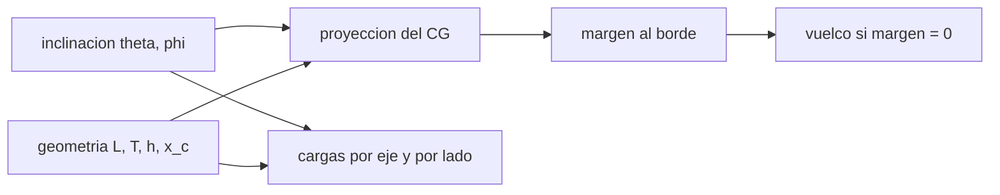

# B102-C05 — Distribución de cargas y estabilidad ante vuelco

<!-- nav:top -->
[🏠 Programa](../../../../README.md) · [📚 Bloque B102](../../../tronco-comun/B102-movilidad-de-robots-planetarios.md) · [← Anterior: B102-C04 — Suspensión rocker-bogie y mecánica de rovers](../B102-C04-suspension-rocker-bogie-y-mecanica-de-rovers/CLASE.md) · [Siguiente: B102-C06 — Dinamometría y medición de fuerzas de tracción →](../B102-C06-dinamometria-y-medicion-de-fuerzas-de-traccion/CLASE.md)
<!-- /nav -->

## 1. Ubicación, nivel y alcance

Clase 5 del bloque B102. Nivel N3. Un rover en una ladera carga más unas ruedas que otras y, si la pendiente es excesiva, vuelca. Aquí aplicas los diagramas de cuerpo libre de B05-C05 al reparto de carga entre ejes y ruedas, calculas los ángulos de vuelco cuasiestáticos y el margen de estabilidad y los comparas con un límite operativo. Usas la suspensión de B102-C04 como origen del polígono de apoyo. El rover es sintético y no corresponde a ningún vehículo real.

## 2. Por qué esta clase existe

Las leyes de operación de un rover fijan un máximo de inclinación. La decisión central: **¿cuánto margen queda frente al vuelco en una pendiente dada, y qué parte de ese margen depende de la gravedad?** La respuesta separa los ángulos (geométricos, independientes de `g`) de las cargas y de las aceleraciones críticas (que escalan con `g`).

## 3. Lo que podrás hacer al terminar

1. Proyectar el centro de masas sobre el polígono de apoyo para una inclinación dada.
2. Calcular los ángulos de vuelco por cabeceo y por balanceo, con la fórmula y por bisección.
3. Calcular el margen de estabilidad (distancia al borde) en una pendiente.
4. Calcular la carga de los ejes y la transferencia lateral en pendiente.
5. Calcular la aceleración lateral crítica en un giro y su velocidad en un arco.
6. Separar lo consultado (gravedades, límites operativos de referencia) de lo ilustrativo (geometría).

La evidencia es la **tabla de márgenes de estabilidad** del ejercicio 12 (sección 20).

## 4. Con qué llegas y cómo comprobarlo

1. ¿Qué es el centro de masas?
2. ¿Qué es un polígono de apoyo?
3. ¿Cómo se descompone el peso en una pendiente de ángulo `θ`?
4. ¿Qué es un margen de estabilidad?
5. ¿Qué es una verificación por segunda vía?

<details>
<summary>Ver respuestas</summary>

1. El punto en que se puede suponer concentrada la masa para el movimiento y el equilibrio. 2. La figura que forman los puntos de contacto con el suelo. 3. `M g cos θ` normal y `M g sen θ` a lo largo de la pendiente. 4. La distancia entre la proyección del centro de masas y el borde del polígono de apoyo. 5. Calcular lo mismo con otro método y comparar.
</details>

Con cuatro o cinco aciertos, sigue; si no, repasa los prerrequisitos.

## 5. Un caso de contexto y casos de referencia

Un rover ilustrativo de `1000 kg`, base `L = 2,2 m`, vía `T = 1,6 m` y centro de masas a `0,70 m` vuelca lateralmente a `48,81°`, hacia atrás al subir a `59,74°` y hacia delante al bajar a `55,01°`, en cualquier cuerpo. A `30°` de pendiente transversal conserva un margen de `0,396 m`. Es el **ejemplo conductor**. Todo es **ilustrativo**: no es un rover real.

## 6. Vocabulario

La **proyección del centro de masas** es el punto en que la vertical local, desde el centro de masas, corta el plano de apoyo. El **margen de vuelco** es la distancia de esa proyección al borde más próximo. El **cabeceo** `θ` es la inclinación longitudinal (morro arriba) y el **balanceo** `φ` la lateral. La **transferencia de carga** es la diferencia de carga entre lados o ejes producida por la pendiente. La **aceleración lateral crítica** de un giro es `g T/(2h)`.

## 7. Modelo mental: una mesa con la bandeja inclinada



*Descripción textual:* la inclinación y la geometría fijan dónde cae la proyección del centro de masas; la distancia al borde es el margen y el vuelco ocurre cuando es nulo; además la inclinación reparte las cargas entre ejes y lados.

Analogía: una caja alta sobre una tabla que se inclina vuelca antes que una baja. Límite: es un cálculo cuasiestático con terreno plano, rígido y sin deslizamiento; no incluye dinámica ni suspensión que se mueve.

## 8. La explicación, paso a paso

### 8.1 Proyección y ángulos de vuelco

Con el cuerpo inclinado `θ` y `φ`, la proyección del centro de masas cae en `p_x = x_c − h tan θ/cos φ` y `p_y = −h tan φ`. El vuelco ocurre cuando `p` toca el borde del polígono `[−L/2, L/2] × [−T/2, T/2]`:

| Vuelco | Fórmula | Valor |
|---|---|---|
| lateral | `atan(T/(2h))` | 48,8141° |
| cabeceo, subiendo | `atan((L/2 + x_c)/h)` | 59,7436° |
| cabeceo, bajando | `atan((L/2 − x_c)/h)` | 55,0080° |

La bisección numérica coincide con la fórmula (error `2,22 × 10⁻¹⁶ rad`). Los ángulos no dependen de `g`.

### 8.2 Margen frente al límite operativo

La página de la NASA indica un diseño para `45°` y la evitación operativa de más de `30°` en el rover de Mars 2020. En el rover ilustrativo, a `30°` el margen es `0,7959 m` en cabeceo, `0,3959 m` en balanceo y `0,5452 m` con `20° + 20°` combinados. El margen es un número que se puede comparar entre diseños; el límite operativo cubre además la incertidumbre de la pendiente, el deslizamiento y la dinámica.

### 8.3 Cargas por eje

En cabeceo `θ`: `N_del = M g (br cos θ − h sin θ)/L` y `N_tras = M g (bf cos θ + h sin θ)/L`, con `br = L/2 + x_c` y `bf = L/2 − x_c`. La suma es `M g cos θ`.

| Cuerpo | pendiente (°) | `N_del` (N) | `N_tras` (N) |
|---|---|---|---|
| Tierra | 0 | 5349,08 | 4457,57 |
| Tierra | 30 | 3072,29 | 5420,52 |
| Marte | 0 | 2034,55 | 1695,45 |
| Marte | 30 | 1168,56 | 2061,72 |
| Luna | 0 | 883,64 | 736,36 |
| Luna | 30 | 507,52 | 895,44 |

La suma de cargas coincide con `M g cos θ` con desviación `2,22 × 10⁻¹⁶`. Al subir, el eje delantero se descarga: en Marte a 30° lleva `1168,56 N`, el `36 %` de `M g cos 30°`.

### 8.4 Transferencia lateral y giros

En una pendiente transversal `φ`, la diferencia entre las cargas derecha e izquierda es `ΔN = 2 M g cos φ h tan φ/T`; a `20°` es `0,29927 M g` (`2934,81 N` en la Tierra, `1116,27 N` en Marte, `484,81 N` en la Luna). En un giro en terreno llano, el vuelco ocurre con `a_y = g T/(2h)`: `11,208`, `4,263` y `1,851 m/s²`; en un arco de `5 m`, la velocidad crítica `√(a_y R)` es `7,486`, `4,617` y `3,043 m/s`.

### 8.5 Qué escala con `g`

Los ángulos de vuelco y las razones de transferencia de carga no dependen de `g`; las cargas, las aceleraciones críticas y las velocidades críticas en un giro sí. Un rover es igual de vulnerable al vuelco estático en Marte que en la Tierra, pero por la baja gravedad un giro brusco lo vuelca a velocidades menores.

## 9. Magnitudes, símbolos y unidades

| Símbolo | Qué es | Unidad | Valor / nota |
|---|---|---|---|
| `L`, `T`, `h` | base, vía y altura del centro de masas | m | 2,2; 1,6; 0,70 (ilustrativos) |
| `x_c` | desplazamiento longitudinal del centro de masas | m | +0,10 |
| `θ`, `φ` | cabeceo y balanceo | ° | 0 a 60 |
| margen | distancia al borde del polígono | m | 0,3959 (30° de balanceo) |
| `N` | carga normal de un eje | N | 5349,08 (Tierra, 0°) |
| `a_y` | aceleración lateral crítica | m/s² | 4,263 (Marte) |

## 10. Convenciones y referencias

Gravedades de las fichas de la NASA/NSSDC (Marte, Luna) y `gₙ` del NIST (Tierra). Los límites de 45° (diseño) y 30° (evitación operativa) proceden de la página de Mars 2020 de la NASA y son valores de referencia, no del vehículo ilustrativo. Marco del cuerpo: `x` adelante, `y` a la izquierda, `z` arriba. Cuasiestático, terreno plano y rígido. Geometría y masa ilustrativas.

## 11. De dónde sale lo que afirmamos

| ID | Fuente | Localizador | Respalda | Estado |
|---|---|---|---|---|
| S1 | NASA/NSSDC, Mars Fact Sheet — https://nssdc.gsfc.nasa.gov/planetary/factsheet/marsfact.html (consultada 2026-11-10) | fila «Surface gravity (mean)» | g media de Marte = 3,73 m/s² | Consultada |
| S2 | NASA/NSSDC, Moon Fact Sheet — https://nssdc.gsfc.nasa.gov/planetary/factsheet/moonfact.html (consultada 2026-11-10) | fila «Surface gravity» | g de la Luna = 1,62 m/s² | Consultada |
| S3 | NIST, CODATA 2022, standard acceleration of gravity — https://physics.nist.gov/cgi-bin/cuu/Value?gn (consultada 2026-11-10) | valor `gₙ` | `gₙ` = 9,806 65 m/s² (exacto por definición) | Consultada |
| S4 | NASA, Mars 2020 Perseverance Rover Components — https://science.nasa.gov/mission/mars-2020-perseverance/rover-components/ (consultada 2026-11-10) | secciones «Wheels», «Body» y descripción del rocker-bogie | seis ruedas con motor propio; ruedas de 52,5 cm de diámetro; masa 1025 kg; rocker-bogie con pivote diferencial; cruza obstáculos del tamaño de una rueda; diseñado para 45° de inclinación en cualquier dirección y evitación de más de 30°; velocidad máxima 152 m/h en terreno llano duro | Consultada |
| — | Estática de cuerpos rígidos y proyección del centro de masas | — | las verifica el laboratorio con una segunda vía | No consultada en una fuente concreta |

Límites: la geometría del rover no se consultó; el modelo es estático, sin deslizamiento ni dinámica; los límites de 45° y 30° son de otro vehículo.

## 12. Cómo ver los márgenes de estabilidad

| Magnitud | Valor |
|---|---|
| vuelco lateral | 48,8141° |
| margen a 30° de balanceo | 0,3959 m |
| `N_del` de Marte a 30° | 1168,56 N |
| `ΔN`/(M g) a 20° | 0,29927 |
| `a_y` crítica en Marte | 4,263 m/s² |

Descripción larga: los ángulos de vuelco dependen solo de la geometría; las cargas y las aceleraciones críticas escalan con la gravedad.

## 13. Ejemplo trabajado: el margen de balanceo a 30°

**Paso 1 · Proyección.** `p_y = −0,70 × tan 30° = −0,4041 m`.

**Paso 2 · Borde.** El borde está a `T/2 = 0,80 m`.

**Paso 3 · Margen.** `0,80 − 0,4041 = 0,3959 m`.

## 14. Distintas formas de describir la estabilidad

**Por ángulo:** `atan(...)`. **Por distancia:** margen al borde. **Por carga:** `N` por eje o lado. **Por aceleración:** `a_y` crítica. **Por velocidad:** `v` crítica en un arco.

## 15. Práctica guiada

**Ejercicio 1 · con los pasos indicados.** Calcula el ángulo de vuelco lateral. *Pasos:* `T/(2h)` y arcotangente.

<details><summary>Solución comentada</summary>

`0,8/0,7 = 1,1429`; `atan = 48,81°`.
</details>

**Ejercicio 2 · con una pista.** Margen de balanceo a 30°. *Pista:* `T/2 − h tan φ`.

<details><summary>Solución comentada</summary>

`0,80 − 0,70 × 0,5774 = 0,3959 m`.
</details>

**Ejercicio 3 · casi autónomo.** Ángulo de vuelco al subir una pendiente.

<details><summary>Solución comentada</summary>

`atan((1,1 + 0,1)/0,7) = 59,74°`.
</details>

## 16. Práctica autónoma, transferencia e integrador

**Ejercicio 4 · autónomo.** ¿Qué fracción de `M g cos 30°` lleva el eje delantero en Marte?

<details><summary>Solución comentada</summary>

`1168,56/(3730 × 0,8660) = 0,362`.
</details>

**Ejercicio 5 · autónomo.** `ΔN/(M g)` a 20° de pendiente transversal.

<details><summary>Solución comentada</summary>

`2 × 0,9397 × 0,70 × 0,3640/1,6 = 0,2993`.
</details>

**Ejercicio 6 · autónomo.** `a_y` crítica en la Luna.

<details><summary>Solución comentada</summary>

`1,62 × 1,6/1,4 = 1,851 m/s²`.
</details>

**Ejercicio 7 · autónomo.** Velocidad crítica en Marte para un arco de 10 m.

<details><summary>Solución comentada</summary>

`√(4,263 × 10) = 6,53 m/s`.
</details>

**Ejercicio 8 · autónomo.** ¿Qué altura `h` hace que el vuelco lateral ocurra a 45°?

<details><summary>Solución comentada</summary>

`atan(0,8/h) = 45°` → `h = 0,80 m`.
</details>

**Ejercicio 9 · transferencia.** **Transferencia.** ¿Por qué la velocidad crítica de giro es menor en la Luna que en la Tierra si el ángulo de vuelco estático es el mismo?

<details><summary>Solución comentada</summary>

La aceleración centrípeta `v²/R` se compara con `g T/(2h)`: a menor `g`, menor `v` para igual radio.
</details>

**Ejercicio 10 · transferencia.** **Transferencia.** Un brazo desplegado sube el centro de masas a 0,80 m. ¿Cuál es el nuevo ángulo de vuelco lateral?

<details><summary>Solución comentada</summary>

`atan(0,8/0,8) = 45°`: un margen menor.
</details>

**Ejercicio 11 · transferencia.** **Transferencia.** La NASA diseña para 45° pero evita más de 30°. ¿Qué cubre la diferencia?

<details><summary>Solución comentada</summary>

Incertidumbre de la pendiente, deslizamiento, rocas bajo una rueda y dinámica; este modelo solo cubre la parte estática.
</details>

**Ejercicio 12 · integrador.** **Integrador.** Elabora tu *tabla de márgenes de estabilidad*: ángulos de vuelco, margen a 30°, cargas por eje en tres cuerpos, transferencia lateral, aceleración crítica y lista de qué es consultado e ilustrativo.

<details><summary>Solución comentada</summary>

Secciones 8.1–8.5 y la salida del laboratorio.
</details>

## 17. Laboratorio: márgenes de vuelco y reparto de cargas

El script [estabilidad.py](estabilidad.py) proyecta el centro de masas, calcula los ángulos de vuelco por bisección y con la fórmula, el margen a 30°, las cargas por eje, la transferencia lateral y los giros (**comprueba** bisección frente a fórmula < 1e-9 y suma de cargas frente a `M g cos θ` < 1e-9).

**Datos:** gravedades de la NASA/NSSDC y del NIST y límites de 45° y 30° de la NASA (consultados); geometría y masa **ilustrativas**. **Predice antes de ejecutar:** ¿cuál será el ángulo de vuelco lateral en Marte? (el mismo que en la Tierra: 48,81°). **Ejecución del 2026-11-10 (Python 3.12.9):**

```text
Python 3.12.9 (biblioteca estandar)
Rover ILUSTRATIVO: M = 1000 kg, L = 2.2 m, T = 1.6 m, h = 0.7 m, CG 0.1 m por delante del centro
Angulos de vuelco (independientes de g):
  cabeceo, subiendo   biseccion =  59.7436 deg ; formula cerrada =  59.7436 deg
  cabeceo, bajando    biseccion =  55.0080 deg ; formula cerrada =  55.0080 deg
  balanceo lateral    biseccion =  48.8141 deg ; formula cerrada =  48.8141 deg
Error maximo biseccion frente a formula: 2.22e-16 rad
Margen de vuelco [m] a 30 grados (limite operativo de evitacion, valor consultado), cabeceo y balanceo:
  cabeceo 30 deg: 0.7959 m ; balanceo 30 deg: 0.3959 m ; combinado 20+20 deg: 0.5452 m
Cargas por eje en pendiente (cabeceo, morro arriba):
 cuerpo   pendiente [deg]  N_del [N]  N_tras [N]  suma/(M g cos) 
Tierra             0      5349.08     4457.57     1.000000
Tierra            15      4359.22     5113.27     1.000000
Tierra            30      3072.29     5420.52     1.000000
Marte              0      2034.55     1695.45     1.000000
Marte             15      1658.05     1944.85     1.000000
Marte             30      1168.56     2061.72     1.000000
Luna               0       883.64      736.36     1.000000
Luna              15       720.12      844.68     1.000000
Luna              30       507.52      895.44     1.000000
Desviacion maxima de la suma de cargas respecto a M g cos(theta): 2.22e-16
Transferencia lateral de carga en pendiente transversal 20 grados (diferencia derecha-izquierda / (M g)):
  Tierra  dN =   2934.81 N ; dN/(M g) = 0.29927
  Marte   dN =   1116.27 N ; dN/(M g) = 0.29927
  Luna    dN =    484.81 N ; dN/(M g) = 0.29927
Giro en terreno llano: aceleracion lateral critica a_y = g T/(2h) y velocidad critica en un arco de 5 m:
  Tierra  a_y crit =  11.208 m/s2 ; v crit =  7.486 m/s
  Marte   a_y crit =   4.263 m/s2 ; v crit =  4.617 m/s
  Luna    a_y crit =   1.851 m/s2 ; v crit =  3.043 m/s
Pruebas superadas.
```

```bash
python programa/clases/B102/B102-C05-distribucion-de-cargas-y-estabilidad-ante-vuelco/estabilidad.py
```

**Límites:** cuasiestático, rígido, sin deslizamiento; la suspensión no se mueve; los límites de 45° y 30° no pertenecen al vehículo ilustrativo.

## 18. Errores frecuentes y cómo corregirlos

**Creer que el ángulo de vuelco cambia con la gravedad.** Se corrige con 8.5

**Olvidar el desplazamiento longitudinal del centro de masas.** Se corrige con 8.1

**Aplicar el margen estático a un giro.** Se corrige con 8.4

**Presentar el rover sintético como un vehículo real.** Se corrige con la sección 10

## 19. Cómo sabrás que vas bien

Tras la sección 8: ¿qué margen esperabas a 30° de balanceo y cuál obtuviste? Si dudas, repasa el ejemplo 13. Tras el laboratorio: ¿qué comprueba? (ver la sección 17).

## 20. Qué entregas y cómo se evalúa

El producto es tu **tabla de márgenes de estabilidad** (ejercicio 12).

| Criterio | Inicial | En desarrollo | Logrado | Destacado |
|---|---|---|---|---|
| Conceptos | Los confunde | Parciales | Distingue ángulo, margen y carga | Explica los límites |
| Cálculo | Sin unidades | Con errores | Tablas completas con unidades | Calcula casos nuevos |
| Numérico | Sin comprobar | Un caso | Bisección y fórmula | Interpreta las diferencias |
| Fuentes | Sin fuente | Sin fecha | Fuentes con fecha y estado | Declara lo ilustrativo y lo no consultado |
| Límites | No los nombra | Uno | Tres | Discute qué falta del modelo |

**Condiciones críticas (no se compensan con promedio):** rotular el rover como ilustrativo; no aplicar los límites de otro vehículo a este; citar solo lo consultado.

## 21. Ética, seguridad y límites

Clase educativa: los modelos son simplificados y sus datos son sintéticos o ilustrativos; ningún resultado describe un rover, un suelo ni un terreno reales ni sustituye al análisis de ingeniería ni a los procedimientos de una misión. Accesibilidad: tablas equivalentes a las gráficas, fórmulas en texto, ejercicios sin conexión.

## 22. Para cerrar y seguir

El rover ilustrativo vuelca lateralmente a `48,8°` en cualquier cuerpo y conserva `0,396 m` de margen a `30°`, pero en un giro lo hace a velocidades menores donde `g` es menor. Queda una pregunta: ¿cómo se mide la fuerza de tracción que se modela?

**Glosario español–inglés.** margen de vuelco · *tip-over margin*; proyección del centro de masas · *center-of-mass projection*; transferencia de carga · *load transfer*; cabeceo · *pitch*; balanceo · *roll*.

**Continuidad.** B102-C06 estudia la dinamometría y la medición de fuerzas de tracción.

**Referencias:** ver sección 11.

<!-- nav:bottom -->
---

[← Anterior: B102-C04 — Suspensión rocker-bogie y mecánica de rovers](../B102-C04-suspension-rocker-bogie-y-mecanica-de-rovers/CLASE.md) · [📚 Bloque B102](../../../tronco-comun/B102-movilidad-de-robots-planetarios.md) · [Siguiente: B102-C06 — Dinamometría y medición de fuerzas de tracción →](../B102-C06-dinamometria-y-medicion-de-fuerzas-de-traccion/CLASE.md)
<!-- /nav -->
