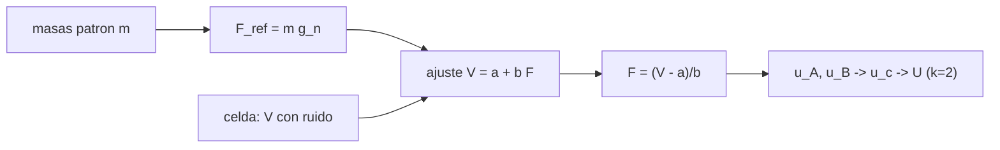

# B102-C06 — Dinamometría y medición de fuerzas de tracción

<!-- nav:top -->
[🏠 Programa](../../../../README.md) · [📚 Bloque B102](../../../tronco-comun/B102-movilidad-de-robots-planetarios.md) · [← Anterior: B102-C05 — Distribución de cargas y estabilidad ante vuelco](../B102-C05-distribucion-de-cargas-y-estabilidad-ante-vuelco/CLASE.md) · [Siguiente: B102-C07 — Simulación de movilidad sobre pendientes y terreno →](../B102-C07-simulacion-de-movilidad-sobre-pendientes-y-terreno/CLASE.md)
<!-- /nav -->

## 1. Ubicación, nivel y alcance

Clase 6 del bloque B102. Nivel N3. Los modelos de tracción de B102-C02 y B102-C07 solo valen si se contrastan con fuerzas medidas. Aquí calibras una celda de carga con masas patrón, ajustas la recta tensión-fuerza, mides una tracción de barra y expresas su incertidumbre con el criterio de la guía GUM (componentes tipo A y tipo B en cuadratura, ampliada con `k = 2`). Usas la metrología general de B13 y la gravedad estándar del NIST. La celda y las lecturas son sintéticas: no hay ninguna medición real.

## 2. Por qué esta clase existe

Un tiro de barra de `176,8 N` sin incertidumbre no se puede comparar con un modelo. La decisión central: **¿con qué incertidumbre se mide una fuerza de tracción y qué parte viene del ruido, de la calibración y de la referencia?**

## 3. Lo que podrás hacer al terminar

1. Convertir masas patrón en fuerzas de referencia con `gₙ`.
2. Ajustar la recta de calibración por mínimos cuadrados y leer su sensibilidad y su residuo.
3. Invertir la recta para medir una fuerza desconocida.
4. Calcular las componentes de incertidumbre tipo A y tipo B y la incertidumbre ampliada.
5. Contrastar la incertidumbre analítica con una simulación de Monte Carlo.
6. Separar lo consultado (`gₙ`) de lo sintético (la celda, el ruido, la referencia).

La evidencia es la **certificado de calibración sintético** del ejercicio 12 (sección 20).

## 4. Con qué llegas y cómo comprobarlo

1. ¿Qué es una celda de carga?
2. ¿Qué es el ajuste por mínimos cuadrados?
3. ¿Qué es una incertidumbre estándar?
4. ¿Qué diferencia hay entre tipo A y tipo B?
5. ¿Qué es un dato sintético?

<details>
<summary>Ver respuestas</summary>

1. Un transductor que convierte una fuerza en una señal eléctrica. 2. El método que halla la recta que minimiza la suma de los cuadrados de los residuos. 3. Una desviación típica asociada al resultado de una medición. 4. A se estima de repeticiones; B de otra información (certificados, hipótesis). 5. Un dato generado para el ejemplo, no medido.
</details>

Con cuatro o cinco aciertos, sigue; si no, repasa los prerrequisitos.

## 5. Un caso de contexto y casos de referencia

Una celda sintética de `1000 N` con sensibilidad `2,0004 mV/V` se calibra con 9 masas de 0 a 100 kg. Medir una tracción sintética de `176,8 N` con 4 lecturas da `176,841 N` con `U = 0,502 N` (`k = 2`, el `0,28 %` de la lectura). Es el **ejemplo conductor**. Todo es **sintético**: ninguna cifra viene de una celda real.

## 6. Vocabulario

La **sensibilidad** es la pendiente `b` de `V = a + b F`, en `mV/V` por newton. El **ajuste lineal** estima `a` y `b`. La **predicción inversa** `F = (V − a)/b` mide una fuerza desconocida. La **incertidumbre tipo A** viene del ruido y del ajuste; la **tipo B** de la fuerza de referencia (masas y gravedad local). La **incertidumbre combinada** `u_c` es su suma en cuadratura y la **ampliada** es `U = k u_c`.

## 7. Modelo mental: una balanza que se contrasta con pesas



*Descripción textual:* las masas patrón dan fuerzas de referencia; el ajuste relaciona la tensión con la fuerza; la inversión mide una fuerza desconocida y la incertidumbre combina ruido, ajuste y referencia.

Analogía: calibrar una báscula con pesas conocidas antes de pesar un objeto. Límite: no hay temperatura, deriva, carga excéntrica ni histéresis; la no linealidad es pequeña y se ve en el residuo, no en `u_c`.

## 8. La explicación, paso a paso

### 8.1 Fuerzas de referencia y ajuste

Cada masa patrón da `F_ref = m gₙ` con `gₙ = 9,80665 m/s²`; las nueve masas (`0, 12,5, …, 100 kg`) cubren `0` a `980,7 N`. El ajuste da `V = 0,00298 + 2,00094 × 10⁻³ F` (mV/V, N): sensibilidad a plena escala `2,0009 mV/V` frente a `2,0004` verdadera. El residuo típico es `0,00067 mV/V` y el máximo `0,00111 mV/V` (`0,557 N`). Sin ruido ni no linealidad el ajuste recupera `a = 0,0031` y `S = 2,0004 mV/V` con error menor que `10⁻⁹`.

### 8.2 Medición y componentes

Con la recta, `F = (V − a)/b`. La incertidumbre tipo A de la predicción inversa con una lectura por punto de calibración y `m = 4` lecturas de la medida es `u_A = (σ/b) √(1/m + 1/n + (F − F̄)²/S_xx)`; la tipo B es `u_B = F u_ref` con `u_ref = 5,8 × 10⁻⁴`.

| Componente | Valor (N) |
|---|---|
| `F` medida | 176,841 |
| `u_A` (ruido y ajuste) | 0,229 |
| `u_B` (referencia) | 0,103 |
| `u_c = √(u_A² + u_B²)` | 0,251 |
| `U (k = 2)` | 0,502 |

`U` es el `0,28 %` de la lectura y el `0,050 %` del alcance.

### 8.3 Verificación por Monte Carlo

Se repite 4000 veces el proceso completo (recalibrar con ruido y con error aleatorio de la referencia, y medir `176,8 N`): sesgo `−0,006 N` y desviación `0,289 N`, frente a `0,293 N` analítica con el ruido verdadero (cociente `0,988`). El `95,6 %` de los errores cae dentro de `±2 u_c`, cercano al `95 %` esperado.

### 8.4 Lo que la incertidumbre no incluye

El residuo máximo del ajuste (`0,557 N`) es mayor que `U` (`0,502 N`): la no linealidad sistemática de `0,02 %` del alcance no está en `u_c`. Una calibración real debe añadir esa componente, la deriva con la temperatura, la histéresis y la carga excéntrica, o ajustar un polinomio.

## 9. Magnitudes, símbolos y unidades

| Símbolo | Qué es | Unidad | Valor / nota |
|---|---|---|---|
| `b` | sensibilidad de la recta | mV/V por N | 2,00094 × 10⁻³ |
| `F_ref` | fuerza de referencia | N | `m gₙ` |
| `σ` | ruido por lectura | mV/V | 0,0008 (sintético) |
| `u_A`, `u_B` | componentes tipo A y B | N | 0,229; 0,103 |
| `U` | incertidumbre ampliada | N | 0,502 (k = 2) |
| `u_ref` | incertidumbre relativa de la referencia | — | 5,8 × 10⁻⁴ (ilustrativa) |

## 10. Convenciones y referencias

`gₙ` = 9,80665 m/s² del NIST (CODATA 2022); se usa como valor nominal de la gravedad local. Fuerza en N, tensión relativa en mV/V. Eje de la celda alineado con la fuerza, sin temperatura ni carga excéntrica. Celda, ruido, masas y `u_ref` sintéticos o ilustrativos.

## 11. De dónde sale lo que afirmamos

| ID | Fuente | Localizador | Respalda | Estado |
|---|---|---|---|---|
| S1 | NIST, CODATA 2022, standard acceleration of gravity — https://physics.nist.gov/cgi-bin/cuu/Value?gn (consultada 2026-11-10) | valor `gₙ` | `gₙ` = 9,806 65 m/s² (exacto por definición) | Consultada |
| — | Guía GUM de la expresión de la incertidumbre de medida y ajuste lineal por mínimos cuadrados | — | las verifica el laboratorio con una segunda vía | No consultada en una fuente concreta |

Límites: la guía GUM no se consultó en una fuente concreta; las especificaciones de celdas reales (alcance, sensibilidad, histéresis) no se consultaron.

## 12. Cómo ver la incertidumbre de una fuerza

| Magnitud | Valor |
|---|---|
| sensibilidad a plena escala | 2,0009 mV/V |
| `F` medida | 176,841 N |
| `u_c` | 0,251 N |
| `U` (k = 2) | 0,502 N (0,28 %) |
| Monte Carlo / analítica | 0,988 |

Descripción larga: la mayor parte de la incertidumbre viene del ruido y del ajuste, y la referencia aporta menos; la simulación coincide con la fórmula.

## 13. Ejemplo trabajado: la incertidumbre de la medición

**Paso 1 · Tipo A.** `σ/b = 0,00067/0,00200094 = 0,3348 N`; factor `√(1/4 + 1/9 + 0,109) = 0,686`; `u_A = 0,229 N`.

**Paso 2 · Tipo B.** `u_B = 176,841 × 5,8 × 10⁻⁴ = 0,103 N`.

**Paso 3 · Combinada.** `u_c = √(0,229² + 0,103²) = 0,251 N`.

**Paso 4 · Ampliada.** `U = 2 × 0,251 = 0,502 N`.

## 14. Distintas formas de describir una medición de fuerza

**Por tensión:** `V` en mV/V. **Por fuerza:** `F` en N. **Por incertidumbre:** `u_A`, `u_B`, `u_c`, `U`. **Por porcentaje:** de la lectura o del alcance.

## 15. Práctica guiada

**Ejercicio 1 · con los pasos indicados.** Calcula la fuerza de referencia de una masa de 50 kg. *Pasos:* `m gₙ`.

<details><summary>Solución comentada</summary>

`50 × 9,80665 = 490,33 N`.
</details>

**Ejercicio 2 · con una pista.** Con `a = 0,00298` y `b = 2,00094 × 10⁻³`, ¿qué fuerza corresponde a `V = 0,3570 mV/V`? *Pista:* `(V − a)/b`.

<details><summary>Solución comentada</summary>

`(0,3570 − 0,00298)/0,00200094 = 176,93 N`.
</details>

**Ejercicio 3 · casi autónomo.** ¿Cuánto vale `u_B` para `F = 176,841 N`?

<details><summary>Solución comentada</summary>

`176,841 × 5,8 × 10⁻⁴ = 0,103 N`.
</details>

## 16. Práctica autónoma, transferencia e integrador

**Ejercicio 4 · autónomo.** `u_c` si `u_A = 0,229 N` y `u_B = 0,103 N`.

<details><summary>Solución comentada</summary>

`√(0,0524 + 0,0106) = 0,251 N`.
</details>

**Ejercicio 5 · autónomo.** `U` como porcentaje del alcance de 1000 N.

<details><summary>Solución comentada</summary>

`0,502/1000 = 0,050 %`.
</details>

**Ejercicio 6 · autónomo.** Contribución de la repetibilidad a `u_A`: `σ/(b √m)` con `m = 4`.

<details><summary>Solución comentada</summary>

`0,3348/2 = 0,167 N`.
</details>

**Ejercicio 7 · autónomo.** Si se toman 16 lecturas en lugar de 4, ¿cuánto vale `u_c`?

<details><summary>Solución comentada</summary>

`u_A = 0,3348 √(1/16 + 1/9 + 0,109) = 0,178 N`; `u_c = √(0,178² + 0,103²) = 0,206 N`.
</details>

**Ejercicio 8 · autónomo.** ¿Por qué el cociente Monte Carlo/analítica es 0,988 y no exactamente 1?

<details><summary>Solución comentada</summary>

El Monte Carlo tiene 4000 repeticiones; su error estadístico es del orden de `1/√(2 × 4000) ≈ 1,1 %`.
</details>

**Ejercicio 9 · transferencia.** **Transferencia.** El residuo máximo (0,557 N) supera a `U` (0,502 N). ¿Qué falta en la incertidumbre y cómo lo incorporarías?

<details><summary>Solución comentada</summary>

Falta la no linealidad: se añade como componente tipo B o se ajusta un polinomio de segundo grado.
</details>

**Ejercicio 10 · transferencia.** **Transferencia.** En la Luna, el tiro de barra es de unos 40 N. ¿Cómo cambia `U` relativa con la misma celda?

<details><summary>Solución comentada</summary>

`u_A = 0,3348 √(0,25 + 0,111 + 0,225) = 0,256 N`; `u_B = 0,023 N`; `U ≈ 0,51 N`, el `1,3 %` de la lectura.
</details>

**Ejercicio 11 · transferencia.** **Transferencia.** Un colega usa `gₙ` como la gravedad del laboratorio. ¿Qué componente lo cubre?

<details><summary>Solución comentada</summary>

`u_ref`, que es una hipótesis ilustrativa; una calibración real mediría o consultaría la gravedad local y la declararía.
</details>

**Ejercicio 12 · integrador.** **Integrador.** Elabora tu *certificado de calibración sintético*: tabla de calibración, recta, residuos, medición con `u_A`, `u_B`, `U`, comparación con Monte Carlo y lista de qué es consultado y sintético.

<details><summary>Solución comentada</summary>

Secciones 8.1–8.4 y la salida del laboratorio.
</details>

## 17. Laboratorio: calibración de una celda y medición de una tracción

El script [dinamometria.py](dinamometria.py) genera una calibración con ruido, ajusta la recta, mide una tracción de barra con sus componentes de incertidumbre y repite 4000 veces el proceso con recalibración (**comprueba** recuperación exacta sin ruido < 1e-9 y desviación Monte Carlo dentro del 5 % de la analítica).

**Datos:** `gₙ` del NIST (consultado); celda, ruido, masas y `u_ref` **sintéticos** con semilla `20261110`. **Predice antes de ejecutar:** ¿cuánto valdrá `U` aproximadamente? (medio newton). **Ejecución del 2026-11-10 (Python 3.12.9):**

```text
Python 3.12.9 (biblioteca estandar)
Celda SINTETICA: alcance 1000 N; S = 2.0004 mV/V; ruido 0.0008 mV/V; 9 puntos de calibracion, 0 a 980.7 N (g_n = 9.80665)
Ajuste: V = 0.00298 + 2.00094e-3 F  [mV/V, N]; sensibilidad 2.0009 mV/V a plena escala; residuo tipico = 0.00067 mV/V
Residuo maximo del ajuste = 0.00111 mV/V = 0.557 N
Sin ruido ni no linealidad: a = 0.003100000 (verdadero 0.0031), b*alcance = 2.000400000 (verdadero 2.0004)
Medicion de una traccion de barra SINTETICA de 176.8 N (media de 4 lecturas):
  F = 176.841 N ; u_A = 0.229 N ; u_B (referencia) = 0.103 N ; u_c = 0.251 N ; U (k = 2) = 0.502 N
  U relativa = 0.28 % de la lectura ; 0.050 % del alcance
Monte Carlo (4000 calibraciones + medidas): sesgo = -0.006 N ; desviacion tipica = 0.289 N
  analitica con el ruido verdadero: u_c = 0.293 N ; cociente MC/analitica = 0.988
  fraccion de errores dentro de +/- 2 u_c (cobertura aproximada) = 0.956
Pruebas superadas.
```

```bash
python programa/clases/B102/B102-C06-dinamometria-y-medicion-de-fuerzas-de-traccion/dinamometria.py
```

**Límites:** no hay temperatura, deriva, histéresis ni carga excéntrica; la no linealidad aparece en el residuo y no en `u_c`; la celda no es un producto real.

## 18. Errores frecuentes y cómo corregirlos

**Confundir `u_c` con `U`.** Se corrige con 8.2

**Olvidar la referencia (tipo B).** Se corrige con 8.2

**Creer que más lecturas eliminan toda la incertidumbre.** Se corrige con el ejercicio 7

**Presentar la celda sintética como una real.** Se corrige con la sección 10

## 19. Cómo sabrás que vas bien

Tras la sección 8: ¿qué `U` esperabas y cuál obtuviste? Si dudas, repasa el ejemplo 13. Tras el laboratorio: ¿qué comprueba? (ver la sección 17).

## 20. Qué entregas y cómo se evalúa

El producto es tu **certificado de calibración sintético** (ejercicio 12).

| Criterio | Inicial | En desarrollo | Logrado | Destacado |
|---|---|---|---|---|
| Conceptos | Los confunde | Parciales | Distingue tipo A, tipo B y ampliada | Explica los límites |
| Cálculo | Sin unidades | Con errores | Tablas completas con unidades | Calcula casos nuevos |
| Numérico | Sin comprobar | Un caso | Monte Carlo frente a analítica | Interpreta las diferencias |
| Fuentes | Sin fuente | Sin fecha | Fuentes con fecha y estado | Declara lo sintético y lo no consultado |
| Límites | No los nombra | Uno | Tres | Discute qué falta del modelo |

**Condiciones críticas (no se compensan con promedio):** rotular la celda y las lecturas como sintéticas; no presentar el certificado como real; citar solo lo consultado.

## 21. Ética, seguridad y límites

Clase educativa: los modelos son simplificados y sus datos son sintéticos o ilustrativos; ningún resultado describe un rover, un suelo ni un terreno reales ni sustituye al análisis de ingeniería ni a los procedimientos de una misión. Accesibilidad: tablas equivalentes a las gráficas, fórmulas en texto, ejercicios sin conexión.

## 22. Para cerrar y seguir

Una tracción sintética de `176,8 N` se mide con `U = 0,50 N` (`k = 2`), pero el residuo de no linealidad sugiere que falta una componente. Queda una pregunta: ¿cómo se simula el avance de un rover sobre una pendiente con esa tracción?

**Glosario español–inglés.** celda de carga · *load cell*; sensibilidad · *sensitivity*; incertidumbre ampliada · *expanded uncertainty*; calibración · *calibration*; masa patrón · *reference mass*.

**Continuidad.** B102-C07 simula la movilidad sobre pendientes y terreno.

**Referencias:** ver sección 11.

<!-- nav:bottom -->
---

[← Anterior: B102-C05 — Distribución de cargas y estabilidad ante vuelco](../B102-C05-distribucion-de-cargas-y-estabilidad-ante-vuelco/CLASE.md) · [📚 Bloque B102](../../../tronco-comun/B102-movilidad-de-robots-planetarios.md) · [Siguiente: B102-C07 — Simulación de movilidad sobre pendientes y terreno →](../B102-C07-simulacion-de-movilidad-sobre-pendientes-y-terreno/CLASE.md)
<!-- /nav -->
