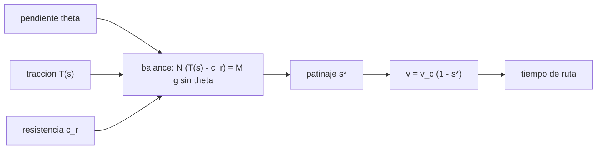

# B102-C07 — Simulación de movilidad sobre pendientes y terreno

<!-- nav:top -->
[🏠 Programa](../../../../README.md) · [📚 Bloque B102](../../../tronco-comun/B102-movilidad-de-robots-planetarios.md) · [← Anterior: B102-C06 — Dinamometría y medición de fuerzas de tracción](../B102-C06-dinamometria-y-medicion-de-fuerzas-de-traccion/CLASE.md) · [Siguiente: B102-C08 — Traversabilidad y evaluación de riesgo de terreno →](../B102-C08-traversabilidad-y-evaluacion-de-riesgo-de-terreno/CLASE.md)
<!-- /nav -->

## 1. Ubicación, nivel y alcance

Clase 7 del bloque B102. Nivel N3. Con el modelo de tracción dependiente del patinaje, la resistencia a la rodadura y el peso en pendiente, un rover avanza con una velocidad y un patinaje de equilibrio que se calculan y se simulan. Aquí integras la dinámica longitudinal con Runge–Kutta, la contrastas con la solución analítica, hallas la pendiente máxima alcanzable y estimas el tiempo de una ruta por tramos. Usas B102-C02 (tracción), B102-C03 (patinaje) y B102-C05 (estabilidad). El suelo y el rover son sintéticos.

## 2. Por qué esta clase existe

Un rover no sube cualquier pendiente aunque no vuelque. La decisión central: **¿a qué pendiente se agota la tracción, cuánto patina antes y cuánto tarda una ruta con tramos de distinta inclinación?** La respuesta separa lo que no depende de `g` (patinaje y pendiente máxima) de lo que sí (la rapidez de la transitoria).

## 3. Lo que podrás hacer al terminar

1. Plantear el balance de fuerzas longitudinales de un rover en pendiente.
2. Calcular el patinaje de equilibrio y la velocidad de avance de forma analítica.
3. Integrar la dinámica con RK4 y contrastar con la solución analítica.
4. Obtener la pendiente máxima `atan(μ − c_r)` y reconocer cuándo no hay equilibrio.
5. Estimar el tiempo de una ruta por tramos y el sobrecoste del patinaje.
6. Separar lo consultado (gravedades, escala de velocidad) de lo ilustrativo (suelo y rover).

La evidencia es la **curva de pendiente alcanzable y tiempo de ruta** del ejercicio 12 (sección 20).

## 4. Con qué llegas y cómo comprobarlo

1. ¿Qué es una ecuación diferencial ordinaria?
2. ¿Qué es el patinaje de una rueda?
3. ¿Qué componentes tiene el peso en una pendiente `θ`?
4. ¿Qué es un estado de equilibrio?
5. ¿Qué es una verificación por segunda vía?

<details>
<summary>Ver respuestas</summary>

1. Una ecuación que relaciona una función de una variable con sus derivadas. 2. `s = 1 − v/(r ω)`, la fracción de giro que no se convierte en avance. 3. `M g cos θ` normal y `M g sen θ` a lo largo. 4. Aquel en que las derivadas son nulas y las variables no cambian. 5. Calcular lo mismo con otro método y comparar.
</details>

Con cuatro o cinco aciertos, sigue; si no, repasa los prerrequisitos.

## 5. Un caso de contexto y casos de referencia

Con un suelo ilustrativo (`μ = 0,50`, `s₀ = 0,20`, `c_r = 0,10`) y una velocidad circunferencial de `0,042 m/s`, un rover en Marte sube una pendiente de `15°` con un patinaje de `0,266` y una velocidad de `30,8 mm/s`; sobre `21,8°` no hay equilibrio. Es el **ejemplo conductor**. Todo es **ilustrativo**: el suelo y el rover no son reales.

## 6. Vocabulario

La **tracción** `μ (1 − e^(−s/s₀))` es la fuerza de empuje por unidad de carga normal. La **resistencia a la rodadura** `c_r` es la fuerza por unidad de carga normal que se pierde en hundir y comprimir. El **patinaje de equilibrio** `s*` es el que iguala tracción, resistencia y pendiente. La **pendiente máxima** es `atan(μ − c_r)`. La **transitoria** es el tiempo que tarda la velocidad en llegar al equilibrio.

## 7. Modelo mental: una rueda en una cuesta de arena



*Descripción textual:* la pendiente, la tracción y la resistencia entran en un balance de fuerzas del que sale el patinaje de equilibrio; con él se obtiene la velocidad y el tiempo de ruta.

Analogía: subir una duna: cuanto más empinada, más resbalas por cada paso. Límite: modelo longitudinal, suelo homogéneo, sin vuelco ni límite de potencia; el coeficiente de resistencia se toma constante.

## 8. La explicación, paso a paso

### 8.1 Balance y equilibrio

`M dv/dt = M g [cos θ (μ (1 − e^(−s/s₀)) − c_r) − sen θ]` con `s = 1 − v/v_c`. En equilibrio `μ (1 − e^(−s/s₀)) = c_r + tan θ`, es decir `s* = −s₀ ln(1 − (c_r + tan θ)/μ)`, que existe solo si `c_r + tan θ < μ`. La pendiente máxima es `atan(μ − c_r) = atan(0,40) = 21,801°`. Ni `g` ni la masa aparecen: todos los términos escalan con el peso.

### 8.2 Simulación frente a analítica (Marte)

| Pendiente (°) | `s*` analítico | `s` simulado | `v` (mm/s) | Tiempo para 100 m (min) |
|---|---|---|---|---|
| 0 | 0,044629 | 0,044629 | 40,126 | 41,54 |
| 5 | 0,093993 | 0,093993 | 38,052 | 43,80 |
| 10 | 0,160885 | 0,160885 | 35,243 | 47,29 |
| 15 | 0,266284 | 0,266284 | 30,816 | 54,08 |
| 20 | 0,526053 | 0,526053 | 19,906 | 83,73 |

La diferencia máxima entre la simulación RK4 y la solución analítica es `1,37 × 10⁻¹⁴`, y reducir `dt` a la mitad cambia `v` en `1,49 × 10⁻¹⁶ m/s`: el sistema es muy rígido y bien resuelto. El patinaje pasa de `0,045` a `0,526` entre 0° y 20°: la pendiente máxima se acerca y el patinaje se dispara.

### 8.3 Efecto de la gravedad

A `15°` el patinaje de equilibrio es el mismo (`0,266284`) en la Tierra, Marte y la Luna, pero el tiempo para alcanzar el 99 % del régimen es `27,0 ms`, `71,0 ms` y `163,4 ms`: crece con `1/g` (`9,80665/1,62 = 6,05`; `163,4/27,0 = 6,05`). La gravedad no cambia hasta dónde sube el rover, solo la rapidez con que llega al equilibrio.

### 8.4 Más allá del máximo

A `25°` no hay patinaje de equilibrio con `s < 1`: la simulación da `v = −681 mm/s`, es decir, el rover retrocede. El valor numérico está saturado por el límite `|s| ≤ 1` del modelo y no tiene significado físico más allá del signo.

### 8.5 Ruta por tramos

Para una ruta de `30 m` a 0°, `40 m` a 10° y `30 m` a 18° en Marte:

| Longitud (m) | Pendiente (°) | `s` | `v` (mm/s) | Tiempo (min) |
|---|---|---|---|---|
| 30,0 | 0 | 0,0446 | 40,126 | 12,46 |
| 40,0 | 10 | 0,1609 | 35,243 | 18,92 |
| 30,0 | 18 | 0,3792 | 26,073 | 19,18 |

El tiempo total es `50,55 min`, frente a `39,68 min` sin patinaje: el patinaje añade el `27 %`.

## 9. Magnitudes, símbolos y unidades

| Símbolo | Qué es | Unidad | Valor / nota |
|---|---|---|---|
| `μ` | coeficiente de tracción máximo | — | 0,50 (ilustrativo) |
| `s₀` | constante de patinaje | — | 0,20 (ilustrativa) |
| `c_r` | coeficiente de resistencia | — | 0,10 (ilustrativo) |
| `v_c` | velocidad circunferencial de las ruedas | m/s | 0,042 (escala consultada) |
| `s*` | patinaje de equilibrio | — | 0,266 (15°) |
| `θ_máx` | pendiente máxima | ° | 21,801 |

## 10. Convenciones y referencias

Gravedades de las fichas de la NASA/NSSDC (Marte, Luna) y `gₙ` del NIST (Tierra). Velocidad de 152 m/h de la página de Mars 2020 de la NASA como escala de `v_c`. Eje `x` a lo largo de la pendiente, subida positiva, `v` en m/s, terreno homogéneo. Parámetros de suelo y rover ilustrativos.

## 11. De dónde sale lo que afirmamos

| ID | Fuente | Localizador | Respalda | Estado |
|---|---|---|---|---|
| S1 | NASA/NSSDC, Mars Fact Sheet — https://nssdc.gsfc.nasa.gov/planetary/factsheet/marsfact.html (consultada 2026-11-10) | fila «Surface gravity (mean)» | g media de Marte = 3,73 m/s² | Consultada |
| S2 | NASA/NSSDC, Moon Fact Sheet — https://nssdc.gsfc.nasa.gov/planetary/factsheet/moonfact.html (consultada 2026-11-10) | fila «Surface gravity» | g de la Luna = 1,62 m/s² | Consultada |
| S3 | NIST, CODATA 2022, standard acceleration of gravity — https://physics.nist.gov/cgi-bin/cuu/Value?gn (consultada 2026-11-10) | valor `gₙ` | `gₙ` = 9,806 65 m/s² (exacto por definición) | Consultada |
| S4 | NASA, Mars 2020 Perseverance Rover Components — https://science.nasa.gov/mission/mars-2020-perseverance/rover-components/ (consultada 2026-11-10) | secciones «Wheels», «Body» y descripción del rocker-bogie | seis ruedas con motor propio; ruedas de 52,5 cm de diámetro; masa 1025 kg; rocker-bogie con pivote diferencial; cruza obstáculos del tamaño de una rueda; diseñado para 45° de inclinación en cualquier dirección y evitación de más de 30°; velocidad máxima 152 m/h en terreno llano duro | Consultada |
| — | Dinámica longitudinal de un vehículo en pendiente y método de Runge–Kutta de cuarto orden | — | las verifica el laboratorio con una segunda vía | No consultada en una fuente concreta |

Límites: los parámetros del suelo no se consultaron; el modelo es longitudinal y sin potencia limitada; el valor de la velocidad de la NASA es de otro vehículo y solo da la escala.

## 12. Cómo ver el avance en pendiente

| Magnitud | Valor |
|---|---|
| pendiente máxima | 21,801° |
| `s*` a 15° | 0,266284 |
| `v` a 15° | 30,816 mm/s |
| tiempo de ruta en Marte | 50,55 min |
| RK4 frente a analítica | 1,37 × 10⁻¹⁴ |

Descripción larga: el patinaje crece rápido cerca de la pendiente máxima, que no depende de `g`; la gravedad solo cambia la rapidez de la transitoria.

## 13. Ejemplo trabajado: el patinaje a 10° de pendiente

**Paso 1 · Razón.** `(c_r + tan 10°)/μ = (0,10 + 0,1763)/0,50 = 0,5527`.

**Paso 2 · Patinaje.** `s* = −0,20 ln(1 − 0,5527) = 0,1609`.

**Paso 3 · Velocidad.** `v = 0,042 (1 − 0,1609) = 35,24 mm/s`.

**Paso 4 · Tiempo.** `100/0,03524 = 2837 s = 47,3 min`.

## 14. Distintas formas de describir el avance de un rover

**Por fuerzas:** tracción, resistencia y peso. **Por patinaje:** `s*`. **Por velocidad:** `v = v_c (1 − s*)`. **Por tiempo:** `distancia/v`. **Por límite:** `atan(μ − c_r)`.

## 15. Práctica guiada

**Ejercicio 1 · con los pasos indicados.** Calcula la pendiente máxima. *Pasos:* `μ − c_r` y arcotangente.

<details><summary>Solución comentada</summary>

`0,50 − 0,10 = 0,40`; `atan = 21,80°`.
</details>

**Ejercicio 2 · con una pista.** Calcula `s*` a `10°`. *Pista:* `−s₀ ln(1 − (c_r + tan θ)/μ)`.

<details><summary>Solución comentada</summary>

`−0,2 ln(0,4473) = 0,1609`.
</details>

**Ejercicio 3 · casi autónomo.** Calcula `v` a `10°`.

<details><summary>Solución comentada</summary>

`0,042 × (1 − 0,1609) = 0,03524 m/s`.
</details>

## 16. Práctica autónoma, transferencia e integrador

**Ejercicio 4 · autónomo.** Tiempo para 100 m a `10°`.

<details><summary>Solución comentada</summary>

`100/0,03524 = 2837 s ≈ 47,3 min`.
</details>

**Ejercicio 5 · autónomo.** `s*` a `0°`.

<details><summary>Solución comentada</summary>

`−0,2 ln(1 − 0,2) = 0,0446`.
</details>

**Ejercicio 6 · autónomo.** ¿A qué pendiente `s* = 0,5`?

<details><summary>Solución comentada</summary>

`(c_r + tan θ)/μ = 1 − e^(−2,5) = 0,918`; `tan θ = 0,359`; `θ = 19,7°`.
</details>

**Ejercicio 7 · autónomo.** Si `μ` baja a `0,45`, ¿cuál es la nueva pendiente máxima?

<details><summary>Solución comentada</summary>

`atan(0,35) = 19,3°`.
</details>

**Ejercicio 8 · autónomo.** ¿Cuántas veces es más lenta la transitoria en la Luna que en la Tierra?

<details><summary>Solución comentada</summary>

`163,4/27,0 = 6,05 = 9,80665/1,62`.
</details>

**Ejercicio 9 · transferencia.** **Transferencia.** El rover de C05 vuelca a 48,8° pero aquí no sube más de 21,8°. ¿Qué límite manda?

<details><summary>Solución comentada</summary>

La tracción: el límite de pendiente por patinaje es mucho menor que el de vuelco.
</details>

**Ejercicio 10 · transferencia.** **Transferencia.** La ruta por tramos añade un 27 % de tiempo por el patinaje. ¿Cómo lo usarías en una planificación?

<details><summary>Solución comentada</summary>

Como estimación a priori del tiempo; se corrige con el patinaje medido (C03) y se declara el margen.
</details>

**Ejercicio 11 · transferencia.** **Transferencia.** A 25° la simulación da `−681 mm/s`. ¿Hay que reportar ese valor como velocidad de retroceso?

<details><summary>Solución comentada</summary>

No: solo indica que no hay equilibrio; la magnitud está fijada por el límite del modelo.
</details>

**Ejercicio 12 · integrador.** **Integrador.** Elabora tu *curva de pendiente alcanzable y tiempo de ruta*: tabla de `s*` y `v` para varias pendientes, pendiente máxima, efecto de la gravedad en la transitoria, ruta por tramos y lista de qué es consultado e ilustrativo.

<details><summary>Solución comentada</summary>

Secciones 8.1–8.5 y la salida del laboratorio.
</details>

## 17. Laboratorio: avance de un rover sobre pendientes

El script [movilidad.py](movilidad.py) integra con RK4 la dinámica longitudinal para varias pendientes y gravedades, la contrasta con la solución analítica, comprueba la convergencia en `dt`, simula una pendiente superior al máximo y calcula una ruta por tramos (**comprueba** diferencia con la analítica < 1e-6, cambio con `dt/2` < 1e-8 y retroceso sobre la pendiente máxima).

**Datos:** gravedades de la NASA/NSSDC y del NIST y velocidad de la NASA como escala (consultadas); suelo y rover **ilustrativos**. **Predice antes de ejecutar:** ¿qué patinaje tendrá la Luna a 15°? (el mismo que Marte: 0,266). **Ejecución del 2026-11-10 (Python 3.12.9):**

```text
Python 3.12.9 (biblioteca estandar)
Rover y suelo ILUSTRATIVOS: mu = 0.5, s0 = 0.2, c_r = 0.1, v_c = 0.042 m/s; pendiente maxima atan(mu - c_r) = 21.801 deg
Patinaje de equilibrio y velocidad de avance (Marte), simulacion frente a analitica:
 pendiente [deg]  s* analitico   s simulado   v [mm/s]   tiempo para 100 m [min]
            0       0.044629     0.044629     40.126                41.54
            5       0.093993     0.093993     38.052                43.80
           10       0.160885     0.160885     35.243                47.29
           15       0.266284     0.266284     30.816                54.08
           20       0.526053     0.526053     19.906                83.73
Diferencia maxima simulacion-analitica: 1.37e-14
Efecto de la gravedad a 15 grados: mismo patinaje, distinta rapidez de la transitoria
  Tierra  g = 9.80665 m/s2 ; s = 0.266284 ; tiempo al 99 % del regimen =    27.0 ms
  Marte   g = 3.73000 m/s2 ; s = 0.266284 ; tiempo al 99 % del regimen =    71.0 ms
  Luna    g = 1.62000 m/s2 ; s = 0.266284 ; tiempo al 99 % del regimen =   163.4 ms
Cambio de v al reducir dt a la mitad: 1.49e-16 m/s
A 25 grados (> 21.8) no hay equilibrio con s < 1: v tras 3 s = -681.0 mm/s (negativa = retrocede)
Ruta por tramos (Marte): longitud [m], pendiente [deg], s, v [mm/s], tiempo [min]
   30.0      0   0.0446   40.126    12.46
   40.0     10   0.1609   35.243    18.92
   30.0     18   0.3792   26.073    19.18
  tiempo total = 50.55 min ; sin patinaje habria sido 39.68 min
Pruebas superadas.
```

```bash
python programa/clases/B102/B102-C07-simulacion-de-movilidad-sobre-pendientes-y-terreno/movilidad.py
```

**Límites:** longitudinal, suelo homogéneo, resistencia constante, sin vuelco ni límite de potencia; el retroceso del caso de 25° es solo cualitativo.

## 18. Errores frecuentes y cómo corregirlos

**Creer que la gravedad cambia la pendiente máxima.** Se corrige con 8.1 y 8.3

**Reportar la velocidad saturada de 8.4.** Se corrige con 8.4

**Ignorar que el patinaje se dispara cerca del máximo.** Se corrige con 8.2

**Presentar el suelo sintético como real.** Se corrige con la sección 10

## 19. Cómo sabrás que vas bien

Tras la sección 8: ¿qué `s*` esperabas a 10° y cuál obtuviste? Si dudas, repasa el ejemplo 13. Tras el laboratorio: ¿qué comprueba? (ver la sección 17).

## 20. Qué entregas y cómo se evalúa

El producto es tu **curva de pendiente alcanzable y tiempo de ruta** (ejercicio 12).

| Criterio | Inicial | En desarrollo | Logrado | Destacado |
|---|---|---|---|---|
| Conceptos | Los confunde | Parciales | Distingue tracción, resistencia y peso | Explica los límites |
| Cálculo | Sin unidades | Con errores | Tablas completas con unidades | Calcula casos nuevos |
| Numérico | Sin comprobar | Un caso | RK4 frente a analítica y convergencia | Interpreta las diferencias |
| Fuentes | Sin fuente | Sin fecha | Fuentes con fecha y estado | Declara lo ilustrativo y lo no consultado |
| Límites | No los nombra | Uno | Tres | Discute qué falta del modelo |

**Condiciones críticas (no se compensan con promedio):** rotular el suelo y el rover como ilustrativos; no presentar la pendiente máxima como la de un rover real; citar solo lo consultado.

## 21. Ética, seguridad y límites

Clase educativa: los modelos son simplificados y sus datos son sintéticos o ilustrativos; ningún resultado describe un rover, un suelo ni un terreno reales ni sustituye al análisis de ingeniería ni a los procedimientos de una misión. Accesibilidad: tablas equivalentes a las gráficas, fórmulas en texto, ejercicios sin conexión.

## 22. Para cerrar y seguir

El rover ilustrativo sube hasta `21,8°` en cualquier cuerpo, a `15°` patina `0,27` y avanza a `30,8 mm/s`, y la ruta de ejemplo tarda `50,6 min`. Queda una pregunta: ¿cómo se convierte la pendiente, la rugosidad y las rocas de un terreno en riesgo de navegación?

**Glosario español–inglés.** patinaje de equilibrio · *equilibrium slip*; pendiente máxima · *maximum slope*; resistencia a la rodadura · *rolling resistance*; transitoria · *transient*; tramo · *segment*.

**Continuidad.** B102-C08 estudia la traversabilidad y la evaluación de riesgo del terreno.

**Referencias:** ver sección 11.

<!-- nav:bottom -->
---

[← Anterior: B102-C06 — Dinamometría y medición de fuerzas de tracción](../B102-C06-dinamometria-y-medicion-de-fuerzas-de-traccion/CLASE.md) · [📚 Bloque B102](../../../tronco-comun/B102-movilidad-de-robots-planetarios.md) · [Siguiente: B102-C08 — Traversabilidad y evaluación de riesgo de terreno →](../B102-C08-traversabilidad-y-evaluacion-de-riesgo-de-terreno/CLASE.md)
<!-- /nav -->
