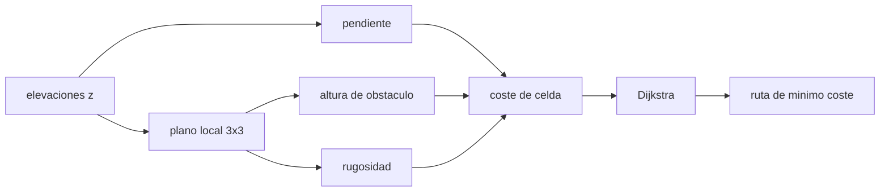

# B102-C08 — Traversabilidad y evaluación de riesgo de terreno

<!-- nav:top -->
[🏠 Programa](../../../../README.md) · [📚 Bloque B102](../../../tronco-comun/B102-movilidad-de-robots-planetarios.md) · [← Anterior: B102-C07 — Simulación de movilidad sobre pendientes y terreno](../B102-C07-simulacion-de-movilidad-sobre-pendientes-y-terreno/CLASE.md) · [Siguiente: B103-C01 — Calibración intrínseca de cámaras →](../../../tronco-comun/B103-percepcion-visual-robotica.md#b103-c01)
<!-- /nav -->

## 1. Ubicación, nivel y alcance

Clase 8 del bloque B102. Nivel N3. Un terreno es traversable si el rover puede cruzarlo sin quedar atrapado, volcar o dañarse; eso depende de la pendiente, la rugosidad y las rocas. Aquí conviertes un modelo digital de elevaciones en tres mapas (pendiente, altura de obstáculo y rugosidad), los combinas en un coste de celda con umbrales de intransitabilidad y calculas la ruta de mínimo coste con el algoritmo de Dijkstra. Usas la geología de superficies de B53 como contexto y los límites de B102-C05 y B102-C07. El terreno es sintético y no corresponde a ningún lugar real.

## 2. Por qué esta clase existe

Elegir la ruta es elegir qué riesgo se acepta. La decisión central: **¿qué celdas son intransitables, cuánto cuesta cruzar las demás y cuánto se alarga la ruta de mínimo riesgo respecto de la recta?** La respuesta depende de los umbrales, y por eso se hace un análisis de sensibilidad.

## 3. Lo que podrás hacer al terminar

1. Calcular la pendiente de un modelo de elevaciones con diferencias centrales.
2. Ajustar un plano local 3×3 y obtener la altura de obstáculo y la rugosidad.
3. Combinar pendiente, obstáculo y rugosidad en un coste de celda con umbrales.
4. Calcular la ruta de mínimo coste con Dijkstra de 8 vecinos y compararla con la recta.
5. Hacer un análisis de sensibilidad del umbral de pendiente.
6. Separar lo consultado (escala de límites del rover) de lo sintético (terreno y pesos).

La evidencia es la **mapa de riesgo y ruta sobre un terreno sintético** del ejercicio 12 (sección 20).

## 4. Con qué llegas y cómo comprobarlo

1. ¿Qué es un modelo digital de elevaciones?
2. ¿Cómo se calcula una pendiente a partir de dos alturas?
3. ¿Qué es una ruta de mínimo coste?
4. ¿Qué es un umbral?
5. ¿Qué es un dato sintético?

<details>
<summary>Ver respuestas</summary>

1. Una rejilla de alturas del terreno. 2. `atan(Δz/Δx)`. 3. La que suma el menor coste de las celdas o tramos que atraviesa. 4. Un valor que separa lo aceptable de lo inaceptable. 5. Un dato generado para el ejemplo, no medido.
</details>

Con cuatro o cinco aciertos, sigue; si no, repasa los prerrequisitos.

## 5. Un caso de contexto y casos de referencia

Un terreno sintético de `40 × 40` celdas de `2 m` con 29 rocas tiene `10,6 %` de celdas intransitables. La ruta de mínimo coste entre dos puntos a `99,0 m` mide `122,4 m`, con una pendiente máxima de `18,83°`. Es el **ejemplo conductor**. Todo es **sintético**: no es un terreno real.

## 6. Vocabulario

La **pendiente** es `atan(|∇z|)`. La **altura de obstáculo** es la diferencia entre la altura central y el plano ajustado a su vecindad 3×3. La **rugosidad** es la desviación típica de los residuos de ese plano. El **coste de celda** es `1 + w_s (pendiente/límite)² + w_r (rugosidad/límite)` y es infinito si se supera algún umbral. La **ruta de mínimo coste** se obtiene con el algoritmo de Dijkstra.

## 7. Modelo mental: un mapa de curvas de nivel pintado de riesgo



*Descripción textual:* las elevaciones dan la pendiente y, con el plano local, la altura de obstáculo y la rugosidad; los tres forman el coste de celda y Dijkstra obtiene la ruta de mínimo coste.

Analogía: un mapa de senderos con tramos marcados «prohibido» y «difícil». Límite: no hay incertidumbre en las elevaciones, el terreno es estático y no se modela la dinámica del vehículo.

## 8. La explicación, paso a paso

### 8.1 Mapas

La pendiente se calcula por diferencias centrales: `(z_(i+1) − z_(i−1))/(2 Δx)`. Un plano de `20°` da `20°` con error `3,55 × 10⁻¹⁴°` y una rugosidad de `2,90 × 10⁻¹⁵ m`: el código es consistente.

En el terreno sintético la pendiente máxima es `31,19°`. Con los umbrales ilustrativos de `30°` de pendiente, `0,20 m` de obstáculo y `0,08 m` de rugosidad, `153` de las `1444` celdas interiores (`10,6 %`) son intransitables: `2` por pendiente, `19` por obstáculo y `152` por rugosidad (se solapan). La rugosidad del plano local incluye la curvatura del terreno además de las rocas, por lo que domina.

### 8.2 Coste de celda

Las celdas transitables tienen costes entre `1,315` y `5,928` (media `3,077`). Un ejemplo: pendiente `15°` y rugosidad `0,04 m` dan `1 + 4 (15/30)² + 2 (0,04/0,08) = 3,0`.

### 8.3 Ruta de mínimo coste

Dijkstra con 8 vecinos y paso `Δx √2` o `Δx` por la media de los costes de las dos celdas encuentra una ruta de `56` celdas, `122,4 m` y coste `257,1`, frente a `99,0 m` en línea recta (`23,6 %` más larga). En la ruta, la pendiente máxima es `18,83°` y la rugosidad máxima `0,0682 m`. Con costes uniformes, Dijkstra da `98,994949 m` en una diagonal de 35 celdas, igual a la distancia octil analítica `98,994949 m`.

### 8.4 Sensibilidad del umbral de pendiente

| Límite (°) | Celdas intransitables | Longitud (m) | Coste |
|---|---|---|---|
| 20 | 446 | 122,4 | 304,6 |
| 25 | 225 | 122,4 | 274,0 |
| 30 | 153 | 122,4 | 257,1 |
| 35 | 153 | 122,4 | 246,7 |

Endurecer el límite de `30°` a `20°` triplica las celdas prohibidas y sube el coste de la ruta un `18,5 %`, aunque la geometría de la ruta no cambia. El mapa de riesgo es tan bueno como sus umbrales.

### 8.5 Qué falta

El modelo no incluye incertidumbre de las elevaciones, la resolución de la rejilla (una roca de 0,3 m en una celda de 2 m puede pasar inadvertida), las propiedades del suelo (C02) ni la dinámica del vehículo (C07). Un mapa real marcaría como «desconocidas» las celdas sin datos.

## 9. Magnitudes, símbolos y unidades

| Símbolo | Qué es | Unidad | Valor / nota |
|---|---|---|---|
| `z` | elevación | m | −9,10 a 4,14 (sintético) |
| pendiente | inclinación local | ° | máx. 31,19 |
| obstáculo | altura sobre el plano local | m | umbral 0,20 |
| rugosidad | desviación típica de residuos | m | umbral 0,08 |
| `w_s`, `w_r` | pesos del coste | — | 4; 2 (ilustrativos) |
| coste | suma ponderada de la ruta | — | 257,1 |

## 10. Convenciones y referencias

La página de Mars 2020 de la NASA da una rueda de 52,5 cm, la capacidad de cruzar obstáculos del tamaño de una rueda y la evitación de más de 30°; se usan solo como escala de los umbrales, que son ilustrativos. Rejilla de `2 m`, coordenadas `i` al norte y `j` al este, alturas en m, semilla `20261110`. Terreno estático.

## 11. De dónde sale lo que afirmamos

| ID | Fuente | Localizador | Respalda | Estado |
|---|---|---|---|---|
| S1 | NASA, Mars 2020 Perseverance Rover Components — https://science.nasa.gov/mission/mars-2020-perseverance/rover-components/ (consultada 2026-11-10) | secciones «Wheels», «Body» y descripción del rocker-bogie | seis ruedas con motor propio; ruedas de 52,5 cm de diámetro; masa 1025 kg; rocker-bogie con pivote diferencial; cruza obstáculos del tamaño de una rueda; diseñado para 45° de inclinación en cualquier dirección y evitación de más de 30°; velocidad máxima 152 m/h en terreno llano duro | Consultada |
| — | Algoritmo de Dijkstra y ajuste de un plano por mínimos cuadrados | — | las verifica el laboratorio con una segunda vía | No consultada en una fuente concreta |

Límites: los umbrales y los pesos no se consultaron; el terreno es sintético y no se infiere nada de un lugar real; los umbrales de la NASA son de otro vehículo.

## 12. Cómo ver el riesgo de un terreno

| Magnitud | Valor |
|---|---|
| celdas intransitables | 153 de 1444 (10,6 %) |
| ruta de mínimo coste | 122,4 m (recta: 99,0 m) |
| pendiente máxima en la ruta | 18,83° |
| coste con límite de 20° | 304,6 |
| Dijkstra uniforme frente a octil | 98,994949 = 98,994949 |

Descripción larga: un 10 % del terreno queda prohibido, la ruta segura es un cuarto más larga que la recta y el coste depende fuertemente de los umbrales.

## 13. Ejemplo trabajado: el coste de una celda

**Paso 1 · Pendiente.** `15°` con límite `30°`: `(15/30)² = 0,25`.

**Paso 2 · Rugosidad.** `0,04/0,08 = 0,5`.

**Paso 3 · Coste.** `1 + 4 × 0,25 + 2 × 0,5 = 3,0`.

**Paso 4 · Paso diagonal.** Con vecina de coste `2,0`: `2 × √2 × 0,5 × (3,0 + 2,0) = 7,07`.

## 14. Distintas formas de describir el riesgo de un terreno

**Por mapa:** pendiente, obstáculo y rugosidad. **Por celda:** coste o intransitable. **Por ruta:** longitud, coste y pendiente máxima. **Por sensibilidad:** cambio al mover los umbrales.

## 15. Práctica guiada

**Ejercicio 1 · con los pasos indicados.** Calcula el coste de una celda con pendiente `15°` y rugosidad `0,04 m`. *Pasos:* aplica la fórmula con límites `30°` y `0,08 m`.

<details><summary>Solución comentada</summary>

`1 + 4 × 0,25 + 2 × 0,5 = 3,0`.
</details>

**Ejercicio 2 · con una pista.** Coste de un paso diagonal entre celdas de costes `1,5` y `2,5` con `Δx = 2 m`. *Pista:* `Δx √2 × media`.

<details><summary>Solución comentada</summary>

`2 × 1,4142 × 2,0 = 5,66`.
</details>

**Ejercicio 3 · casi autónomo.** ¿Qué pendiente da el cálculo con diferencias centrales si `z` sube `0,7 m` entre los vecinos de una celda separados `4 m`?

<details><summary>Solución comentada</summary>

`atan(0,7/4) = 9,93°`.
</details>

## 16. Práctica autónoma, transferencia e integrador

**Ejercicio 4 · autónomo.** Porcentaje de celdas intransitables: 153 de 1444.

<details><summary>Solución comentada</summary>

`153/1444 = 10,6 %`.
</details>

**Ejercicio 5 · autónomo.** ¿Cuánto más larga es la ruta (122,4 m) que la recta (99,0 m)?

<details><summary>Solución comentada</summary>

`122,4/99,0 − 1 = 23,6 %`.
</details>

**Ejercicio 6 · autónomo.** Aumento del coste al pasar el límite de pendiente de `30°` a `20°`.

<details><summary>Solución comentada</summary>

`(304,6 − 257,1)/257,1 = 18,5 %`.
</details>

**Ejercicio 7 · autónomo.** Distancia octil en una diagonal de 35 celdas de `2 m`.

<details><summary>Solución comentada</summary>

`35 × 2 × √2 = 98,995 m`.
</details>

**Ejercicio 8 · autónomo.** ¿Por qué la rugosidad domina las celdas prohibidas (152 de 153)?

<details><summary>Solución comentada</summary>

El plano local 3×3 incluye la curvatura del terreno además de las rocas, y el umbral de `0,08 m` es estricto.
</details>

**Ejercicio 9 · transferencia.** **Transferencia.** El límite de evitación de 30° de la NASA es de otro vehículo. ¿Puede usarse como umbral de este mapa?

<details><summary>Solución comentada</summary>

Solo como escala y rotulado: el umbral de un rover se obtiene de su propio análisis de tracción y vuelco (C05, C07).
</details>

**Ejercicio 10 · transferencia.** **Transferencia.** Una roca de `0,3 m` ocupa una fracción de una celda de `2 m`. ¿Qué riesgo corre el mapa?

<details><summary>Solución comentada</summary>

Puede quedar promediada y no detectarse: hay que usar mayor resolución o marcar la incertidumbre.
</details>

**Ejercicio 11 · transferencia.** **Transferencia.** ¿Cambia el mapa de riesgo entre Marte y la Luna?

<details><summary>Solución comentada</summary>

La geometría y la tracción relativa no cambian con `g` (C05, C07), pero el suelo sí; con el mismo suelo y vehículo, el mapa es igual.
</details>

**Ejercicio 12 · integrador.** **Integrador.** Elabora tu *mapa de riesgo y ruta sobre un terreno sintético*: resumen de mapas, celdas prohibidas, ruta con su longitud y coste, análisis de sensibilidad y lista de qué es consultado y sintético.

<details><summary>Solución comentada</summary>

Secciones 8.1–8.5 y la salida del laboratorio.
</details>

## 17. Laboratorio: terreno sintético, riesgo y ruta de mínimo coste

El script [traversabilidad.py](traversabilidad.py) genera un terreno con semilla fija, calcula pendiente, altura de obstáculo y rugosidad, construye el coste, encuentra la ruta con Dijkstra y hace el análisis de sensibilidad (**comprueba** pendiente de un plano de 20° con error < 1e-9, rugosidad de un plano < 1e-12 y Dijkstra uniforme frente a la distancia octil < 1e-9).

**Datos:** escala de la rueda y de los límites de la NASA (consultada); terreno, umbrales y pesos **sintéticos o ilustrativos** con semilla `20261110`. **Predice antes de ejecutar:** ¿cuánto más larga que la recta será la ruta? (un 20–25 %). **Ejecución del 2026-11-10 (Python 3.12.9):**

```text
Python 3.12.9 (biblioteca estandar)
Terreno SINTETICO 40x40 celdas de 2.0 m; 29 rocas; z entre -9.10 y 4.14 m
Pendiente maxima = 31.19 deg ; celdas interiores = 1444
Celdas intransitables = 153 (10.6 %): por pendiente 2, por obstaculo 19, por rugosidad 152 (se solapan)
Coste de celda transitable: minimo 1.315, media 3.077, maximo 5.928
Ruta de minimo coste: 56 celdas ; longitud = 122.4 m ; coste = 257.1 ; distancia en linea recta = 99.0 m
  pendiente maxima en la ruta = 18.83 deg ; rugosidad maxima = 0.0682 m
Sensibilidad al umbral de pendiente:
  limite 20.0 deg: intransitables  446; longitud   122.4 m, coste    304.6
  limite 25.0 deg: intransitables  225; longitud   122.4 m, coste    274.0
  limite 30.0 deg: intransitables  153; longitud   122.4 m, coste    257.1
  limite 35.0 deg: intransitables  153; longitud   122.4 m, coste    246.7
Plano de 20 deg: error de pendiente = 3.55e-14 deg ; rugosidad = 2.90e-15 m
Dijkstra con coste uniforme (diagonal de 35 celdas): 98.994949 frente a la distancia octil 98.994949
Pruebas superadas.
```

```bash
python programa/clases/B102/B102-C08-traversabilidad-y-evaluacion-de-riesgo-de-terreno/traversabilidad.py
```

**Límites:** sin incertidumbre de elevación, terreno estático, sin suelo ni dinámica; los umbrales y pesos son ilustrativos; no es un procedimiento de misión.

## 18. Errores frecuentes y cómo corregirlos

**Tomar la recta como ruta segura.** Se corrige con 8.3

**Aplicar un umbral de otro vehículo.** Se corrige con la sección 10

**Olvidar que la rugosidad incluye la curvatura.** Se corrige con 8.1

**Presentar el terreno sintético como real.** Se corrige con la sección 10

## 19. Cómo sabrás que vas bien

Tras la sección 8: ¿qué longitud esperabas para la ruta y cuál obtuviste? Si dudas, repasa el ejemplo 13. Tras el laboratorio: ¿qué comprueba? (ver la sección 17).

## 20. Qué entregas y cómo se evalúa

El producto es tu **mapa de riesgo y ruta sobre un terreno sintético** (ejercicio 12).

| Criterio | Inicial | En desarrollo | Logrado | Destacado |
|---|---|---|---|---|
| Conceptos | Los confunde | Parciales | Distingue pendiente, obstáculo y rugosidad | Explica los límites |
| Cálculo | Sin unidades | Con errores | Tablas completas con unidades | Calcula casos nuevos |
| Numérico | Sin comprobar | Un caso | Plano conocido y octil | Interpreta las diferencias |
| Fuentes | Sin fuente | Sin fecha | Fuentes con fecha y estado | Declara lo sintético y lo no consultado |
| Límites | No los nombra | Uno | Tres | Discute qué falta del modelo |

**Condiciones críticas (no se compensan con promedio):** rotular el terreno, los umbrales y los pesos como sintéticos o ilustrativos; no presentar la ruta como una ruta real; citar solo lo consultado.

## 21. Ética, seguridad y límites

Clase educativa: los modelos son simplificados y sus datos son sintéticos o ilustrativos; ningún resultado describe un rover, un suelo ni un terreno reales ni sustituye al análisis de ingeniería ni a los procedimientos de una misión. Accesibilidad: tablas equivalentes a las gráficas, fórmulas en texto, ejercicios sin conexión.

## 22. Para cerrar y seguir

En un terreno sintético, el `10,6 %` de las celdas es intransitable y la ruta de mínimo riesgo mide `122,4 m` frente a `99,0 m` en recta, con una pendiente máxima de `18,8°`. Con esto se cierra el bloque: dinámica, suelo, patinaje, suspensión, estabilidad, medición, simulación y riesgo se suman en una misma decisión de ruta.

**Glosario español–inglés.** traversabilidad · *traversability*; modelo digital de elevaciones · *digital elevation model*; rugosidad · *roughness*; ruta de mínimo coste · *least-cost path*; análisis de sensibilidad · *sensitivity analysis*.

**Continuidad.** B103 estudia la percepción visual robótica, que alimenta los mapas de este bloque.

**Referencias:** ver sección 11.

<!-- nav:bottom -->
---

[← Anterior: B102-C07 — Simulación de movilidad sobre pendientes y terreno](../B102-C07-simulacion-de-movilidad-sobre-pendientes-y-terreno/CLASE.md) · [📚 Bloque B102](../../../tronco-comun/B102-movilidad-de-robots-planetarios.md) · [Siguiente: B103-C01 — Calibración intrínseca de cámaras →](../../../tronco-comun/B103-percepcion-visual-robotica.md#b103-c01)
<!-- /nav -->
