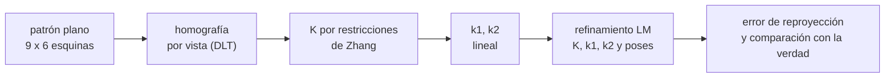

# B103-C01 — Calibración intrínseca de cámaras

<!-- nav:top -->
[🏠 Programa](../../../../README.md) · [📚 Bloque B103](../../../tronco-comun/B103-percepcion-visual-robotica.md) · [← Anterior: B102-C08 — Traversabilidad y evaluación de riesgo de terreno](../../../tronco-comun/B102-movilidad-de-robots-planetarios.md#b102-c08) · [Siguiente: B103-C02 — Calibración extrínseca y registro multisensor →](../B103-C02-calibracion-extrinseca-y-registro-multisensor/CLASE.md)
<!-- /nav -->

## 1. Ubicación, nivel y alcance

Clase 1 del bloque B103. Nivel N3. Una cámara de visión robótica no «ve» metros: ve píxeles. El modelo geométrico (focal, punto principal, distorsión) es el puente. Aquí calibras una cámara **sintética** con un patrón plano de 9 × 6 esquinas visto desde 12 poses, estimas sus parámetros intrínsecos y mides el error de reproyección. Lo que cambia respecto de [B44](../../../tronco-comun/B44-detectores-y-adquisicion-astronomica.md) es el enfoque: allí importa la física del detector; aquí, la geometría de la imagen.

## 2. Por qué esta clase existe

Un rover que mide una distancia con un error de focal del 1 % comete un error del 1 % en la distancia. La decisión central: **¿cuántas vistas y qué modelo de distorsión hacen falta para que la focal y el punto principal sean fiables, y cómo se comprueba?**

## 3. Lo que podrás hacer al terminar

1. Proyectar un punto 3D a píxeles con el modelo estenopeico y la distorsión radial `k1`, `k2`.
2. Calcular el campo de visión y el tamaño de píxel en el terreno (`Z/f`).
3. Estimar una homografía plana y extraer `K` con las restricciones de Zhang.
4. Refinar `K`, la distorsión y las poses minimizando el error de reproyección.
5. Interpretar el RMS de reproyección frente al ruido esperado y frente a la verdad conocida.
6. Decidir cuántas vistas hacen falta con un Monte Carlo, y rotular lo sintético y lo consultado.

La evidencia es la **ficha de calibración con su error de reproyección** del ejercicio 12 (sección 20).

## 4. Con qué llegas y cómo comprobarlo

1. ¿Qué es una matriz de rotación y cuánto vale su determinante?
2. ¿Qué es un píxel y en qué unidad se mide una posición en la imagen?
3. ¿Qué es un mínimo cuadrado?
4. ¿Qué es un dato sintético?
5. ¿Qué es una verificación por segunda vía?

<details>
<summary>Ver respuestas</summary>

1. Una matriz ortogonal que conserva longitudes; su determinante es +1. 2. El elemento mínimo de la imagen; las posiciones se dan en píxeles (px). 3. El ajuste que minimiza la suma de los cuadrados de los residuos. 4. Un dato generado para el ejemplo, no medido. 5. Calcular lo mismo con otro método o contra una verdad conocida y comparar.
</details>

Con cuatro o cinco aciertos, sigue; si no, repasa los prerrequisitos.

## 5. Un caso de contexto y casos de referencia

Una cámara sintética de 1280 × 960 px con `fx = fy = 800 px`, punto principal `(640; 480) px` y distorsión radial `k1 = −0,12`, `k2 = 0,05` mira un tablero de 9 × 6 esquinas con casillas de 25 mm desde 12 poses, con ruido de 0,3 px. La forma cerrada de Zhang devuelve `fx = 803,49 px` pero estima mal la distorsión (`k1 = 0,0033`); el refinamiento por Levenberg–Marquardt devuelve `fx = 802,26 px`, `k1 = −0,1214` y un RMS de reproyección de 0,4043 px. Es el **ejemplo conductor**: todo es **sintético** (semilla 103) y no corresponde a ninguna cámara real.

## 6. Vocabulario

El **modelo estenopeico** proyecta `(x, y, z)` a `u = fx·x/z + cx`, `v = fy·y/z + cy`. La **matriz intrínseca** `K` reúne `fx`, `fy`, `cx`, `cy`. La **distorsión radial** multiplica las coordenadas normalizadas por `1 + k1 r² + k2 r⁴`. Una **homografía** `H` relaciona el plano del patrón con la imagen. El **error de reproyección** es la distancia entre el píxel observado y el que predice el modelo. Los **parámetros extrínsecos** de cada vista son la rotación y la traslación del patrón respecto de la cámara.

## 7. Modelo mental



*Descripción textual:* de cada vista del patrón se obtiene una homografía; de varias homografías sale `K`; con `K` se estima la distorsión; un refinamiento conjunto ajusta todo y se mide el error de reproyección.

Analogía: calibrar una cámara es como medir la escala y la deformación de una lupa mirando una cuadrícula impresa desde varios ángulos. Límite: la cuadrícula del modelo es perfecta (esquinas exactas); en la práctica la detección de esquinas también tiene error y sesgo.

## 8. La explicación, paso a paso

### 8.1 Proyección con distorsión

Con `x = X/Z`, `y = Y/Z`, `r² = x² + y²` y `f(r) = 1 + k1 r² + k2 r⁴`, el píxel es `u = fx·x·f + cx`, `v = fy·y·f + cy`. Cada vista añade 6 parámetros de pose; el modelo común tiene 4 intrínsecos y 2 de distorsión.

### 8.2 Forma cerrada de Zhang

Cada vista da una homografía `H = K [r1 r2 t]` (DLT con las 54 esquinas). Como `r1` y `r2` son ortonormales, cada vista aporta dos restricciones sobre `B = K⁻ᵀK⁻¹`: `h1ᵀ B h2 = 0` y `h1ᵀ B h1 = h2ᵀ B h2`. Con 12 vistas hay 24 ecuaciones para 6 incógnitas de `B`; se resuelven por SVD. Zhang, en el resumen consultado, describe una solución cerrada seguida de refinamiento por máxima verosimilitud; este laboratorio hace lo mismo con una variante propia.

### 8.3 Por qué hace falta refinar

La homografía supone un modelo estenopeico perfecto; con distorsión queda sesgada. Tras 4 iteraciones de «quitar distorsión y recalibrar» la forma cerrada llega a `fx = 803,49`, `cx = 646,52` y `k1 = 0,0033` (verdad `−0,12`): la distorsión **no** se recupera, porque con el patrón ocupando la zona central (radio normalizado ≤ 0,4) su efecto es pequeño y se confunde con la focal y el punto principal. El refinamiento conjunto (Levenberg–Marquardt, jacobiano numérico, 78 parámetros y 1296 residuos) baja el RMS de 0,5966 a 0,4043 px y recupera `k1 = −0,1214`, `k2 = 0,0622`.

### 8.4 Qué error de reproyección es «bueno»

El RMS del laboratorio es el de la distancia radial (2D). Con ruido `σ = 0,3 px` por eje y 1218 grados de libertad (1296 − 78), se espera `σ·√2·√(1218/1296) = 0,411 px`. El valor obtenido (0,4043 px) coincide: el modelo explica los datos hasta el ruido. Un RMS bajo **no garantiza** parámetros correctos: la forma cerrada tenía 0,60 px con `k1` mal estimado.

### 8.5 Cuántas vistas

Monte Carlo (30 repeticiones, semillas 1000–1029): la desviación típica de `fx` es 8,80 px con 3 vistas, 3,92 con 6 y 2,82 con 12. La mejora no es `1/√n` porque la geometría de las poses importa más que su número.

## 9. Magnitudes, símbolos y unidades

| Símbolo | Qué es | Unidad | Valor / nota |
|---|---|---|---|
| `fx`, `fy` | focales en píxeles | px | 800 (verdad); 802,26 y 802,33 (estimadas) |
| `cx`, `cy` | punto principal | px | 640 y 480 (verdad) |
| `k1`, `k2` | coeficientes de distorsión radial | — | −0,12 y 0,05 (verdad) |
| `σ` | ruido de detección de esquinas | px | 0,3 (sintético) |
| RMS | error de reproyección radial | px | 0,4043 (refinado) |
| `Z/f` | tamaño de píxel en el terreno | m/px | 0,0125 a 10 m |

## 10. Convenciones y referencias

Sistema de la cámara: `x` a la derecha, `y` hacia abajo, `z` hacia delante; el patrón está en su plano `z = 0`. Unidades: píxeles en imagen y metros en el patrón. Datos sintéticos con semilla 103 (Monte Carlo: semillas 1000–1029). Modelo radial de dos coeficientes, sin distorsión tangencial ni sesgo (skew = 0). Tolerancias del laboratorio: focal dentro del 1 %, `|k1 − k1_verdad| < 0,05`, RMS < 0,5 px. Numpy 2.4.4, Python 3.12.9.

## 11. De dónde sale lo que afirmamos

| ID | Fuente | Localizador | Respalda | Estado |
|---|---|---|---|---|
| S1 | Zhang, Z., «A flexible new technique for camera calibration», Microsoft Research — https://www.microsoft.com/en-us/research/publication/a-flexible-new-technique-for-camera-calibration/ (consultada 2026-11-10) | resumen de la página | calibración con un patrón plano visto en al menos dos orientaciones, modelo de distorsión radial, solución cerrada seguida de refinamiento por máxima verosimilitud | Consultada (solo el resumen) |
| — | Relaciones estándar usadas en el laboratorio: proyección estenopeica, distorsión radial, DLT, restricciones de `B` y Levenberg–Marquardt | — | las verifica el laboratorio | No consultada en una fuente concreta (las verifica el laboratorio) |

Límites: de Zhang solo se consultó el resumen; el resto (restricciones, parametrización, refinamiento) es una implementación propia verificada contra la verdad sintética. La documentación de OpenCV no se pudo consultar (error 403).

## 12. Cómo ver el resultado

| Magnitud | Valor |
|---|---|
| `fx` forma cerrada / refinada | 803,49 / 802,26 px |
| `k1` forma cerrada / refinada | 0,0033 / −0,1214 |
| RMS forma cerrada / refinada | 0,5966 / 0,4043 px |
| RMS esperado por el ruido | 0,411 px |
| Sin modelo de distorsión | `fx = 807,42`, RMS 0,7547 px |
| Desv. típica de `fx` (3 / 6 / 12 vistas) | 8,80 / 3,92 / 2,82 px |

Descripción larga: el refinamiento baja el RMS hasta el nivel del ruido y recupera la distorsión; la dispersión de la focal cae al añadir vistas, pero con rendimientos decrecientes.

## 13. Ejemplo trabajado: proyectar un punto con distorsión

**Paso 1 · Normalizar.** Un punto `(0,05; 0,02; 0,5) m` da `x = 0,1`, `y = 0,04`.

**Paso 2 · Radio.** `r² = 0,1² + 0,04² = 0,0116`.

**Paso 3 · Factor.** `f = 1 − 0,12·0,0116 + 0,05·0,0116² = 0,998615`.

**Paso 4 · Píxel.** `u = 800·0,1·0,998615 + 640 = 719,89 px`, `v = 800·0,04·0,998615 + 480 = 511,96 px`. Sin distorsión sería `(720; 512)`: la distorsión mueve el punto 0,12 px.

## 14. Distintas formas de describir el problema

**Por geometría:** `K`, `k1`, `k2`. **Por campo de visión:** `FOV = 2·atan(W/(2 fx)) = 77,3°`. **Por escala en el terreno:** `Z/f`. **Por error:** RMS de reproyección. **Por incertidumbre:** desviación típica de `fx` entre repeticiones.

## 15. Práctica guiada

**Ejercicio 1 · con los pasos indicados.** Proyecta `(0,05; 0,02; 0,5) m` sin distorsión con `fx = fy = 800` y `(cx, cy) = (640, 480)`. *Pasos:* normaliza dividiendo por `Z`, multiplica por la focal y suma el punto principal.

<details><summary>Solución comentada</summary>

`x = 0,1`, `y = 0,04`; `u = 720 px`, `v = 512 px`.
</details>

**Ejercicio 2 · con una pista.** Calcula el campo de visión horizontal para 1280 px y `fx = 800`. *Pista:* `FOV = 2·atan(640/800)`.

<details><summary>Solución comentada</summary>

`atan(0,8) = 38,66°`, de modo que `FOV = 77,3°`.
</details>

**Ejercicio 3 · casi autónomo.** ¿Qué tamaño tiene un píxel en el terreno a `Z = 10 m`? ¿Y a 25 m?

<details><summary>Solución comentada</summary>

`Z/f`: `10/800 = 12,5 mm` y `25/800 = 31,25 mm`. A 25 m un objeto de 43 mm (una pelota de golf) ocuparía apenas 1,4 px con esta óptica sintética.
</details>

## 16. Práctica autónoma, transferencia e integrador

**Ejercicio 4 · autónomo.** Con 12 vistas de 54 esquinas, ¿cuántos residuos y cuántos parámetros hay y cuántos grados de libertad?

<details><summary>Solución comentada</summary>

Residuos: `2·54·12 = 1296`. Parámetros: `6 + 6·12 = 78`. Grados de libertad: 1218.
</details>

**Ejercicio 5 · autónomo.** Calcula el RMS radial esperado con `σ = 0,3 px` por eje y 1218 grados de libertad.

<details><summary>Solución comentada</summary>

`0,3·√2·√(1218/1296) = 0,411 px`; el laboratorio da 0,4043.
</details>

**Ejercicio 6 · autónomo.** ¿Cuántas vistas planas mínimas exige Zhang si `fx`, `fy`, `cx`, `cy` y el sesgo son incógnitas? ¿Y sin sesgo?

<details><summary>Solución comentada</summary>

Cada vista da 2 ecuaciones: 3 vistas para 5 incógnitas (con sesgo); con sesgo nulo bastan 2 vistas. En la práctica se usan muchas más por el ruido.
</details>

**Ejercicio 7 · autónomo.** Si `fx` se subestima un 1 % y un obstáculo está a 8 m, ¿cuánto error de rango produce una estimación por tamaño aparente?

<details><summary>Solución comentada</summary>

Un 1 % de la distancia: 0,08 m (la distancia por tamaño aparente es proporcional a `f`).
</details>

**Ejercicio 8 · autónomo.** El Monte Carlo da 8,80 px con 3 vistas y 2,82 con 12. ¿Es el cociente `√(12/3) = 2`?

<details><summary>Solución comentada</summary>

No: `8,80/2,82 = 3,12`. Más vistas bien distribuidas ayudan más que `1/√n`; con 3 vistas el problema está mal condicionado.
</details>

**Ejercicio 9 · transferencia.** **Transferencia.** **Transferencia.** Una cámara calibrada en un laboratorio a 20 °C opera a −60 °C en un rover. ¿Qué parámetros pueden cambiar y cómo lo comprobarías?

<details><summary>Solución comentada</summary>

La focal efectiva y el punto principal (dilatación de la óptica y la montura). Se comprueba con imágenes de un patrón a la temperatura de operación o con una recalibración en servicio; este bloque no trae datos térmicos, así que no se puede cuantificar aquí.
</details>

**Ejercicio 10 · transferencia.** **Transferencia.** **Transferencia.** Con `k1 = −0,12` y `k2 = 0,05`, ¿cuánto se desplaza la esquina de una imagen de 1280 × 960 por la distorsión?

<details><summary>Solución comentada</summary>

Esquina: `x = 0,8`, `y = 0,6`, `r² = 1`, `f = 0,93`; el píxel se acerca al centro `√((640·0,07)² + (480·0,07)²) = 56 px`. Por eso la distorsión importa en la periferia.
</details>

**Ejercicio 11 · transferencia.** **Transferencia.** **Transferencia.** Un patrón que solo ocupa el centro del encuadre da `k1 ≈ 0`. ¿Es un fallo del algoritmo?

<details><summary>Solución comentada</summary>

No: la distorsión radial es casi nula cerca del centro y no es observable allí. Hay que cubrir toda la imagen, incluidas las esquinas, con el patrón.
</details>

**Ejercicio 12 · integrador.** **Integrador.** **Integrador.** Elabora tu *ficha de calibración con su error de reproyección*: parámetros verdaderos y estimados, RMS esperado y obtenido, comparación forma cerrada frente a refinada, efecto del número de vistas y lista de qué es sintético y qué es consultado.

<details><summary>Solución comentada</summary>

Secciones 8.1–8.5 y la salida del laboratorio.
</details>

## 17. Laboratorio: calibración plana con refinamiento

El script [calibracion.py](calibracion.py) genera 12 vistas sintéticas de un tablero, calibra con la forma cerrada y con el refinamiento, y repite con 3, 6 y 12 vistas (**comprueba** focal dentro del 1 %, `k1` dentro de 0,05 y RMS < 0,5 px). Tarda unos 2 minutos.

**Datos:** todo **sintético** con semilla 103 (cámara, patrón, poses y ruido de 0,3 px); ninguna cifra describe una cámara real. **Predice antes de ejecutar:** ¿Recuperará la forma cerrada el `k1 = −0,12`? (No: queda cerca de 0; el refinamiento sí lo recupera.) **Ejecución del 2026-11-10 (Python 3.12.9):**

```text
Python 3.12.9; numpy 2.4.4
DATOS SINTETICOS (semilla 103): 12 vistas, tablero 9x6, casilla 25 mm, ruido 0.3 px
Verdad: fx=fy=800.0 cx=640.0 cy=480.0 k1=-0.12 k2=0.05
iter(1-4 forma cerrada; 5 = refinamiento LM)     fx       fy       cx       cy       k1       k2     RMS[px]
   1   807.42   809.32   650.32   475.49   0.0117  -0.2328    0.7420
   2   805.18   806.89   648.47   476.29   0.0127  -0.3248    0.6678
   3   804.07   805.64   647.29   476.84   0.0091  -0.3555    0.6251
   4   803.49   804.95   646.52   477.24   0.0033  -0.3571    0.5966
   5   802.26   802.33   639.79   481.65  -0.1214   0.0622    0.4043
Error relativo de fx = 0.283 %; de fy = 0.292 %
Error de punto principal = (-0.21, 1.65) px
Sin modelo de distorsion: fx = 807.42, RMS = 0.7547 px
Monte Carlo (30 repeticiones): desviacion de fx segun el numero de vistas
   3 vistas: media =   802.80, desv. tipica =   8.800 px
   6 vistas: media =   800.44, desv. tipica =   3.923 px
  12 vistas: media =   800.78, desv. tipica =   2.815 px
Pruebas superadas.
```

```bash
python programa/clases/B103/B103-C01-calibracion-intrinseca-de-camaras/calibracion.py
```

**Límites:** solo distorsión radial de dos coeficientes, esquinas sin sesgo, ruido gaussiano independiente y poses generadas aleatoriamente; el jacobiano es numérico y la implementación no es la de una biblioteca de calibración. No es una calibración de una cámara real.

## 18. Errores frecuentes y cómo corregirlos

**Fiarse del RMS bajo como prueba de calibración correcta.** La forma cerrada tenía 0,60 px con `k1` erróneo. Se corrige con 8.3 y 8.4.

**Calibrar con el patrón solo en el centro.** Cubre toda la imagen (ejercicio 11).

**Usar pocas vistas casi paralelas.** Varía los ángulos del patrón (8.5).

**Presentar la cámara sintética como una cámara de misión.** Se corrige con la sección 10.

## 19. Cómo sabrás que vas bien

Tras la sección 8: ¿qué RMS esperabas y cuál obtuviste? Si dudas, repasa el ejemplo 13. Tras el laboratorio: ¿qué comprueba? (ver la sección 17).

## 20. Qué entregas y cómo se evalúa

El producto es tu **ficha de calibración con su error de reproyección** (ejercicio 12).

| Criterio | Inicial | En desarrollo | Logrado | Destacado |
|---|---|---|---|---|
| Conceptos | Confunde focal y distorsión | Parciales | Explica `K`, distorsión y error de reproyección | Explica la observabilidad de la distorsión |
| Cálculo | Sin unidades | Con errores | Proyecta y calcula FOV y `Z/f` con unidades | Calcula casos nuevos |
| Numérico | Sin comprobar | Un caso | Compara con la verdad y con el RMS esperado | Interpreta las diferencias |
| Fuentes | Sin fuente | Sin fecha | Fuentes con fecha y estado | Declara lo sintético y lo no consultado |
| Límites | No los nombra | Uno | Tres | Discute qué falta del modelo |

**Condiciones críticas (no se compensan con promedio):** rotular la cámara y los datos como sintéticos; no presentar un RMS bajo como prueba de exactitud; citar solo lo consultado.

## 21. Ética, seguridad y límites

Clase educativa: los datos son sintéticos y el algoritmo es una versión mínima; ningún resultado describe una cámara de misión ni sustituye su calibración de vuelo. Accesibilidad: tablas equivalentes a las gráficas, fórmulas en texto, ejercicios sin conexión.

## 22. Para cerrar y seguir

La calibración sintética recupera la focal con un 0,28 % de error y la distorsión solo tras el refinamiento; un RMS de 0,40 px coincide con el ruido sembrado. Queda una pregunta: ¿cómo se relaciona esta cámara con el resto del robot?

**Glosario español–inglés.** matriz intrínseca · *intrinsic matrix*; distorsión radial · *radial distortion*; error de reproyección · *reprojection error*; homografía · *homography*; punto principal · *principal point*.

**Continuidad.** [B103-C02](../B103-C02-calibracion-extrinseca-y-registro-multisensor/CLASE.md) estima la pose entre la cámara y otros sensores.

**Referencias:** ver sección 11.

<!-- nav:bottom -->
---

[← Anterior: B102-C08 — Traversabilidad y evaluación de riesgo de terreno](../../../tronco-comun/B102-movilidad-de-robots-planetarios.md#b102-c08) · [📚 Bloque B103](../../../tronco-comun/B103-percepcion-visual-robotica.md) · [Siguiente: B103-C02 — Calibración extrínseca y registro multisensor →](../B103-C02-calibracion-extrinseca-y-registro-multisensor/CLASE.md)
<!-- /nav -->
