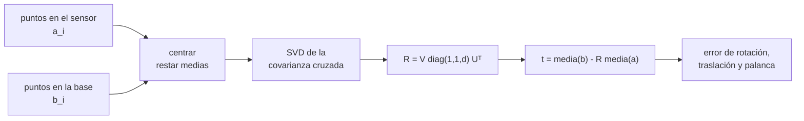

# B103-C02 — Calibración extrínseca y registro multisensor

<!-- nav:top -->
[🏠 Programa](../../../../README.md) · [📚 Bloque B103](../../../tronco-comun/B103-percepcion-visual-robotica.md) · [← Anterior: B103-C01 — Calibración intrínseca de cámaras](../B103-C01-calibracion-intrinseca-de-camaras/CLASE.md) · [Siguiente: B103-C03 — Mapas de profundidad y correspondencia estéreo →](../B103-C03-mapas-de-profundidad-y-correspondencia-estereo/CLASE.md)
<!-- /nav -->

## 1. Ubicación, nivel y alcance

Clase 2 del bloque B103. Nivel N3. La calibración intrínseca ([B103-C01](../B103-C01-calibracion-intrinseca-de-camaras/CLASE.md)) dice cómo una cámara forma su imagen; la **extrínseca** dice dónde está esa cámara respecto del robot o de otro sensor. Aquí estimas una pose rígida (rotación y traslación) a partir de correspondencias de puntos 3D con el algoritmo de Kabsch y propagas su error a un punto lejano. Todos los datos son **sintéticos**.

## 2. Por qué esta clase existe

Un error de 0,02° en la rotación entre una cámara y el brazo de un robot parece nada, pero a 10 m son 3,5 mm de error de posición, y a más distancia crece sin límite. La decisión central: **¿cuántas correspondencias y con qué geometría hacen falta para que la pose entre sensores cumpla un presupuesto de error dado?**

## 3. Lo que podrás hacer al terminar

1. Transformar puntos entre sistemas con `p_base = R p_sensor + t` y su inversa.
2. Estimar `R` y `t` con Kabsch (centrado, SVD y corrección de reflexión).
3. Medir el error de rotación (grados) y de traslación (mm) frente a una verdad conocida.
4. Propagar el error angular a un punto a distancia `d` (brazo de palanca).
5. Predecir cómo escala el error con el ruido y con el número de puntos, y detectar la geometría degenerada (puntos colineales).
6. Rotular lo sintético y declarar el presupuesto de error de un registro.

La evidencia es la **ficha de registro con presupuesto de error** del ejercicio 12 (sección 20).

## 4. Con qué llegas y cómo comprobarlo

1. ¿Qué es una matriz de rotación?
2. ¿Qué es la descomposición en valores singulares (SVD)?
3. ¿Qué es un sistema de referencia?
4. ¿Qué es la desviación típica del ruido?
5. ¿Qué es una verificación por segunda vía?

<details>
<summary>Ver respuestas</summary>

1. Una matriz ortogonal de determinante +1 que gira vectores sin cambiar su longitud. 2. La factorización `A = U Σ Vᵀ` con `U` y `V` ortogonales y `Σ` diagonal. 3. Un origen y unos ejes con los que se expresan posiciones. 4. La dispersión típica de los errores aleatorios de una medida. 5. Calcular lo mismo con otro método o contra una verdad conocida y comparar.
</details>

Con cuatro o cinco aciertos, sigue; si no, repasa los prerrequisitos.

## 5. Un caso de contexto y casos de referencia

Un sensor sintético mide `N = 12` puntos en un volumen de 1 × 1 × 1 m a entre 1 y 3 m, con ruido de 2 mm. La base del robot los conoce exactamente. Kabsch devuelve una rotación con 0,0220° de error y una traslación con 0,72 mm de error; el residuo RMS es de 3,08 mm (el ruido por tres ejes es `2 mm·√3 = 3,46 mm`). A 10 m esos 0,022° equivalen a 3,57 mm de error de posición. Es el **ejemplo conductor**: pose, puntos y ruido son **sintéticos** (semilla 103) y no describen ningún robot real.

## 6. Vocabulario

Una **pose rígida** es un par `(R, t)`. La **calibración extrínseca** estima la pose de un sensor respecto de otro marco. El **registro** alinea dos conjuntos de puntos. **Kabsch** es la solución de mínimos cuadrados para la rotación entre conjuntos de puntos centrados. El **brazo de palanca** es la distancia a la que un error angular se convierte en error lineal. Una geometría **degenerada** deja una dirección sin observar.

## 7. Modelo mental



*Descripción textual:* se centran ambos conjuntos, la SVD de su covarianza cruzada da la rotación (con corrección de reflexión), la traslación sale de las medias y el error se evalúa contra la verdad y a distancia.

Analogía: es como superponer dos transparencias con los mismos puntos marcados; una pequeña rotación de la transparencia se nota poco junto al eje y mucho en el borde. Límite: aquí los puntos tienen error solo en el sensor y todos con la misma desviación; en la práctica el error de cada punto depende de su rango.

## 8. La explicación, paso a paso

### 8.1 Transformaciones

Con `p_base = R p_sensor + t`, la inversa es `p_sensor = Rᵀ(p_base − t)`. La composición de dos poses `(R1, t1)` y `(R2, t2)` es `(R1 R2, R1 t2 + t1)`: los errores angulares de cada eslabón se suman y se amplifican por el brazo de palanca.

### 8.2 Kabsch

Se restan las medias `ā`, `b̄`, se forma `H = Σ (a_i − ā)(b_i − b̄)ᵀ` y se calcula su SVD `H = U Σ Vᵀ`. La rotación es `R = V diag(1, 1, d) Uᵀ` con `d = signo(det(V Uᵀ))`, que evita una reflexión. La traslación es `t = b̄ − R ā`. Sin ruido el error es de `6,8 × 10⁻¹⁵` grados: el código es correcto.

### 8.3 Caso con ruido

Con `N = 12` y `σ = 2 mm` el error es de 0,0220° en rotación y 0,72 mm en traslación. La palanca lo amplifica: 0,83 mm a 1 m, 1,92 mm a 5 m y 3,57 mm a 10 m. El valor a 10 m es algo menor que `0,0220°·(π/180)·10 m = 3,84 mm` porque la traslación estimada compensa parte del error angular.

### 8.4 Escalado con el ruido y con N

El Monte Carlo (500 repeticiones) muestra que el error de rotación es proporcional a `σ` (con `N = 16`: 0,0447° con 1 mm, 0,0894° con 2 mm, 0,2236° con 5 mm) y decrece con `N`: de `N = 16` a `N = 32` el cociente es 1,453, cerca de `√2 = 1,414`. De `N = 4` a `N = 16` es 3,04 y no 2: con pocos puntos la geometría aleatoria a veces es mala y la media se degrada (no se analizó la causa con más detalle).

### 8.5 Geometría degenerada

Con ocho puntos a lo largo de una recta (eje `z`), la rotación alrededor de esa recta no es observable y el error medio sube a 88,75°. Tres puntos no colineales son el mínimo; la dispersión espacial importa tanto como el número.

## 9. Magnitudes, símbolos y unidades

| Símbolo | Qué es | Unidad | Valor / nota |
|---|---|---|---|
| `R` | rotación sensor→base | — | `Rz(25°)Ry(−10°)Rx(5°)` (sintética) |
| `t` | traslación sensor→base | m | (0,35; −0,10; 0,80) (sintética) |
| `σ` | ruido de cada coordenada del sensor | mm | 1, 2 y 5 |
| `N` | número de correspondencias | — | 4 a 32 |
| `d` | distancia de un punto al origen del sensor | m | 1, 5 y 10 |
| `Δθ` | error de rotación | grados | 0,0220 (caso base) |

## 10. Convenciones y referencias

Ejes derecha-mano; `p_base = R p_sensor + t`; metros y grados. El ruido solo afecta al sensor y es gaussiano, isotropo e independiente. Datos sintéticos con semilla 103 (Monte Carlo: semillas 5000–5499 y 9000–9199). Tolerancias del laboratorio: error sin ruido < 1e-9, cociente `N = 16/32` entre 1,25 y 1,6, y error colineal más de 10 veces el del caso base. Numpy 2.4.4, Python 3.12.9.

## 11. De dónde sale lo que afirmamos

| ID | Fuente | Localizador | Respalda | Estado |
|---|---|---|---|---|
| S1 | NASA, «Rover Components» de Mars 2020 Perseverance — https://science.nasa.gov/mission/mars-2020-perseverance/rover-components/ (consultada 2026-11-10) | sección de cámaras de ingeniería | dos Navcam en color en estéreo con ojos separados unos 42 cm; seis Hazcam (cuatro delante, dos detrás); detectan un objeto del tamaño de una pelota de golf a 25 m; la página no da resolución ni campo de visión | Consultada |
| — | Relaciones estándar usadas en el laboratorio: transformaciones rígidas, Kabsch por SVD y propagación del error | — | las verifica el laboratorio | No consultada en una fuente concreta (las verifica el laboratorio) |

Límites: de la ficha de la NASA solo se usa la mención de que las dos Navcam de Perseverance forman un par estéreo de unos 42 cm de separación, lo que ilustra por qué importa la pose relativa entre cámaras; ninguna cifra de ese rover entra en el cálculo. No se consultó ningún procedimiento de calibración extrínseca de una misión.

## 12. Cómo ver el resultado

| Magnitud | Valor |
|---|---|
| Error sin ruido | 6,8 × 10⁻¹⁵ ° |
| Caso base (N = 12, 2 mm) | 0,0220 ° y 0,72 mm |
| Error a 1 / 5 / 10 m | 0,83 / 1,92 / 3,57 mm |
| Cociente N = 16/32 | 1,453 |
| Error con puntos colineales | 88,75 ° |

Descripción larga: el error angular crece linealmente con el ruido, decrece aproximadamente con `1/√N`, se amplifica con la distancia y explota si los puntos son colineales.

## 13. Ejemplo trabajado: transformar un punto

**Paso 1 · Pose.** `R = Rz(90°)`, `t = (1; 0; 0) m`.

**Paso 2 · Punto.** `p_sensor = (1; 0; 0)` se rota a `(0; 1; 0)`.

**Paso 3 · Traslación.** `p_base = (0; 1; 0) + (1; 0; 0) = (1; 1; 0) m`.

**Paso 4 · Inversa.** `Rᵀ(p_base − t) = Rz(−90°)(0; 1; 0) = (1; 0; 0)`: se recupera el punto original.

## 14. Distintas formas de describir el problema

**Por matriz:** `(R, t)`. **Por ángulo-eje:** el ángulo de `R Rᵀ_verdad`. **Por error lineal:** `Δθ·d`. **Por presupuesto:** error permitido a la distancia de trabajo. **Por geometría:** dispersión de los puntos de calibración.

## 15. Práctica guiada

**Ejercicio 1 · con los pasos indicados.** Calcula `p_base` para `R = Rz(90°)`, `t = (1; 0; 0)` y `p_sensor = (1; 0; 0)`. *Pasos:* gira primero y suma después.

<details><summary>Solución comentada</summary>

`R p = (0; 1; 0)`; `p_base = (1; 1; 0)`.
</details>

**Ejercicio 2 · con una pista.** Invierte la transformación anterior para `p_base = (1; 1; 0)`. *Pista:* resta `t` y aplica `Rᵀ`.

<details><summary>Solución comentada</summary>

`(0; 1; 0)` girado −90° da `(1; 0; 0)`.
</details>

**Ejercicio 3 · casi autónomo.** Estima el error de posición a 10 m si el error angular es 0,0220°. ¿Coincide con el laboratorio (3,57 mm)?

<details><summary>Solución comentada</summary>

`0,0220·π/180·10 = 3,84 mm`; el laboratorio da 3,57 mm porque la traslación estimada compensa parte del error. Mismo orden de magnitud.
</details>

## 16. Práctica autónoma, transferencia e integrador

**Ejercicio 4 · autónomo.** ¿Cuántas correspondencias mínimas necesita Kabsch y qué condición deben cumplir?

<details><summary>Solución comentada</summary>

Tres puntos no colineales: dos puntos dejan sin observar la rotación alrededor de la recta que los une.
</details>

**Ejercicio 5 · autónomo.** Con `N = 16`, el error de rotación a 2 mm es 0,0894°. ¿Qué esperas a 5 mm?

<details><summary>Solución comentada</summary>

Proporcional a `σ`: `0,0894·5/2 = 0,2235°`; el laboratorio da 0,2236°.
</details>

**Ejercicio 6 · autónomo.** A partir de la tabla, ¿qué error de posición a 10 m produce el error de rotación de `N = 32`, `σ = 1 mm` (0,0308°)?

<details><summary>Solución comentada</summary>

`0,0308·π/180·10 = 5,4 mm` de palanca angular pura.
</details>

**Ejercicio 7 · autónomo.** ¿Por qué el código incluye `d = signo(det(V Uᵀ))`?

<details><summary>Solución comentada</summary>

Sin él la SVD puede dar una reflexión (determinante −1), que no es una rotación; la corrección fuerza `det(R) = +1`.
</details>

**Ejercicio 8 · autónomo.** Si el residuo RMS del caso base es 3,08 mm, ¿qué ruido por coordenada sugiere?

<details><summary>Solución comentada</summary>

`3,08/√3 = 1,78 mm`, algo menor que 2 mm porque el ajuste absorbe parte del ruido con sus 6 parámetros (esperado `3,46·√(30/36) = 3,16 mm`).
</details>

**Ejercicio 9 · transferencia.** **Transferencia.** **Transferencia.** Un brazo debe colocar una herramienta con 0,5 mm de error a 1 m de la cámara. ¿Qué error angular máximo se admite si solo cuenta la rotación?

<details><summary>Solución comentada</summary>

`0,5 mm/1000 mm = 0,5 mrad = 0,029°`. Con `N = 32` y `σ = 1 mm` el laboratorio da 0,0308°: justo en el límite; hay que reducir el ruido o aumentar los puntos.
</details>

**Ejercicio 10 · transferencia.** **Transferencia.** **Transferencia.** Las dos cámaras de un rover se mueven con el chasis mientras se toman las correspondencias. ¿Qué error nuevo aparece?

<details><summary>Solución comentada</summary>

Un error de sincronización: el desfase temporal por la velocidad del movimiento se convierte en error de posición, que el modelo estático de Kabsch no contempla.
</details>

**Ejercicio 11 · transferencia.** **Transferencia.** **Transferencia.** Los puntos de calibración son esquinas de un tablero plano: ¿sirve Kabsch?

<details><summary>Solución comentada</summary>

Sí: un plano tiene puntos no colineales y fija la pose; lo importante es que cubran bien el plano y que haya vistas desde varios ángulos.
</details>

**Ejercicio 12 · integrador.** **Integrador.** **Integrador.** Elabora tu *ficha de registro con presupuesto de error*: pose verdadera y estimada, error de rotación y traslación, tabla de `σ` y `N`, error a 1, 5 y 10 m, caso degenerado y qué es sintético.

<details><summary>Solución comentada</summary>

Secciones 8.1–8.5 y la salida del laboratorio.
</details>

## 17. Laboratorio: registro rígido con Kabsch

El script [registro.py](registro.py) estima la pose sensor→base con y sin ruido, calcula el error por brazo de palanca, repite 500 veces para varios `σ` y `N`, y prueba el caso colineal (**comprueba** error sin ruido < 1e-9, escalado `√N` y degeneración).

**Datos:** todo **sintético** con semilla 103; la pose verdadera es **ilustrativa** y no es la de ningún robot. **Predice antes de ejecutar:** ¿Qué error de rotación esperas con puntos colineales? (La rotación alrededor de la recta no se observa: decenas de grados.) **Ejecución del 2026-11-10 (Python 3.12.9):**

```text
Python 3.12.9; numpy 2.4.4
DATOS SINTETICOS (semilla 103): pose verdadera ILUSTRATIVA Rz(25)Ry(-10)Rx(5) grados, t = (0.35, -0.10, 0.80) m
Sin ruido (N = 12): error de rotacion = 6.81e-15 grados, de traslacion = 1.00e-16 m
Caso base (N = 12, sigma = 2 mm): rotacion 0.0220 grados, traslacion 0.72 mm, residuo RMS 3.08 mm
Error de posicion de un punto a distancia d del origen del sensor (caso base):
  d =  1.0 m:    0.83 mm
  d =  5.0 m:    1.92 mm
  d = 10.0 m:    3.57 mm
Monte Carlo (500 repeticiones): rotacion media [grados] / traslacion media [mm]
  N \ sigma     1 mm            2 mm            5 mm
    4         0.1359/  3.28       0.2719/  6.57       0.6799/ 16.41
    8         0.0683/  1.65       0.1365/  3.30       0.3412/  8.25
   16         0.0447/  1.11       0.0894/  2.22       0.2236/  5.55
   32         0.0308/  0.75       0.0615/  1.50       0.1539/  3.76
Cociente de rotacion N = 4 frente a N = 16 (sigma = 2 mm) = 3.040 ; sqrt(16/4) = 2.000 (muestras pequenas: peor que la ley)
Cociente de rotacion N = 16 frente a N = 32 (sigma = 2 mm) = 1.453 ; esperado sqrt(32/16) = 1.414
Puntos casi colineales (a lo largo de z, 8 puntos, sigma = 2 mm), 200 repeticiones:
  error de rotacion medio = 88.75 grados (no observable alrededor de la recta)
Pruebas superadas.
```

```bash
python programa/clases/B103/B103-C02-calibracion-extrinseca-y-registro-multisensor/registro.py
```

**Límites:** ruido solo en el sensor, isotropo y gaussiano, sin errores de sincronización ni de modelo; puntos en un volumen simple; no se modela la calibración mano-ojo con poses del robot.

## 18. Errores frecuentes y cómo corregirlos

**Olvidar la corrección de reflexión.** Verifica `det(R) = +1` (ejercicio 7).

**Medir el error solo cerca del origen.** Evalúa a la distancia de trabajo (8.3).

**Usar puntos casi colineales.** Dispersa los puntos (8.5).

**Presentar la pose sintética como la de un robot real.** Se corrige con la sección 10.

## 19. Cómo sabrás que vas bien

Tras la sección 8: ¿qué error angular esperabas y qué error lineal produce a 10 m? Si dudas, repasa el ejemplo 13. Tras el laboratorio: ¿qué comprueba? (ver la sección 17).

## 20. Qué entregas y cómo se evalúa

El producto es tu **ficha de registro con presupuesto de error** (ejercicio 12).

| Criterio | Inicial | En desarrollo | Logrado | Destacado |
|---|---|---|---|---|
| Conceptos | Confunde rotación y traslación | Parciales | Explica Kabsch y la palanca | Explica la degeneración |
| Cálculo | Sin unidades | Con errores | Transforma y propaga con unidades | Calcula presupuestos nuevos |
| Numérico | Sin comprobar | Un caso | Compara con la verdad y con el escalado | Interpreta las diferencias |
| Fuentes | Sin fuente | Sin fecha | Fuentes con fecha y estado | Declara lo sintético y lo no consultado |
| Límites | No los nombra | Uno | Tres | Discute qué falta del modelo |

**Condiciones críticas (no se compensan con promedio):** rotular la pose y los puntos como sintéticos; evaluar el error a la distancia de trabajo; citar solo lo consultado.

## 21. Ética, seguridad y límites

Clase educativa: los datos son sintéticos y el modelo de error es simple; ningún resultado describe un robot real ni sustituye su calibración y verificación. Accesibilidad: tablas equivalentes a las gráficas, fórmulas en texto, ejercicios sin conexión.

## 22. Para cerrar y seguir

Con 12 puntos y 2 mm de ruido la pose entre sensores queda en 0,022° y 0,72 mm, y a 10 m esos 0,022° pesan 3,6 mm; con puntos colineales la rotación se pierde. Queda una pregunta: ¿cómo se usa una cámara calibrada y ubicada para medir distancia?

**Glosario español–inglés.** calibración extrínseca · *extrinsic calibration*; registro · *registration*; pose rígida · *rigid pose*; brazo de palanca · *lever arm*; correspondencia · *correspondence*.

**Continuidad.** [B103-C03](../B103-C03-mapas-de-profundidad-y-correspondencia-estereo/CLASE.md) construye mapas de profundidad con un par estéreo.

**Referencias:** ver sección 11.

<!-- nav:bottom -->
---

[← Anterior: B103-C01 — Calibración intrínseca de cámaras](../B103-C01-calibracion-intrinseca-de-camaras/CLASE.md) · [📚 Bloque B103](../../../tronco-comun/B103-percepcion-visual-robotica.md) · [Siguiente: B103-C03 — Mapas de profundidad y correspondencia estéreo →](../B103-C03-mapas-de-profundidad-y-correspondencia-estereo/CLASE.md)
<!-- /nav -->
