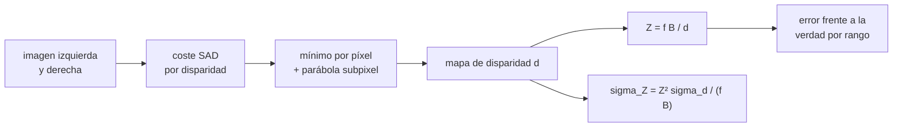

# B103-C03 — Mapas de profundidad y correspondencia estéreo

<!-- nav:top -->
[🏠 Programa](../../../../README.md) · [📚 Bloque B103](../../../tronco-comun/B103-percepcion-visual-robotica.md) · [← Anterior: B103-C02 — Calibración extrínseca y registro multisensor](../B103-C02-calibracion-extrinseca-y-registro-multisensor/CLASE.md) · [Siguiente: B103-C04 — Detección de obstáculos y mapas de traversabilidad →](../../../tronco-comun/B103-percepcion-visual-robotica.md#b103-c04)
<!-- /nav -->

## 1. Ubicación, nivel y alcance

Clase 3 del bloque B103. Nivel N3. Con dos cámaras calibradas ([B103-C01](../B103-C01-calibracion-intrinseca-de-camaras/CLASE.md)) y su pose relativa ([B103-C02](../B103-C02-calibracion-extrinseca-y-registro-multisensor/CLASE.md)), la profundidad sale de la **disparidad**: cuánto se desplaza un punto entre la imagen izquierda y la derecha. Aquí calculas un mapa de disparidad por correspondencia de bloques sobre un par **sintético** y cuantificas su error por rango. B97-C04 (en la [guía de B97](../../../tronco-comun/B97-robotica-y-construccion-extraterrestre.md)) solo presenta la idea del estéreo; esta clase calcula la disparidad y mide sus errores.

## 2. Por qué esta clase existe

La profundidad estéreo es barata y densa, pero su error crece con el cuadrado de la distancia: a 20 m una incertidumbre de 0,3 px en la disparidad son 71 cm. La decisión central: **¿hasta qué distancia se puede confiar en el mapa de profundidad para decidir si un camino es seguro, y qué línea de base lo permite?**

## 3. Lo que podrás hacer al terminar

1. Relacionar disparidad y profundidad con `d = f B/Z`.
2. Calcular un mapa de disparidad con SAD en ventana, integral de imagen y refinamiento subpixel.
3. Propagar el error de disparidad a profundidad con `σ_Z = Z² σ_d/(f B)`.
4. Medir el error por rango frente a una verdad analítica, separando el cuerpo de la distribución de sus valores atípicos.
5. Elegir una línea de base para un rango y una precisión dados.
6. Reconocer los límites del método (superficies inclinadas, falta de textura, bordes) y rotular lo sintético.

La evidencia es la **mapa de profundidad con error por rango** del ejercicio 12 (sección 20).

## 4. Con qué llegas y cómo comprobarlo

1. ¿Qué es una cámara rectificada?
2. ¿Qué es la focal en píxeles?
3. ¿Qué es una mediana y una desviación robusta?
4. ¿Qué es una línea de base?
5. ¿Qué es un dato sintético?

<details>
<summary>Ver respuestas</summary>

1. Un par cuyas filas están alineadas, de modo que los puntos correspondientes están en la misma fila. 2. La distancia del centro óptico al plano de imagen expresada en píxeles (ver B103-C01). 3. La mediana es el valor central; `1,4826·MAD` estima la desviación típica ignorando los valores atípicos. 4. La distancia entre los centros ópticos de las dos cámaras. 5. Un dato generado para el ejemplo, no medido.
</details>

Con cuatro o cinco aciertos, sigue; si no, repasa los prerrequisitos.

## 5. Un caso de contexto y casos de referencia

Un par estéreo sintético de 320 × 240 px con `f = 400 px` y `B = 0,42 m` observa un terreno plano desde 1,2 m de altura y una caja a 6 m. El cálculo de bloques 9 × 9 devuelve la caja en `6,000 m` (mediana) y, en el suelo, una desviación robusta de 0,23 a 0,32 px en la disparidad según el rango. La incertidumbre de profundidad medida concuerda con `Z²σ_d/(f B)` (cociente 0,97–1,00) y es de 0,049 m a 4–8 m, de 0,757 m a 16–32 m y de 1,486 m a 32–60 m. Es el **ejemplo conductor**: el par es **sintético** (semilla 103). La separación de 0,42 m es del orden de la que la ficha de la NASA indica para las Navcam de Perseverance, pero la cámara de aquí no es esa cámara.

## 6. Vocabulario

La **disparidad** `d` es el desplazamiento horizontal de un punto entre las dos imágenes. La **correspondencia por bloques** busca, para cada ventana de la imagen izquierda, la ventana de la derecha con menor coste (aquí, la suma de diferencias absolutas, SAD). La **línea de base** `B` es la separación entre cámaras. El **refinamiento subpixel** ajusta una parábola al coste alrededor del mínimo. La **desviación robusta** es `1,4826·MAD`. Un **valor atípico** es un píxel con un error grande por falsa correspondencia.

## 7. Modelo mental



*Descripción textual:* para cada disparidad candidata se calcula un coste en ventana; el mínimo (con refinamiento subpixel) da la disparidad, de ella sale la profundidad y su incertidumbre, y se mide el error por rango contra la verdad conocida.

Analogía: cerrar un ojo y luego el otro y ver cuánto «salta» un dedo; cuanto más lejos está, menos salta y más difícil es medir el salto. Límite: aquí el desplazamiento se mide en píxeles con una ventana rígida; en superficies inclinadas o sin textura la ventana engaña.

## 8. La explicación, paso a paso

### 8.1 Geometría

Con cámaras rectificadas, un punto a profundidad `Z` se desplaza `d = f B/Z`. Con `f = 400 px` y `B = 0,42 m`, `f B = 168 px·m`: a 10 m, `d = 16,8 px`; a 34,3 m, `d = 4,90 px`. Para un suelo plano a altura `h = 1,2 m`, la disparidad crece linealmente con la fila: `d = B (v − cy)/h`, es decir 0,35 px por fila.

### 8.2 Correspondencia y refinamiento

Para cada `d` entre 0 y 63 se calcula el valor absoluto de la diferencia entre la imagen izquierda y la derecha desplazada, sumado en una ventana de 9 × 9 (con una integral de imagen para que el coste no dependa del tamaño de ventana). El mínimo da la disparidad entera y una parábola ajustada a tres costes consecutivos la refina. Scharstein y Szeliski, en el resumen e introducción consultados, describen este tipo de problema como estéreo denso de dos vistas con geometría de cámara conocida y un mapa de disparidad por píxel.

### 8.3 Del error de disparidad al error de profundidad

De `Z = f B/d` sale `σ_Z ≈ Z² σ_d/(f B)`. El laboratorio mide `σ_d` en el suelo por rango (0,318; 0,272; 0,296 y 0,229 px) y la desviación robusta de `Z` coincide con la fórmula (cociente 1,00; 0,97; 0,99; 0,99).

### 8.4 Colas y valores atípicos

La desviación global de `d` es 1,105 px y la robusta de 0,3 px: la diferencia son las colas. El 3,84 % de los píxeles del suelo tiene un error mayor que 1 px (umbral ilustrativo): 6,49 % en 4–8 m, 3,27 % en 8–16 m y 0 % lejos. La RMSE de `Z` a 4–8 m es 0,689 m frente a 0,049 m robusto: un puñado de falsas correspondencias domina el RMSE. Un factor probable es que el suelo inclinado cambia 0,35 px por fila y una ventana de 9 filas abarca 3,15 px de disparidad, pero no se aisló la causa con un experimento propio.

### 8.5 Línea de base

Con `σ_d = 0,298 px` (robusta global) a `Z = 20 m`: `σ_Z` = 2,98 m con `B = 0,10 m`, 1,49 m con 0,20 m, 0,71 m con 0,42 m y 0,36 m con 0,84 m. Duplicar la línea de base divide el error a la mitad, pero también acerca el alcance mínimo (el objeto debe verse en las dos imágenes).

## 9. Magnitudes, símbolos y unidades

| Símbolo | Qué es | Unidad | Valor / nota |
|---|---|---|---|
| `f` | focal | px | 400 (sintética) |
| `B` | línea de base | m | 0,42 (ilustrativa) |
| `d` | disparidad | px | 4,9 a 41,7 en el suelo |
| `Z` | profundidad | m | 4,03 a 34,3 en el suelo; 6,0 la caja |
| `σ_d` | desviación robusta de la disparidad | px | 0,23–0,32 |
| `σ_Z` | incertidumbre de profundidad | m | 0,049 a 1,486 según el rango |

## 10. Convenciones y referencias

Píxeles con `u` a la derecha y `v` hacia abajo; profundidad `Z` a lo largo del eje óptico en metros. Par rectificado sin distorsión; `d = f B/Z`; suelo plano `Z = h f/(v − cy)` con `h = 1,2 m`. Datos sintéticos con semilla 103; textura aleatoria suavizada con ruido gaussiano de 2 niveles de gris. Ventana 9 × 9, `d` entero entre 0 y 63 más refinamiento parabólico. Tolerancias del laboratorio: cociente `σ_Z` medido/teórico entre 0,6 y 1,6 por debajo de 32 m y caja a 6 m ± 0,2 m. Numpy 2.4.4, Python 3.12.9.

## 11. De dónde sale lo que afirmamos

| ID | Fuente | Localizador | Respalda | Estado |
|---|---|---|---|---|
| S1 | Scharstein, D. y Szeliski, R., «A Taxonomy and Evaluation of Dense Two-Frame Stereo Correspondence Algorithms», Middlebury College / Microsoft — https://vision.middlebury.edu/stereo/taxonomy-IJCV.pdf (consultada 2026-11-10; PDF leído con PyMuPDF) | resumen e introducción (primera página) | taxonomía de métodos estéreo densos de dos vistas con geometría de cámara conocida y mapa de disparidad por píxel; evaluación con datos de verdad conocida | Consultada (solo resumen e introducción) |
| S2 | NASA, «Rover Components» de Mars 2020 Perseverance — https://science.nasa.gov/mission/mars-2020-perseverance/rover-components/ (consultada 2026-11-10) | sección de cámaras de ingeniería | dos Navcam en color en estéreo con ojos separados unos 42 cm; seis Hazcam (cuatro delante, dos detrás); detectan un objeto del tamaño de una pelota de golf a 25 m; la página no da resolución ni campo de visión | Consultada |
| — | Relaciones estándar usadas en el laboratorio: disparidad `d = f B/Z`, propagación de error y suma de diferencias absolutas | — | las verifica el laboratorio | No consultada en una fuente concreta (las verifica el laboratorio) |

Límites: de Scharstein y Szeliski solo se consultaron el resumen y la introducción (primera página), no sus experimentos ni la definición de sus métricas; de la ficha de la NASA solo el orden de magnitud de la separación de las Navcam (unos 42 cm) y la frase sobre la detección de un objeto del tamaño de una pelota de golf a 25 m, sin resolución ni óptica; el umbral de 1 px del laboratorio es ilustrativo, no el de ninguna evaluación consultada. El año y la revista de Scharstein y Szeliski no se verificaron en la página consultada.

## 12. Cómo ver el resultado

| Rango (m) | `σ_d` (px) | Malos (%) | `σ_Z` robusta (m) | `σ_Z` teórica (m) |
|---|---|---|---|---|
| 4–8 | 0,318 | 6,49 | 0,049 | 0,049 |
| 8–16 | 0,272 | 3,27 | 0,215 | 0,222 |
| 16–32 | 0,296 | 0,00 | 0,757 | 0,767 |
| 32–60 | 0,229 | 0,00 | 1,486 | 1,498 |

Descripción larga: `σ_d` es casi constante y el error de profundidad crece con `Z²`; la fórmula acierta dentro del 3 %; a corta distancia la RMSE la dominan las falsas correspondencias.

## 13. Ejemplo trabajado: profundidad desde una fila del suelo

**Paso 1 · Disparidad.** En la fila `v = 160`: `d = 0,42·(160 − 120)/1,2 = 14 px`.

**Paso 2 · Profundidad.** `Z = 400·0,42/14 = 12 m`.

**Paso 3 · Incertidumbre.** Con `σ_d = 0,3 px`: `σ_Z = 12²·0,3/168 = 0,257 m`.

**Paso 4 · Lectura.** A 12 m el mapa distingue pasos de unos 0,5 m (dos sigma), pero no rocas de 10 cm.

## 14. Distintas formas de describir el problema

**Por disparidad:** `d`. **Por profundidad:** `Z`. **Por incertidumbre:** `σ_Z`. **Por geometría:** `B`, `f`. **Por calidad:** porcentaje de píxeles malos. **Por mapa:** imagen codificada en color (con tabla equivalente).

## 15. Práctica guiada

**Ejercicio 1 · con los pasos indicados.** Calcula la disparidad de un punto a 10 m con `f = 400 px` y `B = 0,42 m`. *Pasos:* `d = f B/Z`.

<details><summary>Solución comentada</summary>

`400·0,42/10 = 16,8 px`.
</details>

**Ejercicio 2 · con una pista.** Si un punto tiene `d = 5 px`, ¿a qué profundidad está? *Pista:* `Z = f B/d`.

<details><summary>Solución comentada</summary>

`168/5 = 33,6 m`.
</details>

**Ejercicio 3 · casi autónomo.** Calcula `σ_Z` a 20 m con `σ_d = 0,3 px`.

<details><summary>Solución comentada</summary>

`20²·0,3/168 = 0,714 m`; el laboratorio da 0,71 m.
</details>

## 16. Práctica autónoma, transferencia e integrador

**Ejercicio 4 · autónomo.** Si se duplica `B`, ¿cómo cambia `σ_Z`? ¿Y si se duplica `Z`?

<details><summary>Solución comentada</summary>

Se divide por 2 con `B`; se cuadruplica con `Z`.
</details>

**Ejercicio 5 · autónomo.** ¿A qué distancia máxima `σ_Z ≤ 1 m` si `σ_d = 0,3 px`?

<details><summary>Solución comentada</summary>

`Z² ≤ 168/0,3 = 560`, `Z ≈ 23,7 m`.
</details>

**Ejercicio 6 · autónomo.** ¿A qué profundidad la disparidad es 1 px y por qué no es fiable con `σ_d = 0,3 px`?

<details><summary>Solución comentada</summary>

`Z = 168 m`; allí `σ_Z = 168²·0,3/168 = 50 m`, del orden de un tercio de la distancia.
</details>

**Ejercicio 7 · autónomo.** ¿Cuánto cambia la disparidad por fila en el suelo plano y cuánto abarca una ventana de 9 filas?

<details><summary>Solución comentada</summary>

`B/h = 0,35 px/fila`; `9·0,35 = 3,15 px`: la ventana no es «fronto-paralela».
</details>

**Ejercicio 8 · autónomo.** Con `DMAX = 64`, ¿qué distancia mínima se puede medir? ¿Qué pasa si hay que ver algo a 2 m?

<details><summary>Solución comentada</summary>

`Z_min = 168/63 ≈ 2,7 m`; a 2 m la disparidad es 84 px, fuera de rango: hay que ampliar `DMAX`.
</details>

**Ejercicio 9 · transferencia.** **Transferencia.** **Transferencia.** El mismo par se monta sobre un rover con la altura de cámara de 1,2 m. ¿Cuánto vale la disparidad del suelo a 3 m? ¿Y cuál es el mayor problema de la zona cercana?

<details><summary>Solución comentada</summary>

`d = 168/3 = 56 px`; el rango de búsqueda debe cubrirla y el campo de visión del par solapa menos cerca del rover.
</details>

**Ejercicio 10 · transferencia.** **Transferencia.** **Transferencia.** El suelo es arena lisa casi sin textura. ¿Qué le pasa al mapa de disparidad y qué se hace?

<details><summary>Solución comentada</summary>

El coste es plano y aparecen huecos o falsas correspondencias. Se invalidan píxeles con baja confianza (ratio de costes), se ilumina con luz estructurada o se usa información de otros sensores.
</details>

**Ejercicio 11 · transferencia.** **Transferencia.** **Transferencia.** Un error del 1 % en la línea de base calibrada, ¿qué error de profundidad introduce a 20 m?

<details><summary>Solución comentada</summary>

`Z ∝ B`: 1 % de 20 m = 0,2 m, sesgo sistemático que no se reduce con más vistas (se corrige calibrando, B103-C02).
</details>

**Ejercicio 12 · integrador.** **Integrador.** **Integrador.** Elabora tu *mapa de profundidad con error por rango*: tabla de `σ_d`, `σ_Z` medida y teórica y porcentaje de píxeles malos por rango, efecto de la línea de base y lista de qué es sintético y consultado.

<details><summary>Solución comentada</summary>

Secciones 8.1–8.5 y la salida del laboratorio.
</details>

## 17. Laboratorio: estéreo por bloques sobre un par sintético

El script [estereo.py](estereo.py) genera un par rectificado con suelo plano y una caja, calcula la disparidad por SAD con refinamiento subpixel, mide el error de profundidad por rango frente a la verdad analítica y lo contrasta con `Z²σ_d/(f B)` (**comprueba** cociente entre 0,6 y 1,6 y caja a 6 m ± 0,2 m).

**Datos:** par **sintético** con semilla 103; la cámara y la línea de base son **ilustrativas**. **Predice antes de ejecutar:** ¿Qué `σ_Z` esperas a 20 m con `σ_d = 0,3 px`? (0,71 m.) **Ejecución del 2026-11-10 (Python 3.12.9):**

```text
Python 3.12.9; numpy 2.4.4
DATOS SINTETICOS (semilla 103): par rectificado 320x240, f = 400 px, B = 0.42 m (ilustrativa), altura 1.2 m, caja a 6.0 m
Disparidad del suelo: de 41.65 px (fila inferior, Z = 4.03 m) a 4.90 px (fila 134, Z = 34.3 m)
Error de disparidad en el suelo (global): media = +0.104 px, sigma_d = 1.105 px
Pixeles del suelo con |error| > 1 px (umbral ilustrativo): 3.84 %
Por rango (sigma robusta = 1.4826 MAD respecto de la mediana):
Rango Z [m]    n    sigma_d [px]  malos [%]  RMSE_Z [m]  sigma_Z rob. [m]  sigma_Z teor. [m]  cociente
   4 -   8    7016        0.318       6.49       0.689            0.049             0.049      1.00
   8 -  16    4128        0.272       3.27       0.555            0.215             0.222      0.97
  16 -  32    3720        0.296       0.00       0.886            0.757             0.767      0.99
  32 -  60     496        0.229       0.00       1.601            1.486             1.498      0.99
Caja a 6.0 m (interior): Z estimada = 6.000 m (mediana), error de disparidad medio -0.001 px
Sensibilidad: sigma_Z a Z = 20 m con sigma_d robusto global = 0.298 px, segun la linea de base B:
  B = 0.10 m: sigma_Z =   2.98 m
  B = 0.20 m: sigma_Z =   1.49 m
  B = 0.42 m: sigma_Z =   0.71 m
  B = 0.84 m: sigma_Z =   0.36 m
Pruebas superadas.
```

```bash
python programa/clases/B103/B103-C03-mapas-de-profundidad-y-correspondencia-estereo/estereo.py
```

**Límites:** un único par sintético, textura rica, sin distorsión, sin oclusiones salvo los bordes de la caja y sin calibración imperfecta; el método es SAD local, no una implementación comercial; la verdad de la caja usa un desplazamiento entero.

## 18. Errores frecuentes y cómo corregirlos

**Confundir RMSE con desviación robusta.** Las colas dominan el RMSE (8.4).

**Creer que el error es constante con la distancia.** Crece con `Z²` (8.3).

**Ignorar la inclinación del suelo en la ventana.** Una ventana de 9 filas abarca 3,15 px (ejercicio 7).

**Presentar el par sintético como imágenes de un rover.** Se corrige con la sección 10.

## 19. Cómo sabrás que vas bien

Tras la sección 8: ¿qué `σ_Z` esperabas a 20 m y cuál da la tabla? Si dudas, repasa el ejemplo 13. Tras el laboratorio: ¿qué comprueba? (ver la sección 17).

## 20. Qué entregas y cómo se evalúa

El producto es tu **mapa de profundidad con error por rango** (ejercicio 12).

| Criterio | Inicial | En desarrollo | Logrado | Destacado |
|---|---|---|---|---|
| Conceptos | Confunde disparidad y profundidad | Parciales | Explica `d`, `Z` y `σ_Z` | Explica las colas y la inclinación |
| Cálculo | Sin unidades | Con errores | Calcula `d`, `Z` y `σ_Z` con unidades | Calcula casos nuevos |
| Numérico | Sin comprobar | Un caso | Compara con la verdad y con la fórmula | Interpreta las diferencias |
| Fuentes | Sin fuente | Sin fecha | Fuentes con fecha y estado | Declara lo sintético y lo no consultado |
| Límites | No los nombra | Uno | Tres | Discute qué falta del modelo |

**Condiciones críticas (no se compensan con promedio):** rotular el par como sintético; informar el error por rango y no un único número; citar solo lo consultado.

## 21. Ética, seguridad y límites

Clase educativa: el par es sintético y el método es simple; un mapa de profundidad real exige validación con datos de misión y márgenes de seguridad antes de guiar un vehículo. Accesibilidad: tablas equivalentes a las gráficas, fórmulas en texto, ejercicios sin conexión.

## 22. Para cerrar y seguir

La fórmula `σ_Z = Z²σ_d/(f B)` acierta dentro del 3 % en el par sintético: 0,049 m a 4–8 m y 1,49 m a 32–60 m. Queda una pregunta: ¿cómo se convierte un mapa de profundidad en una decisión de dónde puede ir el vehículo?

**Glosario español–inglés.** disparidad · *disparity*; línea de base · *baseline*; correspondencia estéreo · *stereo matching*; subpixel · *subpixel*; valor atípico · *outlier*.

**Continuidad.** [B103-C04](../B103-C04-deteccion-de-obstaculos-y-mapas-de-traversabilidad/CLASE.md) convierte la profundidad en un mapa de traversabilidad.

**Referencias:** ver sección 11.

<!-- nav:bottom -->
---

[← Anterior: B103-C02 — Calibración extrínseca y registro multisensor](../B103-C02-calibracion-extrinseca-y-registro-multisensor/CLASE.md) · [📚 Bloque B103](../../../tronco-comun/B103-percepcion-visual-robotica.md) · [Siguiente: B103-C04 — Detección de obstáculos y mapas de traversabilidad →](../../../tronco-comun/B103-percepcion-visual-robotica.md#b103-c04)
<!-- /nav -->
