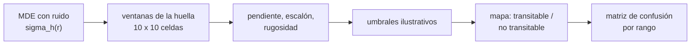

# B103-C04 — Detección de obstáculos y mapas de traversabilidad

<!-- nav:top -->
[🏠 Programa](../../../../README.md) · [📚 Bloque B103](../../../tronco-comun/B103-percepcion-visual-robotica.md) · [← Anterior: B103-C03 — Mapas de profundidad y correspondencia estéreo](../B103-C03-mapas-de-profundidad-y-correspondencia-estereo/CLASE.md) · [Siguiente: B103-C05 — Segmentación semántica de superficies planetarias →](../B103-C05-segmentacion-semantica-de-superficies-planetarias/CLASE.md)
<!-- /nav -->

## 1. Ubicación, nivel y alcance

Clase 4 del bloque B103. Nivel N3. Con un modelo digital de elevación (MDE) calculado a partir de estéreo ([B103-C03](../B103-C03-mapas-de-profundidad-y-correspondencia-estereo/CLASE.md)), el vehículo debe decidir qué celdas puede pisar. Aquí calculas pendiente, escalón y rugosidad sobre una ventana del tamaño del vehículo, clasificas el terreno y mides cuántos peligros se escapan y cuántas falsas alarmas aparecen por el ruido del MDE. B97-C03 (en la [guía de B97](../../../tronco-comun/B97-robotica-y-construccion-extraterrestre.md)) ofrece una visión general de sensores; aquí se construye el mapa. Todo el terreno es **sintético**.

## 2. Por qué esta clase existe

El ruido del MDE crece con el cuadrado del rango y, a partir de cierta distancia, la señal de un obstáculo queda por debajo del ruido. La decisión central: **¿hasta qué rango se puede clasificar el terreno de forma útil, y qué política (conservadora o corregida) elegir más allá?**

## 3. Lo que podrás hacer al terminar

1. Calcular pendiente, escalón y rugosidad en ventanas del tamaño de la huella del vehículo.
2. Clasificar celdas como transitables o no con umbrales explícitos.
3. Construir la matriz de confusión con la verdad del terreno sin ruido.
4. Cuantificar el efecto del ruido por rango sobre los falsos «seguro» y las falsas alarmas.
5. Corregir el sesgo del ruido y reconocer el compromiso entre exhaustividad de peligros y falsas alarmas.
6. Determinar el rango útil del mapa y rotular lo sintético y lo ilustrativo.

La evidencia es la **mapa de traversabilidad con matriz de confusión** del ejercicio 12 (sección 20).

## 4. Con qué llegas y cómo comprobarlo

1. ¿Qué es una pendiente en grados a partir de un desnivel?
2. ¿Qué es un modelo digital de elevación?
3. ¿Qué es un ajuste de plano por mínimos cuadrados?
4. ¿Qué es una matriz de confusión?
5. ¿Qué es el error de profundidad estéreo?

<details>
<summary>Ver respuestas</summary>

1. `atan(Δz/Δx)`; por ejemplo, 0,364 m por metro son 20°. 2. Una rejilla de alturas `z(x, y)`. 3. El plano que minimiza la suma de los cuadrados de los residuos de altura. 4. Una tabla de verdaderos y falsos positivos y negativos. 5. Una incertidumbre que crece con `Z²` (B103-C03).
</details>

Con cuatro o cinco aciertos, sigue; si no, repasa los prerrequisitos.

## 5. Un caso de contexto y casos de referencia

Un MDE sintético de 200 × 200 celdas de 0,10 m (20 × 20 m) con 40 rocas y lomas suaves se evalúa con una huella de 1 m × 1 m y umbrales ilustrativos (pendiente 20°, escalón 0,25 m, rugosidad 0,06 m). La verdad (sin ruido) declara no transitable el 60,7 % de las ventanas. Con el ruido ilustrativo `σ_h = 0,0005 r²` (5 cm a 10 m), el clasificador bruto deja pasar solo 27 peligros de 22 144, pero da un 99,4 % de falsas alarmas entre 10 y 15 m; con corrección de sesgo, las falsas alarmas bajan a 0,6 % pero se pierde el 72,9 % de los peligros en esa banda. Es el **ejemplo conductor**: terreno, ruido y umbrales son **sintéticos o ilustrativos** y no describen ningún vehículo.

## 6. Vocabulario

La **pendiente** es el ángulo del plano ajustado. El **escalón** es la diferencia entre la altura máxima y la mínima en la huella. La **rugosidad** es la desviación típica del residuo respecto del plano. La **traversabilidad** es la capacidad de un vehículo de cruzar una celda. Un **falso «seguro»** es un peligro declarado transitable; una **falsa alarma** es una celda segura declarada peligrosa. La **corrección de sesgo** resta el aporte esperado del ruido.

## 7. Modelo mental



*Descripción textual:* el MDE ruidoso se evalúa en ventanas del tamaño del vehículo; de cada una se calculan pendiente, escalón y rugosidad, se aplican los umbrales y el mapa resultante se compara con la verdad por rango.

Analogía: ver un suelo a través de un cristal esmerilado; cerca distingues una piedra, lejos todo parece rugoso. Límite: el ruido real del MDE no es gaussiano ni independiente entre celdas y depende de la textura.

## 8. La explicación, paso a paso

### 8.1 Métricas en una ventana

En cada ventana de 10 × 10 celdas se ajusta un plano `z = z̄ + a x + b y` con fórmulas cerradas en rejilla regular (`a = Σ x z/Σ x²`, `b` análogo). La **pendiente** es `atan(√(a² + b²))`, la **rugosidad** es la desviación típica del residuo y el **escalón** es `máx − mín`. Una celda es no transitable si supera cualquiera de los tres umbrales (20°, 0,25 m, 0,06 m; todos ilustrativos).

### 8.2 Verdad y control

La verdad se calcula con el MDE sin ruido: 60,7 % de las ventanas no transitables, pendiente máxima 35,8° y escalón máximo 0,79 m. Con el mismo clasificador sobre el MDE sin ruido hay 0 diferencias: el código es consistente.

### 8.3 Efecto del ruido

El ruido ilustrativo `σ_h(r) = 0,0005 r²` es de 0,2 cm a 2 m, 1,25 cm a 5 m, 5 cm a 10 m y 20 cm a 20 m. El ruido **infla** el escalón (el máximo menos el mínimo de 100 muestras tiene una esperanza de unas 5,0 σ) y la rugosidad. El clasificador bruto produce falsas alarmas del 5,3 % (0–5 m), 45,4 % (5–10 m), 99,4 % (10–15 m) y 100 % (15–20 m), con muy pocos falsos «seguro»: 22, 5, 0 y 0.

### 8.4 Corrección de sesgo y compromiso

Se resta `0,97 σ²` a la rugosidad al cuadrado y `5,0 σ` al escalón. Las falsas alarmas caen a 0,0 %, 0,3 %, 0,6 % y 12,7 %, pero los falsos «seguro» suben a 526, 1937, 4182 y 2477 celdas (8,5 %, 36,6 %, 72,9 % y 50,5 % de los peligros de cada banda). Totales: el bruto tiene exhaustividad de peligro de 0,9988 con 9547 falsas alarmas; el corregido, de 0,5881 con 501. Es un compromiso real: la corrección «limpia» el mapa porque asume que no hay señal bajo el ruido, y los obstáculos pequeños lejanos se pierden.

### 8.5 Rango útil

El escalón esperado por ruido iguala el umbral cuando `5·0,0005 r² = 0,25`, es decir `r = 10 m`. Más allá, un escalón de 0,25 m no se distingue del ruido. La política razonable: usar el mapa corregido cerca, el conservador (bruto) a media distancia y **tratar como desconocido** lo que queda más allá del rango útil, o mejorar la medida (línea de base mayor, ver B103-C03).

## 9. Magnitudes, símbolos y unidades

| Símbolo | Qué es | Unidad | Valor / nota |
|---|---|---|---|
| `Δz` | desnivel | m | 0,364 m por metro = 20° |
| Huella | lado de la ventana | m | 1,0 (ilustrativa) |
| Pendiente máx. | umbral | grados | 20 (ilustrativo) |
| Escalón máx. | umbral | m | 0,25 (ilustrativo) |
| Rugosidad máx. | umbral | m | 0,06 (ilustrativo) |
| `σ_h` | ruido de altura del MDE | m | 0,0005 r² (ilustrativo) |

## 10. Convenciones y referencias

Ejes `x`, `y` en el plano y `z` hacia arriba; el sensor está en el borde `y = 0` y el rango es `y`. MDE de 0,10 m de celda y 200 × 200 celdas. Datos sintéticos con semilla 103. El ruido `σ_h` es ilustrativo (su dependencia con `r²` sigue a B103-C03; la constante no se midió). Los umbrales y la huella no vienen de ninguna misión. Tolerancias: 0 errores sin ruido; el ajuste de sesgo no puede reducir los falsos «seguro». Numpy 2.4.4, Python 3.12.9.

## 11. De dónde sale lo que afirmamos

| ID | Fuente | Localizador | Respalda | Estado |
|---|---|---|---|---|
| — | Relaciones estándar usadas en el laboratorio: ajuste de plano por mínimos cuadrados, estadística de orden del rango de 100 normales y matriz de confusión | — | las verifica el laboratorio | No consultada en una fuente concreta (las verifica el laboratorio) |

Límites: no se consultó ninguna fuente específica para esta clase: los umbrales y la huella son ilustrativos y no proceden de una misión; el mapa no incluye el suelo blando ni la tracción, que la geometría no ve.

## 12. Cómo ver el resultado

| Banda de rango | Falsos «seguro» bruto | Falsos «seguro» corregido | Falsas alarmas bruto / corregido |
|---|---|---|---|
| 0–5 m | 22 (0,4 %) | 526 (8,5 %) | 5,3 % / 0,0 % |
| 5–10 m | 5 (0,1 %) | 1937 (36,6 %) | 45,4 % / 0,3 % |
| 10–15 m | 0 (0,0 %) | 4182 (72,9 %) | 99,4 % / 0,6 % |
| 15–20 m | 0 (0,0 %) | 2477 (50,5 %) | 100,0 % / 12,7 % |

Descripción larga: el clasificador bruto no deja pasar peligros pero declara casi todo lo lejano como peligroso; el corregido limpia el mapa y pierde obstáculos que están por debajo del ruido.

## 13. Ejemplo trabajado: pendiente y rango útil

**Paso 1 · Pendiente.** Un plano sube 0,36 m en 1 m: `atan(0,36) = 19,8°`, justo bajo el umbral de 20°.

**Paso 2 · Ruido.** A 10 m, `σ_h = 0,0005·100 = 0,05 m`.

**Paso 3 · Escalón por ruido.** `5·0,05 = 0,25 m`: igual al umbral.

**Paso 4 · Conclusión.** Más allá de 10 m el escalón de umbral no se distingue del ruido.

## 14. Distintas formas de describir el problema

**Por celda:** transitable/no. **Por métrica:** pendiente, escalón, rugosidad. **Por error:** matriz de confusión por rango. **Por política:** bruto, corregido, desconocido. **Por mapa:** rejilla con colores y leyenda con texto.

## 15. Práctica guiada

**Ejercicio 1 · con los pasos indicados.** Calcula la pendiente de un plano que sube 0,36 m en 1 m. *Pasos:* `atan(Δz/Δx)`.

<details><summary>Solución comentada</summary>

`atan(0,36) = 19,8°`.
</details>

**Ejercicio 2 · con una pista.** ¿Qué desnivel por metro corresponde a 20°? *Pista:* `tan 20°`.

<details><summary>Solución comentada</summary>

`0,364 m` por metro.
</details>

**Ejercicio 3 · casi autónomo.** Calcula `σ_h` a 5, 10 y 20 m con `0,0005 r²`.

<details><summary>Solución comentada</summary>

1,25 cm, 5 cm y 20 cm.
</details>

## 16. Práctica autónoma, transferencia e integrador

**Ejercicio 4 · autónomo.** ¿A qué rango el escalón esperado por ruido (`5σ`) iguala 0,25 m?

<details><summary>Solución comentada</summary>

`5·0,0005 r² = 0,25` → `r = 10 m`.
</details>

**Ejercicio 5 · autónomo.** ¿A qué rango el ruido por sí solo da una rugosidad de 0,06 m (`√0,97 σ = 0,06`)?

<details><summary>Solución comentada</summary>

`σ = 0,061 m`, `r = √(0,061/0,0005) = 11,0 m`.
</details>

**Ejercicio 6 · autónomo.** ¿Cuántas ventanas de 10 × 10 caben en un MDE de 200 × 200?

<details><summary>Solución comentada</summary>

`191² = 36 481`, que coincide con la suma de las bandas del laboratorio.
</details>

**Ejercicio 7 · autónomo.** Calcula la exhaustividad de peligros del clasificador bruto con TP = 22 117 y FN = 27.

<details><summary>Solución comentada</summary>

`22117/(22117 + 27) = 0,9988`.
</details>

**Ejercicio 8 · autónomo.** Calcula la tasa global de falsas alarmas del bruto (FP = 9547, TN = 4790) y del corregido (FP = 501, TN = 13 836).

<details><summary>Solución comentada</summary>

Bruto: `9547/14 337 = 66,6 %`; corregido: `501/14 337 = 3,5 %`.
</details>

**Ejercicio 9 · transferencia.** **Transferencia.** **Transferencia.** Si el umbral de escalón baja a 0,15 m por un vehículo más pequeño, ¿qué rango útil queda?

<details><summary>Solución comentada</summary>

`5·0,0005 r² = 0,15` → `r = 7,75 m`: un umbral más estricto acorta el rango útil.
</details>

**Ejercicio 10 · transferencia.** **Transferencia.** **Transferencia.** Detrás de una roca hay una celda sin datos (sombra de oclusión). ¿Cómo debe tratarse en el mapa?

<details><summary>Solución comentada</summary>

Como desconocida y, para planificar, no transitable hasta que se observe desde otro punto de vista.
</details>

**Ejercicio 11 · transferencia.** **Transferencia.** **Transferencia.** Una celda plana de arena blanda pasa los tres umbrales. ¿Qué no ve la geometría?

<details><summary>Solución comentada</summary>

El hundimiento y el deslizamiento de las ruedas: la traversabilidad real también depende de las propiedades del suelo, que este mapa no incluye.
</details>

**Ejercicio 12 · integrador.** **Integrador.** **Integrador.** Elabora tu *mapa de traversabilidad con matriz de confusión*: métricas, umbrales, verdad, confusión por banda de rango con ambas políticas, rango útil y lista de qué es sintético e ilustrativo.

<details><summary>Solución comentada</summary>

Secciones 8.1–8.5 y la salida del laboratorio.
</details>

## 17. Laboratorio: traversabilidad sobre un MDE sintético con ruido

El script [traversabilidad.py](traversabilidad.py) genera un MDE con rocas, calcula pendiente, escalón y rugosidad en ventanas, clasifica con y sin corrección de sesgo y muestra la matriz de confusión por rango (**comprueba** 0 errores sin ruido y el compromiso entre falsos «seguro» y falsas alarmas).

**Datos:** MDE **sintético** con semilla 103; el ruido, los umbrales y la huella son **ilustrativos**. **Predice antes de ejecutar:** ¿A partir de qué rango el mapa bruto deja de ser útil? (Hacia 10 m, donde `5σ` iguala el umbral.) **Ejecución del 2026-11-10 (Python 3.12.9):**

```text
Python 3.12.9; numpy 2.4.4
DATOS SINTETICOS (semilla 103): MDE 200x200 celdas de 0.1 m, 40 rocas, huella 1.0 m, umbrales ILUSTRATIVOS (pendiente 20.0 grados, escalon 0.25 m, rugosidad 0.06 m)
Verdad: 60.7 % de las ventanas NO transitables; pendiente maxima 35.8 grados, escalon maximo 0.79 m
Sin ruido (control): errores de clasificacion = 0
Ruido del MDE por rango: sigma_h = 0.2 cm a 2 m, 1.2 cm a 5 m, 5.0 cm a 10 m, 20.0 cm a 20 m
Banda de rango [m]   n   falsos 'seguro' sin correccion   con correccion de sesgo    falsas alarmas sin / con
   0 -  5     8786      22 (  0.4 % de peligro)     526 (  8.5 %)     5.3 % /   0.0 %
   5 - 10     9550       5 (  0.1 % de peligro)    1937 ( 36.6 %)    45.4 % /   0.3 %
  10 - 15     9550       0 (  0.0 % de peligro)    4182 ( 72.9 %)    99.4 % /   0.6 %
  15 - 20     8595       0 (  0.0 % de peligro)    2477 ( 50.5 %)   100.0 % /  12.7 %
Total sin correccion:  TP=22117 FN=27 FP=9547 TN=4790 ; exhaustividad de peligro = 0.9988
Total con correccion:  TP=13022 FN=9122 FP=501 TN=13836 ; exhaustividad de peligro = 0.5881
Fraccion transitable del MDE ruidoso (sin / con correccion): 13.2 % / 62.9 % ; verdad: 39.3 %
Pruebas superadas.
```

```bash
python programa/clases/B103/B103-C04-deteccion-de-obstaculos-y-mapas-de-traversabilidad/traversabilidad.py
```

**Límites:** ruido independiente por celda y solo vertical, un único terreno, sin oclusiones ni suelo blando, umbrales arbitrarios; no hay validación con datos de misión.

## 18. Errores frecuentes y cómo corregirlos

**Evaluar solo la exactitud global.** Mira falsos «seguro» y falsas alarmas por separado y por rango (8.3, 8.4).

**Creer que quitar el ruido siempre mejora el mapa.** Puede ocultar obstáculos bajo el ruido (8.4).

**Clasificar más allá del rango útil.** Marca lo lejano como desconocido (8.5).

**Presentar el terreno sintético como un sitio real.** Se corrige con la sección 10.

## 19. Cómo sabrás que vas bien

Tras la sección 8: ¿qué rango útil calculaste y por qué? Si dudas, repasa el ejemplo 13. Tras el laboratorio: ¿qué comprueba? (ver la sección 17).

## 20. Qué entregas y cómo se evalúa

El producto es tu **mapa de traversabilidad con matriz de confusión** (ejercicio 12).

| Criterio | Inicial | En desarrollo | Logrado | Destacado |
|---|---|---|---|---|
| Conceptos | Confunde falso «seguro» y falsa alarma | Parciales | Explica métricas, umbrales y confusión | Explica el compromiso y el rango útil |
| Cálculo | Sin unidades | Con errores | Calcula pendiente, `σ_h` y rango útil con unidades | Calcula casos nuevos |
| Numérico | Sin comprobar | Un caso | Compara con la verdad sin ruido | Interpreta el compromiso |
| Fuentes | Sin fuente | Sin fecha | Declara que no se consultó fuente específica | Declara lo sintético y lo ilustrativo |
| Límites | No los nombra | Uno | Tres | Discute qué falta del modelo |

**Condiciones críticas (no se compensan con promedio):** rotular el MDE, el ruido y los umbrales como sintéticos o ilustrativos; informar los falsos «seguro» por rango; no presentar el mapa como validación para un vehículo.

## 21. Ética, seguridad y límites

Clase educativa: un falso «seguro» puede llevar a un vehículo a un peligro. Ningún umbral ni mapa de aquí sirve para operar un vehículo real sin validación con datos de misión y verificación independiente. Accesibilidad: tablas equivalentes a las gráficas, fórmulas en texto, ejercicios sin conexión.

## 22. Para cerrar y seguir

Con ruido ilustrativo, el mapa bruto casi no deja pasar peligros pero a más de 10 m declara todo peligroso (99,4 %); la corrección limpia el mapa y pierde el 72,9 % de los peligros de esa banda. Queda una pregunta: ¿puede una máquina de aprendizaje dar significado a la imagen, más allá de la geometría?

**Glosario español–inglés.** traversabilidad · *traversability*; rugosidad · *roughness*; escalón · *step height*; falso negativo · *false negative*; modelo digital de elevación · *digital elevation model*.

**Continuidad.** [B103-C05](../B103-C05-segmentacion-semantica-de-superficies-planetarias/CLASE.md) segmenta la imagen en clases de superficie.

**Referencias:** ver sección 11.

<!-- nav:bottom -->
---

[← Anterior: B103-C03 — Mapas de profundidad y correspondencia estéreo](../B103-C03-mapas-de-profundidad-y-correspondencia-estereo/CLASE.md) · [📚 Bloque B103](../../../tronco-comun/B103-percepcion-visual-robotica.md) · [Siguiente: B103-C05 — Segmentación semántica de superficies planetarias →](../B103-C05-segmentacion-semantica-de-superficies-planetarias/CLASE.md)
<!-- /nav -->
