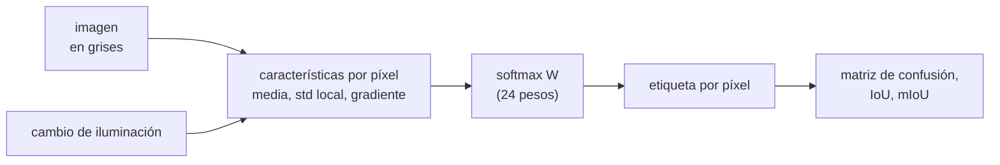

# B103-C05 — Segmentación semántica de superficies planetarias

<!-- nav:top -->
[🏠 Programa](../../../../README.md) · [📚 Bloque B103](../../../tronco-comun/B103-percepcion-visual-robotica.md) · [← Anterior: B103-C04 — Detección de obstáculos y mapas de traversabilidad](../B103-C04-deteccion-de-obstaculos-y-mapas-de-traversabilidad/CLASE.md) · [Siguiente: B103-C06 — Detección y catalogación de rocas en imágenes de superficie →](../../../tronco-comun/B103-percepcion-visual-robotica.md#b103-c06)
<!-- /nav -->

## 1. Ubicación, nivel y alcance

Clase 5 del bloque B103. Nivel N3. La geometría ([B103-C04](../B103-C04-deteccion-de-obstaculos-y-mapas-de-traversabilidad/CLASE.md)) dice dónde hay desniveles; la **segmentación semántica** dice qué es cada píxel (arena, lecho rocoso, roca, sombra). Aquí entrenas un clasificador de píxeles con regresión softmax, escrita desde cero, sobre imágenes **sintéticas**, mides su IoU por clase y lo pruebas con un cambio de iluminación. La segmentación clásica de imágenes de B15 no usa aprendizaje; esta clase es la introducción de aprendizaje automático del bloque (no existe un bloque de aprendizaje automático en el programa).

## 2. Por qué esta clase existe

Un modelo que acierta el 91 % de los píxeles en el dominio de entrenamiento puede acertar el 45 % cuando cambia la luz. La decisión central: **¿qué métrica y qué prueba demuestran que un segmentador es utilizable en otras condiciones, y no solo en las de entrenamiento?**

## 3. Lo que podrás hacer al terminar

1. Definir características por píxel (media, desviación local, gradiente) y estandarizarlas.
2. Entrenar una regresión softmax multiclase con descenso de gradiente.
3. Calcular exactitud, IoU por clase, mIoU y matriz de confusión.
4. Comparar el modelo con la línea base de la clase mayoritaria y explicar por qué la exactitud engaña con clases desbalanceadas.
5. Medir la degradación por cambio de dominio (iluminación) y probar una normalización local.
6. Rotular los datos como sintéticos y declarar que ninguna cifra describe una superficie real.

La evidencia es la **informe de IoU por clase en dos dominios** del ejercicio 12 (sección 20).

## 4. Con qué llegas y cómo comprobarlo

1. ¿Qué es una clase y una etiqueta de píxel?
2. ¿Qué es el descenso de gradiente?
3. ¿Qué es una matriz de confusión?
4. ¿Qué es la desviación típica local?
5. ¿Qué es un dato sintético?

<details>
<summary>Ver respuestas</summary>

1. Una categoría (arena, roca…) y la verdad que se asigna a cada píxel. 2. Un método iterativo que reduce una función de pérdida moviéndose contra su gradiente. 3. Una tabla con la verdad en las filas y la predicción en las columnas. 4. La dispersión de los valores en una vecindad del píxel. 5. Un dato generado para el ejemplo, no medido.
</details>

Con cuatro o cinco aciertos, sigue; si no, repasa los prerrequisitos.

## 5. Un caso de contexto y casos de referencia

Seis imágenes sintéticas de 128 × 128 px con cuatro clases (arena 44,2 %, lecho 44,4 %, roca 8,1 %, sombra 3,3 %) entrenan una regresión softmax con seis características por píxel. En imágenes nuevas del mismo dominio logra una exactitud de 91,14 % y un mIoU de 0,759 (IoU de arena 0,850, lecho 0,871, roca 0,665 y sombra 0,650); predecir siempre «lecho» daría 44,4 %. Con las mismas escenas bajo otra iluminación (ganancia 0,6 y desplazamiento −10) la exactitud cae a 45,09 % y el mIoU a 0,113; con una normalización local queda en 79,91 % y mIoU 0,567. Es el **ejemplo conductor**: todo es **sintético** (semilla 103) y no describe ninguna superficie real.

## 6. Vocabulario

La **segmentación semántica** asigna una clase a cada píxel. La **regresión softmax** modela la probabilidad de cada clase con `p_k = exp(z_k)/Σ exp(z_j)`, `z = x W`. La **intersección sobre unión** (IoU) de una clase es `TP/(TP + FP + FN)`. El **mIoU** es el promedio de los IoU por clase. El **cambio de dominio** es una diferencia entre las condiciones de entrenamiento y de uso. Una **línea base** es un modelo trivial con el que se compara.

## 7. Modelo mental



*Descripción textual:* de la imagen se extraen características por píxel, un clasificador softmax asigna la clase y se evalúa con la matriz de confusión; el cambio de iluminación altera las características y degrada el resultado.

Analogía: aprender a distinguir arena de roca solo por su brillo en un día soleado; con nubes, el brillo cambia y la regla falla. Límite: aquí el clasificador solo ve una vecindad pequeña; un modelo convolucional profundo usa más contexto, pero comparte el riesgo de cambio de dominio.

## 8. La explicación, paso a paso

### 8.1 Características

Para cada píxel: media 3 × 3, media 9 × 9, desviación típica 5 × 5, módulo del gradiente de la media 3 × 3, media 21 × 21 y un sesgo (seis valores). Se estandarizan con la media y desviación del entrenamiento.

### 8.2 Modelo y entrenamiento

La probabilidad es `p = softmax(x W)` con `W` de 6 × 4 = 24 pesos. Se minimiza la entropía cruzada con descenso de gradiente de lote completo (400 iteraciones, paso 0,5, L2 = 10⁻³). No hay biblioteca de aprendizaje automático: el gradiente es `Xᵀ(P − Y)/n`.

### 8.3 Métricas

En la prueba del mismo dominio: exactitud 91,14 % (59 732 de 65 536 píxeles), IoU por clase 0,850; 0,871; 0,665 y 0,650, mIoU 0,759. La roca (8,1 % de los píxeles) y la sombra (3,3 %) tienen los IoU más bajos: la exactitud global los oculta. Para la roca, `TP = 3983`, `FP = 737` y `FN = 1271`, de donde `IoU = 3983/5991 = 0,665`.

### 8.4 Cambio de dominio

Con ganancia 0,6 y desplazamiento −10 los niveles medios pasan de 150, 110, 175 y 45 a 80, 56, 95 y 17. El modelo, que aprendió umbrales de brillo absolutos, falla: exactitud 45,09 %, IoU de lecho 0,451 y las demás clases 0,000. Ese patrón (un IoU igual a la frecuencia de «lecho» y el resto en cero) indica que casi todo se predice como lecho; la matriz de confusión de esta condición no se imprimió.

### 8.5 Normalización local

Restar la media 31 × 31 y dividir por la desviación local hace las características invariantes a una ganancia y un desplazamiento: el resultado con y sin cambio es idéntico (79,91 %; mIoU 0,567). El precio: se pierde el brillo absoluto, que distingue sombra y roca, y el mIoU en el dominio original baja de 0,759 a 0,567. Es un compromiso entre robustez y exactitud, no una solución gratuita.

## 9. Magnitudes, símbolos y unidades

| Símbolo | Qué es | Unidad | Valor / nota |
|---|---|---|---|
| Exactitud | fracción de píxeles bien clasificados | % | 91,14 (prueba) |
| IoU | `TP/(TP + FP + FN)` por clase | — | 0,650 a 0,871 |
| mIoU | promedio de los IoU | — | 0,759 (prueba); 0,113 (cambio) |
| `W` | pesos del modelo | — | 6 × 4 = 24 |
| Ganancia / desplazamiento | cambio de iluminación | — / niveles | 0,6 / −10 (ilustrativo) |
| Imágenes | entrenamiento / prueba | — | 6 / 4 |

## 10. Convenciones y referencias

Imágenes en niveles de gris de 0 a 255, 128 × 128 px, una etiqueta por píxel dada por el generador. Datos sintéticos con semilla 103 (entrenamiento) y 203 (prueba y cambio de iluminación). Clases: 0 arena, 1 lecho, 2 roca, 3 sombra. Sin conjunto de validación separado (no se ajusta ningún hiperparámetro). Tolerancias: exactitud mayor que la de la clase mayoritaria + 5 puntos; mIoU con cambio de iluminación al menos 0,05 menor que sin él; la normalización lo mejora. Numpy 2.4.4, Python 3.12.9.

## 11. De dónde sale lo que afirmamos

| ID | Fuente | Localizador | Respalda | Estado |
|---|---|---|---|---|
| — | Relaciones estándar usadas en el laboratorio: regresión softmax, descenso de gradiente, IoU y matriz de confusión | — | las verifica el laboratorio | No consultada en una fuente concreta (las verifica el laboratorio) |

Límites: no se consultó ninguna fuente específica para esta clase; no existe aquí una comparación con redes profundas ni con conjuntos de datos reales de superficies planetarias, y ningún conjunto de datos de misión se consultó.

## 12. Cómo ver el resultado

| Dominio | Exactitud | IoU arena | lecho | roca | sombra | mIoU |
|---|---|---|---|---|---|---|
| Prueba, directa | 91,14 % | 0,850 | 0,871 | 0,665 | 0,650 | 0,759 |
| Cambio de iluminación, directa | 45,09 % | 0,000 | 0,451 | 0,000 | 0,000 | 0,113 |
| Prueba, normalizada | 79,91 % | 0,688 | 0,705 | 0,409 | 0,464 | 0,567 |
| Cambio de iluminación, normalizada | 79,91 % | 0,688 | 0,705 | 0,409 | 0,464 | 0,567 |

Descripción larga: la regresión directa acierta en su dominio y se hunde con otra iluminación; la normalizada es estable pero menos exacta.

## 13. Ejemplo trabajado: IoU de la roca

**Paso 1 · TP.** Píxeles de roca bien clasificados: 3983.

**Paso 2 · FP.** Otras clases predichas como roca: `455 + 220 + 62 = 737`.

**Paso 3 · FN.** Roca predicha como otra clase: `1083 + 150 + 38 = 1271`.

**Paso 4 · IoU.** `3983/(3983 + 737 + 1271) = 0,665`.

## 14. Distintas formas de describir el problema

**Por píxel:** etiqueta. **Por clase:** IoU, precisión y exhaustividad. **Por modelo:** exactitud, mIoU. **Por robustez:** mIoU en otro dominio. **Por tabla:** matriz de confusión (con texto equivalente).

## 15. Práctica guiada

**Ejercicio 1 · con los pasos indicados.** Calcula el IoU de la roca con `TP = 3983`, `FP = 737` y `FN = 1271`. *Pasos:* `TP/(TP + FP + FN)`.

<details><summary>Solución comentada</summary>

`3983/5991 = 0,665`.
</details>

**Ejercicio 2 · con una pista.** Calcula la exactitud de prueba a partir de la diagonal (26 666; 27 563; 3983; 1520) y el total 65 536.

<details><summary>Solución comentada</summary>

`59 732/65 536 = 0,9114`.
</details>

**Ejercicio 3 · casi autónomo.** Calcula la precisión y la exhaustividad de la sombra. *Pista:* columna y fila de la sombra.

<details><summary>Solución comentada</summary>

Exhaustividad `1520/2153 = 0,706`; precisión `1520/1706 = 0,891` (FP = 74 + 74 + 38).
</details>

## 16. Práctica autónoma, transferencia e integrador

**Ejercicio 4 · autónomo.** ¿Cuánto mejora el modelo sobre la clase mayoritaria?

<details><summary>Solución comentada</summary>

`91,14 − 44,4 = 46,7` puntos porcentuales.
</details>

**Ejercicio 5 · autónomo.** La roca es el 8,1 % de los píxeles: ¿por qué la exactitud global la oculta?

<details><summary>Solución comentada</summary>

Un modelo podría fallar toda la roca y aún acertar más del 91 %; el IoU por clase pondera cada clase por igual.
</details>

**Ejercicio 6 · autónomo.** ¿Cuántos pesos tiene el modelo y por qué su número no depende del tamaño de la imagen?

<details><summary>Solución comentada</summary>

`6 × 4 = 24`: pesos por característica y clase; se aplican a cada píxel.
</details>

**Ejercicio 7 · autónomo.** Calcula los niveles medios de las cuatro clases tras la ganancia 0,6 y el desplazamiento −10.

<details><summary>Solución comentada</summary>

`0,6·150 − 10 = 80`; `56`; `95`; `17`.
</details>

**Ejercicio 8 · autónomo.** La normalización local da exactamente el mismo resultado con y sin cambio de iluminación. ¿Por qué?

<details><summary>Solución comentada</summary>

Restar la media y dividir por la desviación elimina una ganancia y un desplazamiento afines (salvo recortes de 0 a 255, aquí irrelevantes).
</details>

**Ejercicio 9 · transferencia.** **Transferencia.** **Transferencia.** Las imágenes reales de un rover cambian con el polvo en el aire y la hora del día. ¿Qué estrategias reducen la fragilidad frente al dominio?

<details><summary>Solución comentada</summary>

Datos de entrenamiento con iluminaciones variadas, aumento de datos, normalización de características y una prueba con datos de otro sitio o de otra hora; en este bloque solo se demuestra la normalización.
</details>

**Ejercicio 10 · transferencia.** **Transferencia.** **Transferencia.** Dos personas etiquetan las mismas imágenes y sus máscaras coinciden con IoU 0,8. ¿Qué dice eso de un modelo que logra 0,76?

<details><summary>Solución comentada</summary>

El techo práctico del IoU está cerca del acuerdo entre anotadores; un 0,76 no es necesariamente un fallo del modelo.
</details>

**Ejercicio 11 · transferencia.** **Transferencia.** **Transferencia.** Una clase rara pero crítica (una grieta) ocupa el 0,5 % de los píxeles. ¿Qué haces con la pérdida y con la métrica?

<details><summary>Solución comentada</summary>

Ponderar la clase en la pérdida o aumentar sus ejemplos y reportar su IoU y su exhaustividad por separado, no la exactitud global.
</details>

**Ejercicio 12 · integrador.** **Integrador.** **Integrador.** Elabora tu *informe de IoU por clase en dos dominios*: frecuencia de clases, línea base, IoU y mIoU en prueba y con cambio de iluminación, confusión, efecto de la normalización y lista de qué es sintético.

<details><summary>Solución comentada</summary>

Secciones 8.1–8.5 y la salida del laboratorio.
</details>

## 17. Laboratorio: regresión softmax sobre imágenes sintéticas

El script [segmentacion.py](segmentacion.py) genera imágenes con cuatro clases, entrena una regresión softmax escrita desde cero y mide exactitud, IoU, mIoU y matriz de confusión en prueba, con cambio de iluminación y con normalización local (**comprueba** que supera la línea base, que el cambio de dominio degrada y que la normalización lo recupera en parte). Tarda unos 30 s.

**Datos:** imágenes **sintéticas** con semilla 103 (entrenamiento) y 203 (prueba); niveles, texturas y cambio de iluminación **ilustrativos**. **Predice antes de ejecutar:** ¿Qué le pasa a la exactitud cuando se baja el brillo un 40 %? (Cae a la frecuencia de la clase que el modelo termina prediciendo, ~45 %.) **Ejecución del 2026-11-10 (Python 3.12.9):**

```text
Python 3.12.9; numpy 2.4.4
DATOS SINTETICOS (semilla 103): 4 clases, imagenes 128x128; texturas y niveles ILUSTRATIVOS
Frecuencia de clases (entrenamiento): arena 44.2 %, lecho 44.4 %, roca 8.1 %, sombra 3.3 %
Exactitud de predecir siempre la clase mayoritaria (lecho): 44.4 %

Caracteristicas directa:
 dominio                              exactitud   IoU  arena   lecho    roca  sombra   mIoU
 entrenamiento                         91.97 %       0.867   0.885   0.671   0.659   0.770
 prueba                                91.14 %       0.850   0.871   0.665   0.650   0.759
 prueba con cambio de iluminacion      45.09 %       0.000   0.451   0.000   0.000   0.113

Caracteristicas normalizada:
 dominio                              exactitud   IoU  arena   lecho    roca  sombra   mIoU
 entrenamiento                         81.28 %       0.719   0.727   0.387   0.411   0.561
 prueba                                79.91 %       0.688   0.705   0.409   0.464   0.567
 prueba con cambio de iluminacion      79.91 %       0.688   0.705   0.409   0.464   0.567

Matriz de confusion (prueba, directa; filas = verdad, columnas = prediccion):
           arena   lecho    roca  sombra
 arena     26666    1386     455      74
 lecho      1691   27563     220      74
 roca       1083     150    3983      38
 sombra       20     551      62    1520

mIoU directa: prueba 0.759 -> con cambio de iluminacion 0.113; normalizada con cambio 0.567
Pruebas superadas.
```

```bash
python programa/clases/B103/B103-C05-segmentacion-semantica-de-superficies-planetarias/segmentacion.py
```

**Límites:** clases y texturas simples, solo escala de grises, características de vecindad pequeña, un único cambio de dominio, sin conjunto de validación ni ajuste de hiperparámetros; no es una red profunda ni se entrenó con imágenes reales.

## 18. Errores frecuentes y cómo corregirlos

**Reportar solo la exactitud global.** Calcula el IoU por clase (8.3).

**Probar solo en el dominio de entrenamiento.** Prueba también con otro dominio (8.4).

**Creer que la normalización es gratis.** Pierde exactitud en el dominio original (8.5).

**Presentar las imágenes sintéticas como superficies reales.** Se corrige con la sección 10.

## 19. Cómo sabrás que vas bien

Tras la sección 8: ¿qué mIoU esperabas con el cambio de iluminación y cuál obtuviste? Si dudas, repasa el ejemplo 13. Tras el laboratorio: ¿qué comprueba? (ver la sección 17).

## 20. Qué entregas y cómo se evalúa

El producto es tu **informe de IoU por clase en dos dominios** (ejercicio 12).

| Criterio | Inicial | En desarrollo | Logrado | Destacado |
|---|---|---|---|---|
| Conceptos | Confunde exactitud e IoU | Parciales | Explica softmax, IoU y confusión | Explica el cambio de dominio |
| Cálculo | Sin unidades | Con errores | Calcula IoU, precisión y exhaustividad | Calcula casos nuevos |
| Numérico | Sin comprobar | Un caso | Compara con la línea base y con otro dominio | Interpreta el compromiso |
| Fuentes | Sin fuente | Sin fecha | Declara que no se consultó fuente específica | Declara lo sintético |
| Límites | No los nombra | Uno | Tres | Discute qué falta del modelo |

**Condiciones críticas (no se compensan con promedio):** rotular las imágenes y su verdad como sintéticas; probar en un dominio distinto del de entrenamiento; no presentar el resultado como evidencia sobre superficies reales.

## 21. Ética, seguridad y límites

Clase educativa: el clasificador es mínimo y sus datos son sintéticos; un segmentador real exige datos etiquetados de misión, evaluación por dominios y supervisión humana antes de influir en la navegación. Accesibilidad: tablas equivalentes a las gráficas, fórmulas en texto, ejercicios sin conexión.

## 22. Para cerrar y seguir

El segmentador sintético acierta el 91 % en su dominio y el 45 % con otra iluminación; la normalización estabiliza el resultado al costo de exactitud. Queda una pregunta: ¿cómo se detectan y se catalogan los objetos individuales, como las rocas?

**Glosario español–inglés.** segmentación semántica · *semantic segmentation*; intersección sobre unión · *intersection over union*; cambio de dominio · *domain shift*; regresión softmax · *softmax regression*; línea base · *baseline*.

**Continuidad.** [B103-C06](../B103-C06-deteccion-y-catalogacion-de-rocas-en-imagenes-de-superficie/CLASE.md) detecta y cataloga rocas.

**Referencias:** ver sección 11.

<!-- nav:bottom -->
---

[← Anterior: B103-C04 — Detección de obstáculos y mapas de traversabilidad](../B103-C04-deteccion-de-obstaculos-y-mapas-de-traversabilidad/CLASE.md) · [📚 Bloque B103](../../../tronco-comun/B103-percepcion-visual-robotica.md) · [Siguiente: B103-C06 — Detección y catalogación de rocas en imágenes de superficie →](../../../tronco-comun/B103-percepcion-visual-robotica.md#b103-c06)
<!-- /nav -->
