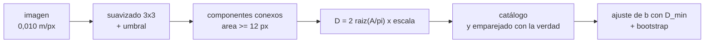

# B103-C06 — Detección y catalogación de rocas en imágenes de superficie

<!-- nav:top -->
[🏠 Programa](../../../../README.md) · [📚 Bloque B103](../../../tronco-comun/B103-percepcion-visual-robotica.md) · [← Anterior: B103-C05 — Segmentación semántica de superficies planetarias](../B103-C05-segmentacion-semantica-de-superficies-planetarias/CLASE.md) · [Siguiente: B103-C07 — Estimación de pose de objetos y objetivos por visión →](../B103-C07-estimacion-de-pose-de-objetos-y-objetivos-por-vision/CLASE.md)
<!-- /nav -->

## 1. Ubicación, nivel y alcance

Clase 6 del bloque B103. Nivel N3. Las rocas son a la vez un **peligro de navegación** y un **objetivo científico**, y su distribución de tamaños dice algo del terreno. Aquí detectas rocas en una imagen **sintética** por umbral y componentes conexos, conviertes píxeles en tamaños físicos, mides la exhaustividad por tamaño y ajustas una ley de potencias a la distribución tamaño-frecuencia con su incertidumbre. Usas la escala `Z/f` de [B103-C01](../B103-C01-calibracion-intrinseca-de-camaras/CLASE.md) y la segmentación de [B103-C05](../B103-C05-segmentacion-semantica-de-superficies-planetarias/CLASE.md) como contexto.

## 2. Por qué esta clase existe

Un catálogo de rocas es incompleto justo donde hay más rocas: las pequeñas. Ajustar una ley de potencias con todas las detecciones da un exponente sesgado. La decisión central: **¿desde qué tamaño es fiable el catálogo, y con qué incertidumbre se puede declarar su exponente?**

## 3. Lo que podrás hacer al terminar

1. Convertir píxeles en metros con la escala en el terreno y calcular el diámetro equivalente de una región.
2. Detectar rocas con umbral, suavizado y componentes conexos.
3. Medir precisión y exhaustividad por clase de tamaño contra una verdad conocida.
4. Ajustar `N(>D) ∝ D^−b` por máxima verosimilitud sobre un tamaño mínimo de completitud, con incertidumbre y bootstrap.
5. Explicar el sesgo del ajuste ingenuo y el efecto de la mezcla de rocas vecinas.
6. Relacionar la longitud de la sombra con la altura de una roca y rotular lo sintético.

La evidencia es la **catálogo de rocas con exponente e incertidumbre** del ejercicio 12 (sección 20).

## 4. Con qué llegas y cómo comprobarlo

1. ¿Qué es la escala en el terreno (m/px)?
2. ¿Qué es un componente conexo?
3. ¿Qué es una ley de potencias?
4. ¿Qué es exhaustividad (recall)?
5. ¿Qué es un dato sintético?

<details>
<summary>Ver respuestas</summary>

1. La distancia del terreno que cubre un píxel (por ejemplo `Z/f`; ver B103-C01). 2. Un conjunto de píxeles del primer plano que se tocan por un borde. 3. Una relación `N ∝ D^−b` entre la cantidad y el tamaño. 4. La fracción de objetos reales que se detectan. 5. Un dato generado para el ejemplo, no medido.
</details>

Con cuatro o cinco aciertos, sigue; si no, repasa los prerrequisitos.

## 5. Un caso de contexto y casos de referencia

Una imagen cenital sintética de 600 × 600 px con 0,010 m/px (6 × 6 m) contiene 400 rocas de 0,05 a 1,0 m con una acumulada `N(>D) ∝ D^−2,0` (verdad del generador). El detector encuentra 316 (precisión 1,000, exhaustividad 0,790) y el ajuste ingenuo con todas ellas da `b = 1,647 ± 0,093`, lejos de 2,0; con un tamaño mínimo de 0,15 m, `b = 2,090 ± 0,344` (bootstrap 95 %: 1,655–2,751). Es el **ejemplo conductor**: la imagen, el tamaño y la ley son **sintéticos** (semilla 103) y no describen ninguna superficie real.

## 6. Vocabulario

El **diámetro equivalente** es `D = 2√(A/π)` por la escala. La **distribución tamaño-frecuencia** acumulada `N(>D)` cuenta las rocas mayores que `D`. El **tamaño mínimo de completitud** `D_min` es el diámetro a partir del cual el catálogo detecta casi todas las rocas. La **máxima verosimilitud** para una ley de Pareto da `b = n/Σ ln(D_i/D_min)` con error `b/√n`. El **bootstrap** remuestrea las detecciones para estimar un intervalo. La **sombra** de una roca de altura `h` bajo el Sol a elevación `e` mide `L = h/tan e`.

## 7. Modelo mental



*Descripción textual:* la imagen se umbraliza, los componentes conexos se convierten en un catálogo de diámetros, se comparan con la verdad y la distribución por encima de un tamaño de completitud se ajusta a una ley de potencias con su incertidumbre.

Analogía: contar peces con una red de malla ancha; los grandes caen todos, los pequeños se escapan, y si ajustas la curva con lo que cayó subestimas cuántos pequeños hay. Límite: aquí lo que se pierde es por contraste y ruido, no por una malla fija, y las rocas que se tocan se cuentan como una.

## 8. La explicación, paso a paso

### 8.1 Escala y diámetro

Con 0,010 m/px, una roca de 0,30 m mide 30 px y ocupa `π·15² = 707 px²`. Inversamente, una región de 200 px² tiene `D = 2√(200/π)·0,010 = 0,160 m`.

### 8.2 Detección

Tras un suavizado 3 × 3 se marcan los píxeles por encima de 170 niveles (arena nominal 150 más 20), se agrupan por componentes conexos de 4 vecinos y se descartan los de menos de 12 px. Se empareja cada roca verdadera con la detección más cercana (distancia de centros menor que `0,6 D`). Resultado: 316 verdaderos positivos, 84 falsos negativos y 0 falsos positivos (precisión 1,000, exhaustividad 0,790).

### 8.3 Exhaustividad y sesgo del diámetro por tamaño

| `D` (m) | verdaderas | halladas | exhaustividad | `D` est./`D` verd. |
|---|---|---|---|---|
| 0,05–0,10 | 307 | 243 | 0,792 | 0,856 |
| 0,10–0,20 | 66 | 49 | 0,742 | 0,923 |
| 0,20–0,50 | 25 | 22 | 0,880 | 0,977 |
| 0,50–1,01 | 2 | 2 | 1,000 | 0,932 |

El diámetro se subestima porque el umbral pierde píxeles del borde (para las más pequeñas, la mediana es 0,856). La exhaustividad por tamaño no es monótona: la imagen cubre 12,2 % de su área con la suma de discos (sin descontar solapes), y las rocas que se tocan se fusionan en un solo componente, de modo que incluso las medianas pueden perderse.

### 8.4 Ajuste de la ley de potencias

Con `D ≥ D_min`, `b = n/Σ ln(D_i/D_min)` y error `b/√n`. Sobre las rocas **verdaderas**: `b = 2,083 ± 0,104` (parámetro del generador: 2,0). Sobre todas las detecciones (ingenuo, `D ≥ 0,039 m`): `b = 1,647 ± 0,093`: **sesgo hacia abajo**, porque las pequeñas faltan. Con `D_min = 0,10 m`: `1,664 ± 0,213` (todavía incompleto, exhaustividad 0,74); con 0,15 m: `2,090 ± 0,344`; con 0,20 m: `2,139 ± 0,467`. Subir `D_min` quita el sesgo y ensancha la incertidumbre (`n` pasa de 61 a 37 y 21).

### 8.5 Peligro y sombra

Con `h = 0,5 D`, una roca de `D ≥ 0,5 m` supera 0,25 m de altura: hay 2 y se detectan las 2. La sombra de una roca de 0,25 m a elevación solar de 30° mide `0,25/tan 30° = 0,433 m`; con una sombra medida se puede invertir: `h = L tan e`.

## 9. Magnitudes, símbolos y unidades

| Símbolo | Qué es | Unidad | Valor / nota |
|---|---|---|---|
| Escala | metros por píxel | m/px | 0,010 |
| `D` | diámetro equivalente | m | 0,05 a 1,0 |
| `b` | exponente de `N(>D) ∝ D^−b` | — | 2,0 (verdad); 2,090 ± 0,344 (estimado) |
| `D_min` | tamaño de completitud | m | 0,15 |
| `e` | elevación solar | grados | 30 (ilustrativo) |
| `h` | altura de la roca | m | `0,5 D` (ilustrativa) |

## 10. Convenciones y referencias

Imagen cenital con escala fija (no hay perspectiva); arena de 150 niveles, roca de 185 con gradiente, sombra de 105; ruido de 4 niveles. Datos sintéticos con semilla 103; la distribución `N(>D) ∝ D^−2` es una elección de enseñanza, no un dato medido. Emparejado por distancia de centros. Tolerancias del laboratorio: `b` con `D_min = 0,15 m` dentro de `3σ + 0,2` de 2,0; el ajuste ingenuo menor que el corregido; exhaustividad de `D ≥ 0,2 m` mayor que 0,8. Numpy 2.4.4, Python 3.12.9.

## 11. De dónde sale lo que afirmamos

| ID | Fuente | Localizador | Respalda | Estado |
|---|---|---|---|---|
| — | Relaciones estándar usadas en el laboratorio: componentes conexos, estimador de máxima verosimilitud de la ley de Pareto, bootstrap y relación `L = h/tan e` | — | las verifica el laboratorio | No consultada en una fuente concreta (las verifica el laboratorio) |

Límites: no se consultó ninguna fuente específica para esta clase; no se consultó la literatura de distribuciones de rocas de misiones, de modo que el exponente 2,0 y la forma de la ley son una elección didáctica y no representan ningún sitio real.

## 12. Cómo ver el resultado

| Ajuste | `D_min` (m) | `n` | `b` |
|---|---|---|---|
| Verdad (todas) | 0,05 | 400 | 2,083 ± 0,104 |
| Ingenuo (detecciones) | 0,039 | 316 | 1,647 ± 0,093 |
| Detecciones | 0,10 | 61 | 1,664 ± 0,213 |
| Detecciones | 0,15 | 37 | 2,090 ± 0,344 |
| Detecciones | 0,20 | 21 | 2,139 ± 0,467 |

Descripción larga: el exponente se acerca a la verdad cuando `D_min` supera el límite de completitud, a costa de más incertidumbre.

## 13. Ejemplo trabajado: diámetro de una región

**Paso 1 · Área.** Una región tiene 200 px.

**Paso 2 · Diámetro en píxeles.** `2√(200/π) = 15,96 px`.

**Paso 3 · Escala.** `15,96·0,010 = 0,160 m`.

**Paso 4 · Clase.** Cae en el intervalo 0,10–0,20 m, donde la exhaustividad del laboratorio es 0,742.

## 14. Distintas formas de describir el problema

**Por píxeles:** área. **Por metros:** `D`. **Por distribución:** `N(>D)`. **Por exponente:** `b`. **Por altura:** `h = L tan e`. **Por tabla:** catálogo con diámetro, posición y confianza.

## 15. Práctica guiada

**Ejercicio 1 · con los pasos indicados.** ¿Cuántos píxeles de diámetro y de área tiene una roca de 0,30 m a 0,010 m/px? *Pasos:* divide por la escala y aplica `πr²`.

<details><summary>Solución comentada</summary>

30 px; `π·15² = 707 px²`.
</details>

**Ejercicio 2 · con una pista.** Calcula `D` de una región de 200 px² a 0,010 m/px. *Pista:* `2√(A/π)`.

<details><summary>Solución comentada</summary>

`0,160 m`.
</details>

**Ejercicio 3 · casi autónomo.** ¿Cuánto mide la sombra de una roca de 0,25 m con el Sol a 30° de elevación? ¿Y a 10°?

<details><summary>Solución comentada</summary>

`0,25/tan 30° = 0,433 m`; a 10°, `0,25/tan 10° = 1,418 m`.
</details>

## 16. Práctica autónoma, transferencia e integrador

**Ejercicio 4 · autónomo.** Con `N(>D) = 400 (0,05/D)²`, ¿cuántas rocas se esperan por encima de 0,2 m y de 0,5 m?

<details><summary>Solución comentada</summary>

`400·(0,25)² = 25` y `400·(0,1)² = 4`; en la imagen hay 27 y 2 (variación aleatoria).
</details>

**Ejercicio 5 · autónomo.** Calcula `b` con `D = 0,2; 0,3; 0,5 m` y `D_min = 0,15 m`.

<details><summary>Solución comentada</summary>

`Σ ln(D/D_min) = 0,2877 + 0,6931 + 1,2040 = 2,1848`; `b = 3/2,1848 = 1,373 ± 0,793`.
</details>

**Ejercicio 6 · autónomo.** ¿Por qué el ajuste ingenuo (1,647) queda por debajo del verdadero (2,083)?

<details><summary>Solución comentada</summary>

Faltan rocas pequeñas, así que la distribución parece más plana; hay que ajustar sobre `D ≥ D_min` donde el catálogo está completo.
</details>

**Ejercicio 7 · autónomo.** ¿Por qué `D_min = 0,10 m` todavía sesga el ajuste (1,664)?

<details><summary>Solución comentada</summary>

La exhaustividad en 0,10–0,20 m es 0,742: el catálogo aún no es completo allí.
</details>

**Ejercicio 8 · autónomo.** La mediana de `D` estimado/`D` verdadero es 0,856 para 0,05–0,10 m. ¿Cuántos píxeles de borde se pierden en una roca de 0,075 m?

<details><summary>Solución comentada</summary>

`7,5 px` verdaderos y `6,4 px` estimados: se pierden unos 0,55 px por lado.
</details>

**Ejercicio 9 · transferencia.** **Transferencia.** **Transferencia.** Una imagen oblicua tiene escala `Z/f` con `f = 800 px`. ¿Qué escala hay a 10 m y qué área mínima corresponde a una roca de 5 cm?

<details><summary>Solución comentada</summary>

`10/800 = 12,5 mm/px`; una roca de 5 cm mide 4 px de diámetro (área ~12,6 px): en el límite del umbral de 12 px.
</details>

**Ejercicio 10 · transferencia.** **Transferencia.** **Transferencia.** El Sol está a 60° de elevación. ¿Qué ocurre con las sombras como pista para detectar y medir rocas?

<details><summary>Solución comentada</summary>

Se acortan (`L = h/tan 60° = 0,58 h`): son más difíciles de ver y su medida, menos precisa; con Sol bajo son más largas pero también ocultan zonas.
</details>

**Ejercicio 11 · transferencia.** **Transferencia.** **Transferencia.** Dos rocas se tocan y el detector las cuenta como una. ¿Cómo afecta al catálogo y qué se puede hacer?

<details><summary>Solución comentada</summary>

Se subestima la cantidad y se sobreestima el tamaño; se separan con transformaciones de distancia o con las sombras y se informa la fracción de fusiones.
</details>

**Ejercicio 12 · integrador.** **Integrador.** **Integrador.** Elabora tu *catálogo de rocas con exponente e incertidumbre*: escala, método, exhaustividad por tamaño, ajuste con varios `D_min` e incertidumbre (formal y bootstrap), peligros altos y lista de qué es sintético.

<details><summary>Solución comentada</summary>

Secciones 8.1–8.5 y la salida del laboratorio.
</details>

## 17. Laboratorio: detección y distribución tamaño-frecuencia

El script [rocas.py](rocas.py) genera una imagen con 400 rocas, las detecta por umbral y componentes conexos, mide la exhaustividad por tamaño y ajusta la ley de potencias con varios `D_min` y con bootstrap (**comprueba** `b` dentro de la tolerancia, ajuste ingenuo sesgado y exhaustividad de las rocas ≥ 0,2 m mayor que 0,8).

**Datos:** imagen **sintética** con semilla 103; escala, contraste, elevación solar y ley **ilustrativos**. **Predice antes de ejecutar:** ¿Qué le pasa a `b` al usar todas las detecciones? (Queda por debajo de 2,0 por la falta de rocas pequeñas.) **Ejecución del 2026-11-10 (Python 3.12.9):**

```text
Python 3.12.9; numpy 2.4.4
DATOS SINTETICOS (semilla 103): imagen 600x600 px, escala 0.01 m/px, 400 rocas, b verdadero = 2.0, D entre 0.05 y 1.0 m
Detecciones: 316 componentes (area >= 12 px)
Verdaderos positivos = 316, falsos negativos = 84, falsos positivos = 0
Precision = 1.000; exhaustividad global = 0.790
Clase de tamano D [m]    verdaderas   halladas   exhaustividad   D estimado / D verdadero (mediana)
  0.05 - 0.10             307        243           0.792        0.856
  0.10 - 0.20              66         49           0.742        0.923
  0.20 - 0.50              25         22           0.880        0.977
  0.50 - 1.01               2          2           1.000        0.932
Verdad (todas las rocas, D >= 0.05 m): b = 2.083 +- 0.104 (n = 400); parametro del generador = 2.0
Ajuste ingenuo (todas las detecciones, D >= 0.039 m): b = 1.647 +- 0.093 (n = 316)
Ajuste con D_min = 0.10 m: b = 1.664 +- 0.213 (n = 61); bootstrap 95 %: [1.394, 2.028]
Ajuste con D_min = 0.15 m: b = 2.090 +- 0.344 (n = 37); bootstrap 95 %: [1.655, 2.751]
Ajuste con D_min = 0.20 m: b = 2.139 +- 0.467 (n = 21); bootstrap 95 %: [1.718, 2.941]
Rocas con altura verdadera >= 0.25 m (D >= 0.5 m): verdad = 2, detectadas = 2
Suma de areas de discos / area de la imagen (sin descontar solapes): verdad 12.22 %, detectada 9.32 %
Pruebas superadas.
```

```bash
python programa/clases/B103/B103-C06-deteccion-y-catalogacion-de-rocas-en-imagenes-de-superficie/rocas.py
```

**Límites:** vista cenital sin perspectiva, rocas circulares, contraste uniforme, ruido independiente, exponente constante y sin rocas semienterradas; las sombras no se usan para detectar; no se compara con ningún catálogo de misión.

## 18. Errores frecuentes y cómo corregirlos

**Ajustar la ley con todo el catálogo.** Usa `D ≥ D_min` de completitud (8.4).

**Informar `b` sin su incertidumbre.** Da el error formal y el bootstrap (8.4).

**Confundir el área de la región con la del disco real.** El umbral pierde píxeles del borde (8.3).

**Presentar el catálogo sintético como el de un sitio real.** Se corrige con la sección 10.

## 19. Cómo sabrás que vas bien

Tras la sección 8: ¿qué `D_min` elegiste y por qué? Si dudas, repasa el ejemplo 13. Tras el laboratorio: ¿qué comprueba? (ver la sección 17).

## 20. Qué entregas y cómo se evalúa

El producto es tu **catálogo de rocas con exponente e incertidumbre** (ejercicio 12).

| Criterio | Inicial | En desarrollo | Logrado | Destacado |
|---|---|---|---|---|
| Conceptos | Confunde tamaño y número | Parciales | Explica `D`, `N(>D)` y completitud | Explica el sesgo y la fusión |
| Cálculo | Sin unidades | Con errores | Convierte escala y ajusta `b` con unidades | Calcula casos nuevos |
| Numérico | Sin comprobar | Un caso | Compara con la verdad y con varios `D_min` | Interpreta el compromiso |
| Fuentes | Sin fuente | Sin fecha | Declara que no se consultó fuente específica | Declara lo sintético |
| Límites | No los nombra | Uno | Tres | Discute qué falta del modelo |

**Condiciones críticas (no se compensan con promedio):** rotular la imagen y la ley como sintéticas; informar `b` con su `D_min` y su incertidumbre; no presentar el catálogo como el de un sitio real.

## 21. Ética, seguridad y límites

Clase educativa: el exponente y la imagen son ilustrativos; un catálogo real de rocas exige datos de misión, verificación con otra vista y revisión por especialistas, y su uso como peligro de navegación requiere validación independiente. Accesibilidad: tablas equivalentes a las gráficas, fórmulas en texto, ejercicios sin conexión.

## 22. Para cerrar y seguir

Con rocas sintéticas, el ajuste ingenuo da `b = 1,65` y el ajuste sobre la parte completa da `2,09 ± 0,34`, coherente con 2,0 pero con una incertidumbre grande. Queda una pregunta: ¿cómo se estima la pose de un objeto concreto, como una herramienta o un marcador?

**Glosario español–inglés.** diámetro equivalente · *equivalent diameter*; completitud · *completeness*; distribución tamaño-frecuencia · *size-frequency distribution*; sombra · *shadow*; máxima verosimilitud · *maximum likelihood*.

**Continuidad.** [B103-C07](../B103-C07-estimacion-de-pose-de-objetos-y-objetivos-por-vision/CLASE.md) estima la pose de objetos con un modelo conocido.

**Referencias:** ver sección 11.

<!-- nav:bottom -->
---

[← Anterior: B103-C05 — Segmentación semántica de superficies planetarias](../B103-C05-segmentacion-semantica-de-superficies-planetarias/CLASE.md) · [📚 Bloque B103](../../../tronco-comun/B103-percepcion-visual-robotica.md) · [Siguiente: B103-C07 — Estimación de pose de objetos y objetivos por visión →](../B103-C07-estimacion-de-pose-de-objetos-y-objetivos-por-vision/CLASE.md)
<!-- /nav -->
