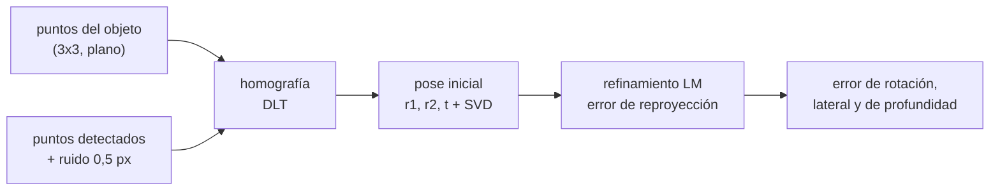

# B103-C07 — Estimación de pose de objetos y objetivos por visión

<!-- nav:top -->
[🏠 Programa](../../../../README.md) · [📚 Bloque B103](../../../tronco-comun/B103-percepcion-visual-robotica.md) · [← Anterior: B103-C06 — Detección y catalogación de rocas en imágenes de superficie](../B103-C06-deteccion-y-catalogacion-de-rocas-en-imagenes-de-superficie/CLASE.md) · [Siguiente: B103-C08 — Métricas de evaluación de percepción →](../B103-C08-metricas-de-evaluacion-de-percepcion/CLASE.md)
<!-- /nav -->

## 1. Ubicación, nivel y alcance

Clase 7 del bloque B103. Nivel N3. Para tomar una herramienta, acoplar a un objetivo o apuntar a un blanco, el robot necesita la **pose** (posición y orientación) del objeto respecto de la cámara. Si el objeto tiene una geometría conocida, la pose sale de proyectar sus puntos y ajustar: el problema *Perspective-n-Point* (PnP). Aquí resuelves el caso plano (un marcador de 3 × 3 puntos) con homografía y refinamiento, y mides cómo crece el error con la distancia. B87-C09 (en la [guía de B87](../../../tronco-comun/B87-sensores-y-control-de-actitud.md)) estima la actitud con sensores específicos; esta clase lo hace con imágenes. Todo es **sintético**.

## 2. Por qué esta clase existe

A 8 m un marcador de 10 cm mide 10 px y su pose es casi indeterminada; a 1 m, el error de profundidad es de unos 3 mm. La decisión central: **¿hasta qué distancia es fiable la pose estimada con un objeto de cierto tamaño, y cuándo hay que dudar de ella?**

## 3. Lo que podrás hacer al terminar

1. Proyectar un objeto plano con una pose dada y la cámara de B103-C01.
2. Estimar la pose con homografía, descomposición y refinamiento por mínimos cuadrados.
3. Medir el error de rotación, lateral y de profundidad frente a la verdad y la distancia.
4. Predecir el error relativo de profundidad con `σ_px Z/(f ρ √N)`.
5. Reconocer la ambigüedad de la pose plana (vuelcos) y su dependencia de la inclinación.
6. Dimensionar un marcador para una distancia y precisión dadas, y rotular lo sintético.

La evidencia es la **ficha de pose con error por distancia** del ejercicio 12 (sección 20).

## 4. Con qué llegas y cómo comprobarlo

1. ¿Qué es una pose?
2. ¿Qué es una homografía?
3. ¿Qué es el error de reproyección?
4. ¿Qué es la mediana?
5. ¿Qué es un dato sintético?

<details>
<summary>Ver respuestas</summary>

1. Una rotación y una traslación que ubican un objeto respecto de otro marco. 2. La transformación proyectiva entre dos planos (B103-C01). 3. La distancia entre el píxel observado y el predicho por el modelo. 4. El valor central de un conjunto; es robusta ante valores atípicos. 5. Un dato generado para el ejemplo, no medido.
</details>

Con cuatro o cinco aciertos, sigue; si no, repasa los prerrequisitos.

## 5. Un caso de contexto y casos de referencia

Un marcador plano sintético de 3 × 3 puntos (paso 0,05 m, 0,10 m de lado) se observa con la cámara ilustrativa de B103-C01 (`f = 800 px`) con ruido de 0,5 px. Sin ruido, la pose se recupera con `4,6 × 10⁻¹²` ° y `6,5 × 10⁻¹⁴` m. Con ruido, a 1 m y 20° de inclinación el error mediano es de 1,40° y de 3,40 mm en profundidad; a 2 m, de 3,40° y 14,34 mm, pero el 22,5 % de las estimaciones «vuelca» (más de 30° de error); a 8 m, el error mediano de rotación es 22,4° y el 45,5 % vuelca. Es el **ejemplo conductor**: marcador, cámara y ruido son **sintéticos** (semilla 103) y no describen ningún objetivo real.

## 6. Vocabulario

La **pose** `(R, t)` cumple `p_cam = R p_obj + t`. **PnP** es estimar la pose a partir de correspondencias 2D–3D. El **PnP plano** usa puntos coplanares y una homografía. El **radio cuadrático medio** `ρ` de los puntos del objeto mide su extensión. Un **vuelco** (*flip*) es una solución de pose con la inclinación invertida, casi tan compatible con los datos como la verdadera. La **ambigüedad de pose** aparece con poca perspectiva (objeto pequeño, lejano o visto de frente).

## 7. Modelo mental



*Descripción textual:* de los puntos del objeto y los detectados se obtiene una homografía, de ella una pose inicial, que se refina minimizando el error de reproyección; se mide el error por componente y por distancia.

Analogía: estimar cómo está girada una moneda lejana mirando su elipse: de cerca la elipse es clara, de lejos casi es un círculo y no sabes hacia qué lado se inclina. Límite: la ambigüedad aquí es la de un plano con perspectiva débil; un objeto tridimensional (puntos no coplanares) la reduce.

## 8. La explicación, paso a paso

### 8.1 Pose inicial

La homografía `H = λ K [r1 r2 t]` se obtiene por DLT con los 9 puntos. De `K⁻¹H` salen `r1`, `r2` y `t` con `λ = 1/‖K⁻¹h1‖`; `r3 = r1 × r2` y la matriz se ortonormaliza por SVD. Se elige el signo para que `t_z > 0`.

### 8.2 Refinamiento

Se minimiza el error de reproyección sobre 6 parámetros (rotación en forma de Rodrigues y traslación) con Levenberg–Marquardt. Sin ruido el error es de `4,6 × 10⁻¹²` ° y `6,5 × 10⁻¹⁴` m: el código es correcto.

### 8.3 Error de profundidad: ley y datos

El tamaño aparente del marcador fija `Z`. Con `ρ = 57,74 mm` (radio cuadrático medio de los 9 puntos), `N = 9` y `f = 800 px`: `σ_Z/Z ≈ σ_px Z/(f ρ √N)`. A 2 m es 0,722 %; la **mediana** del valor absoluto es `0,6745 σ`: 0,487 %. El laboratorio da 0,717 % (cociente 1,47). A lo largo de 0,5–8 m el cociente se mantiene en 1,39–1,49: la ley acierta la proporcionalidad con `Z` (el error absoluto crece con `Z²`: de 0,85 mm a 3,40 mm al duplicar `Z` de 0,5 a 1 m) pero subestima la magnitud en ~45 %, porque ignora el acoplamiento con la inclinación.

### 8.4 Error lateral frente a profundidad

A 2 m la mediana del error lateral es 0,78 mm y la de profundidad 14,34 mm: unas 18 veces más. Un solo punto de vista mide mal la profundidad; la pose lateral es precisa.

### 8.5 Vuelcos y ambigüedad

La rotación mediana a 2 m: 10,5° con 5° de inclinación, 3,76° con 20° y 1,59° con 45°: menos perspectiva, más error. Pero la cola es mala: la proporción de vuelcos (más de 30°) es 0 % con 5°, 22,5 % con 20° y 11,5 % con 45° a 2 m, y a 8 m casi la mitad. El método parte de una sola solución (la de la homografía) y no explora la alternativa; un sistema real calcula ambas o usa un objeto no plano.

## 9. Magnitudes, símbolos y unidades

| Símbolo | Qué es | Unidad | Valor / nota |
|---|---|---|---|
| `f` | focal | px | 800 (ilustrativa) |
| `ρ` | radio cuadrático medio de los puntos | mm | 57,74 |
| `N` | número de puntos | — | 9 |
| `σ_px` | ruido de detección | px | 0,5 |
| `Δθ` | error de rotación | grados | 0,704 (0,5 m) a 22,4 (8 m) |
| `ΔZ` | error de profundidad | mm | 0,85 (0,5 m) a 232,6 (8 m) |

## 10. Convenciones y referencias

Cámara con `z` hacia delante, sin distorsión, con la `K` de B103-C01; objeto con su plano `z = 0`; `p_cam = R p_obj + t`. Datos sintéticos con semilla 103 (Monte Carlo: semillas 7000–7199 y 8000–8199); la inclinación es el ángulo entre la normal del objeto y el eje óptico. Metros, milímetros, píxeles y grados. Tolerancias: error sin ruido < 1e-6; cociente de la mediana frente a `0,6745 σ_Z/Z` entre 0,6 y 1,8 a 2 m; error de rotación con 5° mayor que con 45°. Numpy 2.4.4, Python 3.12.9.

## 11. De dónde sale lo que afirmamos

| ID | Fuente | Localizador | Respalda | Estado |
|---|---|---|---|---|
| S1 | CVLab, EPFL, página de EPnP — https://www.epfl.ch/labs/cvlab/software/multi-view-stereo/epnp/ (consultada 2026-11-10) | página completa | EPnP resuelve la pose de cámara (Perspective-n-Point) con coste O(n), no iterativo; referencia: Lepetit, Moreno-Noguer y Fua, IJCV 81, 155–166, 2009 | Consultada |
| — | Relaciones estándar usadas en el laboratorio: homografía plana, descomposición de pose, mínimos cuadrados de Levenberg–Marquardt y propagación de error | — | las verifica el laboratorio | No consultada en una fuente concreta (las verifica el laboratorio) |

Límites: de la página de CVLab solo se usa que EPnP resuelve la pose de cámara con coste O(n), no iterativa, y su referencia (Lepetit, Moreno-Noguer y Fua, IJCV 2009); el laboratorio **no** implementa EPnP: usa homografía y refinamiento, y no se consultó el artículo. La ambigüedad de pose del objeto plano es un comportamiento observado en el laboratorio, no citado de una fuente.

## 12. Cómo ver el resultado

| `Z` (m) | rotación mediana (°) | vuelcos > 30° (%) | profundidad mediana (mm) | mediana `ΔZ/Z` (%) |
|---|---|---|---|---|
| 0,5 | 0,704 | 0,0 | 0,85 | 0,169 |
| 1,0 | 1,400 | 0,0 | 3,40 | 0,340 |
| 2,0 | 3,397 | 22,5 | 14,34 | 0,717 |
| 4,0 | 9,043 | 40,5 | 55,43 | 1,386 |
| 8,0 | 22,400 | 45,5 | 232,62 | 2,908 |

Descripción larga: el error de profundidad crece con `Z²` y la rotación se degrada rápidamente; desde 2 m aparece una fracción creciente de vuelcos.

## 13. Ejemplo trabajado: proyectar un punto del marcador

**Paso 1 · Punto.** El punto `(0,05; 0,05; 0) m` del marcador, con `R = I` y `t = (0; 0; 2) m`.

**Paso 2 · Cámara.** `x = 0,05/2 = 0,025`, `y = 0,025`.

**Paso 3 · Píxel.** `u = 800·0,025 + 640 = 660 px`, `v = 800·0,025 + 480 = 500 px`.

**Paso 4 · Tamaño.** El lado del marcador (0,10 m) mide `800·0,10/2 = 40 px`.

## 14. Distintas formas de describir el problema

**Por matriz:** `(R, t)`. **Por ángulos:** error en grados. **Por distancia:** error lateral y de profundidad. **Por ley:** `σ_px Z/(f ρ √N)`. **Por fiabilidad:** fracción de vuelcos.

## 15. Práctica guiada

**Ejercicio 1 · con los pasos indicados.** Proyecta `(0,05; 0,05; 0)` con `R = I`, `t = (0; 0; 2) m`. *Pasos:* divide por `Z`, multiplica por `f` y suma el punto principal.

<details><summary>Solución comentada</summary>

`u = 660 px`, `v = 500 px`.
</details>

**Ejercicio 2 · con una pista.** ¿Cuántos píxeles mide el lado del marcador a 2 m y a 8 m? *Pista:* `f L/Z`.

<details><summary>Solución comentada</summary>

`800·0,10/2 = 40 px` y `800·0,10/8 = 10 px`.
</details>

**Ejercicio 3 · casi autónomo.** Calcula `σ_Z/Z` teórico a 2 m con `σ_px = 0,5`, `ρ = 57,74 mm`, `N = 9`.

<details><summary>Solución comentada</summary>

`0,5·2/(800·0,05774·3) = 0,722 %`; en milímetros, `14,4 mm`.
</details>

## 16. Práctica autónoma, transferencia e integrador

**Ejercicio 4 · autónomo.** Al duplicar `Z` de 0,5 a 1 m el error de profundidad pasa de 0,85 a 3,40 mm. ¿Qué factor es y por qué?

<details><summary>Solución comentada</summary>

×4: crece con `Z²` (relativo ×2 y distancia ×2).
</details>

**Ejercicio 5 · autónomo.** ¿Cuántas veces es mayor el error de profundidad que el lateral a 2 m?

<details><summary>Solución comentada</summary>

`14,34/0,78 ≈ 18`.
</details>

**Ejercicio 6 · autónomo.** ¿Cuántos puntos mínimos requiere una homografía por DLT?

<details><summary>Solución comentada</summary>

4 puntos (8 ecuaciones); se usan 9 para promediar el ruido.
</details>

**Ejercicio 7 · autónomo.** Con una inclinación de 45°, ¿cuánto se acorta el lado del marcador en la imagen?

<details><summary>Solución comentada</summary>

`cos 45° = 0,707`: queda en 70,7 % del tamaño frontal (a lo largo del eje de inclinación).
</details>

**Ejercicio 8 · autónomo.** A 2 m, la mediana del error de rotación es 10,5° con 5° de inclinación y 1,59° con 45°. ¿Por qué?

<details><summary>Solución comentada</summary>

Con poca inclinación hay poca perspectiva: el marcador parece casi frontal y la rotación se determina mal; con más inclinación hay más información.
</details>

**Ejercicio 9 · transferencia.** **Transferencia.** **Transferencia.** Un objetivo de acoplamiento debe ubicarse a 8 m con un error relativo de profundidad como el del marcador a 2 m. ¿Qué tamaño de marcador hace falta?

<details><summary>Solución comentada</summary>

`σ_Z/Z ∝ Z/ρ`: un `Z` cuatro veces mayor requiere `ρ` cuatro veces mayor, es decir, un marcador de unos 0,40 m.
</details>

**Ejercicio 10 · transferencia.** **Transferencia.** **Transferencia.** Un detector de esquinas mejora de 0,5 a 0,25 px. ¿Cómo cambia el error de profundidad y qué no cambia?

<details><summary>Solución comentada</summary>

Se reduce a la mitad (`∝ σ_px`); no cambia el riesgo de vuelco con poca perspectiva, que depende de la geometría.
</details>

**Ejercicio 11 · transferencia.** **Transferencia.** **Transferencia.** Una esquina del marcador se confunde con una sombra y se desplaza 20 px. ¿Qué haces?

<details><summary>Solución comentada</summary>

El ajuste por mínimos cuadrados se contamina: hay que rechazar valores atípicos (por ejemplo, con RANSAC o con el error de reproyección por punto) y exigir un RMS de reproyección coherente con el ruido.
</details>

**Ejercicio 12 · integrador.** **Integrador.** **Integrador.** Elabora tu *ficha de pose con error por distancia*: método, tabla por distancia (rotación, profundidad, lateral, vuelcos), comparación con la ley teórica, efecto de la inclinación y lista de qué es sintético y consultado.

<details><summary>Solución comentada</summary>

Secciones 8.1–8.5 y la salida del laboratorio.
</details>

## 17. Laboratorio: pose de un marcador plano

El script [pose.py](pose.py) proyecta un marcador de 3 × 3 puntos, estima la pose por homografía y refinamiento, repite 200 veces por distancia y por inclinación y cuenta los vuelcos (**comprueba** error sin ruido < 1e-6, la proporción con la ley de profundidad y que la poca inclinación empeora la rotación). Tarda unos 45 s.

**Datos:** marcador, cámara y ruido **sintéticos** con semilla 103; la cámara es **ilustrativa**. **Predice antes de ejecutar:** ¿Cuántas veces mayor es el error de profundidad que el lateral a 2 m? (Unas 18.) **Ejecución del 2026-11-10 (Python 3.12.9):**

```text
Python 3.12.9; numpy 2.4.4
DATOS SINTETICOS (semilla 103): marcador 3x3 puntos, paso 0.05 m, camara ILUSTRATIVA f = 800 px, ruido 0.5 px
Sin ruido (Z = 2 m, inclinacion 20 grados): error de rotacion = 4.56e-12 grados, de traslacion = 6.47e-14 m
rho (radio cuadratico medio de los puntos) = 57.74 mm
Monte Carlo (200 repeticiones, inclinacion 20 grados): error segun la distancia Z
  Z [m]   rotacion mediana [grados]   >30 grados [%]   lateral med. [mm]   profundidad med. [mm]   mediana dZ/Z [%]   0.6745 sigma teorico [%]   cociente
    0.5                 0.704             0.0              0.13                 0.85            0.169                   0.122       1.39
    1.0                 1.400             0.0              0.28                 3.40            0.340                   0.243       1.40
    2.0                 3.397            22.5              0.78                14.34            0.717                   0.487       1.47
    4.0                 9.043            40.5              2.21                55.43            1.386                   0.974       1.42
    8.0                22.400            45.5              8.85               232.62            2.908                   1.947       1.49
Efecto de la inclinacion del marcador (Z = 2 m, 200 repeticiones): error de rotacion [grados]
  inclinacion  5.0: mediana 10.521 ; percentil 95 19.498 ; maximo  23.157 ; vuelcos (> 30 grados)  0.0 %
  inclinacion 20.0: mediana  3.757 ; percentil 95 43.820 ; maximo  49.410 ; vuelcos (> 30 grados) 22.5 %
  inclinacion 45.0: mediana  1.588 ; percentil 95 88.972 ; maximo  95.150 ; vuelcos (> 30 grados) 11.5 %
Pruebas superadas.
```

```bash
python programa/clases/B103/B103-C07-estimacion-de-pose-de-objetos-y-objetivos-por-vision/pose.py
```

**Límites:** solo un objeto plano de 9 puntos, detección con ruido gaussiano sin atípicos, una sola solución de partida, sin distorsión ni sincronización; EPnP no está implementado ni comparado.

## 18. Errores frecuentes y cómo corregirlos

**Confiar en la rotación con poca perspectiva.** Revisa la inclinación y los vuelcos (8.5).

**Medir solo el error medio.** Usa la mediana y reporta vuelcos (8.3, 8.5).

**Tomar la ley `σ_px Z/(f ρ √N)` como exacta.** Subestima ~45 % (8.3).

**Presentar el marcador sintético como un objetivo real.** Se corrige con la sección 10.

## 19. Cómo sabrás que vas bien

Tras la sección 8: ¿qué error de profundidad esperabas a 4 m y cuál da la tabla? Si dudas, repasa el ejemplo 13. Tras el laboratorio: ¿qué comprueba? (ver la sección 17).

## 20. Qué entregas y cómo se evalúa

El producto es tu **ficha de pose con error por distancia** (ejercicio 12).

| Criterio | Inicial | En desarrollo | Logrado | Destacado |
|---|---|---|---|---|
| Conceptos | Confunde posición y orientación | Parciales | Explica PnP, error y ambigüedad | Explica el vuelco y su causa |
| Cálculo | Sin unidades | Con errores | Proyecta, dimensiona y propaga con unidades | Calcula casos nuevos |
| Numérico | Sin comprobar | Un caso | Compara con la verdad y con la ley | Interpreta las diferencias |
| Fuentes | Sin fuente | Sin fecha | Fuentes con fecha y estado | Declara lo sintético y lo no consultado |
| Límites | No los nombra | Uno | Tres | Discute qué falta del modelo |

**Condiciones críticas (no se compensan con promedio):** rotular el marcador, la cámara y el ruido como sintéticos; reportar la fracción de vuelcos y no solo el error medio; citar solo lo consultado.

## 21. Ética, seguridad y límites

Clase educativa: un error de pose puede provocar una colisión o un acoplamiento fallido. Los resultados son sintéticos y no sustituyen a la validación con datos de misión, redundancia y verificación independiente. Accesibilidad: tablas equivalentes a las gráficas, fórmulas en texto, ejercicios sin conexión.

## 22. Para cerrar y seguir

Con un marcador de 10 cm y 0,5 px de ruido, el error de profundidad es de 3,4 mm a 1 m y de 14,3 mm a 2 m, y desde 2 m una parte de las estimaciones vuelca. Queda una pregunta: ¿cómo se mide la calidad de todos estos algoritmos de forma comparable?

**Glosario español–inglés.** pose · *pose*; perspectiva-n-puntos · *perspective-n-point*; ambigüedad de pose · *pose ambiguity*; marcador · *fiducial marker*; vuelco · *flip*.

**Continuidad.** [B103-C08](../B103-C08-metricas-de-evaluacion-de-percepcion/CLASE.md) define las métricas con las que se evalúa la percepción.

**Referencias:** ver sección 11.

<!-- nav:bottom -->
---

[← Anterior: B103-C06 — Detección y catalogación de rocas en imágenes de superficie](../B103-C06-deteccion-y-catalogacion-de-rocas-en-imagenes-de-superficie/CLASE.md) · [📚 Bloque B103](../../../tronco-comun/B103-percepcion-visual-robotica.md) · [Siguiente: B103-C08 — Métricas de evaluación de percepción →](../B103-C08-metricas-de-evaluacion-de-percepcion/CLASE.md)
<!-- /nav -->
