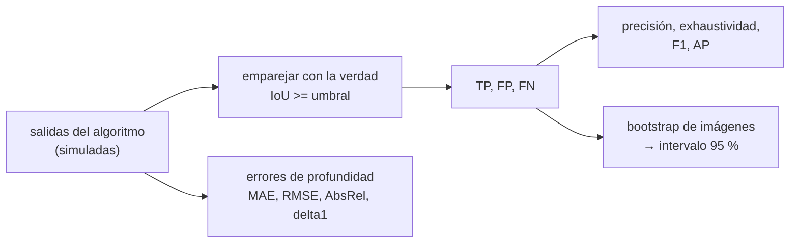

# B103-C08 — Métricas de evaluación de percepción

<!-- nav:top -->
[🏠 Programa](../../../../README.md) · [📚 Bloque B103](../../../tronco-comun/B103-percepcion-visual-robotica.md) · [← Anterior: B103-C07 — Estimación de pose de objetos y objetivos por visión](../B103-C07-estimacion-de-pose-de-objetos-y-objetivos-por-vision/CLASE.md) · [Siguiente: B104-C01 — Historia de vuelos tripulados →](../../../tronco-comun/B104-astronautica-y-preparacion-de-astronautas.md#b104-c01)
<!-- /nav -->

## 1. Ubicación, nivel y alcance

Clase 8 y última del bloque B103. Nivel N3. Cada clase anterior dejó un número (error de reproyección, error de profundidad, IoU, exponente, error de pose). Aquí aprendes a **evaluar** un algoritmo de percepción de forma comparable: precisión, exhaustividad, F1, IoU, AP y errores de profundidad, con intervalos de confianza por remuestreo. Las salidas del «detector», del «segmentador» y del «estimador de profundidad» son **simuladas** y no proceden de ningún algoritmo real.

## 2. Por qué esta clase existe

Un segmentador que acierta el 99 % de los píxeles puede no encontrar nunca la clase que importa, y dos detectores con AP de 0,58 y 0,60 pueden ser indistinguibles con 100 imágenes. La decisión central: **¿qué métricas y qué intervalo hacen falta para afirmar que un algoritmo de percepción es suficiente para una tarea?**

## 3. Lo que podrás hacer al terminar

1. Calcular IoU de cajas y de máscaras y decidir aciertos con un umbral.
2. Calcular precisión, exhaustividad y F1 a un umbral de confianza, y barrerlo.
3. Calcular el AP como el área bajo la curva precisión-exhaustividad con envolvente monótona.
4. Identificar la paradoja de la exactitud con clases raras y usar IoU por clase.
5. Calcular MAE, RMSE, AbsRel y delta1 en profundidad, global y por rango.
6. Estimar intervalos por bootstrap y juzgar cuándo dos resultados son indistinguibles; rotular lo simulado.

La evidencia es la **informe de métricas con intervalos de confianza** del ejercicio 12 (sección 20).

## 4. Con qué llegas y cómo comprobarlo

1. ¿Qué es un verdadero positivo y un falso positivo?
2. ¿Qué es un percentil?
3. ¿Qué es la intersección sobre unión?
4. ¿Qué es un remuestreo con reemplazo?
5. ¿Qué es un dato simulado?

<details>
<summary>Ver respuestas</summary>

1. Un acierto y una alarma falsa respectivamente. 2. El valor bajo el cual cae un porcentaje de los datos. 3. El área común de dos regiones dividida por el área de su unión (B103-C05). 4. Elegir muestras al azar de un conjunto pudiendo repetirlas. 5. Un dato generado por un modelo y no medido; se rotula como tal.
</details>

Con cuatro o cinco aciertos, sigue; si no, repasa los prerrequisitos.

## 5. Un caso de contexto y casos de referencia

Un «detector» simulado sobre 100 imágenes sintéticas (291 cajas verdaderas, 342 detecciones) obtiene `AP50 = 0,581` y `AP75 = 0,089`; la mejor `F1 = 0,705` aparece con confianza ≥ 0,5 (precisión 0,873, exhaustividad 0,591). Su exhaustividad por tamaño es 0,239 (10–20 px), 0,558, 0,909 y 0,976 (70–100 px). El intervalo del 95 % de `AP50` mide 0,276 con 20 imágenes y 0,117 con 100. Un segmentador trivial tiene 99,12 % de exactitud y un IoU de la clase rara de 0,000; uno razonable, 99,38 % y 0,504. Es el **ejemplo conductor**: todo es **sintético y simulado** (semillas 103, 104, 105) y no describe ningún algoritmo real.

## 6. Vocabulario

El **IoU** de dos regiones es `área(A ∩ B)/área(A ∪ B)`. La **precisión** es `TP/(TP + FP)`, la **exhaustividad** `TP/(TP + FN)` y `F1 = 2PR/(P + R)`. El **AP** es el área bajo la curva precisión-exhaustividad con la precisión interpolada. `AP50` y `AP75` exigen IoU de 0,50 y 0,75. **MAE** es el error absoluto medio, **RMSE** el cuadrático medio, **AbsRel** la media de `|ẑ − z|/z` y **delta1** la fracción de puntos con `máx(z/ẑ, ẑ/z) < 1,25`. El **bootstrap** remuestrea las imágenes para obtener un intervalo.

## 7. Modelo mental



*Descripción textual:* las salidas se emparejan con la verdad por IoU, de ahí salen TP, FP y FN y las métricas; el remuestreo de imágenes da intervalos y la profundidad se evalúa con métricas de error propias.

Analogía: un examen con una sola pregunta no distingue a dos alumnos; con 100 preguntas, la nota tiene una incertidumbre que hay que reportar. Límite: aquí el «examen» es sintético y cada imagen es independiente; en datos reales las imágenes de un mismo sitio se parecen y el intervalo es mayor.

## 8. La explicación, paso a paso

### 8.1 IoU y emparejamiento

Para dos cajas `(x, y, w, h)`, `IoU = inter/(A + B − inter)`. Las detecciones se ordenan por confianza y cada una se asigna a la verdad no usada con mayor IoU; es acierto si `IoU ≥ umbral`. Control: un detector perfecto da `AP = 1,000`.

### 8.2 Precisión, exhaustividad y AP

Con confianza ≥ 0,5 hay `TP = 172`, `FP = 25` y `FN = 119`: `P = 0,873`, `R = 0,591`, `F1 = 0,705`. Subir el umbral sube la precisión (0,957 con 0,8) y baja la exhaustividad (0,302). El **AP** es el área bajo la curva con precisión interpolada: `AP50 = 0,581`. La exhaustividad máxima es 0,612 (no se detectan las cajas pequeñas), lo que limita el AP.

### 8.3 El umbral de IoU importa

`AP75 = 0,089`: el simulador desplaza cada caja un 10 % de su tamaño, lo que casi siempre da IoU entre 0,5 y 0,75. Un mismo detector es «bueno» o «malo» según lo precisa que deba ser la localización.

### 8.4 Exhaustividad por tamaño

Con confianza ≥ 0,4: 0,239 (10–20 px), 0,558 (20–40), 0,909 (40–70) y 0,976 (70–101). El promedio global (0,59) oculta que las cajas pequeñas casi no se detectan. Evaluar por tamaño, por rango o por clase es lo que expone esos fallos.

### 8.5 Intervalos de confianza

El bootstrap de imágenes da un intervalo del 95 % para `AP50`: [0,455; 0,731] con 20 imágenes (ancho 0,276), [0,500; 0,667] con 50 (0,167) y [0,527; 0,644] con 100 (0,117). El ancho cae aproximadamente como `1/√n` (0,276/0,117 = 2,36 frente a `√5 = 2,24`). Dos algoritmos con AP de 0,58 y 0,60 sobre 100 imágenes no se distinguen.

### 8.6 Segmentación y profundidad

Un segmentador trivial (todo fondo) tiene 99,12 % de exactitud y un IoU de 0,000 en la clase rara (0,9 % de los píxeles). Uno razonable llega a 99,38 % y 0,504. En profundidad (5000 puntos de 4 a 40 m con error `Z²σ_d/(f B)` y 2 % de valores atípicos): global `MAE = 1,058 m`, `RMSE = 2,262 m`, `AbsRel = 0,0409`, `delta1 = 0,9788`; por rango, `RMSE` pasa de 0,519 m (4–10 m) a 2,924 m (20–40 m) mientras `AbsRel` va de 0,0187 a 0,0533: el RMSE refleja sobre todo el rango lejano.

## 9. Magnitudes, símbolos y unidades

| Símbolo | Qué es | Unidad | Valor / nota |
|---|---|---|---|
| IoU | intersección sobre unión | — | 0 a 1 |
| `P`, `R`, `F1` | precisión, exhaustividad, media armónica | — | 0,873; 0,591; 0,705 |
| `AP50`, `AP75` | AP con IoU ≥ 0,5 y ≥ 0,75 | — | 0,581; 0,089 |
| MAE, RMSE | error de profundidad | m | 1,058; 2,262 |
| AbsRel | error relativo medio | — | 0,0409 |
| delta1 | fracción con razón < 1,25 | — | 0,9788 |

## 10. Convenciones y referencias

Cajas `(x, y, w, h)` en píxeles; máscaras booleanas por clase; profundidades en metros. Salidas sintéticas y simuladas con semillas 103 (detector), 104 (segmentación) y 105 (profundidad). Asignación voraz por confianza; AP con precisión interpolada de envolvente monótona (definición propia, no copiada de una evaluación publicada). Bootstrap de 500 remuestreos de imágenes con semilla 555. Tolerancias: detector perfecto con AP = 1 dentro de 1e-9; el intervalo con 100 imágenes más estrecho que con 20; exactitud trivial mayor que 0,98 con IoU raro nulo. Numpy 2.4.4, Python 3.12.9.

## 11. De dónde sale lo que afirmamos

| ID | Fuente | Localizador | Respalda | Estado |
|---|---|---|---|---|
| S1 | Scharstein, D. y Szeliski, R., «A Taxonomy and Evaluation of Dense Two-Frame Stereo Correspondence Algorithms», Middlebury College / Microsoft — https://vision.middlebury.edu/stereo/taxonomy-IJCV.pdf (consultada 2026-11-10; PDF leído con PyMuPDF) | resumen e introducción (primera página) | taxonomía de métodos estéreo densos de dos vistas con geometría de cámara conocida y mapa de disparidad por píxel; evaluación con datos de verdad conocida | Consultada (solo resumen e introducción) |
| — | Relaciones estándar usadas en el laboratorio: IoU, precisión, exhaustividad, F1, AP con precisión interpolada, errores de profundidad (MAE, RMSE, AbsRel, delta1) y bootstrap | — | las verifica el laboratorio | No consultada en una fuente concreta (las verifica el laboratorio) |

Límites: de Scharstein y Szeliski solo se consultaron el resumen y la introducción, donde se subraya la necesidad de evaluar con datos de verdad conocida; sus métricas concretas no se consultaron. La documentación de PASCAL VOC (conexión rechazada) y las de otros bancos de pruebas **no se consultaron**: las definiciones de AP, delta1 y demás son las propias del laboratorio y pueden diferir de las de una evaluación publicada.

## 12. Cómo ver el resultado

| Métrica | Valor |
|---|---|
| AP50 / AP75 | 0,581 / 0,089 |
| Mejor F1 (confianza ≥ 0,5) | 0,705 |
| Exhaustividad 10–20 / 70–101 px | 0,239 / 0,976 |
| Intervalo 95 % de AP50 (20 / 100 imágenes) | ancho 0,276 / 0,117 |
| Segmentación trivial: exactitud / IoU raro | 99,12 % / 0,000 |
| Profundidad: RMSE 4–10 / 20–40 m | 0,519 / 2,924 m |

Descripción larga: una misma salida da métricas muy distintas según el umbral de IoU, el tamaño del objeto y el rango; sin intervalo de confianza no se pueden comparar dos algoritmos.

## 13. Ejemplo trabajado: IoU, precisión y exhaustividad

**Paso 1 · IoU.** Cajas `(0, 0, 10, 10)` y `(5, 0, 10, 10)`: intersección `5·10 = 50`, unión `100 + 100 − 50 = 150`, `IoU = 0,333`; con umbral 0,5 es un fallo.

**Paso 2 · Conteos.** Con confianza ≥ 0,5: `TP = 172`, `FP = 25`, `FN = 119`.

**Paso 3 · Métricas.** `P = 172/197 = 0,873`, `R = 172/291 = 0,591`.

**Paso 4 · F1.** `2·0,873·0,591/(0,873 + 0,591) = 0,705`.

## 14. Distintas formas de describir el problema

**Por objeto:** IoU. **Por umbral:** precisión y exhaustividad. **Por curva:** AP. **Por segmento:** tamaño, rango, clase. **Por incertidumbre:** intervalo bootstrap. **Por tabla:** valores equivalentes a la curva.

## 15. Práctica guiada

**Ejercicio 1 · con los pasos indicados.** Calcula el IoU de `(0, 0, 10, 10)` y `(5, 0, 10, 10)`. *Pasos:* intersección, unión, cociente.

<details><summary>Solución comentada</summary>

`50/150 = 0,333`.
</details>

**Ejercicio 2 · con una pista.** Calcula `P`, `R` y `F1` con `TP = 172`, `FP = 25`, `FN = 119`.

<details><summary>Solución comentada</summary>

`P = 0,873`, `R = 0,591`, `F1 = 0,705`.
</details>

**Ejercicio 3 · casi autónomo.** El segmentador trivial tiene 99,12 % de exactitud. ¿Por qué no sirve? *Pista:* mira el IoU de la clase rara.

<details><summary>Solución comentada</summary>

No detecta nunca la clase rara (IoU = 0); la exactitud se la da la clase dominante.
</details>

## 16. Práctica autónoma, transferencia e integrador

**Ejercicio 4 · autónomo.** Un punto a 20 m se estima a 21 m. Calcula `AbsRel` y di si cuenta para `delta1`.

<details><summary>Solución comentada</summary>

`|21 − 20|/20 = 0,05`; `21/20 = 1,05 < 1,25`: cuenta.
</details>

**Ejercicio 5 · autónomo.** Con 2 % de atípicos (×1,5) `delta1 = 0,9788`. ¿Por qué es cercano a 0,98?

<details><summary>Solución comentada</summary>

Los atípicos (razón 1,5 > 1,25) son el 2 % y quedan fuera; el 0,12 % restante que falta hasta 1 son puntos lejanos cuyo error gaussiano también supera el 25 %.
</details>

**Ejercicio 6 · autónomo.** `RMSE/MAE` vale 3,76 de 4 a 10 m y 1,78 de 20 a 40 m. ¿Qué indica?

<details><summary>Solución comentada</summary>

Cerca el error es casi nulo y unos pocos atípicos dominan el RMSE; lejos el error gaussiano grande domina ambos.
</details>

**Ejercicio 7 · autónomo.** El ancho del intervalo baja de 0,276 (20 imágenes) a 0,117 (100). ¿Es el cambio esperado?

<details><summary>Solución comentada</summary>

`0,276/0,117 = 2,36 ≈ √5 = 2,24`: sí, el ancho cae aproximadamente como `1/√n`.
</details>

**Ejercicio 8 · autónomo.** ¿Por qué `AP75 = 0,089` es tan bajo frente a `AP50 = 0,581`?

<details><summary>Solución comentada</summary>

Las cajas se desplazan hasta un 10 % por coordenada, de modo que muchas tienen IoU entre 0,5 y 0,75; la exigencia de 0,75 las descuenta.
</details>

**Ejercicio 9 · transferencia.** **Transferencia.** **Transferencia.** Para peligros de navegación se prefiere no perder rocas de más de 40 px. ¿Qué umbral de confianza eliges con la tabla?

<details><summary>Solución comentada</summary>

Con confianza ≥ 0,4 la exhaustividad de 40–70 px es 0,909; bajarlo mejora la exhaustividad a costa de falsas alarmas (108 con 0,2). Como un peligro perdido cuesta más, se prefiere el umbral bajo y se acepta la precisión menor.
</details>

**Ejercicio 10 · transferencia.** **Transferencia.** **Transferencia.** Dos algoritmos tienen AP50 de 0,58 y 0,60 en 100 imágenes. ¿Puedes afirmar que el segundo es mejor?

<details><summary>Solución comentada</summary>

No: el intervalo de 95 % mide 0,117. Hace falta más datos o un remuestreo pareado de la diferencia.
</details>

**Ejercicio 11 · transferencia.** **Transferencia.** **Transferencia.** Se evalúa con imágenes del mismo sitio que las de entrenamiento. ¿Qué sesgo hay?

<details><summary>Solución comentada</summary>

Optimista: no mide el cambio de dominio (B103-C05). Hay que evaluar con sitios, horas y condiciones distintas.
</details>

**Ejercicio 12 · integrador.** **Integrador.** **Integrador.** Elabora tu *informe de métricas con intervalos de confianza*: definiciones, tabla de `P`, `R`, `F1` por umbral, AP50 y AP75, exhaustividad por tamaño, intervalo por número de imágenes, ejemplo de paradoja de exactitud, métricas de profundidad por rango y qué es simulado.

<details><summary>Solución comentada</summary>

Secciones 8.1–8.6 y la salida del laboratorio.
</details>

## 17. Laboratorio: métricas sobre salidas simuladas

El script [metricas.py](metricas.py) simula un detector, un segmentador y un estimador de profundidad, calcula IoU, precisión, exhaustividad, F1, AP50 y AP75, la exhaustividad por tamaño, intervalos por bootstrap, la paradoja de la exactitud y las métricas de profundidad por rango (**comprueba** AP = 1 para el detector perfecto, el estrechamiento del intervalo y la paradoja de la exactitud).

**Datos:** todo **sintético y simulado** con semillas 103, 104 y 105; ninguna salida procede de un algoritmo real. **Predice antes de ejecutar:** ¿Qué IoU tendrá la clase rara con un segmentador que predice siempre fondo? (0,000, con una exactitud superior al 99 %.) **Ejecución del 2026-11-10 (Python 3.12.9):**

```text
Python 3.12.9; numpy 2.4.4
DATOS SINTETICOS (semilla 103): 100 imagenes, detector SIMULADO; ninguna cifra procede de un algoritmo real
Cajas verdaderas = 291; detecciones = 342
Control: detector perfecto -> AP50 = 1.000
AP50 = 0.581 ; AP75 = 0.089
Umbral de confianza  TP   FP   FN   precision  exhaustividad    F1   (IoU >= 0.5)
        0.20         178  108  113      0.622          0.612    0.617
        0.30         178   75  113      0.704          0.612    0.654
        0.40         175   43  116      0.803          0.601    0.688
        0.50         172   25  119      0.873          0.591    0.705
        0.60         155   11  136      0.934          0.533    0.678
        0.70         126    6  165      0.955          0.433    0.596
        0.80          88    4  203      0.957          0.302    0.460
Mejor F1 = 0.705 con confianza >= 0.5
Exhaustividad por tamano de la caja (confianza >= 0.4, IoU >= 0.5):
   10 -  20 px:  21 de  88 = 0.239
   20 -  40 px:  53 de  95 = 0.558
   40 -  70 px:  60 de  66 = 0.909
   70 - 101 px:  41 de  42 = 0.976
Intervalo bootstrap del 95 % de AP50 segun el numero de imagenes de evaluacion:
   20 imagenes: [0.455, 0.731] (ancho 0.276)
   50 imagenes: [0.500, 0.667] (ancho 0.167)
  100 imagenes: [0.527, 0.644] (ancho 0.117)
Segmentacion (clase rara de ~0.9 % de los pixeles): trivial -> exactitud 99.12 %, IoU de la clase rara = 0.000; razonable -> exactitud 99.38 %, IoU de la clase rara = 0.504
Profundidad (5000 puntos, 4-40 m, 2 % de atipicos): metricas globales y por rango
  rango [m]      MAE [m]   RMSE [m]   AbsRel   delta1
    4 -  40       1.058      2.262   0.0409   0.9788
    4 -  10       0.138      0.519   0.0187   0.9822
   10 -  20       0.459      1.098   0.0295   0.9834
   20 -  40       1.639      2.924   0.0533   0.9755
Pruebas superadas.
```

```bash
python programa/clases/B103/B103-C08-metricas-de-evaluacion-de-percepcion/metricas.py
```

**Límites:** un único detector simulado con cajas cuadradas, imágenes independientes, un solo umbral de confianza por barrido, definiciones propias de las métricas y errores de profundidad gaussianos con atípicos; no replica ninguna evaluación publicada.

## 18. Errores frecuentes y cómo corregirlos

**Reportar la exactitud de un segmentador con clases raras.** Reporta IoU por clase (8.6).

**Dar un solo número sin intervalo.** Calcula el bootstrap (8.5).

**Evaluar solo con IoU ≥ 0,5.** Mira también umbrales más estrictos (8.3).

**Presentar las salidas simuladas como las de un algoritmo real.** Se corrige con la sección 10.

## 19. Cómo sabrás que vas bien

Tras la sección 8: ¿qué intervalo tiene tu AP y qué conclusión permite? Si dudas, repasa el ejemplo 13. Tras el laboratorio: ¿qué comprueba? (ver la sección 17).

## 20. Qué entregas y cómo se evalúa

El producto es tu **informe de métricas con intervalos de confianza** (ejercicio 12).

| Criterio | Inicial | En desarrollo | Logrado | Destacado |
|---|---|---|---|---|
| Conceptos | Confunde exactitud y exhaustividad | Parciales | Explica IoU, P, R, AP y paradoja | Explica el efecto del umbral y del tamaño |
| Cálculo | Sin unidades | Con errores | Calcula las métricas con sus conteos | Calcula casos nuevos |
| Numérico | Sin intervalo | Un caso | Intervalo bootstrap y control con detector perfecto | Interpreta cuándo dos resultados son indistinguibles |
| Fuentes | Sin fuente | Sin fecha | Fuentes con fecha y estado | Declara lo simulado y lo no consultado |
| Límites | No los nombra | Uno | Tres | Discute qué falta de la evaluación |

**Condiciones críticas (no se compensan con promedio):** rotular todo como sintético o simulado; reportar intervalos y métricas por segmento; no presentar estas cifras como el desempeño de un algoritmo real; citar solo lo consultado.

## 21. Ética, seguridad y límites

Clase educativa: las salidas son simuladas y las definiciones son propias del laboratorio. Validar un algoritmo de percepción para una misión exige datos de misión representativos, protocolos de evaluación acordados, intervalos de confianza y revisión independiente. Accesibilidad: tablas equivalentes a las gráficas, fórmulas en texto, ejercicios sin conexión.

## 22. Para cerrar y seguir

Una salida de percepción se evalúa con varias métricas, por segmento y con intervalo: un AP50 de 0,58 tiene un intervalo de ±0,06 con 100 imágenes y un segmentador con 99 % de exactitud puede tener un IoU nulo en la clase que importa. Con esto se cierra el bloque: de la cámara al número, y del número a su incertidumbre.

**Glosario español–inglés.** precisión media · *average precision*; exhaustividad · *recall*; intervalo de confianza · *confidence interval*; error relativo absoluto · *absolute relative error*; remuestreo · *bootstrap*.

**Continuidad.** Esta es la última clase del bloque B103. Vuelve al [bloque B103](../../../tronco-comun/B103-percepcion-visual-robotica.md) para el recorrido completo.

**Referencias:** ver sección 11.

<!-- nav:bottom -->
---

[← Anterior: B103-C07 — Estimación de pose de objetos y objetivos por visión](../B103-C07-estimacion-de-pose-de-objetos-y-objetivos-por-vision/CLASE.md) · [📚 Bloque B103](../../../tronco-comun/B103-percepcion-visual-robotica.md) · [Siguiente: B104-C01 — Historia de vuelos tripulados →](../../../tronco-comun/B104-astronautica-y-preparacion-de-astronautas.md#b104-c01)
<!-- /nav -->
