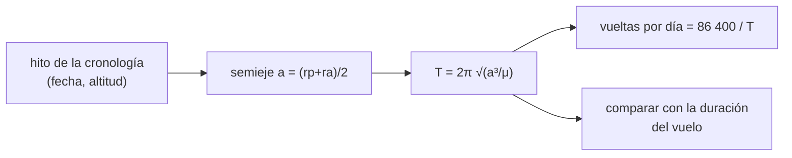

# B104-C01 — Historia de vuelos tripulados

<!-- nav:top -->
[🏠 Programa](../../../../README.md) · [📚 Bloque B104](../../../tronco-comun/B104-astronautica-y-preparacion-de-astronautas.md) · [← Anterior: B103-C08 — Métricas de evaluación de percepción](../../B103/B103-C08-metricas-de-evaluacion-de-percepcion/CLASE.md) · [Siguiente: B104-C02 — Requisitos de tripulación →](../B104-C02-requisitos-de-tripulacion/CLASE.md)
<!-- /nav -->

## 1. Ubicación, nivel y alcance

Clase 1 del bloque B104, nivel N3. Una cronología de vuelos tripulados es una lista de fechas, duraciones y altitudes; aquí la lees con la física de Kepler para comprobar que los números cuentan una historia coherente (¿cuántas vueltas da una tripulación en seis meses?). No es una clase de historia exhaustiva: es una clase sobre **cómo leer y comprobar** datos históricos y cuáles de ellos se consultaron. Prepara a B104-C02 (requisitos), que parte de lo que la historia enseñó a exigir.

## 2. Por qué esta clase existe

Los hitos del vuelo tripulado se citan de memoria y circulan con cifras que difieren entre fuentes (una altitud mínima de 169 km o de 181 km para el primer vuelo orbital). La decisión central: **¿qué cifra histórica puedes usar sin riesgo y cuál debes rotular como no consultada?** Con el periodo de Kepler compruebas la coherencia interna de un dato sin necesidad de creerlo.

## 3. Lo que podrás hacer al terminar

1. Calcular el periodo y las vueltas por día de una órbita circular o elíptica con la tercera ley de Kepler.
2. Calcular las velocidades en perigeo y apogeo con la ecuación vis-viva.
3. Contrastar la duración de un vuelo con el periodo de su órbita y explicar la diferencia.
4. Distinguir un dato consultado, un dato calculado y un valor ilustrativo en una cronología.
5. Reconocer la diferencia entre fuentes primarias, institucionales y de divulgación.
6. Elaborar una ficha de cronología con periodos calculados y su estado de consulta.

La evidencia es la **ficha de cronología con periodos calculados** del ejercicio 12 (sección 20).

## 4. Con qué llegas y cómo comprobarlo

1. ¿Qué dice la tercera ley de Kepler?
2. ¿Qué es el semieje mayor de una órbita?
3. ¿Qué es una órbita circular?
4. ¿Qué es el apogeo?
5. ¿Qué es un dato sintético o ilustrativo?

<details>
<summary>Ver respuestas</summary>

1. El cuadrado del periodo es proporcional al cubo del semieje mayor. 2. La mitad del eje más largo de la elipse. 3. Una órbita de radio constante. 4. El punto más lejano de la Tierra. 5. Un valor puesto para el ejemplo, no medido ni citado.
</details>

Con cuatro o cinco aciertos, sigue; si no, repasa los prerrequisitos.

## 5. Un caso de contexto y casos de referencia

La página de NASA sobre las caminatas espaciales de la Estación Espacial Internacional (consultada el 2026-11-10) registra más de 280 caminatas desde diciembre de 1998 y una altitud orbital «de más de 200 millas (320 km)». Con 320 km el periodo de Kepler es de 90,93 min y la estación da 15,84 vueltas por día; con 400 km (ilustrativo), 92,56 min y 15,56 vueltas. En 180 días a 400 km son unas 2 800 vueltas. Es el **ejemplo conductor**: la altitud de 320 km es una cota inferior consultada; las demás órbitas son **ilustrativas**.

## 6. Vocabulario

El **periodo** `T` es el tiempo de una vuelta. El **semieje mayor** `a` es el promedio de los radios de perigeo y apogeo. La **vis-viva** `v² = μ(2/r − 1/a)` da la velocidad en cada punto. Una **cronología** es una lista ordenada de hitos con fecha. Una **fuente primaria** es un documento de la propia misión o agencia; una de **divulgación** resume a otras.

## 7. Modelo mental



*Descripción textual:* de las altitudes de perigeo y apogeo se obtiene el semieje, de él el periodo y las vueltas por día, y el periodo se compara con la duración declarada del vuelo.

Analogía: comprobar el horario de un tren con la distancia y la velocidad: si el trayecto dice 5 minutos para 100 km, algo no cuadra. Límite: la órbita real se perturba (achatamiento, resistencia del aire), y el modelo de dos cuerpos solo da el orden de magnitud.

## 8. La explicación, paso a paso

### 8.1 Periodo y vueltas por día

Con `μ = 3,986004418 × 10¹⁴ m³/s²` y `R_E = 6378,137 km`, el semieje de una órbita de 320 km es `6 698,1 km`, y `T = 2π√(a³/μ) = 90,93 min`. Las vueltas por día son `86 400 s / T = 15,84`. A 400 km: 92,56 min y 15,56 vueltas.

### 8.2 Velocidades

La vis-viva en una órbita circular da `v = 2πa/T`: 7,714 km/s a 320 km y 7,669 km/s a 400 km (el laboratorio lo comprueba con una tolerancia de 1e-6 m/s). En la elipse de ejemplo (181 × 327 km), `v` en el perigeo es 7,838 km/s y en el apogeo 7,668 km/s: se va más rápido abajo.

### 8.3 Duración frente a periodo

Para la órbita elíptica de ejemplo, de clase Vostok, el periodo es 89,59 min. Una duración de 108 min (valor **no consultado**) da un cociente de 1,206: el vuelo dura más que una vuelta porque incluye el ascenso y el descenso. La comprobación valida la coherencia, no la cifra.

### 8.4 Qué se consultó y qué se calculó

De la página de NASA se usan solo la cifra de más de 280 caminatas desde diciembre de 1998 y la altitud de más de 320 km. Todo lo demás es cálculo con constantes estándar o valor ilustrativo, y así se rotula. La geoestacionaria (35 786 km, 23,93 h) es una referencia de control: su periodo debe ser el día sideral.

## 9. Magnitudes, símbolos y unidades

| Símbolo | Qué es | Unidad | Valor / nota |
|---|---|---|---|
| `T` | periodo orbital | min | 90,93 (320 km) a 1 436 (geoestacionaria) |
| `a` | semieje mayor | km | 6 698,1 a 42 164,1 |
| `μ` | parámetro gravitacional terrestre | m³/s² | 3,986004418e14 (estándar) |
| `v` | velocidad orbital | km/s | 7,714 (320 km) |
| vueltas/día | 86 400/T | 1/d | 15,84 a 1,003 |

## 10. Convenciones y referencias

Modelo de dos cuerpos, sin perturbaciones; altitud medida sobre el radio ecuatorial. Metros y segundos en el cálculo, kilómetros y minutos en las tablas. Tolerancias: periodo a 320 km entre 90 y 92 min; geoestacionaria `23,934 ± 0,01` h; vis-viva circular igual a `2πr/T` con error < 1e-6 m/s. Numpy 2.4.4, Python 3.12.9.

## 11. De dónde sale lo que afirmamos

| ID | Fuente | Localizador | Respalda | Estado |
|---|---|---|---|---|
| S1 | NASA, «Space Station Spacewalks» — https://www.nasa.gov/international-space-station/space-station-spacewalks/ (consultada 2026-11-10; se leyeron los primeros 100 000 caracteres) | página, texto inicial | más de 280 caminatas ISS desde diciembre de 1998; altitud orbital de más de 200 millas (320 km) | Consultada |
| — | Relaciones estándar usadas en el laboratorio | — | las verifica el laboratorio | No consultada en una fuente concreta (las verifica el laboratorio) |

Límites: no se consultó ninguna página sobre Vostok 1: su perigeo (169 o 181 km según las fuentes de búsqueda vistas), su apogeo y la duración de 108 min se usan solo como valores ilustrativos y rotulados «no consultados». No se afirma ningún hito histórico más allá de lo citado.

## 12. Cómo ver el resultado

| Órbita | `a` (km) | `T` (min) | vueltas/día |
|---|---|---|---|
| circular 320 km (cota ISS, consultada) | 6 698,1 | 90,93 | 15,837 |
| circular 400 km (ilustrativa) | 6 778,1 | 92,56 | 15,557 |
| elipse 181 × 327 km (ilustrativa) | 6 632,1 | 89,59 | 16,074 |
| geoestacionaria (referencia) | 42 164,1 | 1 436,07 | 1,003 |

Descripción larga: el periodo crece con la altitud; entre 320 y 400 km la diferencia es de 1,63 min.

## 13. Ejemplo trabajado: periodo a 400 km

**Paso 1 · Semieje.** `a = 6 378,137 + 400 = 6 778,137 km`.

**Paso 2 · Periodo.** `T = 2π √((6,778137e6)³ / 3,986004e14) = 5 554 s`.

**Paso 3 · En minutos.** `5 554/60 = 92,56 min`.

**Paso 4 · Vueltas por día.** `86 400/5 554 = 15,56`.

## 14. Distintas formas de describir el problema

**Por fórmula:** `T = 2π√(a³/μ)`. **Por tabla:** altitud, periodo, vueltas. **Por velocidad:** `v = 2πa/T`. **Por duración:** cociente duración/periodo. **Por fuente:** consultado, calculado o ilustrativo.

## 15. Práctica guiada

**Ejercicio 1 · con los pasos indicados.** Calcula el periodo a 400 km. *Pasos:* suma el radio terrestre, eleva a la tercera potencia, divide por `μ` y extrae la raíz.

<details><summary>Solución comentada</summary>

`T = 5 554 s = 92,56 min`.
</details>

**Ejercicio 2 · con una pista.** ¿Cuántas vueltas por día da una nave a 400 km? *Pista:* `86 400/T`.

<details><summary>Solución comentada</summary>

`86 400/5 554 = 15,56`.
</details>

**Ejercicio 3 · casi autónomo.** Calcula la velocidad circular a 400 km con `2πa/T`.

<details><summary>Solución comentada</summary>

`2π · 6 778 137 / 5 554 = 7 668 m/s ≈ 7,67 km/s`.
</details>

## 16. Práctica autónoma, transferencia e integrador

**Ejercicio 4 · autónomo.** ¿Por qué el periodo de una órbita de 35 786 km es de 23,93 h?

<details><summary>Solución comentada</summary>

Porque ese periodo coincide con el día sideral: la nave queda fija sobre un punto del ecuador.
</details>

**Ejercicio 5 · autónomo.** Una duración de 108 min y un periodo de 89,6 min dan un cociente de 1,21. ¿Qué dice y qué no?

<details><summary>Solución comentada</summary>

Que el vuelo duró algo más de una vuelta, coherente con el ascenso y el descenso; no valida la cifra de 108 min, que no se consultó.
</details>

**Ejercicio 6 · autónomo.** Comprueba que en 180 días a 400 km hay unas 2 800 vueltas.

<details><summary>Solución comentada</summary>

`180 · 15,557 = 2 800`.
</details>

**Ejercicio 7 · autónomo.** ¿Cuánto cambia el periodo al pasar de 320 a 400 km, en minutos y en porcentaje?

<details><summary>Solución comentada</summary>

`92,56 − 90,93 = 1,63 min`, un `1,8 %`.
</details>

**Ejercicio 8 · autónomo.** Clasifica cada dato de la ficha como consultado, calculado o ilustrativo: «más de 280 caminatas», «T = 90,93 min», «perigeo de 181 km».

<details><summary>Solución comentada</summary>

Consultado; calculado; ilustrativo (no consultado).
</details>

**Ejercicio 9 · transferencia.** Una estación a 400 km: ¿cuánto se desplaza hacia el oeste su traza en el ecuador entre una vuelta y la siguiente?

<details><summary>Solución comentada</summary>

La Tierra gira `360°/86 164 s = 0,004178 °/s`; en 5 554 s son `23,2°`, unos `2 580 km` en el ecuador.
</details>

**Ejercicio 10 · transferencia.** Un tripulante a 400 km ve amanecer en cada vuelta. ¿Cuántos amaneceres por día?

<details><summary>Solución comentada</summary>

Uno por vuelta: unos 15,6 al día, aproximadamente 16 (el modelo ignora la inclinación y la estación).
</details>

**Ejercicio 11 · transferencia.** Un texto afirma que el primer vuelo orbital duró «una vuelta y 108 minutos con 85 min de periodo». ¿Qué compruebas y cómo respondes?

<details><summary>Solución comentada</summary>

Calculas el periodo con las altitudes que cita; si no coincide con 85 min (la elipse de ejemplo da 89,6), señalas la incoherencia y pides la fuente; no corriges con una cifra no consultada.
</details>

**Ejercicio 12 · integrador.** Elabora tu *ficha de cronología con periodos calculados*: tres órbitas, periodo y vueltas por día, velocidades, cociente duración/periodo y rótulo consultado/calculado/ilustrativo de cada cifra.

<details><summary>Solución comentada</summary>

Secciones 8.1–8.4 y la salida del laboratorio.
</details>

## 17. Laboratorio: periodos orbitales de una cronología

El script [cronologia.py](cronologia.py) calcula periodo, vueltas por día y velocidades para cuatro órbitas y compara con una duración de vuelo (**comprueba** el periodo a 320 km, que crezca con la altitud, el día sideral de la geoestacionaria y la vis-viva circular). Tarda menos de 1 s.

**Datos:** órbitas **ilustrativas** (solo 320 km es una cota consultada); `μ` y `R_E` estándar. Sin aleatoriedad. **Predice antes de ejecutar:** ¿Cuántas vueltas por día da una órbita de 400 km? (Unas 15,6.) **Ejecución del 2026-11-10 (Python 3.12.9):**

```text
Python 3.12.9; numpy 2.4.4
MODELO ILUSTRATIVO: orbitas de ejemplo (no son datos de una mision); mu y RE estandar
Caso | semieje a [km] | periodo [min] | vueltas/dia | v perigeo [km/s] | v apogeo [km/s]
circular 320 km (cota inferior de altitud de la ISS segun la pagina de NASA consultada)
      6698.1 |    90.93 |   15.837 |   7.714 |   7.714
circular 400 km (ilustrativa)
      6778.1 |    92.56 |   15.557 |   7.669 |   7.669
elipse 181 x 327 km (clase Vostok; valores NO consultados)
      6632.1 |    89.59 |   16.074 |   7.838 |   7.668
circular 35786 km (geoestacionaria, referencia)
     42164.1 |  1436.07 |    1.003 |   3.075 |   3.075
Cociente 108 min / periodo clase Vostok = 1.206 (ilustrativo; la duracion de 108 min no se consulto)
Vueltas en 180 dias a 400 km: 2800
Pruebas superadas.
```

```bash
python programa/clases/B104/B104-C01-historia-de-vuelos-tripulados/cronologia.py
```

**Límites:** modelo de dos cuerpos sin perturbaciones, sin inclinación ni rotación terrestre en el cálculo del periodo; las altitudes de Vostok no son datos consultados.

## 18. Errores frecuentes y cómo corregirlos

**Citar de memoria una cifra histórica.** Rotúlala como no consultada o consulta la fuente (sección 11).

**Confundir duración del vuelo con periodo.** Compara ambos y explica la diferencia (8.3).

**Mezclar altitud y radio orbital.** Suma el radio terrestre antes de usar Kepler (ejemplo 13).

**Presentar un valor ilustrativo como dato.** Mantén el rótulo en tablas y texto (8.4).

## 19. Cómo sabrás que vas bien

Tras la sección 8: ¿cuántas vueltas por día esperabas a 320 km y cuántas da la tabla? Si dudas, repasa el ejemplo 13. Tras el laboratorio: ¿qué comprueba? (ver la sección 17).

## 20. Qué entregas y cómo se evalúa

El producto es tu **ficha de cronología con periodos calculados** (ejercicio 12).

| Criterio | Inicial | En desarrollo | Logrado | Destacado |
|---|---|---|---|---|
| Conceptos | Confunde los términos | Parciales | Explica periodo, vis-viva y fuente | Explica por qué la duración supera al periodo |
| Cálculo | Sin unidades | Con errores | Calcula con unidades y compara con el laboratorio | Resuelve casos nuevos |
| Numérico | Sin comprobar | Un caso | Compara con una segunda vía de cálculo | Interpreta las diferencias |
| Fuentes | Sin fuente | Sin fecha | Fuentes con fecha y estado | Declara lo sintético, lo ilustrativo y lo no consultado |
| Límites | No los nombra | Uno | Tres | Discute qué falta del modelo |

**Condiciones críticas (no se compensan con promedio):** rotular lo ilustrativo y lo no consultado, no presentar ninguna cifra histórica sin su estado de consulta y citar solo lo consultado.

## 21. Ética, seguridad y límites

Clase educativa: **no da consejo médico, de entrenamiento individual ni operativo** y no sustituye a los requisitos, procedimientos y estándares de ninguna agencia. Los periodos son del modelo de dos cuerpos y no sirven para planificar una operación. Accesibilidad: tablas equivalentes a las gráficas, fórmulas en texto, ejercicios sin conexión.

## 22. Para cerrar y seguir

Con solo la tercera ley de Kepler se comprueba que una nave a 320–400 km da unas 15,6–15,8 vueltas por día y que un vuelo de 108 min es compatible con una vuelta. Queda una pregunta: ¿qué se debe exigir a una tripulación para esos vuelos?

**Glosario español–inglés.** periodo · *period*; semieje mayor · *semi-major axis*; vis-viva · *vis-viva equation*; cronología · *timeline*; órbita geoestacionaria · *geostationary orbit*.

**Continuidad.** [B104-C02](../B104-C02-requisitos-de-tripulacion/CLASE.md) define los requisitos de tripulación y los consumibles que exige un vuelo.

**Referencias:** ver sección 11.

<!-- nav:bottom -->
---

[← Anterior: B103-C08 — Métricas de evaluación de percepción](../../B103/B103-C08-metricas-de-evaluacion-de-percepcion/CLASE.md) · [📚 Bloque B104](../../../tronco-comun/B104-astronautica-y-preparacion-de-astronautas.md) · [Siguiente: B104-C02 — Requisitos de tripulación →](../B104-C02-requisitos-de-tripulacion/CLASE.md)
<!-- /nav -->
