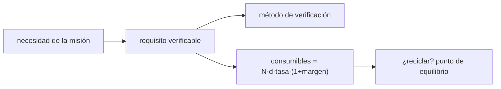

# B104-C02 — Requisitos de tripulación

<!-- nav:top -->
[🏠 Programa](../../../../README.md) · [📚 Bloque B104](../../../tronco-comun/B104-astronautica-y-preparacion-de-astronautas.md) · [← Anterior: B104-C01 — Historia de vuelos tripulados](../B104-C01-historia-de-vuelos-tripulados/CLASE.md) · [Siguiente: B104-C03 — Selección y aptitud →](../B104-C03-seleccion-y-aptitud/CLASE.md)
<!-- /nav -->

## 1. Ubicación, nivel y alcance

Clase 2 del bloque B104, nivel N3. Un requisito de tripulación es una frase verificable que dice qué debe poder hacer o tener la tripulación y la nave. Aquí aprendes a escribirlo, a trazarlo hasta un método de verificación y a dimensionar los consumibles que genera (oxígeno, agua, alimento) con un modelo lineal. Sigue a B104-C01 (historia) y prepara a B104-C03 (selección) y B104-C05 (la nave). Todas las tasas son **ilustrativas**.

## 2. Por qué esta clase existe

«La tripulación tendrá agua suficiente» no se puede comprobar; «4 personas, 30 días, 2,5 kg por persona y día más un 10 % de margen» sí. La decisión central: **¿cuánto hay que llevar, y a partir de cuántos días compensa un equipo que recicla?**

## 3. Lo que podrás hacer al terminar

1. Redactar un requisito verificable con su método (análisis, inspección, ensayo o demostración).
2. Dimensionar consumibles por tripulante y día con un margen de contingencia.
3. Comprobar la linealidad de la masa con el número de tripulantes y los días.
4. Calcular el punto de equilibrio de un reciclador de agua.
5. Detectar requisitos sin verificación cerrada en una matriz de trazabilidad.
6. Rotular las tasas como ilustrativas y no como estándares.

La evidencia es la **matriz de requisitos con consumibles** del ejercicio 12 (sección 20).

## 4. Con qué llegas y cómo comprobarlo

1. ¿Qué es un requisito?
2. ¿Qué es una masa por persona y día?
3. ¿Qué es un margen?
4. ¿Qué es el punto de equilibrio?
5. ¿Qué es un dato ilustrativo?

<details>
<summary>Ver respuestas</summary>

1. Una condición que el sistema debe cumplir y que se puede comprobar. 2. Los kilogramos que consume una persona cada día. 3. Un exceso deliberado para absorber incertidumbre. 4. El valor donde dos costos se igualan. 5. Un valor inventado o ajustado para el ejemplo.
</details>

Con cuatro o cinco aciertos, sigue; si no, repasa los prerrequisitos.

## 5. Un caso de contexto y casos de referencia

Con tasas ilustrativas de 0,84 kg de oxígeno, 2,5 kg de agua potable y 0,62 kg de alimento seco por persona y día, y un margen de 10 %, una misión de 4 personas durante 30 días necesita 522,7 kg de estos tres consumibles; durante 180 días, 3 136,3 kg; y una de 6 personas durante 900 días, 23 522,4 kg. Un reciclador de agua ilustrativo (400 kg, 90 % de recuperación) compensa su masa a partir de los 40,4 días. Es el **ejemplo conductor**: las tasas y la masa del equipo son **ilustrativas** y no vienen de un estándar de NASA, que no se consultó.

## 6. Vocabulario

Un **requisito** es una condición verificable. La **verificación** es la prueba de que se cumple (análisis, inspección, ensayo, demostración). La **trazabilidad** enlaza cada requisito con su origen y su verificación. El **margen** es el exceso sobre la necesidad nominal. El **cierre de lazo** es la fracción de un consumible que se recupera.

## 7. Modelo mental



*Descripción textual:* una necesidad se convierte en un requisito verificable con su método de comprobación y, para los consumibles, en una masa que depende de la tripulación, los días y el margen; el reciclado se decide por el punto de equilibrio.

Analogía: preparar una expedición de campamento: cuántos litros por persona y día, más un colchón. Límite: en una nave cada kilogramo cuesta combustible, y la masa del equipo también cuenta.

## 8. La explicación, paso a paso

### 8.1 Del requisito a la verificación

Un buen requisito tiene sujeto, condición y número: «el sistema de agua entregará 2,5 kg por persona y día a 4 personas durante 180 días». Cada uno se asocia a un método. En la matriz sintética del laboratorio hay 5 requisitos y uno (R5, abortar en 10 min) no tiene la verificación cerrada: la matriz lo señala.

### 8.2 Masa de consumibles

`m = n · d · tasa · (1 + margen)`. Para 2 personas y 8 días con 10 % de margen: oxígeno 14,8 kg, agua 44,0 kg, alimento 10,9 kg (total 69,7 kg). Es lineal: doblar los tripulantes o los días dobla la masa (el laboratorio lo comprueba).

### 8.3 Punto de equilibrio de un reciclador

Con `M_hw = 400 kg`, cierre 90 % y 4 personas, el agua evitada por día es `n · tasa · (1 + margen) · cierre = 9,9 kg/d`, y `d_eq = 400/9,9 = 40,4 d`. A 30 días el reciclador pierde 103,0 kg; a 180 días ahorra 1 382,0 kg; a 900 días, 8 510,0 kg. Más allá del equilibrio, cada día ahorra masa.

### 8.4 Lo que el modelo no incluye

Fallas del reciclador, repuestos, energía, volumen, residuos y la variación de la tasa metabólica. Las tasas son ilustrativas y no sustituyen a los valores de un estándar de salud y desempeño de una agencia.

## 9. Magnitudes, símbolos y unidades

| Símbolo | Qué es | Unidad | Valor / nota |
|---|---|---|---|
| `n` | tripulantes | — | 2 a 6 |
| `d` | duración | días | 8 a 900 |
| tasa | masa por persona y día | kg/(persona·d) | 0,84 / 2,5 / 0,62 (ilustrativas) |
| margen | contingencia | — | 0,10 |
| `M_hw` | masa del reciclador | kg | 400 (ilustrativa) |
| cierre | fracción reciclada | — | 0,90 (ilustrativa) |

## 10. Convenciones y referencias

Masa en kilogramos, tiempo en días; tasas por persona y día constantes; el margen se aplica a cada consumible. Datos sin aleatoriedad. Tolerancias: linealidad exacta (< 1e-9) y punto de equilibrio con igualdad de masas (< 1e-6). Numpy 2.4.4, Python 3.12.9.

## 11. De dónde sale lo que afirmamos

| ID | Fuente | Localizador | Respalda | Estado |
|---|---|---|---|---|
| S1 | NASA, «Human Research Program: hazards» — https://www.nasa.gov/hrp/hazards/ (consultada 2026-11-10) | página completa | el entorno cerrado y la distancia son dos de los cinco peligros del vuelo humano; justifican el cuidado en el dimensionado de recursos | Consultada |
| — | Relaciones estándar usadas en el laboratorio | — | las verifica el laboratorio | No consultada en una fuente concreta (las verifica el laboratorio) |

Límites: de la página de NASA solo se toma la lista de cinco peligros; las tasas de consumo y los valores del reciclador son ilustrativos y no provienen de ningún estándar (por ejemplo NASA-STD-3001, que no se consultó).

## 12. Cómo ver el resultado

| Tripulantes | días | oxígeno (kg) | agua (kg) | alimento (kg) | total (kg) |
|---|---|---|---|---|---|
| 2 | 8 | 14,8 | 44,0 | 10,9 | 69,7 |
| 4 | 30 | 110,9 | 330,0 | 81,8 | 522,7 |
| 4 | 180 | 665,3 | 1 980,0 | 491,0 | 3 136,3 |
| 6 | 900 | 4 989,6 | 14 850,0 | 3 682,8 | 23 522,4 |

Descripción larga: la masa crece en proporción a `n · d`; el reciclador compensa desde 40,4 días.

## 13. Ejemplo trabajado: oxígeno para 2 personas durante 8 días

**Paso 1 · Necesidad nominal.** `2 · 8 · 0,84 = 13,44 kg`.

**Paso 2 · Margen.** `13,44 · 1,10 = 14,78 kg`.

**Paso 3 · Redondeo.** `14,8 kg`.

## 14. Distintas formas de describir el problema

**Por fórmula:** `m = n d tasa (1+margen)`. **Por tabla:** n, d y masa por consumible. **Por equilibrio:** `d_eq = M_hw / (n·tasa·(1+m)·cierre)`. **Por matriz:** requisito, origen, método, estado.

## 15. Práctica guiada

**Ejercicio 1 · con los pasos indicados.** Calcula el oxígeno de 2 personas durante 8 días con 10 % de margen. *Pasos:* multiplica `n·d·tasa` y aplica el margen.

<details><summary>Solución comentada</summary>

`2·8·0,84·1,1 = 14,8 kg`.
</details>

**Ejercicio 2 · con una pista.** ¿Cuánto alimento necesita una tripulación de 6 durante 900 días? *Pista:* usa 0,62 kg/(persona·d).

<details><summary>Solución comentada</summary>

`6·900·0,62·1,1 = 3 682,8 kg`.
</details>

**Ejercicio 3 · casi autónomo.** Calcula el agua de 4 personas durante 30 días sin margen y con él.

<details><summary>Solución comentada</summary>

Sin margen `300 kg`; con margen `330 kg`.
</details>

## 16. Práctica autónoma, transferencia e integrador

**Ejercicio 4 · autónomo.** Si se duplica la tripulación, ¿qué pasa con la masa total? ¿Y si se duplican los días?

<details><summary>Solución comentada</summary>

Se duplica en ambos casos (el modelo es lineal en `n` y `d`).
</details>

**Ejercicio 5 · autónomo.** Calcula el punto de equilibrio si el cierre es 50 % y el equipo pesa 400 kg (4 personas).

<details><summary>Solución comentada</summary>

`400/(4·2,5·1,1·0,5) = 72,7 d`.
</details>

**Ejercicio 6 · autónomo.** ¿Cuánto ahorra el reciclador a 180 días según el laboratorio?

<details><summary>Solución comentada</summary>

`1 382,0 kg` (1 980,0 sin reciclar frente a 598,0 con reciclador incluido el equipo).
</details>

**Ejercicio 7 · autónomo.** Redacta un requisito verificable para el alimento de 4 personas durante 180 días.

<details><summary>Solución comentada</summary>

«La nave dispondrá de 491,0 kg de alimento seco para 4 personas durante 180 días, verificado por análisis de masas».
</details>

**Ejercicio 8 · autónomo.** ¿Por qué existe el margen de 10 % y qué riesgo tiene fijarlo sin análisis?

<details><summary>Solución comentada</summary>

Absorbe fallas y retrasos de reabastecimiento; fijado sin análisis puede sobrar (masa inútil) o faltar.
</details>

**Ejercicio 9 · transferencia.** Compara la masa de 6 personas durante 900 días con la de 4 durante 180 días.

<details><summary>Solución comentada</summary>

`23 522,4 / 3 136,3 = 7,5` = `(6·900)/(4·180)`: la relación es la de las personas-día.
</details>

**Ejercicio 10 · transferencia.** El reciclador pesa 800 kg y recupera 90 %. ¿Desde cuántos días compensa con 4 personas?

<details><summary>Solución comentada</summary>

`800/(4·2,5·1,1·0,9) = 80,8 d`.
</details>

**Ejercicio 11 · transferencia.** El requisito «la tripulación tendrá aire respirable» aparece en una matriz. ¿Qué le falta y cómo lo mejoras?

<details><summary>Solución comentada</summary>

Cantidad, composición, tolerancias, duración y método; por ejemplo, rangos de presión parcial de oxígeno y de dióxido de carbono verificados por ensayo (clase B104-C05).
</details>

**Ejercicio 12 · integrador.** Elabora tu *matriz de requisitos con consumibles*: tres requisitos con método de verificación, la tabla de masas para una misión que definas, el punto de equilibrio de un reciclador y la lista de qué es ilustrativo.

<details><summary>Solución comentada</summary>

Secciones 8.1–8.4 y la salida del laboratorio.
</details>

## 17. Laboratorio: consumibles y trazabilidad de requisitos

El script [requisitos.py](requisitos.py) calcula la masa de consumibles para cuatro misiones, el punto de equilibrio de un reciclador y una matriz de trazabilidad sintética (**comprueba** la linealidad, la igualdad en el equilibrio y que se detecte el requisito sin verificar). Tarda menos de 1 s.

**Datos:** tasas, equipo y matriz **ilustrativos y sintéticos**. Sin aleatoriedad. **Predice antes de ejecutar:** ¿Desde cuántos días compensa el reciclador de 400 kg? (Unos 40.) **Ejecución del 2026-11-10 (Python 3.12.9):**

```text
Python 3.12.9; numpy 2.4.4
MODELO ILUSTRATIVO: tasas por persona y dia inventadas para el ejemplo; margen de contingencia 10 %

Tripulantes | dias | oxigeno [kg] | agua [kg] | alimento [kg] | total [kg]
     2          8         14.8       44.0         10.9       69.7
     4         30        110.9      330.0         81.8      522.7
     4        180        665.3     1980.0        491.0     3136.3
     6        900       4989.6    14850.0       3682.8    23522.4

Punto de equilibrio del reciclador (equipo 400 kg, cierre 90%, 4 tripulantes): 40.4 dias
     30.0 dias: agua sin reciclar    330.0 kg; con reciclador (incl. equipo)    433.0 kg; ahorro   -103.0 kg
     40.4 dias: agua sin reciclar    444.4 kg; con reciclador (incl. equipo)    444.4 kg; ahorro      0.0 kg
    180.0 dias: agua sin reciclar   1980.0 kg; con reciclador (incl. equipo)    598.0 kg; ahorro   1382.0 kg
    900.0 dias: agua sin reciclar   9900.0 kg; con reciclador (incl. equipo)   1390.0 kg; ahorro   8510.0 kg

Requisitos: 5; sin verificacion cerrada: ['R5 abortar en 10 min']
Pruebas superadas.
```

```bash
python programa/clases/B104/B104-C02-requisitos-de-tripulacion/requisitos.py
```

**Límites:** modelo lineal sin fallas, repuestos, energía ni volumen; las tasas no son las de un estándar.

## 18. Errores frecuentes y cómo corregirlos

**Escribir requisitos sin número ni método.** Añade cantidad, condición y verificación (8.1).

**Olvidar el margen.** Aplícalo a cada consumible (8.2).

**Decidir el reciclado sin el punto de equilibrio.** Calcula `d_eq` (8.3).

**Presentar las tasas ilustrativas como estándar.** Rotúlalas (sección 10).

## 19. Cómo sabrás que vas bien

Tras la sección 8: ¿qué masa esperabas para 4 personas y 30 días y cuál da la tabla? Si dudas, repasa el ejemplo 13. Tras el laboratorio: ¿qué comprueba? (ver la sección 17).

## 20. Qué entregas y cómo se evalúa

El producto es tu **matriz de requisitos con consumibles** (ejercicio 12).

| Criterio | Inicial | En desarrollo | Logrado | Destacado |
|---|---|---|---|---|
| Conceptos | Confunde los términos | Parciales | Explica requisito, verificación y margen | Explica cuándo no conviene reciclar |
| Cálculo | Sin unidades | Con errores | Calcula con unidades y compara con el laboratorio | Resuelve casos nuevos |
| Numérico | Sin comprobar | Un caso | Compara con una segunda vía de cálculo | Interpreta las diferencias |
| Fuentes | Sin fuente | Sin fecha | Fuentes con fecha y estado | Declara lo sintético, lo ilustrativo y lo no consultado |
| Límites | No los nombra | Uno | Tres | Discute qué falta del modelo |

**Condiciones críticas (no se compensan con promedio):** rotular las tasas como ilustrativas, no presentarlas como valores de un estándar y citar solo lo consultado.

## 21. Ética, seguridad y límites

Clase educativa: **no da consejo médico, de entrenamiento individual ni operativo** y no sustituye a los requisitos, procedimientos y estándares de ninguna agencia. Las masas son un ejercicio de dimensionado y no sirven para planificar una misión real. Accesibilidad: tablas equivalentes a las gráficas, fórmulas en texto, ejercicios sin conexión.

## 22. Para cerrar y seguir

Con tasas ilustrativas, 4 personas y 30 días requieren 522,7 kg y un reciclador de 400 kg se amortiza desde 40,4 días. Queda una pregunta: ¿cómo se elige a las personas que cumplirán esos requisitos?

**Glosario español–inglés.** requisito · *requirement*; verificación · *verification*; trazabilidad · *traceability*; margen · *margin*; cierre de lazo · *loop closure*.

**Continuidad.** [B104-C03](../B104-C03-seleccion-y-aptitud/CLASE.md) estudia el embudo de selección de la tripulación y sus errores de clasificación.

**Referencias:** ver sección 11.

<!-- nav:bottom -->
---

[← Anterior: B104-C01 — Historia de vuelos tripulados](../B104-C01-historia-de-vuelos-tripulados/CLASE.md) · [📚 Bloque B104](../../../tronco-comun/B104-astronautica-y-preparacion-de-astronautas.md) · [Siguiente: B104-C03 — Selección y aptitud →](../B104-C03-seleccion-y-aptitud/CLASE.md)
<!-- /nav -->
