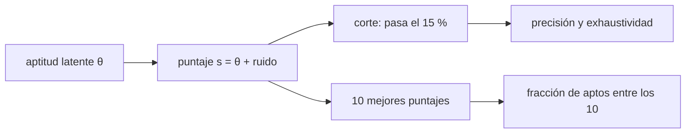

# B104-C03 — Selección y aptitud

<!-- nav:top -->
[🏠 Programa](../../../../README.md) · [📚 Bloque B104](../../../tronco-comun/B104-astronautica-y-preparacion-de-astronautas.md) · [← Anterior: B104-C02 — Requisitos de tripulación](../B104-C02-requisitos-de-tripulacion/CLASE.md) · [Siguiente: B104-C04 — Acondicionamiento físico general →](../B104-C04-acondicionamiento-fisico-general/CLASE.md)
<!-- /nav -->

## 1. Ubicación, nivel y alcance

Clase 3 del bloque B104, nivel N3. La selección de astronautas combina requisitos de formación, experiencia y salud con entrevistas y pruebas. Aquí no describes el proceso de ninguna agencia: modelas, con **postulantes sintéticos**, qué ocurre cuando una prueba imperfecta debe elegir a unas pocas personas entre miles. Sigue a B104-C02 y prepara a B104-C04. B107-C04 (evaluación periódica del rendimiento) es una clase programada aparte.

## 2. Por qué esta clase existe

Si una prueba tiene ruido, ¿cuántos de los elegidos serán de verdad aptos? La decisión central: **¿cuánto ruido tolera un embudo antes de que la elección se parezca a un sorteo?** Un número alto de postulantes y pocas plazas amplifica ese problema.

## 3. Lo que podrás hacer al terminar

1. Describir las condiciones de entrada que NASA publicó el 2026-11-10 y su carácter cambiante.
2. Simular un embudo con aptitud latente, puntaje ruidoso y umbral de corte.
3. Calcular precisión y exhaustividad de una prueba de selección.
4. Aplicar el teorema de Bayes con la tasa base de aptos.
5. Medir cuántos de los elegidos son aptos al aumentar el ruido.
6. Reconocer los límites éticos y estadísticos de un puntaje.

La evidencia es la **informe de embudo con errores de clasificación** del ejercicio 12 (sección 20).

## 4. Con qué llegas y cómo comprobarlo

1. ¿Qué es una distribución normal?
2. ¿Qué es la precisión de una prueba?
3. ¿Qué es la exhaustividad?
4. ¿Qué es la tasa base?
5. ¿Qué es un dato sintético?

<details>
<summary>Ver respuestas</summary>

1. Una distribución simétrica en campana definida por media y desviación. 2. La fracción de los seleccionados que son realmente aptos. 3. La fracción de los aptos que fueron seleccionados. 4. La proporción de aptos en la población. 5. Un dato generado para el ejemplo, no real.
</details>

Con cuatro o cinco aciertos, sigue; si no, repasa los prerrequisitos.

## 5. Un caso de contexto y casos de referencia

La página de NASA «Become an Astronaut» (consultada el 2026-11-10) pide, para esa convocatoria, un máster en ciencias o ingeniería (con alternativas), al menos tres años de experiencia profesional relacionada y aprobar el examen físico de larga duración, y la página de candidatos indica 10 candidatos en el Grupo 24, anunciado el 22 de septiembre de 2025. Con **12 000 postulantes sintéticos**, de los cuales el 2 % es «apto», y una prueba con ruido σ = 1 que deja pasar al 15 %, la precisión es de 0,110 y la exhaustividad de 0,819; con σ = 2, la precisión baja a 0,070 y entre los 10 elegidos solo el 28,8 % es apto. Es el **ejemplo conductor**: el número de postulantes y la tasa de aptos son **sintéticos**.

## 6. Vocabulario

La **aptitud latente** `θ` es la cualidad que se quiere medir, no observable. El **puntaje** `s = θ + ε` suma un ruido `ε`. El **umbral de corte** deja pasar a una fracción. La **precisión** es `aptos que pasan / los que pasan`; la **exhaustividad**, `aptos que pasan / aptos`. La **tasa base** es la fracción de aptos.

## 7. Modelo mental



*Descripción textual:* la aptitud latente genera un puntaje ruidoso; el corte y la elección de los diez mejores producen precisión, exhaustividad y la fracción de aptos entre los elegidos.

Analogía: medir la altura de las personas con una cinta borrosa para elegir a las 10 más altas de 12 000: cuanto más borrosa, más se cuelan personas medianas. Límite: la aptitud real tiene varias dimensiones y no es un número único.

## 8. La explicación, paso a paso

### 8.1 Qué se consultó

De NASA se usan solo los requisitos de la convocatoria visible el 2026-11-10 (máster STEM o alternativas, tres años de experiencia, examen físico de larga duración, liderazgo, trabajo en equipo y comunicación) y los 10 candidatos del Grupo 24, anunciado el 22 de septiembre de 2025. Cambian en cada convocatoria y esta clase no los toma como pauta.

### 8.2 El embudo sintético

12 000 postulantes con `θ ~ N(0,1)`; «apto» es `θ > 2,0537` (2 %, unos 240). El puntaje es `θ + σ ε` y pasa el 15 % (1 800). Con σ = 0 la exhaustividad es 1,000 pero la precisión es solo 0,134: aunque la prueba sea perfecta, dejar pasar 1 800 para 240 aptos arrastra 1 560 no aptos.

### 8.3 El ruido

| σ | precisión | exhaustividad | aptos entre los 10 elegidos |
|---|---|---|---|
| 0,0 | 0,134 | 1,000 | 1,000 |
| 0,5 | 0,132 | 0,988 | 0,978 |
| 1,0 | 0,110 | 0,819 | 0,684 |
| 2,0 | 0,070 | 0,525 | 0,288 |

El laboratorio promedia 200 repeticiones por fila.

### 8.4 Bayes y tasa base

Con σ = 1: `P(apto | pasa) = P(pasa | apto) · P(apto)/P(pasa) = 0,819 · 0,02/0,15 = 0,109`, igual al Monte Carlo (0,110). La tasa base baja manda: un resultado «positivo» sigue siendo improbable de ser realmente apto.

### 8.5 Límites

Un puntaje único mide mal una persona; las agencias combinan formación, experiencia, entrevistas y exámenes médicos que esta clase no modela y cuyos criterios no se consultaron más allá de la convocatoria.

## 9. Magnitudes, símbolos y unidades

| Símbolo | Qué es | Unidad | Valor / nota |
|---|---|---|---|
| `N` | postulantes | — | 12 000 (sintético) |
| `θ` | aptitud latente | σ de la población | N(0,1) |
| `σ` | ruido de la prueba | σ de la población | 0 a 2 |
| corte | fracción que pasa | — | 0,15 |
| precisión | aptos entre los que pasan | — | 0,070 a 0,134 |
| exhaustividad | aptos que pasan / aptos | — | 0,525 a 1,000 |

## 10. Convenciones y referencias

Aptitud y ruido adimensionales (en desviaciones estándar de la población); semilla 104 para la lista y 1000–1199 para las repeticiones. Tolerancias: fracción de aptos 0,02 ± 0,001 con 2 millones de muestras; precisión decreciente con σ; Bayes frente a Monte Carlo < 0,01. Numpy 2.4.4, Python 3.12.9.

## 11. De dónde sale lo que afirmamos

| ID | Fuente | Localizador | Respalda | Estado |
|---|---|---|---|---|
| S1 | NASA, «Become an Astronaut» — https://nasa.gov/humans-in-space/astronauts/become-an-astronaut (consultada 2026-11-10) | lista de requisitos básicos | requisitos de la convocatoria visible: máster STEM o alternativas, tres años de experiencia, examen físico, liderazgo, trabajo en equipo y comunicación | Consultada |
| S2 | NASA, «Astronaut Candidates» — https://www.nasa.gov/humans-in-space/astronauts/astronaut-candidates/ (consultada 2026-11-10) | sección de la clase más reciente | Grupo 24: 10 candidatos, anunciado el 22 de septiembre de 2025; el número de postulantes no figura en la página | Consultada |
| — | Relaciones estándar usadas en el laboratorio | — | las verifica el laboratorio | No consultada en una fuente concreta (las verifica el laboratorio) |

Límites: las páginas de NASA no indican el número de postulantes ni los criterios de las entrevistas; el 12 000 es sintético. Una búsqueda mostró cifras de experiencia distintas en material antiguo; se usa solo la página consultada.

## 12. Cómo ver el resultado

| σ | precisión | exhaustividad | aptos entre los 10 elegidos |
|---|---|---|---|
| 0,0 | 0,134 | 1,000 | 1,000 |
| 0,5 | 0,132 | 0,988 | 0,978 |
| 1,0 | 0,110 | 0,819 | 0,684 |
| 2,0 | 0,070 | 0,525 | 0,288 |

Descripción larga: el ruido casi no afecta hasta σ = 0,5 y degrada rápido desde σ = 1.

## 13. Ejemplo trabajado: precisión con una prueba perfecta

**Paso 1 · Aptos.** `12 000 · 0,02 = 240`.

**Paso 2 · Pasan.** `12 000 · 0,15 = 1 800`.

**Paso 3 · Precisión.** Con σ = 0 pasan los 240: `240/1 800 = 0,133`.

**Paso 4 · Exhaustividad.** `240/240 = 1`.

## 14. Distintas formas de describir el problema

**Por conteo:** aptos, pasan, aptos que pasan. **Por Bayes:** `P(apto|pasa)`. **Por tabla:** σ frente a precisión. **Por elegidos:** fracción de aptos entre las 10 plazas.

## 15. Práctica guiada

**Ejercicio 1 · con los pasos indicados.** ¿Cuántos aptos esperas entre 12 000 con una tasa base de 2 %? *Pasos:* multiplica.

<details><summary>Solución comentada</summary>

`240`.
</details>

**Ejercicio 2 · con una pista.** Con una prueba perfecta y un corte del 15 %, ¿cuál es la precisión? *Pista:* aptos entre los que pasan.

<details><summary>Solución comentada</summary>

`240/1 800 = 0,133` (el laboratorio da 0,134 por el azar de la muestra).
</details>

**Ejercicio 3 · casi autónomo.** Aplica Bayes con σ = 1: exhaustividad 0,819, tasa base 0,02 y 15 % que pasa.

<details><summary>Solución comentada</summary>

`0,819 · 0,02/0,15 = 0,109`.
</details>

## 16. Práctica autónoma, transferencia e integrador

**Ejercicio 4 · autónomo.** ¿Por qué la precisión es baja con σ = 0?

<details><summary>Solución comentada</summary>

Porque el corte de 15 % deja pasar a muchos más que los 2 % de aptos.
</details>

**Ejercicio 5 · autónomo.** Con σ = 2, ¿qué fracción de los aptos se pierde?

<details><summary>Solución comentada</summary>

`1 − 0,525 = 47,5 %`.
</details>

**Ejercicio 6 · autónomo.** Con σ = 1, ¿cuántos de los 10 elegidos esperas que sean aptos?

<details><summary>Solución comentada</summary>

`0,684 · 10 ≈ 6,8`.
</details>

**Ejercicio 7 · autónomo.** Si el corte fuera 3 % y la prueba perfecta, ¿qué precisión y exhaustividad habría?

<details><summary>Solución comentada</summary>

`0,02/0,03 = 0,667` y `1`.
</details>

**Ejercicio 8 · autónomo.** Define con tus palabras precisión y exhaustividad y di cuál importa más al descartar riesgos.

<details><summary>Solución comentada</summary>

La precisión mide cuántos de los elegidos son aptos; la exhaustividad cuántos aptos se retienen; depende del costo de cada error.
</details>

**Ejercicio 9 · transferencia.** Se promedian dos pruebas independientes de σ = 1. ¿Qué ruido efectivo resulta y qué efecto esperas?

<details><summary>Solución comentada</summary>

`σ/√2 = 0,71`; la precisión sube hacia un valor entre 0,110 y 0,132 (filas de σ = 1 y σ = 0,5).
</details>

**Ejercicio 10 · transferencia.** Una prueba favorece a quienes tienen una experiencia ajena a la aptitud. ¿Qué sesgo introduce y cómo lo detectas?

<details><summary>Solución comentada</summary>

Un sesgo sistemático, no ruido: se detecta comparando el desempeño posterior de grupos con igual aptitud y revisando la validez de la prueba.
</details>

**Ejercicio 11 · transferencia.** Un informe dice «la prueba acierta el 98 %». ¿Qué preguntas haces?

<details><summary>Solución comentada</summary>

Qué mide («acierta»), la tasa base, la precisión y la exhaustividad: con 2 % de aptos, rechazar a todos acierta el 98 %.
</details>

**Ejercicio 12 · integrador.** Elabora tu *informe de embudo con errores de clasificación*: tasa base, corte, tabla por σ, Bayes, fracción de aptos entre los elegidos, límites y qué es sintético y qué fue consultado.

<details><summary>Solución comentada</summary>

Secciones 8.1–8.5 y la salida del laboratorio.
</details>

## 17. Laboratorio: embudo de selección con puntajes ruidosos

El script [seleccion.py](seleccion.py) genera 12 000 postulantes sintéticos, aplica un corte con cuatro niveles de ruido y calcula precisión, exhaustividad y aptos entre los 10 elegidos con 200 repeticiones (**comprueba** la fracción de aptos, que más ruido baje la precisión, que sin ruido los 10 sean aptos y la concordancia con Bayes). Tarda menos de 1 s.

**Datos:** postulantes y puntajes **sintéticos** con semilla 104 (repeticiones 1000–1199). **Predice antes de ejecutar:** ¿Qué precisión tiene una prueba perfecta con un corte de 15 % y una tasa base de 2 %? (Unos 0,13.) **Ejecución del 2026-11-10 (Python 3.12.9):**

```text
Python 3.12.9; numpy 2.4.4
DATOS SINTETICOS (semilla 104): 12000 postulantes ficticios; aptitud latente N(0,1); 'apto' = 2 % superior

sigma ruido | precision (apto entre los que pasan) | exhaustividad | aptos entre los 10 elegidos
     0.0                0.134                  1.000                  1.000
     0.5                0.132                  0.988                  0.978
     1.0                0.110                  0.819                  0.684
     2.0                0.070                  0.525                  0.288

Aptos esperados en 12000: 240; plazas: 10
Bayes (sigma = 1): P(apto|pasa) = 0.819 x 0.02 / 0.15 = 0.109
Pruebas superadas.
```

```bash
python programa/clases/B104/B104-C03-seleccion-y-aptitud/seleccion.py
```

**Límites:** una sola dimensión de aptitud, ruido gaussiano, tasa base y número de postulantes inventados; no modela entrevistas ni salud.

## 18. Errores frecuentes y cómo corregirlos

**Olvidar la tasa base.** Aplica Bayes (8.4).

**Evaluar con solo un indicador.** Reporta precisión y exhaustividad (8.3).

**Tomar los requisitos de NASA como permanentes.** Cita fecha y convocatoria (8.1).

**Presentar los postulantes sintéticos como datos.** Rotula (sección 10).

## 19. Cómo sabrás que vas bien

Tras la sección 8: ¿qué precisión esperabas con σ = 2 y cuál da la tabla? Si dudas, repasa el ejemplo 13. Tras el laboratorio: ¿qué comprueba? (ver la sección 17).

## 20. Qué entregas y cómo se evalúa

El producto es tu **informe de embudo con errores de clasificación** (ejercicio 12).

| Criterio | Inicial | En desarrollo | Logrado | Destacado |
|---|---|---|---|---|
| Conceptos | Confunde los términos | Parciales | Explica precisión, exhaustividad y tasa base | Explica por qué una prueba perfecta no basta |
| Cálculo | Sin unidades | Con errores | Calcula con unidades y compara con el laboratorio | Resuelve casos nuevos |
| Numérico | Sin comprobar | Un caso | Compara con una segunda vía de cálculo | Interpreta las diferencias |
| Fuentes | Sin fuente | Sin fecha | Fuentes con fecha y estado | Declara lo sintético, lo ilustrativo y lo no consultado |
| Límites | No los nombra | Uno | Tres | Discute qué falta del modelo |

**Condiciones críticas (no se compensan con promedio):** rotular los postulantes como sintéticos, no presentar los requisitos de una convocatoria como permanentes ni como consejo de postulación y citar solo lo consultado.

## 21. Ética, seguridad y límites

Clase educativa: **no da consejo médico, de entrenamiento individual ni operativo** y no sustituye a los requisitos, procedimientos y estándares de ninguna agencia. La clase no evalúa a personas ni orienta una postulación; los requisitos de NASA citados son los de una página en una fecha. Accesibilidad: tablas equivalentes a las gráficas, fórmulas en texto, ejercicios sin conexión.

## 22. Para cerrar y seguir

Con 12 000 postulantes sintéticos y una tasa base de 2 %, una prueba de σ = 1 deja una precisión de 0,110 y solo 6,8 aptos entre 10 elegidos. Queda una pregunta: ¿cómo se prepara físicamente a quien fue elegido?

**Glosario español–inglés.** aptitud · *fitness / aptitude*; precisión · *precision*; exhaustividad · *recall*; tasa base · *base rate*; umbral de corte · *cutoff*.

**Continuidad.** [B104-C04](../B104-C04-acondicionamiento-fisico-general/CLASE.md) trata el acondicionamiento físico general y la carga de entrenamiento.

**Referencias:** ver sección 11.

<!-- nav:bottom -->
---

[← Anterior: B104-C02 — Requisitos de tripulación](../B104-C02-requisitos-de-tripulacion/CLASE.md) · [📚 Bloque B104](../../../tronco-comun/B104-astronautica-y-preparacion-de-astronautas.md) · [Siguiente: B104-C04 — Acondicionamiento físico general →](../B104-C04-acondicionamiento-fisico-general/CLASE.md)
<!-- /nav -->
