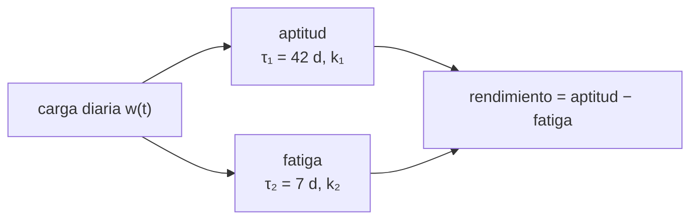

# B104-C04 — Acondicionamiento físico general

<!-- nav:top -->
[🏠 Programa](../../../../README.md) · [📚 Bloque B104](../../../tronco-comun/B104-astronautica-y-preparacion-de-astronautas.md) · [← Anterior: B104-C03 — Selección y aptitud](../B104-C03-seleccion-y-aptitud/CLASE.md) · [Siguiente: B104-C05 — Sistemas de vehículos tripulados →](../B104-C05-sistemas-de-vehiculos-tripulados/CLASE.md)
<!-- /nav -->

## 1. Ubicación, nivel y alcance

Clase 4 del bloque B104, nivel N3. El acondicionamiento físico general prepara el cuerpo para exigencias de trabajo. Aquí no prescribes ejercicio: usas un modelo clásico de **impulso-respuesta** (aptitud que sube lento y fatiga que sube rápido) para entender por qué la carga, el descanso y el momento importan. Sigue a B104-C03; el diseño de resistencia para vuelo es la clase programada B107-C01, aparte. Los parámetros son **ilustrativos**.

## 2. Por qué esta clase existe

Entrenar más no siempre significa rendir más el día que importa. La decisión central: **¿cómo distribuir una misma carga total para llegar con la mejor combinación de aptitud y fatiga?**

## 3. Lo que podrás hacer al terminar

1. Calcular la fracción de reserva de frecuencia cardiaca (Karvonen) y una carga tipo TRIMP.
2. Simular aptitud, fatiga y rendimiento con el modelo de Banister.
3. Comparar planes con igual carga total y distinta distribución.
4. Calcular el instante del máximo de rendimiento tras un impulso y compararlo con la simulación.
5. Explicar por qué la fatiga domina al inicio y la aptitud después.
6. Reconocer que los parámetros son individuales y que no hay prescripción en esta clase.

La evidencia es la **plan de 12 semanas con curvas de carga** del ejercicio 12 (sección 20).

## 4. Con qué llegas y cómo comprobarlo

1. ¿Qué es la frecuencia cardiaca máxima?
2. ¿Qué es una exponencial decreciente?
3. ¿Qué es una constante de tiempo?
4. ¿Qué es la carga de entrenamiento?
5. ¿Qué es un modelo ilustrativo?

<details>
<summary>Ver respuestas</summary>

1. El mayor número de latidos por minuto que alcanza una persona. 2. Una función `e^(−t/τ)` que decae. 3. El tiempo en que una magnitud cae a 1/e. 4. La cantidad de esfuerzo acumulado. 5. Uno cuyos parámetros no vienen de datos reales.
</details>

Con cuatro o cinco aciertos, sigue; si no, repasa los prerrequisitos.

## 5. Un caso de contexto y casos de referencia

Con parámetros ilustrativos `k₁ = 0,10`, `k₂ = 0,30`, `τ₁ = 42 d` y `τ₂ = 7 d`, tres planes de 12 semanas dan el día 84 un rendimiento de 42,68 (3 sesiones de 60 unidades arbitrarias por semana, carga total 2 160), 43,48 (progresivo con semana de descarga, 1 926) y 45,19 (2 sesiones de 90, carga 2 160). Con la misma carga total, repartirla en menos sesiones y más descanso deja menos fatiga el día 84 (45,95 frente a 49,56) en este modelo. Es el **ejemplo conductor**: los planes y los parámetros son **sintéticos e ilustrativos**.

## 6. Vocabulario

La **carga** `w(t)` es el esfuerzo del día `t`. La **aptitud** es `k₁ Σ w e^(−(t−s)/τ₁)` y la **fatiga** `k₂ Σ w e^(−(t−s)/τ₂)`. El **rendimiento** es aptitud menos fatiga. **TRIMP** es una carga basada en frecuencia cardiaca. La **fracción de reserva** es `(FC − FC_reposo)/(FC_máx − FC_reposo)`.

## 7. Modelo mental



*Descripción textual:* la carga diaria alimenta dos respuestas con constantes de tiempo distintas; su diferencia es el rendimiento.

Analogía: llenar una piscina grande con un balde mientras una piscina chica se vacía enseguida: lo grande se acumula despacio y dura, lo pequeño sube y baja rápido. Límite: el cuerpo real se adapta y tiene límites que un modelo lineal no muestra.

## 8. La explicación, paso a paso

### 8.1 Frecuencia cardiaca y TRIMP

Con FC de reposo 55 y máxima 190 lpm (valores de ejemplo), a 140 lpm la fracción de reserva es `(140−55)/135 = 0,630` y la carga de 30 min `30·0,630·0,64·e^(1,92·0,630) = 40,5` unidades; a 110 lpm, 17,1; a 165 lpm, 74,8. La forma exponencial es ilustrativa y no se consultó su artículo.

### 8.2 Impulso-respuesta

Cada sesión suma una exponencial lenta de aptitud y una rápida de fatiga. Tras un único impulso, el máximo de rendimiento ocurre en `t* = τ₁τ₂/(τ₁−τ₂) · ln(k₂τ₁/(k₁τ₂)) = 8,4 · ln 18 = 24,28 d`; el laboratorio da el día 24. Justo después del impulso el rendimiento es negativo, porque `k₂ > k₁`.

### 8.3 Tres planes

| plan | carga | aptitud d84 | fatiga d84 | rendimiento d84 |
|---|---|---|---|---|
| A: 3 × 60 por semana | 2 160 | 92,24 | 49,56 | 42,68 |
| B: progresivo con descarga | 1 926 | 88,68 | 45,21 | 43,48 |
| C: 2 × 90 por semana | 2 160 | 91,14 | 45,95 | 45,19 |

Con igual carga total, C llega con más rendimiento que A porque descansa más entre sesiones; B logra casi lo mismo con 10,8 % menos carga. Es un resultado del modelo, no una prescripción.

### 8.4 Qué falta

Individualidad (los parámetros cambian por persona), sueño, nutrición, lesiones, tipos de ejercicio y adaptación. Un plan real lo diseña un profesional con la persona; esta clase no lo reemplaza.

## 9. Magnitudes, símbolos y unidades

| Símbolo | Qué es | Unidad | Valor / nota |
|---|---|---|---|
| `τ₁` | constante de la aptitud | d | 42 (ilustrativa) |
| `τ₂` | constante de la fatiga | d | 7 (ilustrativa) |
| `k₁`, `k₂` | ganancias | — | 0,10 y 0,30 (ilustrativas) |
| `w` | carga diaria | unidades arbitrarias | 0 a 90 |
| `t*` | día del máximo tras un impulso | d | 24,28 |

## 10. Convenciones y referencias

Tiempo en días, carga en unidades arbitrarias, plan de 84 días con sesiones en los días 0, 2 y 4 de cada semana (planes A y B) o 0 y 3 (plan C). Sin aleatoriedad. Tolerancias: máximo numérico dentro de 1 d del teórico; rendimiento negativo en el día 0; carga del plan A igual a 60 × 36. Numpy 2.4.4, Python 3.12.9.

## 11. De dónde sale lo que afirmamos

| ID | Fuente | Localizador | Respalda | Estado |
|---|---|---|---|---|
| S1 | NASA, «Human Research Program: hazards» — https://www.nasa.gov/hrp/hazards/ (consultada 2026-11-10) | página completa | los cinco peligros del vuelo, entre ellos la distancia y el entorno cerrado, motivan la preparación física; no respalda el modelo de Banister | Consultada |
| — | Relaciones estándar usadas en el laboratorio | — | las verifica el laboratorio | No consultada en una fuente concreta (las verifica el laboratorio) |

Límites: el modelo de impulso-respuesta, sus parámetros y la forma exponencial del TRIMP no se consultaron en su artículo original; son ilustrativos. No se consultó ninguna guía de acondicionamiento de una agencia.

## 12. Cómo ver el resultado

| plan | carga total | aptitud d84 | fatiga d84 | rendimiento d84 |
|---|---|---|---|---|
| A: 3 × 60 por semana | 2 160 | 92,24 | 49,56 | 42,68 |
| B: progresivo con descarga | 1 926 | 88,68 | 45,21 | 43,48 |
| C: 2 × 90 por semana | 2 160 | 91,14 | 45,95 | 45,19 |

Descripción larga: con igual carga, menos sesiones y más descanso dan más rendimiento en el modelo.

## 13. Ejemplo trabajado: TRIMP de 30 minutos a 140 lpm

**Paso 1 · Fracción de reserva.** `(140 − 55)/(190 − 55) = 0,630`.

**Paso 2 · Exponencial.** `e^(1,92·0,630) = 3,35`.

**Paso 3 · Carga.** `30 · 0,630 · 0,64 · 3,35 = 40,5` unidades.

## 14. Distintas formas de describir el problema

**Por fórmula:** aptitud menos fatiga. **Por curva:** rendimiento diario. **Por instante:** `t*` tras un impulso. **Por plan:** carga total frente a rendimiento final.

## 15. Práctica guiada

**Ejercicio 1 · con los pasos indicados.** Calcula la fracción de reserva a 110 lpm (reposo 55, máxima 190). *Pasos:* resta y divide.

<details><summary>Solución comentada</summary>

`55/135 = 0,407`.
</details>

**Ejercicio 2 · con una pista.** Calcula el TRIMP de 30 min a 110 lpm. *Pista:* `30·x·0,64·e^(1,92x)`.

<details><summary>Solución comentada</summary>

`30·0,407·0,64·e^0,782 = 17,1`.
</details>

**Ejercicio 3 · casi autónomo.** Calcula `t*` con `τ₁ = 42`, `τ₂ = 7`, `k₁ = 0,1`, `k₂ = 0,3`.

<details><summary>Solución comentada</summary>

`8,4 · ln 18 = 24,28 d`.
</details>

## 16. Práctica autónoma, transferencia e integrador

**Ejercicio 4 · autónomo.** ¿Por qué el rendimiento es negativo justo tras un impulso?

<details><summary>Solución comentada</summary>

Porque `k₂ > k₁` y la fatiga, con constante corta, aún no decayó.
</details>

**Ejercicio 5 · autónomo.** ¿Cuánta menos carga tiene el plan B que el A y qué rendimiento logra?

<details><summary>Solución comentada</summary>

`2 160 − 1 926 = 234` (10,8 % menos); logra 43,48 frente a 42,68.
</details>

**Ejercicio 6 · autónomo.** ¿Qué fracción de la aptitud queda tras 42 días sin entrenar?

<details><summary>Solución comentada</summary>

`e^−1 = 0,368`.
</details>

**Ejercicio 7 · autónomo.** ¿Qué fracción queda tras 14 días de inactividad?

<details><summary>Solución comentada</summary>

`e^(−14/42) = 0,717`.
</details>

**Ejercicio 8 · autónomo.** La razón fatiga/aptitud del plan A el día 84 es…

<details><summary>Solución comentada</summary>

`49,56/92,24 = 0,537`.
</details>

**Ejercicio 9 · transferencia.** Una persona tiene una pausa de 14 días. ¿Cómo la representas en el modelo y qué predices sin dar consejo?

<details><summary>Solución comentada</summary>

Con `w = 0` esos días: la aptitud baja a ~72 % y la fatiga a casi cero; es un comportamiento del modelo, no una pauta.
</details>

**Ejercicio 10 · transferencia.** Dos personas muestran respuestas distintas con el mismo plan. ¿Qué parámetros ajustarías y con cuántos datos?

<details><summary>Solución comentada</summary>

`k₁, k₂, τ₁, τ₂` por persona, con series largas de carga y rendimiento; con pocos datos el ajuste es inestable.
</details>

**Ejercicio 11 · transferencia.** Si la FC máxima real fuera 180 y no 190, ¿cuánto cambia el TRIMP de 140 lpm?

<details><summary>Solución comentada</summary>

Fracción `85/125 = 0,68`; TRIMP `30·0,68·0,64·e^1,306 = 48,2`: unos 19 % más.
</details>

**Ejercicio 12 · integrador.** Elabora tu *plan de 12 semanas con curvas de carga*: tres distribuciones con igual carga total, curvas de aptitud, fatiga y rendimiento, `t*`, límites y qué es ilustrativo.

<details><summary>Solución comentada</summary>

Secciones 8.1–8.4 y la salida del laboratorio.
</details>

## 17. Laboratorio: aptitud y fatiga de un plan de 12 semanas

El script [carga.py](carga.py) simula aptitud, fatiga y rendimiento de tres planes, calcula TRIMP a tres frecuencias y compara el máximo tras un impulso con la fórmula (**comprueba** `t*` dentro de 1 d, el rendimiento negativo inicial y la carga del plan A). Tarda menos de 1 s.

**Datos:** planes y parámetros **sintéticos e ilustrativos**. Sin aleatoriedad. **Predice antes de ejecutar:** ¿Qué plan crees que deja más rendimiento el día 84 con igual carga total? (El de 2 sesiones por semana (45,19).) **Ejecución del 2026-11-10 (Python 3.12.9):**

```text
Python 3.12.9; numpy 2.4.4
MODELO ILUSTRATIVO: k1=0.1, k2=0.3, tau1=42.0 d, tau2=7.0 d; planes inventados; NO es una prescripcion

plan | carga total [u.a.] | aptitud dia 84 | fatiga dia 84 | rendimiento dia 84 | maximo del rendimiento (dia)
A_constante                        2160       92.24       49.56       42.68     42.68 (d 83)
B_progresivo_con_descarga          1926       88.68       45.21       43.48     43.48 (d 83)
C_misma_carga_total_en_2_dias      2160       91.14       45.95       45.19     45.19 (d 83)
FC 110 lpm: fraccion de reserva 0.407; TRIMP (30 min) = 17.1
FC 140 lpm: fraccion de reserva 0.630; TRIMP (30 min) = 40.5
FC 165 lpm: fraccion de reserva 0.815; TRIMP (30 min) = 74.8

Impulso unico: maximo teorico en d 24.28; numerico en d 24
Pruebas superadas.
```

```bash
python programa/clases/B104/B104-C04-acondicionamiento-fisico-general/carga.py
```

**Límites:** modelo lineal de dos componentes sin individualidad, sueño ni lesiones; no es una prescripción.

## 18. Errores frecuentes y cómo corregirlos

**Creer que más carga siempre rinde más.** Compara planes con igual carga (8.3).

**Tomar los parámetros como universales.** Son individuales (8.4).

**Leer el modelo como una pauta de ejercicio.** Reléelo como razonamiento (sección 21).

**Olvidar que la fatiga decae rápido.** Usa `τ₂` (8.2).

## 19. Cómo sabrás que vas bien

Tras la sección 8: ¿qué `t*` esperabas y cuál da el laboratorio? Si dudas, repasa el ejemplo 13. Tras el laboratorio: ¿qué comprueba? (ver la sección 17).

## 20. Qué entregas y cómo se evalúa

El producto es tu **plan de 12 semanas con curvas de carga** (ejercicio 12).

| Criterio | Inicial | En desarrollo | Logrado | Destacado |
|---|---|---|---|---|
| Conceptos | Confunde los términos | Parciales | Explica aptitud, fatiga y rendimiento | Explica por qué el máximo llega tras un retraso |
| Cálculo | Sin unidades | Con errores | Calcula con unidades y compara con el laboratorio | Resuelve casos nuevos |
| Numérico | Sin comprobar | Un caso | Compara con una segunda vía de cálculo | Interpreta las diferencias |
| Fuentes | Sin fuente | Sin fecha | Fuentes con fecha y estado | Declara lo sintético, lo ilustrativo y lo no consultado |
| Límites | No los nombra | Uno | Tres | Discute qué falta del modelo |

**Condiciones críticas (no se compensan con promedio):** rotular los parámetros como ilustrativos, no presentar el modelo como pauta de ejercicio ni consejo médico y citar solo lo consultado.

## 21. Ética, seguridad y límites

Clase educativa: **no da consejo médico, de entrenamiento individual ni operativo** y no sustituye a los requisitos, procedimientos y estándares de ninguna agencia. El modelo no es una prescripción: cualquier plan de ejercicio lo diseña un profesional con la persona. Accesibilidad: tablas equivalentes a las gráficas, fórmulas en texto, ejercicios sin conexión.

## 22. Para cerrar y seguir

En el modelo, repartir 2 160 unidades en menos sesiones deja un rendimiento de 45,19 el día 84 frente a 42,68. Queda una pregunta: ¿qué debe entender un astronauta de la nave que opera?

**Glosario español–inglés.** acondicionamiento · *conditioning*; aptitud física · *fitness*; fatiga · *fatigue*; carga de entrenamiento · *training load*; frecuencia cardiaca de reserva · *heart-rate reserve*.

**Continuidad.** [B104-C05](../B104-C05-sistemas-de-vehiculos-tripulados/CLASE.md) estudia los sistemas de una nave tripulada, empezando por su atmósfera.

**Referencias:** ver sección 11.

<!-- nav:bottom -->
---

[← Anterior: B104-C03 — Selección y aptitud](../B104-C03-seleccion-y-aptitud/CLASE.md) · [📚 Bloque B104](../../../tronco-comun/B104-astronautica-y-preparacion-de-astronautas.md) · [Siguiente: B104-C05 — Sistemas de vehículos tripulados →](../B104-C05-sistemas-de-vehiculos-tripulados/CLASE.md)
<!-- /nav -->
