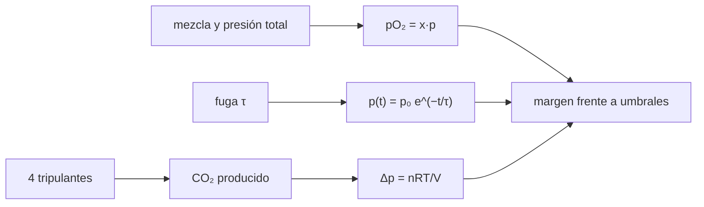

# B104-C05 — Sistemas de vehículos tripulados

<!-- nav:top -->
[🏠 Programa](../../../../README.md) · [📚 Bloque B104](../../../tronco-comun/B104-astronautica-y-preparacion-de-astronautas.md) · [← Anterior: B104-C04 — Acondicionamiento físico general](../B104-C04-acondicionamiento-fisico-general/CLASE.md) · [Siguiente: B104-C06 — Entrenamiento de procedimientos →](../B104-C06-entrenamiento-de-procedimientos/CLASE.md)
<!-- /nav -->

## 1. Ubicación, nivel y alcance

Clase 5 del bloque B104, nivel N3. Una nave tripulada es un recinto cerrado cuyo primer trabajo es mantener un aire respirable: presión total, presión parcial de oxígeno y de dióxido de carbono. Aquí usas el gas ideal para ver cuánto margen hay frente a una fuga y a la producción de CO₂ de la tripulación. Sigue a B104-C04 y prepara a B104-C13 (emergencias); el soporte vital completo se estudia en B106. Los valores son **ilustrativos**.

## 2. Por qué esta clase existe

Lo que importa para respirar no es la presión total sino la **presión parcial** de cada gas. La decisión central: **¿cuánto tiempo hay para actuar si la cabina pierde presión o si se acumula CO₂?**

## 3. Lo que podrás hacer al terminar

1. Calcular la presión parcial de oxígeno de una mezcla a una presión total dada.
2. Modelar una fuga lineal con una constante de tiempo y calcular el tiempo hasta un umbral.
3. Calcular la tasa de aumento de la presión parcial de CO₂ de una tripulación sin depuración.
4. Convertir una variación de presión parcial en masa de oxígeno.
5. Explicar por qué una nave necesita depurar el CO₂.
6. Rotular que las atmósferas del ejemplo no son especificaciones de ninguna nave.

La evidencia es la **balance de atmósfera de cabina** del ejercicio 12 (sección 20).

## 4. Con qué llegas y cómo comprobarlo

1. ¿Qué dice la ley de los gases ideales?
2. ¿Qué es la presión parcial?
3. ¿Qué es una constante de tiempo?
4. ¿Cuántos gramos tiene un mol de O₂?
5. ¿Qué es un dato ilustrativo?

<details>
<summary>Ver respuestas</summary>

1. `pV = nRT`. 2. La presión que tendría un gas si estuviera solo en el recinto. 3. El tiempo en que una magnitud cae a 1/e. 4. 32 g. 5. Un valor puesto para el ejemplo.
</details>

Con cuatro o cinco aciertos, sigue; si no, repasa los prerrequisitos.

## 5. Un caso de contexto y casos de referencia

Una cabina ilustrativa de 30 m³ a 294 K con 4 tripulantes: el aire a nivel del mar (101,3 kPa, 20,9 % de O₂) da una presión parcial de oxígeno de 21,18 kPa; una mezcla ilustrativa de 70,3 kPa con 26,5 % de O₂ da 18,63 kPa. Con una fuga de constante de tiempo de 72 h, la presión baja de 101,3 a 70 kPa en 26,6 h. Sin depuración, 4 kg de CO₂ por día (ilustrativos) elevan la presión parcial de CO₂ en 7,41 kPa/d: 1,0 kPa se alcanza en 3,2 h. Es el **ejemplo conductor**: cabina, tasas y mezclas son **ilustrativas** y no describen una nave real.

## 6. Vocabulario

La **presión parcial** `p_i = x_i p` es la contribución de cada gas. La **ley de Dalton** suma las parciales. Una **fuga** es una pérdida de gas hacia el exterior. La **depuración** retira CO₂ del aire. La **constante de fuga** `τ` hace `p = p₀ e^(−t/τ)`.

## 7. Modelo mental



*Descripción textual:* la mezcla da la presión parcial de oxígeno; la fuga reduce la presión con el tiempo; la tripulación añade CO₂; los tres efectos se comparan con umbrales para obtener el margen de tiempo.

Analogía: una bañera con una fuga y una persona que añade jabón: importa cuánto baja el agua y cuánto sube el jabón. Límite: aquí el «jabón» es un gas que se mezcla y que se retira con depuradores.

## 8. La explicación, paso a paso

### 8.1 Presión parcial

`p_O₂ = x_O₂ · p`. Aire a nivel del mar: `0,209 · 101,325 = 21,18 kPa`. Mezcla ilustrativa: `0,265 · 70,3 = 18,63 kPa`. Oxígeno puro a 34,5 kPa (ilustrativo): 34,50 kPa. Una nave puede elegir presión y fracción distintas siempre que la presión parcial sea adecuada; los valores de esta tabla no son especificaciones.

### 8.2 Fuga

En régimen lineal `p(t) = p₀ e^(−t/τ)`; el tiempo para llegar a 70 kPa es `τ ln(p₀/70)`: 8,9 h con `τ = 24 h`, 26,6 h con 72 h y 88,8 h con 240 h. Una fuga grande (flujo ahogado) no es lineal: se trata en B104-C13.

### 8.3 Dióxido de carbono

4 kg/d son `4 000/44,01 = 90,9 mol/d`. En 30 m³ y 294 K, `Δp = nRT/V = 7,41 kPa/d`. Para 1,0 kPa bastan 3,2 h: sin depuración el CO₂ es el primer límite, mucho antes que el oxígeno.

### 8.4 El oxígeno en masa

Perder 2,2 kPa de `p_O₂` (de 21,18 a 19,0) en 30 m³ equivale a 27 mol, es decir 0,86 kg de O₂. El consumo de 4 personas (3,36 kg/d ilustrativo) se repone con el suministro; esta cifra muestra cuánto cuesta cada kilopascal.

### 8.5 Límites

Sin temperatura variable, sin humedad, sin mezcla incompleta ni control automático. Los umbrales (1,0 kPa de CO₂; 19,0 kPa de O₂) son **ilustrativos**.

## 9. Magnitudes, símbolos y unidades

| Símbolo | Qué es | Unidad | Valor / nota |
|---|---|---|---|
| `V` | volumen de la cabina | m³ | 30 (ilustrativo) |
| `T` | temperatura | K | 294 |
| `p` | presión total | kPa | 34,5 a 101,3 |
| `τ` | constante de fuga | h | 24 a 240 |
| `R` | constante de los gases | J/(mol·K) | 8,314462618 |
| `Δp_CO₂` | aumento de la parcial de CO₂ | kPa/d | 7,41 |

## 10. Convenciones y referencias

Gas ideal, temperatura constante, mezcla homogénea; kilopascales, horas y kilogramos. Sin aleatoriedad. Tolerancias: `p_O₂` del aire 21,18 ± 0,05 kPa; tiempo de fuga de 72 h igual a 26,7 ± 0,1 h; aumento de CO₂ 7,41 ± 0,05 kPa/d; 2,2 kPa de O₂ ≈ 0,8 ± 0,15 kg. Numpy 2.4.4, Python 3.12.9.

## 11. De dónde sale lo que afirmamos

| ID | Fuente | Localizador | Respalda | Estado |
|---|---|---|---|---|
| S1 | NASA, «Human Research Program: hazards» — https://www.nasa.gov/hrp/hazards/ (consultada 2026-11-10) | página completa | el entorno cerrado exige una nave segura y habitable que controle presión, temperatura, iluminación, ruido y microbios | Consultada |
| — | Relaciones estándar usadas en el laboratorio | — | las verifica el laboratorio | No consultada en una fuente concreta (las verifica el laboratorio) |

Límites: no se consultó ninguna especificación de atmósfera de nave (por ejemplo, de la ISS o de Apolo); las mezclas, los umbrales y las tasas son ilustrativos. La referencia de la presión del traje en B104-C11 es otra clase.

## 12. Cómo ver el resultado

| Mezcla | presión total (kPa) | fracción de O₂ | pO₂ (kPa) |
|---|---|---|---|
| aire a nivel del mar | 101,3 | 0,209 | 21,18 |
| mezcla enriquecida ilustrativa | 70,3 | 0,265 | 18,63 |
| O₂ puro a baja presión (ilustrativo) | 34,5 | 1,000 | 34,50 |

| `τ` (h) | tiempo 101,3 → 70 kPa (h) |
|---|---|
| 24 | 8,9 |
| 72 | 26,6 |
| 240 | 88,8 |

Descripción larga: el tiempo disponible es proporcional a `τ`; el CO₂ sin depurar sube 7,41 kPa/d.

## 13. Ejemplo trabajado: presión parcial de oxígeno del aire

**Paso 1 · Fracción.** `x = 0,209`.

**Paso 2 · Presión total.** `p = 101,325 kPa`.

**Paso 3 · Parcial.** `0,209 · 101,325 = 21,18 kPa`.

## 14. Distintas formas de describir el problema

**Por fórmula:** `p_i = x_i p`. **Por tiempo:** `p(t) = p₀ e^(−t/τ)`. **Por moles:** `Δp = nRT/V`. **Por masa:** kilogramos de O₂ por kilopascal.

## 15. Práctica guiada

**Ejercicio 1 · con los pasos indicados.** Calcula la pO₂ del aire (20,9 % a 101,325 kPa). *Pasos:* multiplica fracción por presión.

<details><summary>Solución comentada</summary>

`21,18 kPa`.
</details>

**Ejercicio 2 · con una pista.** Calcula la pO₂ de 26,5 % a 70,3 kPa. *Pista:* misma fórmula.

<details><summary>Solución comentada</summary>

`18,63 kPa`.
</details>

**Ejercicio 3 · casi autónomo.** Con `τ = 72 h`, ¿cuánto tarda la presión en bajar de 101,3 a 70 kPa?

<details><summary>Solución comentada</summary>

`72 · ln(101,3/70) = 26,6 h`.
</details>

## 16. Práctica autónoma, transferencia e integrador

**Ejercicio 4 · autónomo.** ¿Cuántos moles de CO₂ son 4 kg?

<details><summary>Solución comentada</summary>

`4 000/44,01 = 90,9 mol`.
</details>

**Ejercicio 5 · autónomo.** ¿Cuánto sube la pCO₂ por día en 30 m³ y 294 K con esos moles?

<details><summary>Solución comentada</summary>

`90,9 · 8,314 · 294/30 = 7,41 kPa/d`.
</details>

**Ejercicio 6 · autónomo.** ¿Cuánto tarda en llegar a 1,0 kPa sin depurar?

<details><summary>Solución comentada</summary>

`24/7,41 = 3,2 h`.
</details>

**Ejercicio 7 · autónomo.** ¿Cuántos moles y kilogramos de O₂ equivalen a 2,2 kPa en 30 m³?

<details><summary>Solución comentada</summary>

`2 200 · 30/(8,314 · 294) = 27 mol`; `27 · 32 g = 0,86 kg`.
</details>

**Ejercicio 8 · autónomo.** Si el volumen se duplica a 60 m³, ¿qué pasa con la tasa de CO₂?

<details><summary>Solución comentada</summary>

Se reduce a la mitad: `3,7 kPa/d`.
</details>

**Ejercicio 9 · transferencia.** Con 2 tripulantes en vez de 4, ¿cuánto tarda en llegar a 1,0 kPa?

<details><summary>Solución comentada</summary>

La tasa es la mitad (`3,7 kPa/d`): `6,5 h`.
</details>

**Ejercicio 10 · transferencia.** La fuga real es por un orificio grande. ¿Por qué falla el modelo exponencial?

<details><summary>Solución comentada</summary>

Porque el flujo no es proporcional a la sobrepresión cuando es ahogado (sónico) y la presión cae más rápido al inicio; se modela en B104-C13.
</details>

**Ejercicio 11 · transferencia.** Un sensor tiene ±0,5 kPa de error en la presión total con 20,9 % de O₂. ¿Qué error induce en pO₂?

<details><summary>Solución comentada</summary>

`0,209 · 0,5 = ±0,10 kPa` si la fracción es exacta; si no lo es, el error de la fracción se suma.
</details>

**Ejercicio 12 · integrador.** Elabora tu *balance de atmósfera de cabina*: una mezcla con su pO₂, tiempo de fuga para tres `τ`, aumento de pCO₂ de tu tripulación, umbrales ilustrativos y lista de qué es ilustrativo.

<details><summary>Solución comentada</summary>

Secciones 8.1–8.5 y la salida del laboratorio.
</details>

## 17. Laboratorio: atmósfera de una cabina

El script [cabina.py](cabina.py) calcula presiones parciales de tres mezclas, tiempos de fuga lineal, el aumento de CO₂ sin depurar y el oxígeno equivalente a 2,2 kPa (**comprueba** la parcial del aire, el tiempo de 72 h, la tasa de CO₂ y la masa de O₂). Tarda menos de 1 s.

**Datos:** cabina, tasas y mezclas **ilustrativas**. Sin aleatoriedad. **Predice antes de ejecutar:** ¿Cuántas horas tarda en llegar a 1,0 kPa de CO₂ una cabina de 30 m³ sin depurar con 4 personas? (Unas 3.) **Ejecución del 2026-11-10 (Python 3.12.9):**

```text
Python 3.12.9; numpy 2.4.4
MODELO ILUSTRATIVO: cabina de 30 m3, 294 K, 4 tripulantes; atmosferas de ejemplo (no consultadas)

Mezcla | presion total [kPa] | fraccion O2 | pO2 [kPa]
aire a nivel del mar                      101.3    0.209    21.18
mezcla enriquecida ilustrativa             70.3    0.265    18.63
O2 puro a baja presion ilustrativo         34.5    1.000    34.50

Tiempo para bajar de 101,3 a 70 kPa segun la constante de fuga tau
  tau =   24 h ->     8.9 h
  tau =   72 h ->    26.6 h
  tau =  240 h ->    88.8 h

Sin depuracion: CO2 producido 4.0 kg/d = 91 mol/d; sube pCO2 7.41 kPa/d en 30 m3
Tiempo para que pCO2 llegue a 1,0 kPa (umbral ILUSTRATIVO) sin depurar: 3.2 h
Perder 2,2 kPa de pO2 equivale a 0.86 kg de O2 (27 mol)
Pruebas superadas.
```

```bash
python programa/clases/B104/B104-C05-sistemas-de-vehiculos-tripulados/cabina.py
```

**Límites:** gas ideal isotermo, mezcla homogénea, fuga lineal y tasas ilustrativas; sin control automático ni humedad.

## 18. Errores frecuentes y cómo corregirlos

**Confundir presión total y parcial.** Calcula `x·p` (8.1).

**Usar la fuga lineal para un orificio grande.** Verifica el régimen (8.2, B104-C13).

**Ignorar el CO₂.** Calcula su tasa (8.3).

**Tomar las mezclas como especificaciones.** Son ilustrativas (sección 10).

## 19. Cómo sabrás que vas bien

Tras la sección 8: ¿qué tiempo esperabas hasta 1,0 kPa de CO₂ y cuál da el laboratorio? Si dudas, repasa el ejemplo 13. Tras el laboratorio: ¿qué comprueba? (ver la sección 17).

## 20. Qué entregas y cómo se evalúa

El producto es tu **balance de atmósfera de cabina** (ejercicio 12).

| Criterio | Inicial | En desarrollo | Logrado | Destacado |
|---|---|---|---|---|
| Conceptos | Confunde los términos | Parciales | Explica presión parcial, fuga y depuración | Explica por qué el CO₂ limita antes que el O₂ |
| Cálculo | Sin unidades | Con errores | Calcula con unidades y compara con el laboratorio | Resuelve casos nuevos |
| Numérico | Sin comprobar | Un caso | Compara con una segunda vía de cálculo | Interpreta las diferencias |
| Fuentes | Sin fuente | Sin fecha | Fuentes con fecha y estado | Declara lo sintético, lo ilustrativo y lo no consultado |
| Límites | No los nombra | Uno | Tres | Discute qué falta del modelo |

**Condiciones críticas (no se compensan con promedio):** rotular cabina, tasas y mezclas como ilustrativas, no presentarlas como especificaciones de una nave ni como consejo operativo y citar solo lo consultado.

## 21. Ética, seguridad y límites

Clase educativa: **no da consejo médico, de entrenamiento individual ni operativo** y no sustituye a los requisitos, procedimientos y estándares de ninguna agencia. Los umbrales y tiempos son ilustrativos y no sirven para decidir la respuesta a una emergencia real. Accesibilidad: tablas equivalentes a las gráficas, fórmulas en texto, ejercicios sin conexión.

## 22. Para cerrar y seguir

En una cabina ilustrativa de 30 m³ y 4 personas, el CO₂ sin depurar llega a 1,0 kPa en 3,2 h y una fuga de `τ = 72 h` baja la presión a 70 kPa en 26,6 h. Queda una pregunta: ¿cómo se aprende a operar todo esto sin error?

**Glosario español–inglés.** presión parcial · *partial pressure*; fuga · *leak*; depurador de CO₂ · *CO₂ scrubber*; atmósfera de cabina · *cabin atmosphere*; ley de Dalton · *Dalton's law*.

**Continuidad.** [B104-C06](../B104-C06-entrenamiento-de-procedimientos/CLASE.md) trata el entrenamiento de procedimientos con curvas de aprendizaje y olvido.

**Referencias:** ver sección 11.

<!-- nav:bottom -->
---

[← Anterior: B104-C04 — Acondicionamiento físico general](../B104-C04-acondicionamiento-fisico-general/CLASE.md) · [📚 Bloque B104](../../../tronco-comun/B104-astronautica-y-preparacion-de-astronautas.md) · [Siguiente: B104-C06 — Entrenamiento de procedimientos →](../B104-C06-entrenamiento-de-procedimientos/CLASE.md)
<!-- /nav -->
