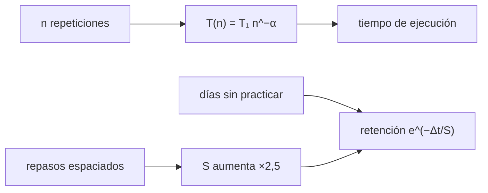

# B104-C06 — Entrenamiento de procedimientos

<!-- nav:top -->
[🏠 Programa](../../../../README.md) · [📚 Bloque B104](../../../tronco-comun/B104-astronautica-y-preparacion-de-astronautas.md) · [← Anterior: B104-C05 — Sistemas de vehículos tripulados](../B104-C05-sistemas-de-vehiculos-tripulados/CLASE.md) · [Siguiente: B104-C07 — Factores de liderazgo →](../../../tronco-comun/B104-astronautica-y-preparacion-de-astronautas.md#b104-c07)
<!-- /nav -->

## 1. Ubicación, nivel y alcance

Clase 6 del bloque B104, nivel N3. Un procedimiento es una secuencia de pasos que la tripulación debe ejecutar bien y a tiempo. Aquí modelas cómo baja el tiempo de ejecución con la práctica (ley potencial), cómo se olvida y cómo un calendario de repasos espaciados mantiene la retención. Sigue a B104-C05 y prepara a B104-C09 (simuladores) y B104-C22 (listas de comprobación). Datos **sintéticos**, parámetros **ilustrativos**.

## 2. Por qué esta clase existe

Los procedimientos se practican en tierra y a veces se usan meses después, en el momento crítico. La decisión central: **¿cuándo repasar para que el procedimiento siga disponible sin gastar tiempo de entrenamiento de más?**

## 3. Lo que podrás hacer al terminar

1. Ajustar la ley de práctica `T = T₁ n^−α` por regresión log-log.
2. Calcular el número de repeticiones necesario para reducir un tiempo a una fracción.
3. Calcular la retención con una curva de olvido exponencial.
4. Comparar un entrenamiento masivo con uno espaciado.
5. Calcular el intervalo de repaso para mantener una retención mínima.
6. Rotular qué es sintético y que los parámetros no vienen de datos de astronautas.

La evidencia es la **plan de repaso con tiempos esperados** del ejercicio 12 (sección 20).

## 4. Con qué llegas y cómo comprobarlo

1. ¿Qué es una ley de potencia?
2. ¿Qué es una regresión lineal?
3. ¿Qué es un logaritmo?
4. ¿Qué es una constante de tiempo?
5. ¿Qué es un dato sintético?

<details>
<summary>Ver respuestas</summary>

1. Una relación `y = a x^b`. 2. El ajuste de una recta a datos por mínimos cuadrados. 3. El exponente al que se eleva una base para dar un número. 4. El tiempo en que algo cae a 1/e. 5. Un dato generado para el ejemplo.
</details>

Con cuatro o cinco aciertos, sigue; si no, repasa los prerrequisitos.

## 5. Un caso de contexto y casos de referencia

Con tiempos sintéticos `T(n) = 600 n^−0,30` s con 5 % de ruido (semilla 104), el ajuste recupera `α = 0,294` y `T₁ = 602,3 s`; la repetición 10 tarda unos 300 s y la 30, unos 216 s. Con una estabilidad de memoria ilustrativa `S₀ = 5 d` que se multiplica por 2,5 en cada repaso espaciado (días 3, 10, 25 y 55), la retención a los 90 días es de 0,836, mientras que el entrenamiento masivo del día 0 da una retención casi nula. Es el **ejemplo conductor**: los tiempos y la estabilidad son **sintéticos e ilustrativos**.

## 6. Vocabulario

La **ley de práctica** dice que el tiempo baja como una potencia del número de repeticiones. La **curva de olvido** `R = e^(−Δt/S)` da la retención tras `Δt` días con estabilidad `S`. El **repaso espaciado** reparte las repeticiones en el tiempo y aumenta `S`. El **sobreaprendizaje** es seguir practicando tras alcanzar el dominio.

## 7. Modelo mental



*Descripción textual:* las repeticiones reducen el tiempo de ejecución con una ley potencial; el olvido lo deteriora con una exponencial; los repasos espaciados alargan la estabilidad de la memoria.

Analogía: aprender un instrumento: tocar mucho un solo día no sirve si no vuelves a tocar en meses; unas pocas sesiones repartidas sí. Límite: la memoria real depende del tipo de tarea y de la persona.

## 8. La explicación, paso a paso

### 8.1 Ley de práctica

`ln T = ln T₁ − α ln n`: una recta en log-log. El ajuste con 30 puntos da `α = 0,294` (verdad 0,30) y `T₁ = 602,3 s` (600). La repetición 10 es unos 300 s y la 20, unos 244 s; duplicar el número de repeticiones multiplica el tiempo por `2^−0,3 = 0,81`.

### 8.2 Cuántas repeticiones

Para reducir el tiempo a la mitad, `n = 2^(1/0,3) = 10,1`: unas 10 repeticiones. Cada mejora cuesta más práctica que la anterior (rendimientos decrecientes).

### 8.3 Olvido

Con `S₀ = 5 d` la retención cae a 0,37 en 5 días y a 0,000 a los 90 días si no se repasa. Para conservar una retención mínima de 0,8 hay que repasar cada `S · ln(1/0,8)` días: 1,12 d con `S = 5 d`, 2,79 d con 12,5 d y 6,97 d con 31,25 d.

### 8.4 Repaso espaciado

Con repasos en los días 3, 10, 25 y 55 y un factor de 2,5, la estabilidad pasa a `5 · 2,5⁴ = 195 d`; a los 90 días la retención es `e^(−35/195) = 0,836`. Con el entrenamiento masivo del día 0 (sin repasos), `e^(−90/5) ≈ 0`. El tiempo esperado con 30 repeticiones y retención 0,836 es de unos 259 s.

### 8.5 Límites

La ley y el factor de 2,5 son ilustrativos; tareas motoras y cognitivas se comportan distinto, y la retención de un procedimiento crítico se verifica con una prueba real, no con este modelo.

## 9. Magnitudes, símbolos y unidades

| Símbolo | Qué es | Unidad | Valor / nota |
|---|---|---|---|
| `T₁` | tiempo de la primera repetición | s | 600 (ilustrativo) |
| `α` | exponente de la práctica | — | 0,30 (ilustrativo), ajustado 0,294 |
| `n` | repeticiones | — | 1 a 30 |
| `S` | estabilidad de la memoria | d | 5 a 195 |
| `R` | retención | — | 0 a 1 |

## 10. Convenciones y referencias

Tiempo en segundos y días; datos con ruido multiplicativo log-normal de 5 % y semilla 104. Tolerancias: `|α̂ − α| < 0,03`; retención espaciada mayor que masiva y menor que 1; `5 ln(1/0,8) = 1,116 ± 0,001`. Numpy 2.4.4, Python 3.12.9.

## 11. De dónde sale lo que afirmamos

| ID | Fuente | Localizador | Respalda | Estado |
|---|---|---|---|---|
| S1 | NASA History, SP-4225, «Training and Operations» — https://www.nasa.gov/history/SP-4225/training/training.htm (consultada 2026-11-10) | secciones sobre simuladores y duración del entrenamiento | el entrenamiento de Shuttle–Mir se basó en simulaciones prácticas; los tripulantes de Mir debían dominar los sistemas a bordo y usaron un sistema en CD-ROM para repasar; el astronauta Mike Foale dijo que el entrenamiento es más difícil que el vuelo | Consultada |
| — | Relaciones estándar usadas en el laboratorio | — | las verifica el laboratorio | No consultada en una fuente concreta (las verifica el laboratorio) |

Límites: no se consultó ningún estudio sobre aprendizaje o retención de procedimientos de vuelo; la ley potencial, la curva de olvido y el factor de 2,5 son modelos estándar o ilustrativos verificados solo por el laboratorio.

## 12. Cómo ver el resultado

| `n` | `T(n)` verdad (s) | `T(n)` ajustado (s) |
|---|---|---|
| 1 | 600,0 | 602,3 |
| 5 | 370,2 | 375,3 |
| 10 | 300,7 | 306,1 |
| 20 | 244,3 | 249,7 |
| 30 | 216,3 | 221,6 |

Retención a 90 días: masivo 0,000; espaciado 0,836. Descripción larga: el tiempo baja con rendimientos decrecientes y el repaso espaciado mantiene la retención.

## 13. Ejemplo trabajado: tiempo de la décima repetición

**Paso 1 · Ley.** `T(n) = 600 · n^−0,3`.

**Paso 2 · Potencia.** `10^−0,3 = 0,501`.

**Paso 3 · Tiempo.** `600 · 0,501 = 300,7 s`.

## 14. Distintas formas de describir el problema

**Por fórmula:** `T₁ n^−α` y `e^(−Δt/S)`. **Por recta log-log:** pendiente `−α`. **Por tabla:** n y tiempo. **Por calendario:** días de repaso y `S`.

## 15. Práctica guiada

**Ejercicio 1 · con los pasos indicados.** Calcula `T(10)` con `T₁ = 600`, `α = 0,3`. *Pasos:* eleva 10 a `−0,3` y multiplica.

<details><summary>Solución comentada</summary>

`300,7 s`.
</details>

**Ejercicio 2 · con una pista.** ¿Cuánto baja el tiempo al duplicar las repeticiones? *Pista:* `2^−0,3`.

<details><summary>Solución comentada</summary>

A `0,81`: un `19 %` menos.
</details>

**Ejercicio 3 · casi autónomo.** ¿Qué retención hay a los 5 días con `S = 5 d`?

<details><summary>Solución comentada</summary>

`e^−1 = 0,368`.
</details>

## 16. Práctica autónoma, transferencia e integrador

**Ejercicio 4 · autónomo.** ¿Cuánto vale `S` tras 4 repasos con factor 2,5 desde 5 d?

<details><summary>Solución comentada</summary>

`5 · 2,5⁴ = 195,3 d`.
</details>

**Ejercicio 5 · autónomo.** ¿Cada cuántos días hay que repasar con `S = 12,5 d` para tener retención ≥ 0,8?

<details><summary>Solución comentada</summary>

`12,5 · ln 1,25 = 2,79 d`.
</details>

**Ejercicio 6 · autónomo.** ¿Por qué la recta log-log tiene pendiente `−α`?

<details><summary>Solución comentada</summary>

Porque `ln T = ln T₁ − α ln n`.
</details>

**Ejercicio 7 · autónomo.** ¿Cuántas repeticiones reducen el tiempo a la mitad?

<details><summary>Solución comentada</summary>

`2^(1/0,3) = 10,1`: unas 10.
</details>

**Ejercicio 8 · autónomo.** Compara retención masiva y espaciada a los 90 días.

<details><summary>Solución comentada</summary>

Masiva casi 0; espaciada 0,836.
</details>

**Ejercicio 9 · transferencia.** Un procedimiento crítico se usa una vez cada 6 meses (180 d). Con `S = 195 d`, ¿cuál es la retención sin repasar?

<details><summary>Solución comentada</summary>

`e^(−180/195) = 0,40`: demasiado baja; hace falta un repaso previo.
</details>

**Ejercicio 10 · transferencia.** Solo tienes 8 repeticiones para estimar `α` con ruido de 5 %. ¿Cómo afecta?

<details><summary>Solución comentada</summary>

La pendiente se estima con más incertidumbre; se calcula un intervalo (por ejemplo con remuestreo) antes de usarla.
</details>

**Ejercicio 11 · transferencia.** Un compañero logra el mismo tiempo con la mitad de las repeticiones. ¿Qué parámetro cambia en el modelo y qué precaución tomas?

<details><summary>Solución comentada</summary>

`α` mayor (o `T₁` menor) para él; no se generaliza: el modelo es por persona y por tarea.
</details>

**Ejercicio 12 · integrador.** Elabora tu *plan de repaso con tiempos esperados*: ajuste log-log, número de repeticiones para un tiempo meta, calendario espaciado con retención esperada, límites y lo ilustrativo.

<details><summary>Solución comentada</summary>

Secciones 8.1–8.5 y la salida del laboratorio.
</details>

## 17. Laboratorio: aprendizaje, olvido y repaso de un procedimiento

El script [repaso.py](repaso.py) genera tiempos sintéticos, ajusta la ley de práctica, compara olvido masivo y espaciado y calcula intervalos de repaso (**comprueba** `α` dentro de 0,03, que el espaciado supere al masivo y el intervalo de 1,116 d). Tarda menos de 1 s.

**Datos:** tiempos **sintéticos** con semilla 104 y parámetros **ilustrativos**. **Predice antes de ejecutar:** ¿Cuántas repeticiones reducen el tiempo de ejecución a la mitad con `α = 0,3`? (Unas 10.) **Ejecución del 2026-11-10 (Python 3.12.9):**

```text
Python 3.12.9; numpy 2.4.4
DATOS SINTETICOS (semilla 104): tiempos de ejecucion generados con T(n) = T1 n^-alfa y ruido; parametros ilustrativos

Ajuste log-log: alfa = 0.294 (verdad 0.3); T1 = 602.3 s (verdad 600.0)
n | T(n) verdad [s] | T(n) ajustado [s]
  1      600.0      602.3
  5      370.2      375.3
 10      300.7      306.1
 20      244.3      249.7
 30      216.3      221.6

Retencion a los 90 dias: masivo (todo el dia 0) = 0.0000; espaciado ([0.0, 3.0, 10.0, 25.0, 55.0]) = 0.8359
Tiempo esperado de ejecucion a los 90 dias con n = 30 repeticiones y espaciado: T/retencion = 259 s (con retencion casi nula el modelo no es util: se reinicia el aprendizaje)
  con S =   5.00 d, retencion >= 0,8 durante  1.12 d
  con S =  12.50 d, retencion >= 0,8 durante  2.79 d
  con S =  31.25 d, retencion >= 0,8 durante  6.97 d
Pruebas superadas.
```

```bash
python programa/clases/B104/B104-C06-entrenamiento-de-procedimientos/repaso.py
```

**Límites:** una sola tarea, ley potencial sin saturación, olvido exponencial con factor fijo; sin errores de ejecución ni variabilidad entre personas.

## 18. Errores frecuentes y cómo corregirlos

**Practicar todo de una vez.** Reparte las repeticiones (8.4).

**Leer `α` sin intervalo.** Calcúlalo con pocos datos (ejercicio 10).

**Suponer que el dominio es permanente.** Aplica la curva de olvido (8.3).

**Presentar los parámetros como de astronautas reales.** Son ilustrativos (sección 10).

## 19. Cómo sabrás que vas bien

Tras la sección 8: ¿qué retención esperabas a los 90 días con el calendario espaciado y cuál da el laboratorio? Si dudas, repasa el ejemplo 13. Tras el laboratorio: ¿qué comprueba? (ver la sección 17).

## 20. Qué entregas y cómo se evalúa

El producto es tu **plan de repaso con tiempos esperados** (ejercicio 12).

| Criterio | Inicial | En desarrollo | Logrado | Destacado |
|---|---|---|---|---|
| Conceptos | Confunde los términos | Parciales | Explica ley de práctica, olvido y repaso | Explica por qué el espaciado alarga la estabilidad |
| Cálculo | Sin unidades | Con errores | Calcula con unidades y compara con el laboratorio | Resuelve casos nuevos |
| Numérico | Sin comprobar | Un caso | Compara con una segunda vía de cálculo | Interpreta las diferencias |
| Fuentes | Sin fuente | Sin fecha | Fuentes con fecha y estado | Declara lo sintético, lo ilustrativo y lo no consultado |
| Límites | No los nombra | Uno | Tres | Discute qué falta del modelo |

**Condiciones críticas (no se compensan con promedio):** rotular los datos como sintéticos y los parámetros como ilustrativos, no presentar el modelo como datos de entrenamiento real y citar solo lo consultado.

## 21. Ética, seguridad y límites

Clase educativa: **no da consejo médico, de entrenamiento individual ni operativo** y no sustituye a los requisitos, procedimientos y estándares de ninguna agencia. El calendario es un ejercicio: el entrenamiento real de una tripulación lo define su agencia con evaluaciones reales. Accesibilidad: tablas equivalentes a las gráficas, fórmulas en texto, ejercicios sin conexión.

## 22. Para cerrar y seguir

Con una ley potencial de exponente 0,3 hacen falta unas 10 repeticiones para reducir a la mitad el tiempo, y con repasos espaciados la retención a 90 días es de 0,836. Queda una pregunta: ¿qué entrenamiento reproduce mejor las condiciones reales?

**Glosario español–inglés.** ley de práctica · *power law of practice*; curva de olvido · *forgetting curve*; repaso espaciado · *spaced repetition*; retención · *retention*; procedimiento · *procedure*.

**Continuidad.** [B104-C07](../B104-C07-factores-de-liderazgo/CLASE.md) estudia el liderazgo y el gradiente de autoridad en la tripulación.

**Referencias:** ver sección 11.

<!-- nav:bottom -->
---

[← Anterior: B104-C05 — Sistemas de vehículos tripulados](../B104-C05-sistemas-de-vehiculos-tripulados/CLASE.md) · [📚 Bloque B104](../../../tronco-comun/B104-astronautica-y-preparacion-de-astronautas.md) · [Siguiente: B104-C07 — Factores de liderazgo →](../../../tronco-comun/B104-astronautica-y-preparacion-de-astronautas.md#b104-c07)
<!-- /nav -->
