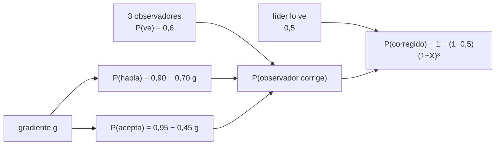

# B104-C07 — Factores de liderazgo

<!-- nav:top -->
[🏠 Programa](../../../../README.md) · [📚 Bloque B104](../../../tronco-comun/B104-astronautica-y-preparacion-de-astronautas.md) · [← Anterior: B104-C06 — Entrenamiento de procedimientos](../B104-C06-entrenamiento-de-procedimientos/CLASE.md) · [Siguiente: B104-C08 — Comunicación de tripulación →](../B104-C08-comunicacion-de-tripulacion/CLASE.md)
<!-- /nav -->

## 1. Ubicación, nivel y alcance

Clase 7 del bloque B104, nivel N3. El liderazgo en una tripulación no es solo mandar: es crear las condiciones para que un error del jefe sea señalado y corregido. Aquí lo modelas con el **gradiente de autoridad** y calculas cuántos errores del líder se corrigen según lo empinado que sea. Sigue a B104-C06 y prepara a B104-C08 (comunicación) y B104-C16 (conflictos). El modelo y sus parámetros son **ilustrativos**.

## 2. Por qué esta clase existe

Los procedimientos fallan no solo por lo que se desconoce sino por lo que nadie se atreve a decir. La decisión central: **¿cuántos errores del líder pasan sin corregirse cuando el gradiente de autoridad sube, y cuánto ayuda añadir observadores?**

## 3. Lo que podrás hacer al terminar

1. Definir el gradiente de autoridad y sus efectos sobre hablar y aceptar una observación.
2. Calcular la probabilidad de corregir un error con un líder y tres observadores.
3. Comparar la fórmula con una simulación Monte Carlo.
4. Calcular cuántos errores por mil quedan sin corregir en cada gradiente.
5. Estimar el efecto de añadir observadores y de reducir el gradiente.
6. Reconocer que el modelo es ilustrativo y no evalúa a personas.

La evidencia es la **curva de detección frente a gradiente** del ejercicio 12 (sección 20).

## 4. Con qué llegas y cómo comprobarlo

1. ¿Qué es una probabilidad?
2. ¿Qué es la probabilidad del complemento?
3. ¿Qué es la independencia de sucesos?
4. ¿Qué es una simulación Monte Carlo?
5. ¿Qué es un modelo ilustrativo?

<details>
<summary>Ver respuestas</summary>

1. Un número entre 0 y 1 que mide qué tan posible es un suceso. 2. `1 − p`. 3. Que un suceso no cambia la probabilidad del otro. 4. Repetir un experimento aleatorio muchas veces para estimar una probabilidad. 5. Uno con parámetros inventados.
</details>

Con cuatro o cinco aciertos, sigue; si no, repasa los prerrequisitos.

## 5. Un caso de contexto y casos de referencia

Una tripulación sintética de 4: un líder y tres observadores. El líder advierte su propio error con probabilidad 0,5 y cada observador lo advierte con 0,6. Si el gradiente `g` es 0 (plano), quien lo ve habla con probabilidad 0,90 y el líder acepta con 0,95; si `g = 1`, 0,20 y 0,50. La probabilidad de corregir el error es de 0,9422 con `g = 0` y de 0,5847 con `g = 1`: 58 frente a 417 errores no corregidos por mil. Añadir un cuarto observador con `g = 0,5` sube la corrección de 0,7799 a 0,8325. Es el **ejemplo conductor**: todo es **ilustrativo** (semilla 104).

## 6. Vocabulario

El **gradiente de autoridad** `g` mide cuánto inhibe la jerarquía hablar o aceptar un desafío. Un **observador** es quien puede ver el error. **Desafío y respuesta** es la práctica de decir y confirmar. La **detección** es que el error se advierta; la **corrección**, que se acepte y se repare.

## 7. Modelo mental



*Descripción textual:* el gradiente reduce la probabilidad de hablar y de aceptar; con los tres observadores y la autodetección del líder se obtiene la probabilidad de corregir el error.

Analogía: un grupo de excursión con un guía muy severo: aunque varios vean que la ruta es equivocada, pocos lo dirán. Límite: en una tripulación real hay roles, normas y entrenamiento que cambian esas probabilidades y que no se midieron aquí.

## 8. La explicación, paso a paso

### 8.1 Los dos efectos del gradiente

El gradiente baja `P(habla) = 0,90 − 0,70 g` y `P(acepta) = 0,95 − 0,45 g` (relaciones lineales ilustrativas). A `g = 0,5` son 0,55 y 0,72.

### 8.2 Probabilidad de corrección

Un observador corrige con `x = 0,6 · P(habla) · P(acepta)`. Con tres observadores independientes y el líder, `P = 1 − (1 − 0,5)(1 − x)³`. A `g = 0`: `x = 0,513` y `P = 0,9422`. A `g = 1`: `x = 0,060` y `P = 0,5847`.

### 8.3 Tabla y simulación

| `g` | P(habla) | P(acepta) | P analítica | P Monte Carlo | no corregidos por mil |
|---|---|---|---|---|---|
| 0,00 | 0,90 | 0,95 | 0,9422 | 0,9418 | 58 |
| 0,25 | 0,73 | 0,84 | 0,8716 | 0,8708 | 129 |
| 0,50 | 0,55 | 0,72 | 0,7799 | 0,7793 | 221 |
| 0,75 | 0,38 | 0,61 | 0,6795 | 0,6781 | 322 |
| 1,00 | 0,20 | 0,50 | 0,5847 | 0,5831 | 417 |

Las 200 000 pruebas por fila coinciden con la fórmula en menos de 0,005.

### 8.4 Más observadores no compensan un gradiente alto

Con `g = 0,5`, pasar de 3 a 4 observadores sube de 0,7799 a 0,8325. Con `g = 1` harían falta unos 34,9 observadores para igualar el caso plano con tres: un gradiente alto no se corrige con más gente sino con liderazgo que invite al desafío.

### 8.5 Límites

Independencia entre observadores, un solo tipo de error, parámetros lineales inventados y ningún efecto de fatiga ni de estrés. Los números no evalúan a nadie.

## 9. Magnitudes, símbolos y unidades

| Símbolo | Qué es | Unidad | Valor / nota |
|---|---|---|---|
| `g` | gradiente de autoridad | — | 0 a 1 |
| `P(ve)` | probabilidad de ver el error | — | 0,6 observador; 0,5 líder |
| `P(habla)` | probabilidad de decirlo | — | 0,90 a 0,20 |
| `P(acepta)` | probabilidad de aceptarlo | — | 0,95 a 0,50 |
| `P` | probabilidad de corrección | — | 0,9422 a 0,5847 |

## 10. Convenciones y referencias

Probabilidades adimensionales; 3 observadores independientes más el líder; semilla 104 con 200 000 pruebas por gradiente. Tolerancias: |analítica − Monte Carlo| < 0,005; la corrección decrece estrictamente con `g`; con `g = 0` la corrección supera 0,9. Numpy 2.4.4, Python 3.12.9.

## 11. De dónde sale lo que afirmamos

| ID | Fuente | Localizador | Respalda | Estado |
|---|---|---|---|---|
| S1 | NASA, «Human Research Program: hazards» — https://www.nasa.gov/hrp/hazards/ (consultada 2026-11-10) | página completa | el aislamiento y el confinamiento de grupos pequeños se cuentan entre los cinco peligros del vuelo humano, con cambios de conducta | Consultada |
| S2 | NASA, «Become an Astronaut» — https://nasa.gov/humans-in-space/astronauts/become-an-astronaut (consultada 2026-11-10) | lista de requisitos | la convocatoria exige demostrar liderazgo, trabajo en equipo y comunicación | Consultada |
| — | Relaciones estándar usadas en el laboratorio | — | las verifica el laboratorio | No consultada en una fuente concreta (las verifica el laboratorio) |

Límites: las páginas de NASA solo respaldan que el liderazgo, el trabajo en equipo y la comunicación se piden a los candidatos y que el aislamiento es un peligro; la forma del gradiente y las probabilidades son inventadas y no se consultó literatura de factores humanos sobre autoridad.

## 12. Cómo ver el resultado

| `g` | P analítica | P Monte Carlo | no corregidos por mil |
|---|---|---|---|
| 0,00 | 0,9422 | 0,9418 | 58 |
| 0,25 | 0,8716 | 0,8708 | 129 |
| 0,50 | 0,7799 | 0,7793 | 221 |
| 0,75 | 0,6795 | 0,6781 | 322 |
| 1,00 | 0,5847 | 0,5831 | 417 |

Descripción larga: la corrección cae de 94 % a 58 % cuando el gradiente pasa de plano a máximo.

## 13. Ejemplo trabajado: corrección con gradiente plano

**Paso 1 · Un observador.** `x = 0,6 · 0,90 · 0,95 = 0,513`.

**Paso 2 · Ninguno corrige.** `(1 − 0,513)³ = 0,1155`.

**Paso 3 · Ni el líder.** `0,5 · 0,1155 = 0,0577`.

**Paso 4 · Corregido.** `1 − 0,0577 = 0,9423`.

## 14. Distintas formas de describir el problema

**Por fórmula:** `P = 1 − (1 − q)(1 − x)^m`. **Por tabla:** `g` frente a `P`. **Por conteo:** errores por mil sin corregir. **Por simulación:** frecuencia en 200 000 pruebas.

## 15. Práctica guiada

**Ejercicio 1 · con los pasos indicados.** Calcula `x` para `g = 0`. *Pasos:* multiplica 0,6 por P(habla) y P(acepta).

<details><summary>Solución comentada</summary>

`0,6 · 0,90 · 0,95 = 0,513`.
</details>

**Ejercicio 2 · con una pista.** ¿Cuál es la corrección total con `g = 0`? *Pista:* `1 − 0,5 (1 − x)³`.

<details><summary>Solución comentada</summary>

`0,9423` (el laboratorio da 0,9422).
</details>

**Ejercicio 3 · casi autónomo.** Calcula la corrección con `g = 1`.

<details><summary>Solución comentada</summary>

`x = 0,6·0,20·0,50 = 0,06`; `1 − 0,5·0,94³ = 0,5847`.
</details>

## 16. Práctica autónoma, transferencia e integrador

**Ejercicio 4 · autónomo.** ¿Cuántos errores por mil no se corrigen con `g = 0,5`?

<details><summary>Solución comentada</summary>

`221`.
</details>

**Ejercicio 5 · autónomo.** ¿Cuánto sube la corrección al añadir un cuarto observador con `g = 0,5`?

<details><summary>Solución comentada</summary>

De 0,7799 a 0,8325: `+0,053`.
</details>

**Ejercicio 6 · autónomo.** ¿Por qué no sirve añadir observadores con `g = 1`?

<details><summary>Solución comentada</summary>

Cada uno aporta solo 0,06; harían falta unos 35.
</details>

**Ejercicio 7 · autónomo.** ¿Qué comportamiento del líder cambiaría `P(habla)` y `P(acepta)`?

<details><summary>Solución comentada</summary>

Invitar al desafío y agradecer la observación; ambos aumentan.
</details>

**Ejercicio 8 · autónomo.** ¿Qué supuesto del modelo es más discutible?

<details><summary>Solución comentada</summary>

La independencia de los observadores y la linealidad con `g`.
</details>

**Ejercicio 9 · transferencia.** Un líder pasa de `g = 0,75` a `g = 0,25`. ¿Cuántos errores por mil evita?

<details><summary>Solución comentada</summary>

De 322 a 129: `193` menos por mil (corrección de 0,6795 a 0,8716).
</details>

**Ejercicio 10 · transferencia.** Un nuevo integrante tiene `P(ve) = 0,3` por falta de experiencia. ¿Cómo cambia la corrección y qué decisión tomas?

<details><summary>Solución comentada</summary>

Reduce `x` y la corrección; la decisión es entrenarlo y dar contexto, no excluirlo de la observación.
</details>

**Ejercicio 11 · transferencia.** Control de misión y tripulación se desafían entre sí. ¿Cómo extiendes el modelo?

<details><summary>Solución comentada</summary>

Añade los observadores de tierra con su propio `g` y el retardo de comunicación (B104-C08).
</details>

**Ejercicio 12 · integrador.** Elabora tu *curva de detección frente a gradiente*: tabla analítica y simulada, errores por mil, efecto de observadores, límites y qué es ilustrativo.

<details><summary>Solución comentada</summary>

Secciones 8.1–8.5 y la salida del laboratorio.
</details>

## 17. Laboratorio: gradiente de autoridad y corrección de errores

El script [gradiente.py](gradiente.py) calcula la corrección analítica y simulada para cinco gradientes y el efecto de un cuarto observador (**comprueba** la concordancia con Monte Carlo, la caída con `g` y que con `g = 0` supere 0,9). Tarda menos de 1 s.

**Datos:** modelo y parámetros **ilustrativos** con semilla 104 (200 000 pruebas por gradiente). **Predice antes de ejecutar:** ¿Cuántos errores por mil se corrigen menos con `g = 1` que con `g = 0`? (Unos 360 más sin corregir (417 frente a 58).) **Ejecución del 2026-11-10 (Python 3.12.9):**

```text
Python 3.12.9; numpy 2.4.4
MODELO ILUSTRATIVO (semilla 104): tripulacion de 4 (lider + 3), un error del lider por prueba; parametros inventados

gradiente g | P(habla) | P(acepta) | P(corregido) analitico | P(corregido) Monte Carlo | errores no corregidos por 1000
     0.00       0.90      0.95               0.9422                   0.9418                         58
     0.25       0.73      0.84               0.8716                   0.8708                        129
     0.50       0.55      0.72               0.7799                   0.7793                        221
     0.75       0.38      0.61               0.6795                   0.6781                        322
     1.00       0.20      0.50               0.5847                   0.5831                        417

Con 4 observadores y g = 0,5: P(corregido) = 0.8325 (con 3: 0.7799)
Observadores con g = 1 para igualar el caso g = 0 con 3 observadores: 34.9
Pruebas superadas.
```

```bash
python programa/clases/B104/B104-C07-factores-de-liderazgo/gradiente.py
```

**Límites:** independencia entre observadores, un solo tipo de error y parámetros lineales inventados; no mide personas ni equipos reales.

## 18. Errores frecuentes y cómo corregirlos

**Creer que más observadores bastan.** Revisa el gradiente (8.4).

**Suponer independencia siempre.** Es un supuesto del modelo (8.5).

**Usar la tabla para evaluar a personas.** Es ilustrativa (sección 21).

**Olvidar la autodetección del líder.** Incluye el 0,5 (8.2).

## 19. Cómo sabrás que vas bien

Tras la sección 8: ¿qué corrección esperabas con `g = 0,5` y cuál da la tabla? Si dudas, repasa el ejemplo 13. Tras el laboratorio: ¿qué comprueba? (ver la sección 17).

## 20. Qué entregas y cómo se evalúa

El producto es tu **curva de detección frente a gradiente** (ejercicio 12).

| Criterio | Inicial | En desarrollo | Logrado | Destacado |
|---|---|---|---|---|
| Conceptos | Confunde los términos | Parciales | Explica gradiente, observador y corrección | Explica por qué más gente no compensa el gradiente |
| Cálculo | Sin unidades | Con errores | Calcula con unidades y compara con el laboratorio | Resuelve casos nuevos |
| Numérico | Sin comprobar | Un caso | Compara con una segunda vía de cálculo | Interpreta las diferencias |
| Fuentes | Sin fuente | Sin fecha | Fuentes con fecha y estado | Declara lo sintético, lo ilustrativo y lo no consultado |
| Límites | No los nombra | Uno | Tres | Discute qué falta del modelo |

**Condiciones críticas (no se compensan con promedio):** rotular el modelo como ilustrativo, no usar los números para evaluar a personas ni equipos y citar solo lo consultado.

## 21. Ética, seguridad y límites

Clase educativa: **no da consejo médico, de entrenamiento individual ni operativo** y no sustituye a los requisitos, procedimientos y estándares de ninguna agencia. El modelo no mide a ninguna persona ni tripulación y no es una herramienta de evaluación. Accesibilidad: tablas equivalentes a las gráficas, fórmulas en texto, ejercicios sin conexión.

## 22. Para cerrar y seguir

Con un gradiente plano se corrige el 94 % de los errores del líder; con el máximo, el 58 %. Queda una pregunta: ¿qué se dice, cómo y con qué retardo cuando la tripulación habla con el control de misión?

**Glosario español–inglés.** gradiente de autoridad · *authority gradient*; liderazgo · *leadership*; desafío y respuesta · *challenge and response*; observador · *monitor*; corrección · *correction*.

**Continuidad.** [B104-C08](../B104-C08-comunicacion-de-tripulacion/CLASE.md) estudia la comunicación de tripulación, el retardo de luz y la repetición de lectura.

**Referencias:** ver sección 11.

<!-- nav:bottom -->
---

[← Anterior: B104-C06 — Entrenamiento de procedimientos](../B104-C06-entrenamiento-de-procedimientos/CLASE.md) · [📚 Bloque B104](../../../tronco-comun/B104-astronautica-y-preparacion-de-astronautas.md) · [Siguiente: B104-C08 — Comunicación de tripulación →](../B104-C08-comunicacion-de-tripulacion/CLASE.md)
<!-- /nav -->
