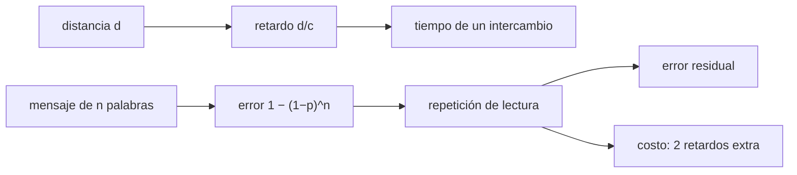

# B104-C08 — Comunicación de tripulación

<!-- nav:top -->
[🏠 Programa](../../../../README.md) · [📚 Bloque B104](../../../tronco-comun/B104-astronautica-y-preparacion-de-astronautas.md) · [← Anterior: B104-C07 — Factores de liderazgo](../B104-C07-factores-de-liderazgo/CLASE.md) · [Siguiente: B104-C09 — Entrenamiento en simuladores →](../B104-C09-entrenamiento-en-simuladores/CLASE.md)
<!-- /nav -->

## 1. Ubicación, nivel y alcance

Clase 8 del bloque B104, nivel N3. La tripulación se comunica entre sí y con tierra; cuando la distancia crece aparece el retardo de luz y la conversación cambia de naturaleza. Aquí calculas retardos y estimas cuánto reduce la repetición de lectura (*read-back*) el error de un mensaje en un canal con ruido. Sigue a B104-C07 y prepara a B104-C12 (teleoperación). Distancias estándar no consultadas; mensajes **sintéticos**.

## 2. Por qué esta clase existe

A 1,28 s de la Luna aún se conversa; a más de 3 minutos de Marte ya no. La decisión central: **¿qué protocolo de mensajes usar cuando cada ida y vuelta cuesta minutos y un error cuesta caro?**

## 3. Lo que podrás hacer al terminar

1. Calcular el retardo de luz de ida y de ida y vuelta a un destino.
2. Estimar el tiempo de un intercambio y de varios.
3. Calcular la probabilidad de error de un mensaje con una tasa por palabra.
4. Estimar el error residual con repetición de lectura y su costo en tiempo.
5. Distinguir un canal síncrono de uno asíncrono.
6. Rotular qué distancias y tasas son estándar o ilustrativas.

La evidencia es la **tabla de retardos y errores residuales** del ejercicio 12 (sección 20).

## 4. Con qué llegas y cómo comprobarlo

1. ¿Cuál es la velocidad de la luz?
2. ¿Qué es un retardo?
3. ¿Qué es una tasa de error?
4. ¿Qué es la probabilidad de al menos un error?
5. ¿Qué es una simulación con semilla fija?

<details>
<summary>Ver respuestas</summary>

1. Unos 299 792 km/s. 2. El tiempo entre enviar y recibir. 3. La fracción de elementos recibidos con error. 4. `1 − (1 − p)^n`. 5. Una simulación reproducible.
</details>

Con cuatro o cinco aciertos, sigue; si no, repasa los prerrequisitos.

## 5. Un caso de contexto y casos de referencia

Con `c = 299 792,458 km/s`, el retardo de ida a la Luna (384 400 km, media estándar) es de 1,282 s (2,564 s ida y vuelta); a Marte, entre unos 54,6 y 401 millones de km (valores estándar no consultados), es de 182,1 a 1 337,6 s (3,0 a 22,3 min). Con 5 s por mensaje, diez intercambios duran 2,1 min en la Luna y de 62,4 a 447,5 min en Marte. Un mensaje de 20 palabras con 1 % de error por palabra llega mal el 18,2 % de las veces; con repetición de lectura (detección de 0,95) el error residual baja a 0,9 %. Es el **ejemplo conductor**: distancias estándar, error y mensajes **sintéticos** (semilla 104).

## 6. Vocabulario

El **retardo de luz** es `d/c`. Un canal **síncrono** permite conversar; uno **asíncrono**, solo mensajes. La **repetición de lectura** es devolver lo recibido para confirmarlo. El **error residual** es el que sobrevive al protocolo. Una **tasa de error por palabra** es la probabilidad de que una palabra se reciba mal.

## 7. Modelo mental



*Descripción textual:* la distancia fija el retardo y el tiempo de cada intercambio; el mensaje tiene un error por palabra; la repetición de lectura reduce el error residual al costo de dos retardos adicionales.

Analogía: enviar una carta y pedir que la devuelvan transcrita: casi no hay malentendidos, pero tardas el doble. Límite: aquí la «carta» viaja a la velocidad de la luz y su retraso no se puede reducir.

## 8. La explicación, paso a paso

### 8.1 Retardo de luz

`t = d/c`. Luna: 384 400/299 792,458 = 1,282 s (ida) y 2,564 s (ida y vuelta). Marte, cercano: 182,1 s; lejano: 1 337,6 s. Para la ISS a 400 km, el retardo es de 1,3 ms (despreciable); los retardos de transmisión reales de una red de relevos no se modelaron.

### 8.2 Tiempo de un intercambio

Un intercambio (pregunta y respuesta) con 5 s por mensaje tarda `2d/c + 10 s`: 10,0 s en la ISS, 12,6 s en la Luna, 374,3 s a Marte cercano y 2 685,2 s a Marte lejano. Diez intercambios a Marte cercano son 62,4 min: no es una conversación.

### 8.3 Error de un mensaje

Con `p = 0,01` por palabra y 20 palabras, `P(error) = 1 − 0,99²⁰ = 0,1821`; el laboratorio da 0,1843. Mensajes de 5 palabras fallan en 4,9 %: lo corto es más seguro.

### 8.4 Repetición de lectura

El receptor devuelve el mensaje; si difiere, el emisor lo advierte con probabilidad 0,95. El error residual baja de 0,1843 a 0,0091 (unas 20 veces), y el 31,5 % de los mensajes se repite (por errores de subida o de bajada). El costo son dos retardos extra: +2,56 s en la Luna y +364 s a Marte cercano.

### 8.5 Elegir el protocolo

Con retardo pequeño, repetir cada mensaje es barato; con retardos de minutos conviene mensajes completos y autocontenidos, con confirmación final y en lotes. Los números no sustituyen los procedimientos de comunicación de ninguna agencia.

## 9. Magnitudes, símbolos y unidades

| Símbolo | Qué es | Unidad | Valor / nota |
|---|---|---|---|
| `c` | velocidad de la luz | km/s | 299 792,458 |
| `d` | distancia | km | 400 a 4,01e8 |
| `t` | retardo de ida | s | 0,001 a 1 337,6 |
| `p` | error por palabra | — | 0,01 (sintético) |
| `n` | palabras por mensaje | — | 20 |
| detección | probabilidad de advertir la discrepancia | — | 0,95 (sintético) |

## 10. Convenciones y referencias

Retardo de una dirección salvo que se diga «ida y vuelta»; kilómetros y segundos; errores independientes entre palabras; semilla 104 con 200 000 mensajes. Tolerancias: retardo a la Luna 1,282 ± 0,001 s; Marte lejano 22,3 ± 0,1 min; error sin repetición dentro de 0,003 de la fórmula; error con repetición menor que un quinto del anterior. Numpy 2.4.4, Python 3.12.9.

## 11. De dónde sale lo que afirmamos

| ID | Fuente | Localizador | Respalda | Estado |
|---|---|---|---|---|
| S1 | NASA, «Human Research Program: hazards» — https://www.nasa.gov/hrp/hazards/ (consultada 2026-11-10) | página completa | la distancia a la Tierra hace más difícil obtener instrucciones, suministros y atención médica | Consultada |
| — | Relaciones estándar usadas en el laboratorio | — | las verifica el laboratorio | No consultada en una fuente concreta (las verifica el laboratorio) |

Límites: las distancias a la Luna y a Marte son valores estándar que no se consultaron en una página; el 1 % de error, el 5 s por mensaje y la probabilidad de detección son inventados. No se consultó ninguna norma de comunicaciones (ITU, CCSDS).

## 12. Cómo ver el resultado

| Destino | ida (s) | ida y vuelta (s) | 10 intercambios (min) |
|---|---|---|---|
| ISS (400 km, ilustrativo) | 0,001 | 0,003 | 1,7 |
| Luna (media) | 1,282 | 2,564 | 2,1 |
| Marte, mínimo | 182,126 | 364,252 | 62,4 |
| Marte, máximo | 1 337,592 | 2 675,184 | 447,5 |

Error de un mensaje de 20 palabras: 0,1843 sin repetición y 0,0091 con ella. Descripción larga: el retardo crece con la distancia y la repetición de lectura reduce el error 20 veces al costo de dos retardos.

## 13. Ejemplo trabajado: retardo de luz a la Luna

**Paso 1 · Distancia.** `384 400 km`.

**Paso 2 · División.** `384 400/299 792,458 = 1,282 s`.

**Paso 3 · Ida y vuelta.** `2 · 1,282 = 2,564 s`.

## 14. Distintas formas de describir el problema

**Por fórmula:** `t = d/c`. **Por tabla:** destino y retardo. **Por probabilidad:** `1 − (1 − p)^n`. **Por protocolo:** error residual y costo en tiempo.

## 15. Práctica guiada

**Ejercicio 1 · con los pasos indicados.** Calcula el retardo de ida a la Luna. *Pasos:* divide la distancia por `c`.

<details><summary>Solución comentada</summary>

`1,282 s`.
</details>

**Ejercicio 2 · con una pista.** ¿Y el de ida y vuelta? *Pista:* duplica.

<details><summary>Solución comentada</summary>

`2,564 s`.
</details>

**Ejercicio 3 · casi autónomo.** Calcula el retardo a Marte con 54,6 millones de km, en segundos y en minutos.

<details><summary>Solución comentada</summary>

`182,1 s ≈ 3,04 min`.
</details>

## 16. Práctica autónoma, transferencia e integrador

**Ejercicio 4 · autónomo.** Calcula el retardo con 401 millones de km.

<details><summary>Solución comentada</summary>

`1 337,6 s ≈ 22,3 min`.
</details>

**Ejercicio 5 · autónomo.** ¿Cuánto dura un intercambio en la Luna con 5 s por mensaje?

<details><summary>Solución comentada</summary>

`2,564 + 10 = 12,6 s`.
</details>

**Ejercicio 6 · autónomo.** ¿Cuál es la probabilidad de error de un mensaje de 20 palabras con `p = 0,01`?

<details><summary>Solución comentada</summary>

`1 − 0,99²⁰ = 0,1821`.
</details>

**Ejercicio 7 · autónomo.** ¿Y de uno de 5 palabras?

<details><summary>Solución comentada</summary>

`1 − 0,99⁵ = 0,049`.
</details>

**Ejercicio 8 · autónomo.** ¿Cuánto tiempo extra cuesta la repetición de lectura a Marte cercano?

<details><summary>Solución comentada</summary>

Dos retardos: `364 s ≈ 6 min`.
</details>

**Ejercicio 9 · transferencia.** Con Marte cercano, ¿puede la tripulación consultar a tierra durante una emergencia de minutos? ¿Qué implica?

<details><summary>Solución comentada</summary>

No: la respuesta llega después de 6 min como mínimo; implica procedimientos, autonomía y decisión a bordo.
</details>

**Ejercicio 10 · transferencia.** Diseña un formato de mensaje para Marte que reduzca idas y vueltas.

<details><summary>Solución comentada</summary>

Mensajes completos y autocontenidos con contexto, pregunta numerada, plazo y confirmación única; varias preguntas por lote.
</details>

**Ejercicio 11 · transferencia.** La repetición de lectura repite el 31,5 % de los mensajes. ¿Cuántos mensajes extra hay en 1 000?

<details><summary>Solución comentada</summary>

`315` repeticiones; cada una cuesta un ciclo adicional.
</details>

**Ejercicio 12 · integrador.** Elabora tu *tabla de retardos y errores residuales*: cuatro destinos, tiempo de intercambio, error de un mensaje con y sin repetición, costo en tiempo y qué es estándar, sintético e ilustrativo.

<details><summary>Solución comentada</summary>

Secciones 8.1–8.5 y la salida del laboratorio.
</details>

## 17. Laboratorio: retardo de luz y repetición de lectura

El script [retardo.py](retardo.py) calcula retardos de luz, tiempos de intercambio y el error de mensajes con y sin repetición de lectura en 200 000 mensajes sintéticos (**comprueba** el retardo a la Luna, el de Marte lejano, el error sin repetición frente a la fórmula y la reducción por repetición). Tarda menos de 1 s.

**Datos:** distancias estándar **no consultadas** y mensajes **sintéticos** con semilla 104. **Predice antes de ejecutar:** ¿Cuántos minutos de retardo de ida tiene Marte en su máxima distancia? (Unos 22.) **Ejecución del 2026-11-10 (Python 3.12.9):**

```text
Python 3.12.9; numpy 2.4.4
MODELO ILUSTRATIVO: distancias estandar no consultadas; mensajes SINTETICOS (semilla 104)

Destino | ida [s] | ida y vuelta [s]
ISS (400 km, ilustrativo)                       0.001        0.003
Luna (media 384 400 km)                         1.282        2.564
Marte, minimo (~54,6 millones de km)          182.126      364.252
Marte, maximo (~401 millones de km)          1337.592     2675.184

Tiempo de un intercambio (pregunta + respuesta, 5 s por mensaje) y de 10 intercambios
ISS (400 km, ilustrativo)                        10.0 s por intercambio;      1.7 min por 10
Luna (media 384 400 km)                          12.6 s por intercambio;      2.1 min por 10
Marte, minimo (~54,6 millones de km)            374.3 s por intercambio;     62.4 min por 10
Marte, maximo (~401 millones de km)            2685.2 s por intercambio;    447.5 min por 10

Error por mensaje de 20 palabras con p = 0.01 por palabra: teorico 0.1821
  sin repeticion de lectura: error residual 0.1843
  con repeticion de lectura (deteccion 0.95): error residual 0.0091; mensajes repetidos 0.3152
Costo en tiempo de la repeticion: 2 mensajes extra por intercambio -> en Marte (minimo) +364 s
Pruebas superadas.
```

```bash
python programa/clases/B104/B104-C08-comunicacion-de-tripulacion/retardo.py
```

**Límites:** canal sin ancho de banda ni pérdidas de paquete, errores independientes por palabra, distancias fijas; no sustituye a las normas de comunicaciones.

## 18. Errores frecuentes y cómo corregirlos

**Confundir ida con ida y vuelta.** Rotula cada retardo (sección 10).

**Alargar los mensajes sin pensar en errores.** Calcula `1 − (1 − p)^n` (8.3).

**Repetir todo en cualquier distancia.** Evalúa el costo en tiempo (8.5).

**Presentar las distancias estándar como consultadas.** Rotúlalas (sección 11).

## 19. Cómo sabrás que vas bien

Tras la sección 8: ¿qué retardo esperabas a Marte cercano y cuál da la tabla? Si dudas, repasa el ejemplo 13. Tras el laboratorio: ¿qué comprueba? (ver la sección 17).

## 20. Qué entregas y cómo se evalúa

El producto es tu **tabla de retardos y errores residuales** (ejercicio 12).

| Criterio | Inicial | En desarrollo | Logrado | Destacado |
|---|---|---|---|---|
| Conceptos | Confunde los términos | Parciales | Explica retardo, error de mensaje y repetición | Explica qué protocolo conviene con minutos de retardo |
| Cálculo | Sin unidades | Con errores | Calcula con unidades y compara con el laboratorio | Resuelve casos nuevos |
| Numérico | Sin comprobar | Un caso | Compara con una segunda vía de cálculo | Interpreta las diferencias |
| Fuentes | Sin fuente | Sin fecha | Fuentes con fecha y estado | Declara lo sintético, lo ilustrativo y lo no consultado |
| Límites | No los nombra | Uno | Tres | Discute qué falta del modelo |

**Condiciones críticas (no se compensan con promedio):** rotular las distancias como estándar no consultadas y los mensajes como sintéticos, no presentar el protocolo como norma y citar solo lo consultado.

## 21. Ética, seguridad y límites

Clase educativa: **no da consejo médico, de entrenamiento individual ni operativo** y no sustituye a los requisitos, procedimientos y estándares de ninguna agencia. Los números no sustituyen a los procedimientos de comunicación ni a las normas de ninguna agencia. Accesibilidad: tablas equivalentes a las gráficas, fórmulas en texto, ejercicios sin conexión.

## 22. Para cerrar y seguir

La luz tarda 1,28 s a la Luna y de 3 a 22 minutos a Marte; la repetición de lectura reduce el error de un mensaje 20 veces al costo de dos retardos. Queda una pregunta: ¿cómo se entrena a la tripulación para resolver todo esto sin la nave real?

**Glosario español–inglés.** retardo de luz · *light-time delay*; repetición de lectura · *read-back*; canal · *channel*; tasa de error · *error rate*; comunicación asíncrona · *asynchronous communication*.

**Continuidad.** [B104-C09](../B104-C09-entrenamiento-en-simuladores/CLASE.md) trata el entrenamiento en simuladores y su razón de transferencia.

**Referencias:** ver sección 11.

<!-- nav:bottom -->
---

[← Anterior: B104-C07 — Factores de liderazgo](../B104-C07-factores-de-liderazgo/CLASE.md) · [📚 Bloque B104](../../../tronco-comun/B104-astronautica-y-preparacion-de-astronautas.md) · [Siguiente: B104-C09 — Entrenamiento en simuladores →](../B104-C09-entrenamiento-en-simuladores/CLASE.md)
<!-- /nav -->
