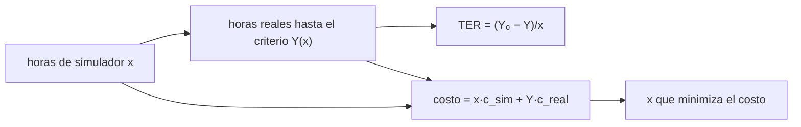

# B104-C09 — Entrenamiento en simuladores

<!-- nav:top -->
[🏠 Programa](../../../../README.md) · [📚 Bloque B104](../../../tronco-comun/B104-astronautica-y-preparacion-de-astronautas.md) · [← Anterior: B104-C08 — Comunicación de tripulación](../B104-C08-comunicacion-de-tripulacion/CLASE.md) · [Siguiente: B104-C10 — Actividades extravehiculares EVA →](../B104-C10-actividades-extravehiculares-eva/CLASE.md)
<!-- /nav -->

## 1. Ubicación, nivel y alcance

Clase 9 del bloque B104, nivel N3. Un simulador reproduce una parte del sistema real para entrenar sin riesgo y a menor costo. Aquí mides su utilidad con la **razón de efectividad de transferencia** (TER: cuántas horas reales se ahorran por hora simulada) y buscas cuántas horas de simulador minimizan el costo total. Sigue a B104-C08 y prepara a B104-C10 y a B104-C15 (analogías). Datos **sintéticos** (semilla 104), costos **ilustrativos**.

## 2. Por qué esta clase existe

El simulador es más barato que el vuelo, pero más horas no siempre ahorran más: hay saturación. La decisión central: **¿cuántas horas de simulador conviene programar y cómo se sabe que transfieren al sistema real?**

## 3. Lo que podrás hacer al terminar

1. Definir la TER y calcularla a partir de horas reales hasta el criterio.
2. Modelar la saturación del ahorro con las horas de simulador.
3. Calcular el costo total y las horas que lo minimizan.
4. Estimar una TER con grupos pequeños y su intervalo por remuestreo.
5. Leer lo que la documentación de Shuttle–Mir consultada dice sobre simulaciones.
6. Rotular los costos y parámetros como ilustrativos.

La evidencia es la **ficha de transferencia de un simulador** del ejercicio 12 (sección 20).

## 4. Con qué llegas y cómo comprobarlo

1. ¿Qué es un simulador?
2. ¿Qué es un costo total?
3. ¿Qué es un mínimo de una función?
4. ¿Qué es un intervalo de confianza?
5. ¿Qué es un dato sintético?

<details>
<summary>Ver respuestas</summary>

1. Un sistema que reproduce parte del comportamiento de otro. 2. La suma de los costos de todos los componentes. 3. El valor donde la función es más baja. 4. Un rango plausible para una estimación. 5. Un dato generado para el ejemplo.
</details>

Con cuatro o cinco aciertos, sigue; si no, repasa los prerrequisitos.

## 5. Un caso de contexto y casos de referencia

En un ejemplo sintético, un criterio de dominio en el sistema real requiere 20 h sin simulador. Con `x` horas previas de simulador, el tiempo real baja como `Y(x) = 20 − 12 (1 − e^(−x/6))`: con 5 h se ahorran 6,78 h (TER = 1,357), con 10 h, 9,73 h (TER = 0,973) y con 40 h, 11,98 h (TER = 0,300). Con costos ilustrativos de 20 000 por hora real y 800 por hora de simulador, el costo mínimo se logra con 23,47 h de simulador (184,6 miles frente a 400,0 sin simulador). Con 30 aprendices por grupo, la TER medida a 10 h es 1,125 con intervalo 95 % [0,967; 1,287]. Es el **ejemplo conductor**: todo es **sintético e ilustrativo**.

## 6. Vocabulario

La **razón de efectividad de transferencia** `TER = (Y₀ − Y(x))/x` mide las horas reales ahorradas por hora simulada. La **fidelidad** es cuánto se parece el simulador al sistema real. La **saturación** es el límite del ahorro. El **criterio** es el nivel de desempeño exigido. La **transferencia negativa** es entrenar algo que perjudica en el sistema real.

## 7. Modelo mental



*Descripción textual:* las horas de simulador reducen las horas reales hasta el criterio; de ahí salen la TER y el costo total, y se busca el mínimo del costo.

Analogía: practicar en una pista cubierta antes de salir a la calle: las primeras horas enseñan mucho, las siguientes poco. Límite: un simulador con una fidelidad mal elegida puede enseñar un hábito equivocado.

## 8. La explicación, paso a paso

### 8.1 Qué dice la fuente consultada

La historia de la NASA sobre el entrenamiento de Shuttle–Mir (SP-4225, consultada el 2026-11-10) dice que la NASA se apoyó más en simulaciones prácticas que la agencia rusa; que el centro de Star City tenía simuladores integrados de Soyuz y Mir, un tanque de agua de 5 000 m³ y centrífugas; que las tripulaciones de Mir usaron un sistema de repaso en CD-ROM en órbita; y que Mike Foale dijo que el entrenamiento es más difícil que los vuelos.

### 8.2 La TER y la saturación

`Y(x) = 20 − 12(1 − e^(−x/6))`. El ahorro máximo es de 12 h. La TER disminuye con `x`: 1,701 con 2 h, 1,357 con 5 h, 0,973 con 10 h, 0,579 con 20 h y 0,300 con 40 h. Las primeras horas valen más.

### 8.3 Costo total

| `x` (h) | horas reales | ahorro (h) | TER | costo (miles) |
|---|---|---|---|---|
| 0 | 20,00 | 0,00 | — | 400,0 |
| 2 | 16,60 | 3,40 | 1,701 | 333,6 |
| 5 | 13,22 | 6,78 | 1,357 | 268,3 |
| 10 | 10,27 | 9,73 | 0,973 | 213,3 |
| 20 | 8,43 | 11,57 | 0,579 | 184,6 |
| 40 | 8,02 | 11,98 | 0,300 | 192,3 |

El mínimo está en `x* = X₀ ln(Y_max c_real/(X₀ c_sim)) = 6 ln(50) = 23,47 h`, coincidente con la búsqueda numérica.

### 8.4 Medir la TER

Con 30 aprendices por grupo (ruido log-normal de 20 %), la TER medida a 10 h es 1,125 y el intervalo de 95 % por remuestreo, [0,967; 1,287], contiene la verdad (0,973). Con grupos pequeños el intervalo es ancho: no se concluye de un solo grupo.

### 8.5 Límites

Un único criterio, una curva exponencial inventada, costos ilustrativos, sin transferencia negativa y sin diferencias de fidelidad. La validez de un simulador real se establece con datos de desempeño reales.

## 9. Magnitudes, símbolos y unidades

| Símbolo | Qué es | Unidad | Valor / nota |
|---|---|---|---|
| `Y₀` | horas reales sin simulador | h | 20 (sintético) |
| `x` | horas de simulador | h | 0 a 40 |
| `TER` | razón de transferencia | h reales/h sim. | 1,701 a 0,300 |
| `c_real`, `c_sim` | costo por hora | unidades arbitrarias | 20 000 y 800 (ilustrativos) |
| `x*` | horas que minimizan el costo | h | 23,47 |

## 10. Convenciones y referencias

Horas de entrenamiento hasta un criterio; costo en unidades arbitrarias; ruido log-normal de 20 % con semilla 104 y 2 000 remuestreos. Tolerancias: mínimo numérico dentro de 0,05 h del teórico; TER decreciente con `x`; costo con 10 h menor que sin simulador. Numpy 2.4.4, Python 3.12.9.

## 11. De dónde sale lo que afirmamos

| ID | Fuente | Localizador | Respalda | Estado |
|---|---|---|---|---|
| S1 | NASA History, SP-4225, «Training and Operations» — https://www.nasa.gov/history/SP-4225/training/training.htm (consultada 2026-11-10) | secciones de simuladores y de Shuttle–Mir | simulaciones prácticas del entrenamiento de NASA; simuladores integrados de Soyuz y Mir, tanque de agua de 5 000 m³ y centrífugas en Star City; sistema de repaso en CD-ROM en órbita; cita de Mike Foale | Consultada |
| — | Relaciones estándar usadas en el laboratorio | — | las verifica el laboratorio | No consultada en una fuente concreta (las verifica el laboratorio) |

Límites: de SP-4225 solo se usan los hechos citados; la TER como concepto y la forma de la curva de saturación no se consultaron en una fuente concreta; los costos y las horas son inventados.

## 12. Cómo ver el resultado

| `x` (h) | ahorro (h) | TER | costo (miles) |
|---|---|---|---|
| 0 | 0,00 | — | 400,0 |
| 5 | 6,78 | 1,357 | 268,3 |
| 10 | 9,73 | 0,973 | 213,3 |
| 20 | 11,57 | 0,579 | 184,6 |
| 40 | 11,98 | 0,300 | 192,3 |

Descripción larga: el costo total baja hasta unas 23,5 h de simulador y vuelve a subir.

## 13. Ejemplo trabajado: TER con 5 horas de simulador

**Paso 1 · Tiempo real.** `Y(5) = 20 − 12(1 − e^(−5/6)) = 13,22 h`.

**Paso 2 · Ahorro.** `20 − 13,22 = 6,78 h`.

**Paso 3 · TER.** `6,78/5 = 1,357`.

## 14. Distintas formas de describir el problema

**Por fórmula:** `TER = (Y₀ − Y)/x`. **Por curva:** `Y(x)` con saturación. **Por costo:** mínimo de `x c_sim + Y c_real`. **Por intervalo:** remuestreo de dos grupos.

## 15. Práctica guiada

**Ejercicio 1 · con los pasos indicados.** Calcula `Y(5)`. *Pasos:* evalúa `20 − 12(1 − e^(−5/6))`.

<details><summary>Solución comentada</summary>

`13,22 h`.
</details>

**Ejercicio 2 · con una pista.** Calcula la TER con 5 h. *Pista:* ahorro entre horas.

<details><summary>Solución comentada</summary>

`6,78/5 = 1,357`.
</details>

**Ejercicio 3 · casi autónomo.** Calcula el costo con 10 h de simulador.

<details><summary>Solución comentada</summary>

`10·800 + 10,27·20 000 = 213,4` miles (213,3 en el laboratorio por redondeo).
</details>

## 16. Práctica autónoma, transferencia e integrador

**Ejercicio 4 · autónomo.** ¿Cuál es el ahorro máximo posible?

<details><summary>Solución comentada</summary>

`12 h` (cuando `x → ∞`).
</details>

**Ejercicio 5 · autónomo.** ¿Por qué la TER baja con `x`?

<details><summary>Solución comentada</summary>

Porque el ahorro satura y se divide entre más horas.
</details>

**Ejercicio 6 · autónomo.** Calcula `x*` con la fórmula.

<details><summary>Solución comentada</summary>

`6 ln(12·20 000/(6·800)) = 6 ln 50 = 23,47 h`.
</details>

**Ejercicio 7 · autónomo.** ¿Cuánto se ahorra en costo respecto de no usar simulador en `x*`?

<details><summary>Solución comentada</summary>

`400,0 − 184,6 ≈ 215` miles (54 %).
</details>

**Ejercicio 8 · autónomo.** ¿Qué indica una TER medida de 1,125 con intervalo [0,967; 1,287]?

<details><summary>Solución comentada</summary>

Ahorro de alrededor de una hora real por hora simulada, con incertidumbre del orden de ±0,16.
</details>

**Ejercicio 9 · transferencia.** El costo del simulador sube a 3 000 por hora. ¿Cómo cambia `x*`?

<details><summary>Solución comentada</summary>

`6 ln(12·20 000/(6·3 000)) = 6 ln 13,33 = 15,5 h`: menos horas.
</details>

**Ejercicio 10 · transferencia.** Un simulador de baja fidelidad enseña un procedimiento ligeramente distinto. ¿Qué ocurre con la TER?

<details><summary>Solución comentada</summary>

Puede ser negativa (transferencia negativa): hay que medir con tareas del sistema real.
</details>

**Ejercicio 11 · transferencia.** Una agencia solo puede entrenar con un grupo de 8 personas. ¿Qué haces con la TER?

<details><summary>Solución comentada</summary>

Reportas el intervalo, no solo el valor, y no generalizas; si es posible, usas medidas repetidas.
</details>

**Ejercicio 12 · integrador.** Elabora tu *ficha de transferencia de un simulador*: curva `Y(x)`, TER por horas, costo mínimo, intervalo por remuestreo, límites y qué es sintético, ilustrativo y consultado.

<details><summary>Solución comentada</summary>

Secciones 8.1–8.5 y la salida del laboratorio.
</details>

## 17. Laboratorio: transferencia desde un simulador y punto de equilibrio

El script [transferencia.py](transferencia.py) evalúa la TER y el costo total para seis dotaciones de horas, busca el mínimo de costo y estima la TER con remuestreo (**comprueba** el mínimo, el decrecimiento de la TER, que el simulador reduzca el costo y que el intervalo contenga la verdad). Tarda menos de 1 s.

**Datos:** tiempos **sintéticos** con semilla 104 y costos **ilustrativos**. **Predice antes de ejecutar:** ¿Con cuántas horas de simulador es mínimo el costo en este ejemplo? (Unas 23,5.) **Ejecución del 2026-11-10 (Python 3.12.9):**

```text
Python 3.12.9; numpy 2.4.4
DATOS SINTETICOS (semilla 104): horas hasta el criterio en el sistema real, con y sin horas previas de simulador; costos ilustrativos

horas en simulador x | horas reales hasta el criterio | ahorro | TER | costo total [miles]
                   0                          20.00     0.00     nan          400.0
                   2                          16.60     3.40   1.701          333.6
                   5                          13.22     6.78   1.357          268.3
                  10                          10.27     9.73   0.973          213.3
                  20                           8.43    11.57   0.579          184.6
                  40                           8.02    11.98   0.300          192.3

Horas de simulador que minimizan el costo: numerico 23.47; teorico X0 ln(YMAX C_REAL/(X0 C_SIM)) = 23.47
TER medido con 30 por grupo (x = 10 h): 1.125; intervalo 95 % por remuestreo [0.967, 1.287]; verdad 0.973
Pruebas superadas.
```

```bash
python programa/clases/B104/B104-C09-entrenamiento-en-simuladores/transferencia.py
```

**Límites:** un criterio, curva exponencial inventada, costos ilustrativos, sin transferencia negativa ni fidelidad variable.

## 18. Errores frecuentes y cómo corregirlos

**Creer que más horas siempre convienen.** Calcula la TER y el costo (8.2, 8.3).

**Leer la TER sin intervalo.** Reporta el intervalo (8.4).

**Confundir fidelidad con transferencia.** Mide la transferencia con tareas reales (8.5).

**Presentar los costos como reales.** Son ilustrativos (sección 10).

## 19. Cómo sabrás que vas bien

Tras la sección 8: ¿qué TER esperabas con 10 h y cuál da la tabla? Si dudas, repasa el ejemplo 13. Tras el laboratorio: ¿qué comprueba? (ver la sección 17).

## 20. Qué entregas y cómo se evalúa

El producto es tu **ficha de transferencia de un simulador** (ejercicio 12).

| Criterio | Inicial | En desarrollo | Logrado | Destacado |
|---|---|---|---|---|
| Conceptos | Confunde los términos | Parciales | Explica TER, saturación y costo total | Explica la transferencia negativa |
| Cálculo | Sin unidades | Con errores | Calcula con unidades y compara con el laboratorio | Resuelve casos nuevos |
| Numérico | Sin comprobar | Un caso | Compara con una segunda vía de cálculo | Interpreta las diferencias |
| Fuentes | Sin fuente | Sin fecha | Fuentes con fecha y estado | Declara lo sintético, lo ilustrativo y lo no consultado |
| Límites | No los nombra | Uno | Tres | Discute qué falta del modelo |

**Condiciones críticas (no se compensan con promedio):** rotular datos y costos como sintéticos e ilustrativos, no presentar la curva como medición de un simulador real y citar solo lo consultado.

## 21. Ética, seguridad y límites

Clase educativa: **no da consejo médico, de entrenamiento individual ni operativo** y no sustituye a los requisitos, procedimientos y estándares de ninguna agencia. Los resultados no validan ningún simulador ni programa de entrenamiento real. Accesibilidad: tablas equivalentes a las gráficas, fórmulas en texto, ejercicios sin conexión.

## 22. Para cerrar y seguir

En el ejemplo, la TER baja de 1,70 con 2 h a 0,30 con 40 h y el costo es mínimo con unas 23,5 h de simulador. Queda una pregunta: ¿cómo se prepara un trabajo tan exigente como una caminata espacial?

**Glosario español–inglés.** simulador · *simulator*; razón de efectividad de transferencia · *transfer effectiveness ratio*; fidelidad · *fidelity*; saturación · *saturation*; criterio · *criterion*.

**Continuidad.** [B104-C10](../B104-C10-actividades-extravehiculares-eva/CLASE.md) estudia las actividades extravehiculares y su presupuesto de oxígeno.

**Referencias:** ver sección 11.

<!-- nav:bottom -->
---

[← Anterior: B104-C08 — Comunicación de tripulación](../B104-C08-comunicacion-de-tripulacion/CLASE.md) · [📚 Bloque B104](../../../tronco-comun/B104-astronautica-y-preparacion-de-astronautas.md) · [Siguiente: B104-C10 — Actividades extravehiculares EVA →](../B104-C10-actividades-extravehiculares-eva/CLASE.md)
<!-- /nav -->
