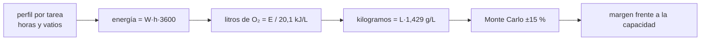

# B104-C10 — Actividades extravehiculares EVA

<!-- nav:top -->
[🏠 Programa](../../../../README.md) · [📚 Bloque B104](../../../tronco-comun/B104-astronautica-y-preparacion-de-astronautas.md) · [← Anterior: B104-C09 — Entrenamiento en simuladores](../B104-C09-entrenamiento-en-simuladores/CLASE.md) · [Siguiente: B104-C11 — Trajes espaciales →](../B104-C11-trajes-espaciales/CLASE.md)
<!-- /nav -->

## 1. Ubicación, nivel y alcance

Clase 10 del bloque B104, nivel N3. Una actividad extravehicular (EVA, caminata espacial) es trabajo fuera de la nave con un traje que es, en sí, una pequeña nave. Aquí presupuestas el oxígeno de una EVA sintética a partir de un perfil metabólico por tarea y miras el margen con incertidumbre. Sigue a B104-C09 y prepara a B104-C11 (trajes) y B104-C15 (analogía subacuática). Perfil **sintético**, capacidad **ilustrativa**: no es una planificación de EVA.

## 2. Por qué esta clase existe

El oxígeno de un traje es finito y el trabajo manual consume más que el reposo. La decisión central: **¿cuánto margen queda sobre el consumo esperado si la tasa metabólica de cada tarea varía?**

## 3. Lo que podrás hacer al terminar

1. Convertir una tasa metabólica en consumo de oxígeno en litros y en kilogramos.
2. Construir un presupuesto por tarea y sumarlo.
3. Estimar con Monte Carlo el percentil 95 y la probabilidad de superar una capacidad.
4. Expresar el margen en horas a la tasa media.
5. Situar la duración planificada frente a las duraciones de EVA consultadas.
6. Rotular que la capacidad y el perfil no son de ningún traje.

La evidencia es la **presupuesto de consumibles de una EVA** del ejercicio 12 (sección 20).

## 4. Con qué llegas y cómo comprobarlo

1. ¿Qué es una potencia en vatios?
2. ¿Qué es un percentil?
3. ¿Qué es una energía en julios?
4. ¿Qué es un margen?
5. ¿Qué es un dato sintético?

<details>
<summary>Ver respuestas</summary>

1. Energía por unidad de tiempo (W = J/s). 2. El valor bajo el cual queda esa fracción de los datos. 3. El trabajo o calor, medido en J. 4. Un exceso deliberado sobre lo esperado. 5. Un dato generado para el ejemplo.
</details>

Con cuatro o cinco aciertos, sigue; si no, repasa los prerrequisitos.

## 5. Un caso de contexto y casos de referencia

La página de NASA sobre las caminatas espaciales de la ISS (consultada el 2026-11-10) registra más de 280 (286 en su gráfico) desde diciembre de 1998; la más larga duró 8 h 56 min, la más corta 19 min, y la mayoría entre 5 y 7 horas; los trajes EMU de NASA salen de la esclusa Quest y los Orlan de Roscosmos, de Poisk. Una EVA **sintética** de 6,0 h con cinco tareas de 250 a 400 W consume 0,534 kg de oxígeno, el 59 % de una capacidad ilustrativa de 0,9 kg; con variación de 15 % por tarea el percentil 95 es 0,609 kg y la probabilidad de superar 0,9 kg es prácticamente cero. Es el **ejemplo conductor**: el perfil y la capacidad son **sintéticos e ilustrativos**.

## 6. Vocabulario

La **tasa metabólica** es la potencia que gasta el cuerpo. El **equivalente energético** es la energía por litro de O₂ consumido. Un **presupuesto de consumibles** suma lo que se gasta por tarea. El **percentil 95** es el valor superado en el 5 % de los casos. La **esclusa** es el recinto por el que se sale de la nave.

## 7. Modelo mental



*Descripción textual:* el perfil por tarea se convierte en energía, litros y kilogramos de oxígeno; la variación aleatoria da el percentil 95 y el margen frente a la capacidad.

Analogía: calcular el combustible de una caminata larga con cuestas: sumas el gasto por tramo y le añades un colchón porque no todos los tramos cuestan lo mismo. Límite: aquí el «colchón» se calcula con una distribución, y la capacidad real depende del traje.

## 8. La explicación, paso a paso

### 8.1 Lo consultado

De la página de NASA: más de 280 caminatas en la ISS desde 1998 (286 en el gráfico), la más larga de 8 h 56 min (James Voss y Susan Helms, 12 de marzo de 2001), la más corta de 19 min, la mayoría de 5 a 7 h, y que sirven al ensamblaje y mantenimiento (por ejemplo instalar paneles solares, reemplazar baterías o reparar el Canadarm2). Se leyeron los primeros 100 000 de 136 052 caracteres de la página.

### 8.2 Del vatio al kilogramo

`E = W · h · 3 600`; litros de O₂ `= E/20,1 kJ`; masa `= litros · 1,429 g`. La tarea de 400 W durante 1,5 h gasta 2,16 MJ, 107,5 L, 0,154 kg. El equivalente de 20,1 kJ/L y la densidad de 1,429 g/L son valores estándar **no consultados**.

### 8.3 Presupuesto sintético

| tarea | horas | `W` | O₂ (kg) |
|---|---|---|---|
| preparación y salida | 0,5 | 250 | 0,032 |
| traslado por pasamanos | 1,0 | 320 | 0,082 |
| instalación de equipo | 2,5 | 360 | 0,230 |
| trabajo con herramienta | 1,5 | 400 | 0,154 |
| regreso y cierre | 0,5 | 280 | 0,036 |
| **total** | **6,0** | media 348 | **0,534** |

### 8.4 Incertidumbre

Con variación log-normal de 15 % por tarea (100 000 corridas), la media es 0,533 kg, el percentil 95, 0,609 kg y la probabilidad de superar 0,9 kg es 0,0000. El margen frente al percentil 95 es 0,291 kg, equivalente a 3,27 h a la tasa media. Un margen amplio sobre el consumo no dice nada de los demás límites (energía, refrigeración, CO₂, tiempo de la tripulación).

### 8.5 Límites

Capacidad inventada, un solo consumible, sin fugas del traje, sin CO₂ ni refrigeración, sin contingencias de la tarea. Una EVA real se planifica con los procedimientos y límites del traje y de la agencia; esta clase no es una pauta.

## 9. Magnitudes, símbolos y unidades

| Símbolo | Qué es | Unidad | Valor / nota |
|---|---|---|---|
| `W` | tasa metabólica media de la tarea | W | 250 a 400 |
| `h` | duración de la tarea | h | 0,5 a 2,5 |
| `E/L` | energía por litro de O₂ | kJ/L | 20,1 (no consultado) |
| densidad O₂ | masa por litro a 0 °C y 101,325 kPa | g/L | 1,429 |
| capacidad | oxígeno utilizable | kg | 0,90 (ilustrativa) |
| `σ` | variación por tarea | — | 0,15 |

## 10. Convenciones y referencias

Potencia en vatios, tiempo en horas, oxígeno en kilogramos y litros normales; variación log-normal de media 1 por tarea, semilla 104 y 100 000 corridas. Tolerancias: suma igual al cálculo directo (< 1e-12); media Monte Carlo a menos de 1 % del determinista; duración de 5 a 7 h. Numpy 2.4.4, Python 3.12.9.

## 11. De dónde sale lo que afirmamos

| ID | Fuente | Localizador | Respalda | Estado |
|---|---|---|---|---|
| S1 | NASA, «Space Station Spacewalks» — https://www.nasa.gov/international-space-station/space-station-spacewalks/ (consultada 2026-11-10; se leyeron los primeros 100 000 caracteres) | datos de recuentos, extremos y duración típica | más de 280 caminatas (286 en el gráfico) desde 1998; más larga 8 h 56 min; más corta 19 min; típicas de 5 a 7 h; EMU desde Quest y Orlan desde Poisk | Consultada |
| — | Relaciones estándar usadas en el laboratorio | — | las verifica el laboratorio | No consultada en una fuente concreta (las verifica el laboratorio) |

Límites: de la página de NASA no se tomó ningún dato de consumibles de los trajes; el equivalente energético, la densidad del oxígeno, la capacidad y el perfil son estándar no consultados o inventados; la ficha del EMU de NASA se intentó leer y no pudo extraerse su texto.

## 12. Cómo ver el resultado

| tarea | O₂ (kg) |
|---|---|
| preparación y salida | 0,032 |
| traslado por pasamanos | 0,082 |
| instalación de equipo | 0,230 |
| trabajo con herramienta | 0,154 |
| regreso y cierre | 0,036 |
| total (6,0 h) | 0,534 |

Percentil 95: 0,609 kg; capacidad ilustrativa: 0,90 kg. Descripción larga: el trabajo de 2,5 h con 360 W es la tarea que más consume.

## 13. Ejemplo trabajado: oxígeno de la tarea con herramienta

**Paso 1 · Energía.** `400 W · 1,5 h · 3 600 = 2,16 MJ`.

**Paso 2 · Litros.** `2,16e6/20,1e3 = 107,5 L`.

**Paso 3 · Masa.** `107,5 · 1,429 g = 153,6 g = 0,154 kg`.

## 14. Distintas formas de describir el problema

**Por fórmula:** `m = W h 3 600 ρ/E`. **Por tabla:** consumo por tarea. **Por margen:** capacidad menos percentil 95. **Por tiempo:** margen en horas a la tasa media.

## 15. Práctica guiada

**Ejercicio 1 · con los pasos indicados.** Calcula el oxígeno de una tarea de 320 W durante 1,0 h. *Pasos:* energía, litros y kilogramos.

<details><summary>Solución comentada</summary>

`1,152 MJ → 57,3 L → 0,082 kg`.
</details>

**Ejercicio 2 · con una pista.** ¿Qué energía es 250 W durante 0,5 h? *Pista:* 3 600 s por hora.

<details><summary>Solución comentada</summary>

`450 kJ`.
</details>

**Ejercicio 3 · casi autónomo.** Suma el presupuesto de la tabla.

<details><summary>Solución comentada</summary>

`0,032 + 0,082 + 0,230 + 0,154 + 0,036 = 0,534 kg`.
</details>

## 16. Práctica autónoma, transferencia e integrador

**Ejercicio 4 · autónomo.** ¿Qué fracción de la capacidad ilustrativa consume la EVA?

<details><summary>Solución comentada</summary>

`0,534/0,90 = 0,59`.
</details>

**Ejercicio 5 · autónomo.** ¿Cuál es la tasa metabólica media ponderada?

<details><summary>Solución comentada</summary>

`(250·0,5+320·1+360·2,5+400·1,5+280·0,5)/6 = 348 W`.
</details>

**Ejercicio 6 · autónomo.** ¿Por qué el percentil 95 supera a la media?

<details><summary>Solución comentada</summary>

Porque incluye las corridas en que varias tareas consumen más que lo nominal.
</details>

**Ejercicio 7 · autónomo.** ¿Cuánto vale el margen frente al percentil 95 y a cuántas horas equivale?

<details><summary>Solución comentada</summary>

`0,291 kg`; `3,27 h`.
</details>

**Ejercicio 8 · autónomo.** ¿Dónde se sitúa 6,0 h entre las duraciones de EVA consultadas?

<details><summary>Solución comentada</summary>

Dentro del rango típico de 5 a 7 h; lejos de los extremos de 19 min y 8 h 56 min.
</details>

**Ejercicio 9 · transferencia.** La tarea de instalación sube de 360 a 450 W. ¿Cuánto sube el consumo total?

<details><summary>Solución comentada</summary>

`Δ = 90·2,5·3 600/20,1e3·1,429/1000 = 0,058 kg`; total `0,592 kg`.
</details>

**Ejercicio 10 · transferencia.** El oxígeno no es el único límite. Nombra otros dos y cómo los incorporarías.

<details><summary>Solución comentada</summary>

CO₂ y refrigeración (y tiempo de la tripulación); se añade una fila por consumible con su capacidad y su variación.
</details>

**Ejercicio 11 · transferencia.** Con una capacidad de 0,60 kg, ¿qué concluyes del percentil 95?

<details><summary>Solución comentada</summary>

`0,609 > 0,60`: hay cerca del 5 % de probabilidad de superarla; el margen es insuficiente y se reduce la tarea o se cambia la capacidad.
</details>

**Ejercicio 12 · integrador.** Elabora tu *presupuesto de consumibles de una EVA*: perfil por tarea, oxígeno por tarea, percentil 95, margen en horas, comparación con las duraciones consultadas y lista de qué es sintético, estándar e ilustrativo.

<details><summary>Solución comentada</summary>

Secciones 8.1–8.5 y la salida del laboratorio.
</details>

## 17. Laboratorio: presupuesto de oxígeno de una EVA

El script [oxigeno.py](oxigeno.py) convierte un perfil metabólico sintético en oxígeno, suma el presupuesto y estima percentil 95 y margen con 100 000 corridas (**comprueba** la suma, la media Monte Carlo y que la duración esté en el rango consultado). Tarda menos de 1 s.

**Datos:** perfil **sintético** con semilla 104, capacidad **ilustrativa** y duraciones de NASA consultadas. **Predice antes de ejecutar:** ¿Qué fracción de una capacidad de 0,9 kg consume esta EVA sintética? (Cerca del 59 %.) **Ejecución del 2026-11-10 (Python 3.12.9):**

```text
Python 3.12.9; numpy 2.4.4
DATOS SINTETICOS (semilla 104): perfil metabolico por tarea; capacidad de O2 ilustrativa (no es la de ningun traje)

tarea | horas | tasa metabolica media [W] | O2 [kg]
preparacion y salida           0.5                  250     0.032
traslado por pasamanos         1.0                  320     0.082
instalacion de equipo          2.5                  360     0.230
trabajo con herramienta        1.5                  400     0.154
regreso y cierre               0.5                  280     0.036
Total: 6.0 h; O2 = 0.534 kg; fraccion de la capacidad ilustrativa de 0.9 kg = 0.59
Tasa metabolica media ponderada: 348 W

Monte Carlo (100000 corridas, variacion 15 % por tarea): media 0.533 kg; percentil 95 0.609 kg; P(superar 0.9 kg) = 0.0000
Margen frente al percentil 95: 0.291 kg = 3.27 h a la tasa media

Contexto consultado (NASA, 2026-11-10): mas larga 8 h 56 min; mas corta 19 min; tipicas ~5 a 7 h; 286 caminatas en el grafico
Duracion planificada aqui: 6.0 h (dentro del rango tipico consultado)
Pruebas superadas.
```

```bash
python programa/clases/B104/B104-C10-actividades-extravehiculares-eva/oxigeno.py
```

**Límites:** un solo consumible, capacidad inventada, sin fugas, CO₂, refrigeración ni contingencias; no es una planificación de EVA.

## 18. Errores frecuentes y cómo corregirlos

**Mezclar vatios y kilovatios.** Escribe las unidades (8.2).

**Usar solo la media.** Calcula el percentil 95 (8.4).

**Tomar el margen de oxígeno como seguridad total.** Hay otros límites (8.4).

**Presentar la capacidad como la de un traje real.** Es ilustrativa (sección 10).

## 19. Cómo sabrás que vas bien

Tras la sección 8: ¿qué consumo esperabas para 6,0 h y cuál da la tabla? Si dudas, repasa el ejemplo 13. Tras el laboratorio: ¿qué comprueba? (ver la sección 17).

## 20. Qué entregas y cómo se evalúa

El producto es tu **presupuesto de consumibles de una EVA** (ejercicio 12).

| Criterio | Inicial | En desarrollo | Logrado | Destacado |
|---|---|---|---|---|
| Conceptos | Confunde los términos | Parciales | Explica tasa metabólica, presupuesto y percentil | Explica por qué el margen sobre un consumible no basta |
| Cálculo | Sin unidades | Con errores | Calcula con unidades y compara con el laboratorio | Resuelve casos nuevos |
| Numérico | Sin comprobar | Un caso | Compara con una segunda vía de cálculo | Interpreta las diferencias |
| Fuentes | Sin fuente | Sin fecha | Fuentes con fecha y estado | Declara lo sintético, lo ilustrativo y lo no consultado |
| Límites | No los nombra | Uno | Tres | Discute qué falta del modelo |

**Condiciones críticas (no se compensan con promedio):** rotular el perfil como sintético y la capacidad como ilustrativa, no presentar el presupuesto como planificación de una EVA ni como consejo operativo y citar solo lo consultado.

## 21. Ética, seguridad y límites

Clase educativa: **no da consejo médico, de entrenamiento individual ni operativo** y no sustituye a los requisitos, procedimientos y estándares de ninguna agencia. El presupuesto no planifica ninguna EVA ni evalúa un traje real. Accesibilidad: tablas equivalentes a las gráficas, fórmulas en texto, ejercicios sin conexión.

## 22. Para cerrar y seguir

Una EVA sintética de 6 h consume 0,534 kg de oxígeno, con percentil 95 de 0,609 kg frente a una capacidad ilustrativa de 0,9 kg. Queda una pregunta: ¿por qué el traje trabaja a una presión menor que la cabina y qué exige eso?

**Glosario español–inglés.** actividad extravehicular · *extravehicular activity (EVA)*; tasa metabólica · *metabolic rate*; esclusa · *airlock*; presupuesto · *budget*; percentil · *percentile*.

**Continuidad.** [B104-C11](../B104-C11-trajes-espaciales/CLASE.md) estudia los trajes espaciales, su presión y la preoxigenación según un modelo de tejido.

**Referencias:** ver sección 11.

<!-- nav:bottom -->
---

[← Anterior: B104-C09 — Entrenamiento en simuladores](../B104-C09-entrenamiento-en-simuladores/CLASE.md) · [📚 Bloque B104](../../../tronco-comun/B104-astronautica-y-preparacion-de-astronautas.md) · [Siguiente: B104-C11 — Trajes espaciales →](../B104-C11-trajes-espaciales/CLASE.md)
<!-- /nav -->
