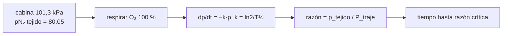

# B104-C11 — Trajes espaciales

<!-- nav:top -->
[🏠 Programa](../../../../README.md) · [📚 Bloque B104](../../../tronco-comun/B104-astronautica-y-preparacion-de-astronautas.md) · [← Anterior: B104-C10 — Actividades extravehiculares EVA](../B104-C10-actividades-extravehiculares-eva/CLASE.md) · [Siguiente: B104-C12 — Robótica tripulada →](../B104-C12-robotica-tripulada/CLASE.md)
<!-- /nav -->

## 1. Ubicación, nivel y alcance

Clase 11 del bloque B104, nivel N3. Un traje espacial es un recinto presurizado con forma humana: mantiene una presión, aporta oxígeno, gestiona el calor y permite moverse. Aquí estudias una de sus consecuencias fisiológicas con un modelo mínimo: el nitrógeno disuelto en los tejidos y por qué se respira oxígeno puro antes de bajar la presión. Sigue a B104-C10. **No es una pauta de descompresión ni de uso del traje**; los tiempos medios y las razones críticas son **ilustrativos**.

## 2. Por qué esta clase existe

Un traje presurizado a una fracción de la presión de la cabina deja al nitrógeno disuelto en sobresaturación si no se elimina antes. La decisión conceptual: **¿cómo depende el tiempo de eliminación del nitrógeno del compartimento, de la razón crítica y de la presión de la cabina?**

## 3. Lo que podrás hacer al terminar

1. Plantear la ecuación de un compartimento de tejido con tiempo medio `T½`.
2. Calcular la razón entre el nitrógeno del tejido y la presión del traje.
3. Calcular el tiempo para alcanzar una razón crítica dada.
4. Comparar el efecto de la presión de cabina sobre ese tiempo.
5. Verificar la solución exacta con una integración numérica.
6. Reconocer los límites del modelo y que no sirve como pauta médica ni operativa.

La evidencia es la **curva de nitrógeno en tejido** del ejercicio 12 (sección 20).

## 4. Con qué llegas y cómo comprobarlo

1. ¿Qué es una presión parcial?
2. ¿Qué es un tiempo medio?
3. ¿Qué es una ecuación diferencial de primer orden?
4. ¿Qué es una razón?
5. ¿Qué es un modelo ilustrativo?

<details>
<summary>Ver respuestas</summary>

1. La presión que ejercería un gas solo. 2. El tiempo en que una magnitud cae a la mitad. 3. Una ecuación que relaciona una función con su derivada primera. 4. El cociente de dos magnitudes. 5. Uno con parámetros no medidos.
</details>

Con cuatro o cinco aciertos, sigue; si no, repasa los prerrequisitos.

## 5. Un caso de contexto y casos de referencia

En el modelo, un tejido equilibrado con aire a 101,3 kPa tiene 80,05 kPa de nitrógeno; un traje a 29,6 kPa (4,3 psi, cifra vista solo en un resultado de búsqueda y **no consultada**) da una razón inicial de 2,70. Respirando oxígeno al 100 %, un compartimento de `T½ = 40 min` llega a la razón 2,0 en 17,4 min y a 1,4 en 38,0 min; uno de 360 min necesita 156,7 min y 341,9 min. Con una cabina ilustrativa de 70,3 kPa la razón inicial es 1,75 y la de 2,0 ya se cumple. Es el **ejemplo conductor**: compartimentos y razones son **ilustrativos**.

## 6. Vocabulario

El **tiempo medio** `T½` es el que tarda un compartimento en eliminar la mitad de su exceso. La **razón crítica** `R` es el máximo cociente tolerado entre `p_N₂` en el tejido y la presión ambiente (valores ilustrativos aquí). La **preoxigenación** es respirar oxígeno antes de bajar la presión. Un **compartimento** es un tejido idealizado.

## 7. Modelo mental



*Descripción textual:* el tejido parte equilibrado con el aire de la cabina; al respirar oxígeno el nitrógeno cae exponencialmente; la razón con la presión del traje determina cuánto tiempo hace falta para bajarla hasta la razón crítica.

Analogía: una esponja empapada que se escurre despacio: cuanto más lenta la esponja, más tiempo hay que esperar antes de pasar a un ambiente de menos presión. Límite: el modelo de un compartimento no recoge burbujas, perfusión ni la variación de los tejidos.

## 8. La explicación, paso a paso

### 8.1 El modelo

`dp/dt = −k p` con `k = ln 2/T½`, solución `p(t) = p₀ e^(−kt)` con `p₀ = 0,79 · 101,325 = 80,05 kPa`. Se supone que el oxígeno puro deja la presión alveolar de nitrógeno en 0 (se ignora el vapor de agua y los demás gases).

### 8.2 Tiempo hasta una razón crítica

`t = (T½/ln 2) ln(p₀/(R P_traje))`, con `P_traje = 29,6 kPa`. Tras un tiempo medio queda la mitad (el laboratorio lo comprueba).

| `T½` (min) | `R = 1,4` (min) | `R = 2,0` (min) |
|---|---|---|
| 5 | 4,7 | 2,2 |
| 40 | 38,0 | 17,4 |
| 120 | 114,0 | 52,2 |
| 360 | 341,9 | 156,7 |

Los compartimentos lentos mandan el tiempo.

### 8.3 Presión de cabina menor

Con una cabina ilustrativa de 70,3 kPa y 73,5 % de nitrógeno, `p₀ = 51,7 kPa` y la razón inicial 1,75: para `R = 2,0` no hace falta preoxigenar; para `R = 1,4` con `T½ = 360 min`, 114,6 min frente a 341,9 min. Una cabina de menor presión reduce el tiempo, a costa de otros problemas (inflamabilidad, presión parcial de oxígeno; ver B104-C05 y B106).

### 8.4 Verificación numérica

Una integración de Euler con paso de 0,01 min da `2,50121 kPa` a los 600 min frente a `2,50146 kPa` exactos (`T½ = 120 min`): el código es coherente.

### 8.5 Límites y seguridad

El modelo ignora burbujas, ejercicio, perfusión y la variación individual. Las razones críticas y los tiempos medios son inventados: **no** usar para ninguna decisión sobre descompresión ni respiración. La preoxigenación real la define la medicina de la agencia.

## 9. Magnitudes, símbolos y unidades

| Símbolo | Qué es | Unidad | Valor / nota |
|---|---|---|---|
| `p₀` | N₂ inicial en el tejido | kPa | 80,05 |
| `P_traje` | presión del traje | kPa | 29,6 (no consultada) |
| `T½` | tiempo medio del compartimento | min | 5 a 360 (ilustrativo) |
| `R` | razón crítica | — | 1,4 y 2,0 (ilustrativas) |
| `t` | tiempo de preoxigenación | min | 2,2 a 341,9 |

## 10. Convenciones y referencias

Presiones en kilopascales, tiempo en minutos; un compartimento por vez; aire con 79 % de N₂ a 101,325 kPa; oxígeno al 100 % con N₂ alveolar nulo. Sin aleatoriedad. Tolerancias: Euler dentro de 1e-3 kPa de la solución exacta; la mitad del exceso tras un tiempo medio (< 1e-9). Numpy 2.4.4, Python 3.12.9.

## 11. De dónde sale lo que afirmamos

| ID | Fuente | Localizador | Respalda | Estado |
|---|---|---|---|---|
| S1 | NASA, «Space Station Spacewalks» — https://www.nasa.gov/international-space-station/space-station-spacewalks/ (consultada 2026-11-10; se leyeron los primeros 100 000 caracteres) | página, sección de trajes y esclusas | los trajes EMU de NASA salen de la esclusa Quest y los Orlan de Roscosmos, de Poisk | Consultada |
| S2 | NASA, «Human Research Program: hazards» — https://www.nasa.gov/hrp/hazards/ (consultada 2026-11-10) | página completa | el entorno cerrado exige controlar presión y temperatura de un habitáculo seguro | Consultada |
| — | Relaciones estándar usadas en el laboratorio | — | las verifica el laboratorio | No consultada en una fuente concreta (las verifica el laboratorio) |

Límites: la presión de 4,3 psi del EMU apareció solo en un resultado de búsqueda y el PDF de la ficha del EMU no pudo leerse como texto, de modo que esa cifra **no se consultó**; no se consultó ningún trabajo de Haldane ni documento de medicina de buceo o de EVA. Todo el modelo es ilustrativo.

## 12. Cómo ver el resultado

| `T½` (min) | `R = 1,4` (min) | `R = 2,0` (min) |
|---|---|---|
| 5 | 4,7 | 2,2 |
| 40 | 38,0 | 17,4 |
| 120 | 114,0 | 52,2 |
| 360 | 341,9 | 156,7 |

Cabina ilustrativa de 70,3 kPa con `T½ = 360 min`: `R = 1,4` en 114,6 min; `R = 2,0` en 0 min. Descripción larga: el tiempo crece con el tiempo medio y disminuye al aflojar la razón o la presión de cabina.

## 13. Ejemplo trabajado: tiempo para la razón 2,0 con T½ = 40 min

**Paso 1 · Presión inicial.** `p₀ = 0,79 · 101,325 = 80,05 kPa`.

**Paso 2 · Meta.** `2,0 · 29,6 = 59,2 kPa`.

**Paso 3 · Cociente.** `80,05/59,2 = 1,352`; `ln = 0,3018`.

**Paso 4 · Tiempo.** `40/0,6931 · 0,3018 = 17,4 min`.

## 14. Distintas formas de describir el problema

**Por ecuación:** `dp/dt = −kp`. **Por solución:** `p₀ e^(−kt)`. **Por tabla:** `T½` y `R`. **Por razón:** `p_tejido/P_traje`. **Por verificación:** Euler frente a la exacta.

## 15. Práctica guiada

**Ejercicio 1 · con los pasos indicados.** Calcula `p₀`. *Pasos:* multiplica 0,79 por 101,325 kPa.

<details><summary>Solución comentada</summary>

`80,05 kPa`.
</details>

**Ejercicio 2 · con una pista.** Calcula la razón inicial con `P_traje = 29,6 kPa`. *Pista:* divide.

<details><summary>Solución comentada</summary>

`80,05/29,6 = 2,70`.
</details>

**Ejercicio 3 · casi autónomo.** Calcula el tiempo para `R = 2,0` con `T½ = 40 min`.

<details><summary>Solución comentada</summary>

`17,4 min`.
</details>

## 16. Práctica autónoma, transferencia e integrador

**Ejercicio 4 · autónomo.** ¿Qué fracción queda tras un tiempo medio? ¿Y tras dos?

<details><summary>Solución comentada</summary>

`1/2` y `1/4`.
</details>

**Ejercicio 5 · autónomo.** ¿Cuánto vale `k` con `T½ = 120 min`?

<details><summary>Solución comentada</summary>

`ln 2/120 = 5,78e-3 min⁻¹`.
</details>

**Ejercicio 6 · autónomo.** ¿Por qué manda el compartimento lento?

<details><summary>Solución comentada</summary>

Porque tarda más en bajar al nivel exigido.
</details>

**Ejercicio 7 · autónomo.** Calcula `p` a los 600 min con `T½ = 120 min`.

<details><summary>Solución comentada</summary>

`80,05 · 2^(−5) = 2,50 kPa`.
</details>

**Ejercicio 8 · autónomo.** ¿Qué razón inicial da una cabina de 70,3 kPa con 73,5 % de N₂?

<details><summary>Solución comentada</summary>

`51,7/29,6 = 1,75`.
</details>

**Ejercicio 9 · transferencia.** La razón crítica real fuera 1,22 en vez de 1,4. ¿Qué pasa con el tiempo para `T½ = 40 min`?

<details><summary>Solución comentada</summary>

`40/0,6931 · ln(80,05/(1,22·29,6)) = 45,9 min`: crece.
</details>

**Ejercicio 10 · transferencia.** ¿Por qué el modelo no sirve para decidir un tiempo de preoxigenación real?

<details><summary>Solución comentada</summary>

Porque ignora burbujas, perfusión, ejercicio y variación individual, y sus parámetros son inventados.
</details>

**Ejercicio 11 · transferencia.** ¿Qué compromiso introduce bajar la presión de la cabina?

<details><summary>Solución comentada</summary>

Menos tiempo de preoxigenación, pero presión parcial de oxígeno y riesgo de incendio que hay que reanalizar (B104-C05, B106).
</details>

**Ejercicio 12 · integrador.** Elabora tu *curva de nitrógeno en tejido*: tabla por `T½` y `R`, efecto de la presión de cabina, verificación numérica, límites y qué es ilustrativo y no consultado.

<details><summary>Solución comentada</summary>

Secciones 8.1–8.5 y la salida del laboratorio.
</details>

## 17. Laboratorio: modelo de tejido de Haldane

El script [haldane.py](haldane.py) resuelve el modelo de un compartimento para cuatro tiempos medios y dos razones, repite con otra cabina y verifica con Euler (**comprueba** Euler frente a la exacta, el orden de los tiempos y que un tiempo medio deja la mitad). Tarda menos de 1 s.

**Datos:** parámetros **ilustrativos**; la presión del traje no se consultó. Sin aleatoriedad. **Predice antes de ejecutar:** ¿Cuántos minutos necesita un compartimento de `T½ = 40 min` para pasar a la razón 2,0? (Unos 17.) **Ejecución del 2026-11-10 (Python 3.12.9):**

```text
Python 3.12.9; numpy 2.4.4
MODELO ILUSTRATIVO: tiempos medios 5-360 min y razones criticas inventadas; NO es una pauta de descompresion

pN2 inicial en el tejido: 80.05 kPa; presion del traje 29.6 kPa -> razon inicial 2.70
t medio [min] | razon critica | tiempo de preoxigenacion [min]
           5            1.4                    4.7
           5            2.0                    2.2
          40            1.4                   38.0
          40            2.0                   17.4
         120            1.4                  114.0
         120            2.0                   52.2
         360            1.4                  341.9
         360            2.0                  156.7

Cabina ilustrativa de 70,3 kPa (73,5 % N2): pN2 tejido 51.7 kPa; razon inicial 1.75
  t medio 360 min, razon 1.4: 114.6 min
  t medio 360 min, razon 2.0: 0.0 min

Euler frente a exacta (t medio 120 min, t = 600 min): 2.50121 frente a 2.50146 kPa
Pruebas superadas.
```

```bash
python programa/clases/B104/B104-C11-trajes-espaciales/haldane.py
```

**Límites:** un solo compartimento, sin burbujas ni perfusión, N₂ alveolar nulo; no es una pauta de descompresión.

## 18. Errores frecuentes y cómo corregirlos

**Usar el modelo como pauta.** Es educativo (8.5).

**Olvidar la presión parcial al bajar la cabina.** Revisa B104-C05 (8.3).

**Mezclar psi y kPa.** Convierte (sección 10).

**Creer que la presión del traje fue consultada.** No lo fue (sección 11).

## 19. Cómo sabrás que vas bien

Tras la sección 8: ¿qué tiempo esperabas para `T½ = 120 min` y `R = 2,0` y cuál da la tabla? Si dudas, repasa el ejemplo 13. Tras el laboratorio: ¿qué comprueba? (ver la sección 17).

## 20. Qué entregas y cómo se evalúa

El producto es tu **curva de nitrógeno en tejido** (ejercicio 12).

| Criterio | Inicial | En desarrollo | Logrado | Destacado |
|---|---|---|---|---|
| Conceptos | Confunde los términos | Parciales | Explica compartimento, razón crítica y preoxigenación | Explica por qué manda el tejido lento |
| Cálculo | Sin unidades | Con errores | Calcula con unidades y compara con el laboratorio | Resuelve casos nuevos |
| Numérico | Sin comprobar | Un caso | Compara con una segunda vía de cálculo | Interpreta las diferencias |
| Fuentes | Sin fuente | Sin fecha | Fuentes con fecha y estado | Declara lo sintético, lo ilustrativo y lo no consultado |
| Límites | No los nombra | Uno | Tres | Discute qué falta del modelo |

**Condiciones críticas (no se compensan con promedio):** rotular el modelo como ilustrativo y la presión del traje como no consultada, no usarlo como pauta de descompresión ni consejo médico y citar solo lo consultado.

## 21. Ética, seguridad y límites

Clase educativa: **no da consejo médico, de entrenamiento individual ni operativo** y no sustituye a los requisitos, procedimientos y estándares de ninguna agencia. **No** uses esta clase para decidir respiración, descompresión ni uso de un traje: es un ejercicio de ecuación diferencial con parámetros inventados. Accesibilidad: tablas equivalentes a las gráficas, fórmulas en texto, ejercicios sin conexión.

## 22. Para cerrar y seguir

En el modelo, un compartimento de 40 min necesita 17,4 min de oxígeno para llegar a la razón 2,0 y uno de 360 min necesita 156,7 min. Queda una pregunta: ¿quién hace el trabajo cuando las manos del astronauta no alcanzan?

**Glosario español–inglés.** traje espacial · *spacesuit*; preoxigenación · *pre-breathe*; tiempo medio · *half-time*; razón crítica · *critical ratio*; compartimento · *compartment*.

**Continuidad.** [B104-C12](../B104-C12-robotica-tripulada/CLASE.md) trata la robótica tripulada y la teleoperación con retardo.

**Referencias:** ver sección 11.

<!-- nav:bottom -->
---

[← Anterior: B104-C10 — Actividades extravehiculares EVA](../B104-C10-actividades-extravehiculares-eva/CLASE.md) · [📚 Bloque B104](../../../tronco-comun/B104-astronautica-y-preparacion-de-astronautas.md) · [Siguiente: B104-C12 — Robótica tripulada →](../B104-C12-robotica-tripulada/CLASE.md)
<!-- /nav -->
