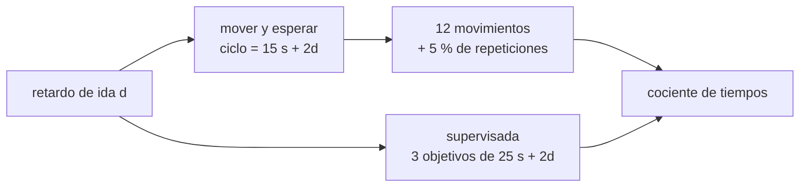

# B104-C12 — Robótica tripulada

<!-- nav:top -->
[🏠 Programa](../../../../README.md) · [📚 Bloque B104](../../../tronco-comun/B104-astronautica-y-preparacion-de-astronautas.md) · [← Anterior: B104-C11 — Trajes espaciales](../B104-C11-trajes-espaciales/CLASE.md) · [Siguiente: B104-C13 — Procedimientos de emergencia →](../B104-C13-procedimientos-de-emergencia/CLASE.md)
<!-- /nav -->

## 1. Ubicación, nivel y alcance

Clase 12 del bloque B104, nivel N3. La robótica tripulada reúne a personas y robots: el astronauta opera un brazo o un rover desde la cabina o desde otro planeta. Con retardo, el lazo de control humano se rompe y hay que elegir entre mover y esperar o delegar objetivos de alto nivel. Sigue a B104-C11 y a la robótica de B96–B103 (otras clases). Tareas y tiempos **sintéticos**; distancias estándar no consultadas.

## 2. Por qué esta clase existe

Con 0 s de retardo se opera en tiempo real; con 3 minutos cada movimiento tarda mucho más. La decisión central: **¿hasta qué retardo conviene teleoperar paso a paso y a partir de cuándo hay que delegar autonomía supervisada?**

## 3. Lo que podrás hacer al terminar

1. Calcular el tiempo de una tarea en modo mover y esperar con un retardo dado.
2. Calcular el tiempo con autonomía supervisada por objetivos.
3. Comparar ambos modos desde la ISS hasta Marte.
4. Estimar con Monte Carlo la variabilidad por correcciones aleatorias.
5. Reconocer cuándo el retardo vuelve inviable el control manual.
6. Rotular que la tarea y los tiempos son sintéticos.

La evidencia es la **tabla de tiempos por retardo** del ejercicio 12 (sección 20).

## 4. Con qué llegas y cómo comprobarlo

1. ¿Qué es un retardo de luz?
2. ¿Qué es un lazo de control?
3. ¿Qué es el valor esperado?
4. ¿Qué es una distribución binomial?
5. ¿Qué es un dato sintético?

<details>
<summary>Ver respuestas</summary>

1. El tiempo que tarda una señal en llegar. 2. Un ciclo de medir, decidir y actuar. 3. El promedio ponderado por probabilidades. 4. El número de éxitos en `n` intentos independientes. 5. Un dato generado para el ejemplo.
</details>

Con cuatro o cinco aciertos, sigue; si no, repasa los prerrequisitos.

## 5. Un caso de contexto y casos de referencia

Una tarea sintética de 12 movimientos de 10 s con 5 s de verificación y un 5 % de correcciones. Con retardo de ida de 0 s tarda 189,0 s en modo mover y esperar y 75,0 s con autonomía supervisada (3 objetivos de 25 s); con la Luna (1,28 s), 221,3 s y 82,7 s; con Marte cercano (182,1 s), 4 778,6 s y 1 167,8 s; con Marte lejano (1 337,6 s), 33 896,3 s y 8 100,6 s. Es el **ejemplo conductor**: la tarea es **sintética** y las distancias son estándar **no consultadas**.

## 6. Vocabulario

**Mover y esperar** es mandar un movimiento, esperar la confirmación y seguir. La **autonomía supervisada** es dar un objetivo de alto nivel que el robot ejecuta solo. El **retardo de ida** es `d/c`. Una **corrección** es repetir un movimiento mal ejecutado. La **teleoperación** es operar a distancia.

## 7. Modelo mental



*Descripción textual:* el retardo se suma dos veces a cada ciclo en el modo mover y esperar y solo una vez por objetivo en el modo supervisado; se comparan los tiempos totales.

Analogía: jugar al ajedrez por correspondencia o por videollamada: la partida es la misma, pero cada jugada cuesta una espera. Límite: un robot que ejecuta objetivos solo necesita una capacidad de percepción y decisión que el ajedrez no exige.

## 8. La explicación, paso a paso

### 8.1 Mover y esperar

Cada ciclo dura `T_mov + T_ver + 2d = 15 s + 2d`. Con 12 movimientos y 5 % de correcciones esperadas (`12 · 0,05 = 0,6` movimientos más), `T = 12,6 · (15 + 2d)`. Con `d = 0`: 189,0 s. Con `d = 182,1 s`: `12,6 · 379,25 = 4 778,6 s`.

### 8.2 Autonomía supervisada

`T = n_obj · (2d + T_auto)`; con 3 objetivos de 25 s: 75,0 s para `d = 0` y 1 167,8 s para `d = 182,1 s`. El retardo se paga una vez por objetivo, no una por movimiento.

### 8.3 Tabla

| escenario | `d` (s) | mover y esperar (s) | supervisada (s) | cociente |
|---|---|---|---|---|
| ISS (0 s) | 0,00 | 189,0 | 75,0 | 2,52 |
| ISS a tierra (0,3 s, ilustrativo) | 0,30 | 196,6 | 76,8 | 2,56 |
| Luna | 1,28 | 221,3 | 82,7 | 2,68 |
| Marte, mínimo | 182,13 | 4 778,6 | 1 167,8 | 4,09 |
| Marte, máximo | 1 337,59 | 33 896,3 | 8 100,6 | 4,18 |

El modo supervisado gana siempre en tiempo, pero exige un robot capaz de ejecutar y detectar fallas por sí mismo.

### 8.4 Variabilidad

Con 100 000 corridas (semilla 104) en Marte cercano, la media es 4 779,9 s (fórmula 4 778,6 s) y el percentil 95, 5 309,5 s: las correcciones aleatorias añaden hasta un 11 %.

### 8.5 Límites

Una sola tarea, tiempos fijos, sin pérdida de enlace y sin el costo de que el robot falle en autonomía. El umbral entre ambos modos depende de la tarea, del riesgo y de la capacidad del robot; no se calcula aquí.

## 9. Magnitudes, símbolos y unidades

| Símbolo | Qué es | Unidad | Valor / nota |
|---|---|---|---|
| `d` | retardo de ida | s | 0 a 1 337,6 |
| `T_mov` | tiempo de un movimiento | s | 10 (sintético) |
| `T_ver` | tiempo de verificación | s | 5 (sintético) |
| `p` | fracción de correcciones | — | 0,05 |
| `T_auto` | tiempo de un objetivo autónomo | s | 25 (sintético) |

## 10. Convenciones y referencias

Tiempos en segundos; retardo de una dirección (se paga en ida y vuelta); distancias de Marte estándar de 54,6 y 401 millones de km, `c = 299 792,458 km/s`; semilla 104. Tolerancias: media Monte Carlo a menos de 0,5 % de la fórmula; tiempos crecientes con el retardo; supervisada menos de un cuarto del modo mover y esperar en Marte lejano. Numpy 2.4.4, Python 3.12.9.

## 11. De dónde sale lo que afirmamos

| ID | Fuente | Localizador | Respalda | Estado |
|---|---|---|---|---|
| S1 | NASA, «Human Research Program: hazards» — https://www.nasa.gov/hrp/hazards/ (consultada 2026-11-10) | página completa | a mayor distancia de la Tierra es más difícil obtener instrucciones, suministros y atención médica | Consultada |
| S2 | NASA, «Space Station Spacewalks» — https://www.nasa.gov/international-space-station/space-station-spacewalks/ (consultada 2026-11-10; se leyeron los primeros 100 000 caracteres) | página, sección de mantenimiento | las caminatas espaciales de la ISS incluyen la reparación del brazo robótico Canadarm2 | Consultada |
| — | Relaciones estándar usadas en el laboratorio | — | las verifica el laboratorio | No consultada en una fuente concreta (las verifica el laboratorio) |

Límites: de las páginas de NASA solo se toman las dos afirmaciones citadas; los tiempos de la tarea, el 5 % de correcciones y las distancias a Marte no se consultaron en una fuente concreta y se rotulan estándar o sintéticas.

## 12. Cómo ver el resultado

| escenario | mover y esperar (s) | supervisada (s) | cociente |
|---|---|---|---|
| ISS (0 s) | 189,0 | 75,0 | 2,52 |
| Luna | 221,3 | 82,7 | 2,68 |
| Marte, mínimo | 4 778,6 | 1 167,8 | 4,09 |
| Marte, máximo | 33 896,3 | 8 100,6 | 4,18 |

Descripción larga: el cociente sube de 2,5 a 4,2 con el retardo; Marte cercano en modo mover y esperar tarda 80 minutos.

## 13. Ejemplo trabajado: mover y esperar a la Luna

**Paso 1 · Ciclo.** `10 + 5 + 2·1,282 = 17,56 s`.

**Paso 2 · Movimientos esperados.** `12 · 1,05 = 12,6`.

**Paso 3 · Total.** `12,6 · 17,56 = 221,3 s`.

## 14. Distintas formas de describir el problema

**Por fórmula:** `12,6(15 + 2d)` y `3(2d + 25)`. **Por tabla:** retardo y tiempo. **Por cociente:** modo uno entre modo dos. **Por simulación:** media y percentil 95.

## 15. Práctica guiada

**Ejercicio 1 · con los pasos indicados.** Calcula el tiempo mover y esperar con `d = 0`. *Pasos:* `12,6 · 15`.

<details><summary>Solución comentada</summary>

`189,0 s`.
</details>

**Ejercicio 2 · con una pista.** Calcula el tiempo supervisado con `d = 0`. *Pista:* `3 · 25`.

<details><summary>Solución comentada</summary>

`75,0 s`.
</details>

**Ejercicio 3 · casi autónomo.** Calcula el mover y esperar a Marte cercano.

<details><summary>Solución comentada</summary>

`12,6 · (15 + 364,25) = 4 778,6 s`.
</details>

## 16. Práctica autónoma, transferencia e integrador

**Ejercicio 4 · autónomo.** ¿Cuánto es eso en minutos?

<details><summary>Solución comentada</summary>

`79,6 min`.
</details>

**Ejercicio 5 · autónomo.** Calcula el supervisado a Marte cercano.

<details><summary>Solución comentada</summary>

`3 · (364,25 + 25) = 1 167,8 s`.
</details>

**Ejercicio 6 · autónomo.** ¿Cuántas veces se paga el retardo en cada modo?

<details><summary>Solución comentada</summary>

En mover y esperar, en cada ciclo (12,6 veces); en supervisado, en cada objetivo (3 veces).
</details>

**Ejercicio 7 · autónomo.** ¿Por qué el cociente crece con el retardo?

<details><summary>Solución comentada</summary>

Porque en mover y esperar el retardo se multiplica por 12,6 ciclos frente a 3 objetivos.
</details>

**Ejercicio 8 · autónomo.** ¿Qué mide el percentil 95 de 5 309,5 s?

<details><summary>Solución comentada</summary>

Que en el 5 % de las corridas hubo suficientes correcciones para superar ese tiempo.
</details>

**Ejercicio 9 · transferencia.** El retardo de la ISS a tierra es 0,3 s. ¿Cambia mucho la decisión de modo?

<details><summary>Solución comentada</summary>

No: el modo mover y esperar pasa de 189,0 a 196,6 s; el retardo no domina.
</details>

**Ejercicio 10 · transferencia.** Si el robot falla con probabilidad 0,1 por objetivo y cada falla cuesta un ciclo de recuperación con espera, ¿cómo cambia la comparación en Marte cercano?

<details><summary>Solución comentada</summary>

Añade `0,1·3·(2d + T)`: el supervisado sube un 10 % (`≈ 1 285 s`) pero sigue ganando frente a 4 779 s.
</details>

**Ejercicio 11 · transferencia.** Define un criterio simple para elegir el modo según el retardo y la tolerancia al riesgo.

<details><summary>Solución comentada</summary>

Si `2d` ≫ `T_mov`, delegar; si la tarea es de alto riesgo y poco predecible, acortar los objetivos y exigir verificación en cada uno.
</details>

**Ejercicio 12 · integrador.** Elabora tu *tabla de tiempos por retardo*: cinco escenarios en ambos modos, cociente, percentil 95 para uno de ellos, límites y qué es sintético y qué es estándar no consultado.

<details><summary>Solución comentada</summary>

Secciones 8.1–8.5 y la salida del laboratorio.
</details>

## 17. Laboratorio: teleoperación con retardo

El script [teleoperacion.py](teleoperacion.py) calcula el tiempo de una tarea sintética en dos modos para cinco retardos y simula las correcciones en Marte cercano (**comprueba** la media Monte Carlo contra la fórmula, el orden de los tiempos y la ventaja del modo supervisado). Tarda menos de 1 s.

**Datos:** tarea **sintética** con semilla 104 y distancias estándar **no consultadas**. **Predice antes de ejecutar:** ¿Cuántos minutos tarda en mover y esperar la tarea con el retardo mínimo a Marte? (Unos 80.) **Ejecución del 2026-11-10 (Python 3.12.9):**

```text
Python 3.12.9; numpy 2.4.4
MODELO ILUSTRATIVO (semilla 104): tarea de 12 movimientos de 10 s; 5 % necesitan correccion; distancias estandar no consultadas

escenario | ida [s] | mover y esperar [s] | supervisada [s] | cociente
brazo de la ISS desde la ISS (0 s)              0.00          189.0           75.0      2.52
ISS a tierra (0,3 s ida, ilustrativo)           0.30          196.6           76.8      2.56
Luna (1,28 s ida)                               1.28          221.3           82.7      2.68
Marte, minimo (182 s ida)                     182.13         4778.6         1167.8      4.09
Marte, maximo (1 338 s ida)                  1337.59        33896.3         8100.6      4.18

Marte (minimo), Monte Carlo (100000 corridas): media 4779.9 s; percentil 95 5309.5 s; formula 4778.6 s
Pruebas superadas.
```

```bash
python programa/clases/B104/B104-C12-robotica-tripulada/teleoperacion.py
```

**Límites:** una tarea con tiempos fijos, sin fallas del robot ni pérdida de enlace; el umbral entre modos no se calcula.

## 18. Errores frecuentes y cómo corregirlos

**Contar el retardo una sola vez por ciclo.** Es ida y vuelta (8.1).

**Suponer que la autonomía no falla.** Añade fallas (ejercicio 10).

**Usar un solo número en lugar de un percentil.** Calcula el percentil 95 (8.4).

**Presentar la tarea como real.** Es sintética (sección 10).

## 19. Cómo sabrás que vas bien

Tras la sección 8: ¿qué tiempo esperabas a la Luna en modo mover y esperar y cuál da la tabla? Si dudas, repasa el ejemplo 13. Tras el laboratorio: ¿qué comprueba? (ver la sección 17).

## 20. Qué entregas y cómo se evalúa

El producto es tu **tabla de tiempos por retardo** (ejercicio 12).

| Criterio | Inicial | En desarrollo | Logrado | Destacado |
|---|---|---|---|---|
| Conceptos | Confunde los términos | Parciales | Explica mover y esperar y autonomía supervisada | Explica cuándo conviene delegar |
| Cálculo | Sin unidades | Con errores | Calcula con unidades y compara con el laboratorio | Resuelve casos nuevos |
| Numérico | Sin comprobar | Un caso | Compara con una segunda vía de cálculo | Interpreta las diferencias |
| Fuentes | Sin fuente | Sin fecha | Fuentes con fecha y estado | Declara lo sintético, lo ilustrativo y lo no consultado |
| Límites | No los nombra | Uno | Tres | Discute qué falta del modelo |

**Condiciones críticas (no se compensan con promedio):** rotular la tarea como sintética y las distancias como estándar no consultadas, no presentar los tiempos como de una operación real y citar solo lo consultado.

## 21. Ética, seguridad y límites

Clase educativa: **no da consejo médico, de entrenamiento individual ni operativo** y no sustituye a los requisitos, procedimientos y estándares de ninguna agencia. Los tiempos no validan ninguna operación ni sistema de teleoperación. Accesibilidad: tablas equivalentes a las gráficas, fórmulas en texto, ejercicios sin conexión.

## 22. Para cerrar y seguir

Con retardo nulo, mover y esperar tarda 189 s y la autonomía supervisada 75 s; a Marte cercano, 4 779 s y 1 168 s. Queda una pregunta: ¿qué hacer cuando algo sale mal de verdad y el tiempo es corto?

**Glosario español–inglés.** robótica tripulada · *crewed robotics*; teleoperación · *teleoperation*; mover y esperar · *move-and-wait*; autonomía supervisada · *supervised autonomy*; retardo · *delay*.

**Continuidad.** [B104-C13](../B104-C13-procedimientos-de-emergencia/CLASE.md) estudia los procedimientos de emergencia y el tiempo disponible ante una despresurización.

**Referencias:** ver sección 11.

<!-- nav:bottom -->
---

[← Anterior: B104-C11 — Trajes espaciales](../B104-C11-trajes-espaciales/CLASE.md) · [📚 Bloque B104](../../../tronco-comun/B104-astronautica-y-preparacion-de-astronautas.md) · [Siguiente: B104-C13 — Procedimientos de emergencia →](../B104-C13-procedimientos-de-emergencia/CLASE.md)
<!-- /nav -->
