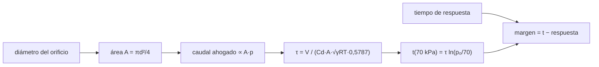

# B104-C13 — Procedimientos de emergencia

<!-- nav:top -->
[🏠 Programa](../../../../README.md) · [📚 Bloque B104](../../../tronco-comun/B104-astronautica-y-preparacion-de-astronautas.md) · [← Anterior: B104-C12 — Robótica tripulada](../B104-C12-robotica-tripulada/CLASE.md) · [Siguiente: B104-C14 — Supervivencia en entorno terrestre →](../B104-C14-supervivencia-en-entorno-terrestre/CLASE.md)
<!-- /nav -->

## 1. Ubicación, nivel y alcance

Clase 13 del bloque B104, nivel N3. Un procedimiento de emergencia es la respuesta ensayada ante una falla que amenaza a la tripulación o a la nave. Esta clase no enseña los procedimientos de ninguna nave: usa una despresurización con un orificio como ejemplo físico para ver **cuánto tiempo hay** y cómo depende del tamaño del orificio. Sigue a B104-C12 y se apoya en B104-C05 (atmósfera). La priorización entre fallas simultáneas es la clase programada B110-C04. Cabina y orificios **ilustrativos**.

## 2. Por qué esta clase existe

Un procedimiento sirve si se puede ejecutar dentro del tiempo disponible. La decisión central: **¿para qué tamaños de orificio alcanza un tiempo de respuesta de 15 minutos y a partir de cuál ya no?**

## 3. Lo que podrás hacer al terminar

1. Calcular el caudal de un orificio en régimen ahogado.
2. Obtener la constante de tiempo `τ` de una cabina y el tiempo hasta un umbral de presión.
3. Verificar la solución con una integración numérica.
4. Calcular el margen frente a un tiempo de respuesta dado.
5. Ver que el tiempo es inversamente proporcional al área del orificio.
6. Rotular que cabina, orificios y tiempos de respuesta son ilustrativos y que no se enseña ningún procedimiento real.

La evidencia es la **tabla de tiempo disponible por tamaño de fuga** del ejercicio 12 (sección 20).

## 4. Con qué llegas y cómo comprobarlo

1. ¿Qué es un flujo ahogado?
2. ¿Qué es un área circular?
3. ¿Qué es una constante de tiempo?
4. ¿Qué es el logaritmo natural?
5. ¿Qué es un modelo ilustrativo?

<details>
<summary>Ver respuestas</summary>

1. Un flujo cuyo caudal ya no aumenta al bajar la presión aguas abajo porque llega a velocidad sónica. 2. `πd²/4`. 3. El tiempo en que una magnitud cae a 1/e. 4. El logaritmo en base `e`. 5. Uno con parámetros inventados.
</details>

Con cuatro o cinco aciertos, sigue; si no, repasa los prerrequisitos.

## 5. Un caso de contexto y casos de referencia

Una cabina ilustrativa de 30 m³ de aire a 294 K con el exterior en vacío y un orificio de coeficiente de descarga 0,6. Con un orificio de 6 mm, `τ = 2,47 h` y la presión baja de 101,3 a 70 kPa en 54,8 min; con 10 mm, en 19,7 min; con 30 mm, en 2,2 min; con 1 mm, en 1 972,7 min (32,9 h). Con un tiempo de respuesta ilustrativo de 15 min, un orificio de 30 mm no deja margen (−12,8 min) y el diámetro límite es de 11,5 mm. Es el **ejemplo conductor**: todo es **ilustrativo** y no describe una nave real.

## 6. Vocabulario

El **flujo ahogado** (o sónico) ocurre cuando la presión exterior es menos de la mitad de la interior: el caudal depende solo de la presión interior. El **coeficiente de descarga** `C_d` corrige el área efectiva. La **constante de despresurización** `τ = V/(C_d A √(γRT) · 0,5787)`. El **tiempo de respuesta** es el que se tarda en detectar, decidir y actuar.

## 7. Modelo mental



*Descripción textual:* el diámetro fija el área y el caudal ahogado; de ahí sale la constante de tiempo y el tiempo hasta un umbral de presión, que se compara con el tiempo de respuesta para obtener el margen.

Analogía: vaciar un tanque por un agujero: cuanto mayor el agujero, menos tiempo para taparlo. Límite: el aire que sale se enfría y el modelo isotermo subestima algo el tiempo real.

## 8. La explicación, paso a paso

### 8.1 Qué se consultó

Ninguna de las fuentes consultadas describe procedimientos de emergencia de una nave. La historia de NASA sobre el entrenamiento de Shuttle–Mir (SP-4225, consultada el 2026-11-10) dice que las tripulaciones de Mir entrenaron aterrizajes de emergencia en tierra y en agua, y NASA lista el entorno cerrado entre los cinco peligros del vuelo humano (consultado el 2026-11-10). Todo lo demás es modelo.

### 8.2 Caudal ahogado

Con el exterior en vacío el flujo está siempre ahogado: `ṁ = C_d A p √(γ/(R T)) · (2/(γ+1))^((γ+1)/(2(γ−1)))`, con `γ = 1,4`, `R = 287,05 J/(kg·K)` y factor `0,5787`. Con gas ideal isotermo, `dp/dt = −p/τ`, y `p(t) = p₀ e^(−t/τ)`.

### 8.3 Constante de tiempo y tiempos

| diámetro (mm) | `τ` (h) | a 70 kPa (min) | a 50 kPa (min) |
|---|---|---|---|
| 1 | 88,90 | 1 972,7 | 3 767,5 |
| 3 | 9,88 | 219,2 | 418,6 |
| 6 | 2,47 | 54,8 | 104,7 |
| 10 | 0,89 | 19,7 | 37,7 |
| 30 | 0,10 | 2,2 | 4,2 |

El tiempo es inversamente proporcional al área: 3 mm tarda 4 veces más que 6 mm (el laboratorio lo comprueba).

### 8.4 Margen

Con 15 min de respuesta ilustrativos: 1 mm deja 1 957,7 min; 3 mm, 204,2 min; 6 mm, 39,8 min; 10 mm, 4,7 min; 30 mm, −12,8 min (insuficiente). El diámetro límite es `6 · √(54,8/15) = 11,5 mm`. Un margen negativo no significa «imposible» sino «el procedimiento debe ser otro» (por ejemplo, aislar el módulo).

### 8.5 Límites y seguridad

Isotermo (el aire se enfría), un solo recinto, sin válvulas ni compartimentación, sin efectos de la presión parcial de oxígeno, sin la conducta de las personas. Los tiempos son ilustrativos y **no** sirven para decidir ninguna respuesta real.

## 9. Magnitudes, símbolos y unidades

| Símbolo | Qué es | Unidad | Valor / nota |
|---|---|---|---|
| `V` | volumen de la cabina | m³ | 30 (ilustrativo) |
| `d` | diámetro del orificio | mm | 1 a 30 |
| `C_d` | coeficiente de descarga | — | 0,6 (ilustrativo) |
| `γ` | razón de calores específicos | — | 1,4 |
| `τ` | constante de tiempo | h | 0,10 a 88,90 |
| `t` | tiempo hasta 70 kPa | min | 2,2 a 1 972,7 |

## 10. Convenciones y referencias

Aire como gas ideal, temperatura constante de 294 K, presión inicial 101 325 Pa, exterior en vacío; milímetros, minutos y pascales. Sin aleatoriedad. Tolerancias: Euler frente a analítico < 0,5 %; relación de tiempos de 3 y 6 mm igual a 4 (< 1e-9); factor de flujo 0,5787 ± 1e-4. Numpy 2.4.4, Python 3.12.9.

## 11. De dónde sale lo que afirmamos

| ID | Fuente | Localizador | Respalda | Estado |
|---|---|---|---|---|
| S1 | NASA History, SP-4225, «Training and Operations» — https://www.nasa.gov/history/SP-4225/training/training.htm (consultada 2026-11-10) | sección de entrenamiento de supervivencia | los astronautas de Mir entrenaron aterrizajes de emergencia en tierra y en agua | Consultada |
| S2 | NASA, «Human Research Program: hazards» — https://www.nasa.gov/hrp/hazards/ (consultada 2026-11-10) | página completa | el entorno cerrado exige un espacio seguro y habitable que controle presión, temperatura y otros factores | Consultada |
| — | Relaciones estándar usadas en el laboratorio | — | las verifica el laboratorio | No consultada en una fuente concreta (las verifica el laboratorio) |

Límites: no se consultó ningún procedimiento ni estándar de emergencia de una nave (por ejemplo de la ISS ni de NASA-STD); la física del flujo ahogado, la cabina y el tiempo de respuesta son estándar no consultados o ilustrativos.

## 12. Cómo ver el resultado

| diámetro (mm) | a 70 kPa (min) | margen con 15 min (min) |
|---|---|---|
| 1 | 1 972,7 | 1 957,7 |
| 3 | 219,2 | 204,2 |
| 6 | 54,8 | 39,8 |
| 10 | 19,7 | 4,7 |
| 30 | 2,2 | −12,8 |

Descripción larga: el tiempo disponible cae con el cuadrado del diámetro; desde unos 11,5 mm el margen se agota.

## 13. Ejemplo trabajado: constante de tiempo de un orificio de 6 mm

**Paso 1 · Área.** `A = π (3e-3)² = 2,827e-5 m²`.

**Paso 2 · Caudal por presión.** `0,6 · 2,827e-5 · √(1,4·287,05·294) · 0,5787 = 3,37e-3 m³/s`.

**Paso 3 · Constante.** `τ = 30/3,37e-3 = 8 890 s = 2,47 h`.

**Paso 4 · Tiempo a 70 kPa.** `τ ln(101,3/70) = 54,8 min`.

## 14. Distintas formas de describir el problema

**Por fórmula:** `τ ∝ V/(C_d A)` y `t = τ ln(p₀/p)`. **Por tabla:** diámetro y tiempo. **Por margen:** `t − T_resp`. **Por diámetro límite:** `d = 6√(t₆/T_resp)`.

## 15. Práctica guiada

**Ejercicio 1 · con los pasos indicados.** Calcula el área de un orificio de 6 mm. *Pasos:* `π d²/4`.

<details><summary>Solución comentada</summary>

`2,83e-5 m²`.
</details>

**Ejercicio 2 · con una pista.** Calcula `τ` para 6 mm con los datos de la sección 8.2.

<details><summary>Solución comentada</summary>

`2,47 h`.
</details>

**Ejercicio 3 · casi autónomo.** Calcula el tiempo para llegar a 70 kPa con `τ = 2,47 h`. *Pista:* `τ ln(101,3/70)`.

<details><summary>Solución comentada</summary>

`54,8 min`.
</details>

## 16. Práctica autónoma, transferencia e integrador

**Ejercicio 4 · autónomo.** Si el diámetro se duplica de 3 a 6 mm, ¿qué pasa con el tiempo?

<details><summary>Solución comentada</summary>

Se divide por 4.
</details>

**Ejercicio 5 · autónomo.** ¿Cuánto tarda en llegar a 50 kPa con 6 mm?

<details><summary>Solución comentada</summary>

`τ ln(101,3/50) = 104,7 min`.
</details>

**Ejercicio 6 · autónomo.** Con un tiempo de respuesta de 15 min, ¿qué margen deja el orificio de 10 mm?

<details><summary>Solución comentada</summary>

`19,7 − 15 = 4,7 min`.
</details>

**Ejercicio 7 · autónomo.** Calcula el diámetro límite que agota 15 min.

<details><summary>Solución comentada</summary>

`6 · √(54,8/15) = 11,5 mm`.
</details>

**Ejercicio 8 · autónomo.** ¿Por qué el modelo isotermo subestima el tiempo real?

<details><summary>Solución comentada</summary>

Porque el aire que se expande se enfría y su presión baja más lento (y el gas restante se enfría).
</details>

**Ejercicio 9 · transferencia.** Un módulo de 30 m³ se aísla de otro de 60 m³ unido por una escotilla. ¿Cómo cambia `τ` si el orificio está en el de 60 m³?

<details><summary>Solución comentada</summary>

Aumenta al doble con el mismo orificio (`τ ∝ V`); aislar es ganar tiempo.
</details>

**Ejercicio 10 · transferencia.** El tiempo de respuesta real se descompone en detección, decisión y acción. ¿Qué parte atacarías con entrenamiento?

<details><summary>Solución comentada</summary>

La decisión y la acción mediante ensayo y listas de comprobación (B104-C06, C22); la detección con sensores.
</details>

**Ejercicio 11 · transferencia.** Un procedimiento exige 20 min con un orificio de 6 mm. ¿Alcanza?

<details><summary>Solución comentada</summary>

Sí: 54,8 min de tiempo a 70 kPa dejan 34,8 min; pero hay que verificar también la presión parcial de oxígeno y otros umbrales.
</details>

**Ejercicio 12 · integrador.** Elabora tu *tabla de tiempo disponible por tamaño de fuga*: cinco diámetros, `τ`, tiempos a dos umbrales, margen frente a un tiempo de respuesta, diámetro límite, límites y qué es ilustrativo.

<details><summary>Solución comentada</summary>

Secciones 8.1–8.5 y la salida del laboratorio.
</details>

## 17. Laboratorio: despresurización por un orificio

El script [despresurizacion.py](despresurizacion.py) calcula `τ` y los tiempos hasta 70 y 50 kPa para cinco diámetros, verifica con Euler y calcula el margen frente a un tiempo de respuesta (**comprueba** Euler, la proporcionalidad con el área, el factor de flujo y el orden del margen). Tarda menos de 1 s.

**Datos:** cabina, orificios y tiempos **ilustrativos**. Sin aleatoriedad. **Predice antes de ejecutar:** ¿Cuántas veces menos tarda un orificio de 6 mm que uno de 3 mm? (4 veces.) **Ejecución del 2026-11-10 (Python 3.12.9):**

```text
Python 3.12.9; numpy 2.4.4
MODELO ILUSTRATIVO: cabina de 30 m3 a 294 K, aire, orificio con Cd = 0,6; exterior en vacio; umbral de 70 kPa ilustrativo
factor de flujo ahogado (2/(g+1))^((g+1)/(2(g-1))) = 0.5787

diametro [mm] | tau [h] | t hasta 70 kPa [min] | t hasta 50 kPa [min]
           1       88.90           1972.7             3767.5
           3        9.88            219.2              418.6
           6        2.47             54.8              104.7
          10        0.89             19.7               37.7
          30        0.10              2.2                4.2

Verificacion Euler (6 mm): 54.80 min frente a analitico 54.80 min

Tiempo de respuesta ilustrativo: 15 min; margen = t(70 kPa) - respuesta
    1 mm: margen   1957.7 min 
    3 mm: margen    204.2 min 
    6 mm: margen     39.8 min 
   10 mm: margen      4.7 min 
   30 mm: margen    -12.8 min (INSUFICIENTE)
Diametro que agota el tiempo de respuesta antes de 70 kPa: 11.5 mm
Pruebas superadas.
```

```bash
python programa/clases/B104/B104-C13-procedimientos-de-emergencia/despresurizacion.py
```

**Límites:** isotermo, un solo recinto, flujo ahogado, sin partes del aire con distinta composición ni compartimentación; no enseña procedimientos.

## 18. Errores frecuentes y cómo corregirlos

**Usar tiempos en vez de áreas.** El tiempo es `∝ 1/A` (8.3).

**Olvidar el coeficiente de descarga.** Inclúyelo en `τ` (8.2).

**Tomar el margen como seguridad.** Hay otros umbrales (8.4).

**Usar la clase como procedimiento.** Es un ejercicio (8.5).

## 19. Cómo sabrás que vas bien

Tras la sección 8: ¿qué tiempo esperabas con 10 mm y cuál da la tabla? Si dudas, repasa el ejemplo 13. Tras el laboratorio: ¿qué comprueba? (ver la sección 17).

## 20. Qué entregas y cómo se evalúa

El producto es tu **tabla de tiempo disponible por tamaño de fuga** (ejercicio 12).

| Criterio | Inicial | En desarrollo | Logrado | Destacado |
|---|---|---|---|---|
| Conceptos | Confunde los términos | Parciales | Explica flujo ahogado, `τ` y margen | Explica el diámetro límite |
| Cálculo | Sin unidades | Con errores | Calcula con unidades y compara con el laboratorio | Resuelve casos nuevos |
| Numérico | Sin comprobar | Un caso | Compara con una segunda vía de cálculo | Interpreta las diferencias |
| Fuentes | Sin fuente | Sin fecha | Fuentes con fecha y estado | Declara lo sintético, lo ilustrativo y lo no consultado |
| Límites | No los nombra | Uno | Tres | Discute qué falta del modelo |

**Condiciones críticas (no se compensan con promedio):** rotular cabina, orificios y tiempos como ilustrativos, no presentar el modelo como procedimiento de emergencia ni consejo operativo y citar solo lo consultado.

## 21. Ética, seguridad y límites

Clase educativa: **no da consejo médico, de entrenamiento individual ni operativo** y no sustituye a los requisitos, procedimientos y estándares de ninguna agencia. **No** es un procedimiento de emergencia: en una situación real se aplican los procedimientos de la agencia y la formación recibida. Accesibilidad: tablas equivalentes a las gráficas, fórmulas en texto, ejercicios sin conexión.

## 22. Para cerrar y seguir

Con 15 min de respuesta, orificios de hasta unos 11,5 mm dejan margen en la cabina ilustrativa; el de 30 mm, no. Queda una pregunta: ¿qué pasa si el aterrizaje no ocurre donde se espera?

**Glosario español–inglés.** procedimiento de emergencia · *emergency procedure*; despresurización · *depressurization*; flujo ahogado · *choked flow*; coeficiente de descarga · *discharge coefficient*; tiempo de respuesta · *response time*.

**Continuidad.** [B104-C14](../B104-C14-supervivencia-en-entorno-terrestre/CLASE.md) estudia la supervivencia en tierra tras un aterrizaje fuera del punto previsto.

**Referencias:** ver sección 11.

<!-- nav:bottom -->
---

[← Anterior: B104-C12 — Robótica tripulada](../B104-C12-robotica-tripulada/CLASE.md) · [📚 Bloque B104](../../../tronco-comun/B104-astronautica-y-preparacion-de-astronautas.md) · [Siguiente: B104-C14 — Supervivencia en entorno terrestre →](../B104-C14-supervivencia-en-entorno-terrestre/CLASE.md)
<!-- /nav -->
