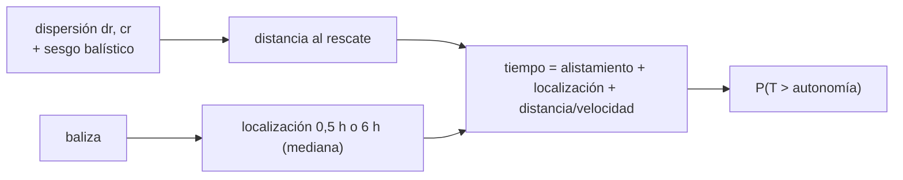

# B104-C14 — Supervivencia en entorno terrestre

<!-- nav:top -->
[🏠 Programa](../../../../README.md) · [📚 Bloque B104](../../../tronco-comun/B104-astronautica-y-preparacion-de-astronautas.md) · [← Anterior: B104-C13 — Procedimientos de emergencia](../B104-C13-procedimientos-de-emergencia/CLASE.md) · [Siguiente: B104-C15 — Entrenamiento subacuático como analogía →](../B104-C15-entrenamiento-subacuatico-como-analogia/CLASE.md)
<!-- /nav -->

## 1. Ubicación, nivel y alcance

Clase 14 del bloque B104, nivel N3. Tras el retorno, una cápsula puede aterrizar lejos del punto previsto y la tripulación debe esperar a los equipos de rescate. Aquí modelas la **dispersión del punto de aterrizaje**, el tiempo de rescate con y sin baliza de localización y la probabilidad de que la espera supere la autonomía de las provisiones. Sigue a B104-C13 y prepara a B104-C15 y B104-C19. **No es una guía de supervivencia.** Datos **sintéticos**, parámetros **ilustrativos**.

## 2. Por qué esta clase existe

Si el rescate no llega antes de que se agoten el refugio y las provisiones, la situación se vuelve crítica. La decisión central: **¿cuánto reducen la baliza y la ubicación del rescate la probabilidad de una espera mayor que la autonomía?**

## 3. Lo que podrás hacer al terminar

1. Modelar el punto de aterrizaje con una distribución bidimensional con sesgo.
2. Calcular la distancia al punto de rescate y el tiempo de llegada.
3. Comparar escenarios con y sin baliza.
4. Calcular P(espera mayor que la autonomía) y el percentil 95.
5. Verificar la distancia media con la fórmula de Rayleigh.
6. Rotular que los parámetros son ilustrativos y que la clase no es una guía de supervivencia.

La evidencia es la **probabilidad de espera mayor que la autonomía** del ejercicio 12 (sección 20).

## 4. Con qué llegas y cómo comprobarlo

1. ¿Qué es una distribución normal?
2. ¿Qué es una mediana?
3. ¿Qué es un percentil?
4. ¿Qué es una distribución log-normal?
5. ¿Qué es un dato sintético?

<details>
<summary>Ver respuestas</summary>

1. Una campana definida por media y desviación. 2. El valor que deja la mitad de los datos a cada lado. 3. El valor bajo el cual queda esa fracción. 4. Una distribución cuyo logaritmo es normal. 5. Un dato generado para el ejemplo.
</details>

Con cuatro o cinco aciertos, sigue; si no, repasa los prerrequisitos.

## 5. Un caso de contexto y casos de referencia

Aterrizajes sintéticos (semilla 104, 200 000 casos): con dispersión nominal (25 km en la dirección del vuelo y 10 km transversal) y baliza, el rescate llega en una mediana de 2,08 h; sin baliza, el tiempo de localización es log-normal de mediana 6 h y la mediana sube a 7,59 h con 24,6 % de probabilidad de superar 12 h. Con un aterrizaje balístico (corto 300 km y dispersión de 120 × 30 km) y baliza la mediana es 3,20 h; sin baliza, 8,72 h y 29,4 % de superar las 12 h. Es el **ejemplo conductor**: dispersiones, velocidad (250 km/h), alistamiento (1,5 h) y autonomía (12 h) son **ilustrativos**.

## 6. Vocabulario

La **dispersión de aterrizaje** es el área donde puede caer la cápsula. Un **aterrizaje balístico** es uno sin sustentación, con mayor dispersión. Una **baliza** es un transmisor que da la posición. La **autonomía** es el tiempo que alcanzan las provisiones y el refugio. El **tiempo de rescate** suma alistamiento, localización y traslado.

## 7. Modelo mental



*Descripción textual:* la dispersión de aterrizaje da la distancia al equipo de rescate; el tiempo total suma alistamiento, localización (muy distinta con y sin baliza) y traslado; se compara con la autonomía.

Analogía: esperar un taxi en una ciudad desconocida: cuenta cuánto se tarda en saber dónde estás y cuánto en llegar. Límite: aquí el taxi son aeronaves de rescate con otros riesgos (clima, terreno).

## 8. La explicación, paso a paso

### 8.1 Qué dicen las fuentes

La historia de NASA de Shuttle–Mir (SP-4225, consultada el 2026-11-10) dice que los astronautas de Mir entrenaron aterrizajes de emergencia en tierra y en agua: en invierno en el bosque cerca de Star City (mantenerse calientes bajo cero), en el mar Negro con equipos distintos para agua fría o cálida, y en Siberia con bengalas para señalizar a los rescatadores. En un resultado de búsqueda, **no consultado en la página original**, aparecen un aterrizaje balístico de Soyuz corto del objetivo (Expedición 6) y la posterior incorporación de un sistema de localización; esos detalles no se citan como hechos de la clase.

### 8.2 Dispersión y distancia

La posición es normal bidimensional: `dr ~ N(sesgo, σ_dr)`, `cr ~ N(0, σ_cr)`. Con σ isotrópica de 25 km, la distancia media es `σ√(π/2) = 31,33 km`; el laboratorio da 31,32 km.

### 8.3 Tiempo de rescate

`T = 1,5 h + t_loc + d/250 km/h`, con `t_loc = 0,5 h` con baliza y log-normal de mediana 6 h (σ_ln = 0,8) sin ella.

| caso | distancia mediana (km) | tiempo mediano (h) | p95 (h) | P(T > 12 h) |
|---|---|---|---|---|
| nominal, con baliza | 20,2 | 2,08 | 2,20 | 0,0000 |
| nominal, sin baliza | 20,2 | 7,59 | 23,98 | 0,2463 |
| balístico, con baliza | 300,7 | 3,20 | 3,99 | 0,0000 |
| balístico, sin baliza | 301,5 | 8,72 | 25,01 | 0,2944 |

### 8.4 Lectura

La baliza reduce el riesgo mucho más que acercar el rescate: lo que domina es la incertidumbre de localización. Aun así, un aterrizaje balístico alarga la mediana en más de una hora.

### 8.5 Límites

Sin clima, sin heridos, sin terreno, sin consumo de provisiones por persona ni fallas de la baliza. La autonomía no se descompone en agua, abrigo y energía. Nada de esto sustituye al entrenamiento de supervivencia de una agencia.

## 9. Magnitudes, símbolos y unidades

| Símbolo | Qué es | Unidad | Valor / nota |
|---|---|---|---|
| `σ_dr`, `σ_cr` | dispersión en la dirección del vuelo y transversal | km | 25/10 y 120/30 (ilustrativas) |
| sesgo | aterrizaje corto | km | 0 y −300 |
| `v` | velocidad de rescate | km/h | 250 (ilustrativa) |
| alistamiento | preparación del rescate | h | 1,5 (ilustrativo) |
| autonomía | provisiones y refugio | h | 12 (ilustrativa) |
| `t_loc` | localización | h | 0,5 con baliza; mediana 6 sin ella |

## 10. Convenciones y referencias

Distancia en kilómetros desde el punto donde espera el rescate; tiempos en horas; semilla 104 con 200 000 aterrizajes; localización log-normal sin baliza. Tolerancias: distancia media isotrópica dentro de 0,15 km de la teórica; con baliza P(T > 12 h) menor que sin ella; el caso balístico peor que el nominal. Numpy 2.4.4, Python 3.12.9.

## 11. De dónde sale lo que afirmamos

| ID | Fuente | Localizador | Respalda | Estado |
|---|---|---|---|---|
| S1 | NASA History, SP-4225, «Training and Operations» — https://www.nasa.gov/history/SP-4225/training/training.htm (consultada 2026-11-10) | sección de entrenamiento de supervivencia | entrenamiento de aterrizajes de emergencia en bosque invernal, mar Negro y Siberia, con bengalas para señalizar | Consultada |
| S2 | NASA, «Human Research Program: hazards» — https://www.nasa.gov/hrp/hazards/ (consultada 2026-11-10) | página completa | la distancia a la Tierra hace más difícil obtener instrucciones, suministros y atención médica | Consultada |
| — | Relaciones estándar usadas en el laboratorio | — | las verifica el laboratorio | No consultada en una fuente concreta (las verifica el laboratorio) |

Límites: los detalles del aterrizaje balístico de Expedición 6, de Soyuz 24 y del requisito de habitabilidad tras el aterrizaje aparecieron solo en un resultado de búsqueda y **no se consultaron** en sus páginas; las dispersiones, velocidades y autonomía son ilustrativas.

## 12. Cómo ver el resultado

| caso | tiempo mediano (h) | p95 (h) | P(T > 12 h) |
|---|---|---|---|
| nominal, con baliza | 2,08 | 2,20 | 0,0000 |
| nominal, sin baliza | 7,59 | 23,98 | 0,2463 |
| balístico, con baliza | 3,20 | 3,99 | 0,0000 |
| balístico, sin baliza | 8,72 | 25,01 | 0,2944 |

Descripción larga: sin baliza el riesgo de superar la autonomía es de 25–29 %; con baliza, casi nulo en este modelo.

## 13. Ejemplo trabajado: tiempo de rescate con baliza a 20 km

**Paso 1 · Alistamiento.** `1,5 h`.

**Paso 2 · Localización.** `0,5 h` con baliza.

**Paso 3 · Traslado.** `20/250 = 0,08 h`.

**Paso 4 · Total.** `1,5 + 0,5 + 0,08 = 2,08 h`.

## 14. Distintas formas de describir el problema

**Por fórmula:** `T = prep + t_loc + d/v`. **Por tabla:** caso y probabilidad. **Por Rayleigh:** `σ√(π/2)`. **Por comparación:** con y sin baliza.

## 15. Práctica guiada

**Ejercicio 1 · con los pasos indicados.** Calcula el tiempo con baliza a 20 km. *Pasos:* suma alistamiento, localización y traslado.

<details><summary>Solución comentada</summary>

`2,08 h`.
</details>

**Ejercicio 2 · con una pista.** ¿Cuál es el tiempo de traslado de 300 km a 250 km/h?

<details><summary>Solución comentada</summary>

`1,2 h`.
</details>

**Ejercicio 3 · casi autónomo.** Calcula la distancia media isotrópica con σ = 25 km. *Pista:* `σ√(π/2)`.

<details><summary>Solución comentada</summary>

`31,33 km`.
</details>

## 16. Práctica autónoma, transferencia e integrador

**Ejercicio 4 · autónomo.** ¿Por qué la baliza tiene más efecto que mejorar la velocidad del rescate?

<details><summary>Solución comentada</summary>

Porque la incertidumbre de localización (mediana de 6 h) domina sobre el traslado.
</details>

**Ejercicio 5 · autónomo.** ¿Qué probabilidad de superar 12 h hay sin baliza en el caso nominal?

<details><summary>Solución comentada</summary>

`0,2463`.
</details>

**Ejercicio 6 · autónomo.** ¿Qué indica el percentil 95 de 23,98 h?

<details><summary>Solución comentada</summary>

En el 5 % de los casos sin baliza el rescate tarda más de ~24 h.
</details>

**Ejercicio 7 · autónomo.** ¿Cuánto añade el aterrizaje balístico a la mediana con baliza?

<details><summary>Solución comentada</summary>

`3,20 − 2,08 = 1,12 h`.
</details>

**Ejercicio 8 · autónomo.** Nombra tres elementos de supervivencia que la clase no modela.

<details><summary>Solución comentada</summary>

Clima, heridos y consumo de agua y abrigo (también terreno y fallas de la baliza).
</details>

**Ejercicio 9 · transferencia.** La autonomía se duplica a 24 h sin baliza. ¿Qué esperas de la probabilidad?

<details><summary>Solución comentada</summary>

Baja a cerca del 5 % (el percentil 95 es de unas 24–25 h); sigue sin ser nula.
</details>

**Ejercicio 10 · transferencia.** La baliza falla con probabilidad 0,1. ¿Cómo calculas el riesgo global nominal?

<details><summary>Solución comentada</summary>

`0,9 · 0,0000 + 0,1 · 0,2463 = 0,0246`.
</details>

**Ejercicio 11 · transferencia.** ¿Qué mide mejor la seguridad: el tiempo medio o el percentil 95? ¿Por qué?

<details><summary>Solución comentada</summary>

El percentil 95 (o una probabilidad de exceso), porque la cola es la que agota las provisiones.
</details>

**Ejercicio 12 · integrador.** Elabora tu *probabilidad de espera mayor que la autonomía*: cuatro escenarios, tiempos mediano y p95, P(T > autonomía), efecto de la baliza, límites y qué es sintético, ilustrativo y no consultado.

<details><summary>Solución comentada</summary>

Secciones 8.1–8.5 y la salida del laboratorio.
</details>

## 17. Laboratorio: dispersión de aterrizaje y tiempo de rescate

El script [aterrizaje.py](aterrizaje.py) simula 200 000 aterrizajes por escenario y calcula distancia, tiempo de rescate y probabilidad de superar la autonomía (**comprueba** la distancia media isotrópica con Rayleigh, que la baliza reduzca el riesgo y que el caso balístico sea peor). Tarda menos de 1 s.

**Datos:** aterrizajes **sintéticos** con semilla 104 y parámetros **ilustrativos**. **Predice antes de ejecutar:** ¿Cuál es la probabilidad aproximada de superar 12 h sin baliza en el caso nominal? (Cerca de 25 %.) **Ejecución del 2026-11-10 (Python 3.12.9):**

```text
Python 3.12.9; numpy 2.4.4
DATOS SINTETICOS (semilla 104): aterrizajes ficticios; dispersiones, velocidades y autonomia ilustrativas; no es una guia de supervivencia

caso | distancia mediana [km] | tiempo mediano [h] | percentil 95 [h] | P(t > 12 h)
nominal, con baliza                      20.2         2.08           2.20         0.0000
nominal, sin baliza                      20.2         7.59          23.98         0.2463
balistico (corto), con baliza           300.7         3.20           3.99         0.0000
balistico (corto), sin baliza           301.5         8.72          25.01         0.2944

Verificacion (isotropica, sigma = 25 km): distancia media 31.32 km frente a teorica 31.33 km
Pruebas superadas.
```

```bash
python programa/clases/B104/B104-C14-supervivencia-en-entorno-terrestre/aterrizaje.py
```

**Límites:** dos dimensiones, tiempos con distribución inventada, sin clima, terreno ni heridos; no es una guía de supervivencia.

## 18. Errores frecuentes y cómo corregirlos

**Confiar en la media.** Mira el percentil 95 (8.4).

**Olvidar la localización.** Es el término dominante (8.3).

**Tomar los parámetros como reales.** Son ilustrativos (sección 10).

**Usar la clase como guía de supervivencia.** No lo es (sección 21).

## 19. Cómo sabrás que vas bien

Tras la sección 8: ¿qué probabilidad esperabas sin baliza y cuál da la tabla? Si dudas, repasa el ejemplo 13. Tras el laboratorio: ¿qué comprueba? (ver la sección 17).

## 20. Qué entregas y cómo se evalúa

El producto es tu **probabilidad de espera mayor que la autonomía** (ejercicio 12).

| Criterio | Inicial | En desarrollo | Logrado | Destacado |
|---|---|---|---|---|
| Conceptos | Confunde los términos | Parciales | Explica dispersión, localización y autonomía | Explica por qué manda la localización |
| Cálculo | Sin unidades | Con errores | Calcula con unidades y compara con el laboratorio | Resuelve casos nuevos |
| Numérico | Sin comprobar | Un caso | Compara con una segunda vía de cálculo | Interpreta las diferencias |
| Fuentes | Sin fuente | Sin fecha | Fuentes con fecha y estado | Declara lo sintético, lo ilustrativo y lo no consultado |
| Límites | No los nombra | Uno | Tres | Discute qué falta del modelo |

**Condiciones críticas (no se compensan con promedio):** rotular los aterrizajes como sintéticos y los parámetros como ilustrativos, no presentar el modelo como guía de supervivencia ni consejo operativo y citar solo lo consultado.

## 21. Ética, seguridad y límites

Clase educativa: **no da consejo médico, de entrenamiento individual ni operativo** y no sustituye a los requisitos, procedimientos y estándares de ninguna agencia. **No** es una guía de supervivencia: los procedimientos y la formación son los de cada agencia. Accesibilidad: tablas equivalentes a las gráficas, fórmulas en texto, ejercicios sin conexión.

## 22. Para cerrar y seguir

En el modelo, sin baliza el 24,6 % de los rescates nominales supera las 12 h y con ella, casi ninguno. Queda una pregunta: ¿qué puede reproducir en tierra la ingravidez para entrenar el trabajo en el espacio?

**Glosario español–inglés.** supervivencia · *survival*; dispersión de aterrizaje · *landing dispersion*; baliza · *beacon*; aterrizaje balístico · *ballistic landing*; autonomía · *endurance*.

**Continuidad.** [B104-C15](../B104-C15-entrenamiento-subacuatico-como-analogia/CLASE.md) estudia el entrenamiento subacuático como analogía de la ingravidez.

**Referencias:** ver sección 11.

<!-- nav:bottom -->
---

[← Anterior: B104-C13 — Procedimientos de emergencia](../B104-C13-procedimientos-de-emergencia/CLASE.md) · [📚 Bloque B104](../../../tronco-comun/B104-astronautica-y-preparacion-de-astronautas.md) · [Siguiente: B104-C15 — Entrenamiento subacuático como analogía →](../B104-C15-entrenamiento-subacuatico-como-analogia/CLASE.md)
<!-- /nav -->
