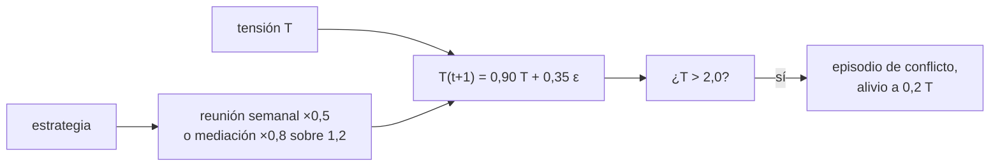

# B104-C16 — Manejo de conflictos

<!-- nav:top -->
[🏠 Programa](../../../../README.md) · [📚 Bloque B104](../../../tronco-comun/B104-astronautica-y-preparacion-de-astronautas.md) · [← Anterior: B104-C15 — Entrenamiento subacuático como analogía](../B104-C15-entrenamiento-subacuatico-como-analogia/CLASE.md) · [Siguiente: B104-C17 — Gestión de fatiga →](../B104-C17-gestion-de-fatiga/CLASE.md)
<!-- /nav -->

## 1. Ubicación, nivel y alcance

Clase 16 del bloque B104, nivel N3. En una tripulación pequeña y aislada, la tensión interpersonal se acumula con roces diarios y se alivia con conversación, descanso y mediación. Aquí usas un **modelo ilustrativo** de tensión con persistencia diaria y choques aleatorios para comparar tres estrategias de manejo de conflictos. Sigue a B104-C15 y a B104-C07 (liderazgo) y prepara a B104-C17 y B104-C18. No describe ni predice a ninguna persona ni tripulación.

## 2. Por qué esta clase existe

Un conflicto abierto cuesta tiempo, errores y confianza; prevenirlo cuesta pequeñas conversaciones continuas. La decisión central: **¿cuánto reduce una intervención temprana la probabilidad de que la tensión llegue al conflicto abierto, frente a no hacer nada o reunirse una vez por semana?**

## 3. Lo que podrás hacer al terminar

1. Modelar la tensión como un proceso autorregresivo con choques.
2. Calcular su varianza estacionaria y el umbral en desviaciones estándar.
3. Simular conflictos abiertos en 180 días para una tripulación de 4.
4. Comparar tres estrategias por episodios medios y por probabilidad de ≥ 1 episodio.
5. Verificar la simulación con la fórmula de la varianza.
6. Rotular que el modelo es ilustrativo y no mide personas.

La evidencia es la **comparación de estrategias de resolución** del ejercicio 12 (sección 20).

## 4. Con qué llegas y cómo comprobarlo

1. ¿Qué es un proceso autorregresivo?
2. ¿Qué es una varianza?
3. ¿Qué es una simulación Monte Carlo?
4. ¿Qué es un umbral?
5. ¿Qué es un modelo ilustrativo?

<details>
<summary>Ver respuestas</summary>

1. Uno donde el valor de hoy depende del de ayer más un ruido. 2. El promedio de los cuadrados de las desviaciones respecto de la media. 3. Repetir un experimento aleatorio para estimar probabilidades. 4. Un valor a partir del cual ocurre algo. 5. Uno con parámetros inventados.
</details>

Con cuatro o cinco aciertos, sigue; si no, repasa los prerrequisitos.

## 5. Un caso de contexto y casos de referencia

Un modelo ilustrativo con persistencia diaria 0,90 y choque diario de 0,35: la tensión estacionaria tiene varianza 0,6447 (el laboratorio mide 0,6431) y el umbral de conflicto abierto de 2,0 equivale a 2,49 desviaciones estándar. En 180 días y 4 personas (1 500 tripulaciones sintéticas, semilla 104), sin intervención hay en promedio 1,55 episodios y el 78,7 % de las tripulaciones tiene al menos uno; con una reunión semanal que reduce la tensión a la mitad, 0,40 y 32,8 %; con mediación temprana al cruzar 1,2 (reduce 20 %), 0,00 y 0,3 %. Es el **ejemplo conductor**: todo es **ilustrativo**.

## 6. Vocabulario

La **tensión** es una variable ilustrativa de malestar interpersonal. La **persistencia** `ρ` es la fracción que sobrevive de un día al siguiente. El **conflicto abierto** ocurre cuando la tensión de alguien supera el umbral. La **mediación temprana** actúa antes del umbral. La **reunión de revisión** es una conversación programada.

## 7. Modelo mental



*Descripción textual:* la tensión de cada persona se actualiza cada día con persistencia y un choque aleatorio; si supera el umbral hay un episodio de conflicto; las estrategias reducen la tensión en momentos distintos.

Analogía: una olla que se calienta con cada roce y se enfría con las conversaciones: quien baja la llama a tiempo evita el desborde. Límite: las personas no son una temperatura; el modelo solo sirve para razonar sobre prevención.

## 8. La explicación, paso a paso

### 8.1 Lo consultado

NASA lista el aislamiento y el confinamiento entre los cinco peligros del vuelo humano, con cambios de conducta en grupos pequeños aislados (página consultada el 2026-11-10). El estudio Mars500 de ESA (consultado el mismo día) tuvo 520 días con seis personas, para estudiar el estrés, el estado de ánimo, el sueño y las contramedidas. La convocatoria de astronautas de NASA pide demostrar liderazgo, trabajo en equipo y comunicación.

### 8.2 El proceso de tensión

`T(t+1) = ρ T(t) + σ ε`, con `ρ = 0,90`, `σ = 0,35`. La varianza estacionaria es `σ²/(1 − ρ²) = 0,6447`; el laboratorio da 0,6431. El umbral de 2,0 está a `2,0/√0,6447 = 2,49` desviaciones estándar de la media.

### 8.3 Estrategias

| estrategia | episodios medios | P(≥ 1 episodio) | P(≥ 5 episodios) |
|---|---|---|---|
| ninguna | 1,55 | 0,787 | 0,017 |
| reunión semanal (×0,5 cada 7 días) | 0,40 | 0,328 | 0,000 |
| mediación temprana (×0,8 sobre 1,2) | 0,00 | 0,003 | 0,000 |

Un episodio es un día en que al menos una de las 4 personas supera el umbral.

### 8.4 Lectura

Intervenir pronto y de forma continua es más eficaz que reunirse una vez por semana en el modelo, pero cuesta atención diaria y confianza para hablar (clase B104-C07). Los resultados dependen del umbral inventado.

### 8.5 Límites

Personas independientes (no se contagian), choques gaussianos, sin motivos, sin roles ni cultura, y alivio fijo. No se consultó literatura de conflicto en tripulaciones ni resultados de Mars500; ninguna conclusión se extrapola a personas.

## 9. Magnitudes, símbolos y unidades

| Símbolo | Qué es | Unidad | Valor / nota |
|---|---|---|---|
| `ρ` | persistencia diaria | — | 0,90 (ilustrativa) |
| `σ` | choque diario | — | 0,35 (ilustrativo) |
| umbral | conflicto abierto | unidades de tensión | 2,0 |
| mediación | umbral y factor | — | 1,2 y ×0,8 |
| `N` | tripulaciones simuladas | — | 1 500 |
| días | duración | d | 180 |

## 10. Convenciones y referencias

Tensión adimensional con media 0; 4 personas independientes; semilla 104; 180 días. Tolerancias: varianza estacionaria simulada dentro de 2 % de la teórica; episodios decrecientes: ninguna > reunión > mediación. Numpy 2.4.4, Python 3.12.9.

## 11. De dónde sale lo que afirmamos

| ID | Fuente | Localizador | Respalda | Estado |
|---|---|---|---|---|
| S1 | NASA, «Human Research Program: hazards» — https://www.nasa.gov/hrp/hazards/ (consultada 2026-11-10) | página de peligros | el aislamiento y el confinamiento de grupos pequeños puede producir cambios de conducta | Consultada |
| S2 | ESA, «Mars500 study overview» — https://www.esa.int/Science_Exploration/Human_and_Robotic_Exploration/Mars500/Mars500_study_overview (consultada 2026-11-10) | página completa | 520 días de aislamiento, 6 personas, objetivos sobre estrés, ánimo y sueño | Consultada |
| S3 | NASA, «Become an Astronaut» — https://nasa.gov/humans-in-space/astronauts/become-an-astronaut (consultada 2026-11-10) | lista de requisitos | se piden liderazgo, trabajo en equipo y comunicación | Consultada |
| — | Relaciones estándar usadas en el laboratorio | — | las verifica el laboratorio | No consultada en una fuente concreta (las verifica el laboratorio) |

Límites: no se consultó ningún resultado del estudio Mars500 ni literatura de conflicto en tripulaciones; el modelo AR(1), los umbrales y los factores de alivio son inventados.

## 12. Cómo ver el resultado

| estrategia | episodios medios | P(≥ 1 episodio) |
|---|---|---|
| ninguna | 1,55 | 0,787 |
| reunión semanal | 0,40 | 0,328 |
| mediación temprana | 0,00 | 0,003 |

Descripción larga: en el modelo, actuar antes de que la tensión llegue al umbral evita casi todos los conflictos abiertos.

## 13. Ejemplo trabajado: varianza estacionaria de la tensión

**Paso 1 · Parámetros.** `ρ = 0,90`, `σ = 0,35`.

**Paso 2 · Fórmula.** `σ²/(1 − ρ²) = 0,1225/0,19`.

**Paso 3 · Valor.** `0,6447`.

**Paso 4 · Umbral.** `2,0/√0,6447 = 2,49` desviaciones estándar.

## 14. Distintas formas de describir el problema

**Por ecuación:** `T(t+1) = ρT + σε`. **Por varianza:** `σ²/(1−ρ²)`. **Por estrategia:** factor de reducción. **Por resultado:** episodios y probabilidad.

## 15. Práctica guiada

**Ejercicio 1 · con los pasos indicados.** Calcula la varianza estacionaria con `ρ = 0,9` y `σ = 0,35`. *Pasos:* `σ²/(1−ρ²)`.

<details><summary>Solución comentada</summary>

`0,6447`.
</details>

**Ejercicio 2 · con una pista.** ¿A cuántas desviaciones estándar está el umbral de 2,0?

<details><summary>Solución comentada</summary>

`2,0/0,803 = 2,49`.
</details>

**Ejercicio 3 · casi autónomo.** ¿Qué fracción de la tensión sobrevive en 7 días sin choques?

<details><summary>Solución comentada</summary>

`0,9⁷ = 0,478`.
</details>

## 16. Práctica autónoma, transferencia e integrador

**Ejercicio 4 · autónomo.** ¿Qué hace la reunión semanal en el modelo?

<details><summary>Solución comentada</summary>

Multiplica la tensión por 0,5 cada 7 días.
</details>

**Ejercicio 5 · autónomo.** ¿Cuántos episodios más tiene la estrategia «ninguna» que la reunión semanal?

<details><summary>Solución comentada</summary>

`1,55 − 0,40 = 1,15`.
</details>

**Ejercicio 6 · autónomo.** ¿Por qué la mediación temprana casi elimina los episodios?

<details><summary>Solución comentada</summary>

Actúa cuando `T > 1,2`, antes del umbral de 2,0.
</details>

**Ejercicio 7 · autónomo.** ¿Qué supuesto del modelo es más discutible?

<details><summary>Solución comentada</summary>

La independencia entre personas (en la realidad la tensión se contagia) y los factores fijos.
</details>

**Ejercicio 8 · autónomo.** ¿Qué mide `P(≥ 5 episodios)`?

<details><summary>Solución comentada</summary>

La proporción de tripulaciones con conflictos recurrentes.
</details>

**Ejercicio 9 · transferencia.** Si `ρ = 0,95` (más persistente), ¿qué pasa con la varianza y los episodios?

<details><summary>Solución comentada</summary>

La varianza sube a `0,1225/0,0975 = 1,256`: más episodios.
</details>

**Ejercicio 10 · transferencia.** La mediación temprana exige que alguien note `T > 1,2`. ¿Qué ocurre si solo detecta la mitad de los casos?

<details><summary>Solución comentada</summary>

Se aproxima al comportamiento intermedio entre mediación y ninguna; hay que medir la detección (clase B104-C18).
</details>

**Ejercicio 11 · transferencia.** Un conflicto abierto reduce la tensión a 0,2 pero daña la confianza. ¿Cómo incorporarías ese costo?

<details><summary>Solución comentada</summary>

Añadiendo un efecto de largo plazo sobre `ρ` o sobre `σ` tras cada episodio.
</details>

**Ejercicio 12 · integrador.** Elabora tu *comparación de estrategias de resolución*: modelo, varianza, tres estrategias, límites y qué es ilustrativo y qué fue consultado.

<details><summary>Solución comentada</summary>

Secciones 8.1–8.5 y la salida del laboratorio.
</details>

## 17. Laboratorio: tensión y estrategias de resolución de conflictos

El script [tension.py](tension.py) simula 1 500 tripulaciones de 4 personas durante 180 días con tres estrategias y verifica la varianza estacionaria (**comprueba** la varianza y el orden de las estrategias). Tarda unos 6 s. Tarda menos de 1 s.

**Datos:** modelo y parámetros **ilustrativos** con semilla 104. **Predice antes de ejecutar:** ¿Qué fracción de las tripulaciones sin intervención tiene al menos un episodio? (Cerca del 79 %.) **Ejecución del 2026-11-10 (Python 3.12.9):**

```text
Python 3.12.9; numpy 2.4.4
MODELO ILUSTRATIVO (semilla 104): 4 personas, 180 dias; tension AR(1) con choques; umbrales inventados

estrategia | episodios medios por tripulacion | P(>= 1 episodio) | P(>= 5 episodios)
ninguna                                1.55              0.787            0.017
reunion semanal                        0.40              0.328            0.000
mediacion temprana                     0.00              0.003            0.000

Varianza estacionaria AR(1): simulada 0.6431; teorica 0.6447
Umbral de conflicto = 2.49 desviaciones estandar de la tension estacionaria
Pruebas superadas.
```

```bash
python programa/clases/B104/B104-C16-manejo-de-conflictos/tension.py
```

**Límites:** personas independientes, ruido gaussiano, umbrales inventados; no mide ni predice a personas reales.

## 18. Errores frecuentes y cómo corregirlos

**Leer el modelo como predicción de personas.** Es ilustrativo (sección 21).

**Ignorar la detección.** Mide cuánto se detecta (ejercicio 10).

**Creer que no hacer nada es neutro.** Compara estrategias (8.3).

**Olvidar el costo de intervenir.** Considera la atención y la confianza (8.4).

## 19. Cómo sabrás que vas bien

Tras la sección 8: ¿qué varianza esperabas y cuál da el laboratorio? Si dudas, repasa el ejemplo 13. Tras el laboratorio: ¿qué comprueba? (ver la sección 17).

## 20. Qué entregas y cómo se evalúa

El producto es tu **comparación de estrategias de resolución** (ejercicio 12).

| Criterio | Inicial | En desarrollo | Logrado | Destacado |
|---|---|---|---|---|
| Conceptos | Confunde los términos | Parciales | Explica tensión, umbral e intervención | Explica por qué importa la detección temprana |
| Cálculo | Sin unidades | Con errores | Calcula con unidades y compara con el laboratorio | Resuelve casos nuevos |
| Numérico | Sin comprobar | Un caso | Compara con una segunda vía de cálculo | Interpreta las diferencias |
| Fuentes | Sin fuente | Sin fecha | Fuentes con fecha y estado | Declara lo sintético, lo ilustrativo y lo no consultado |
| Límites | No los nombra | Uno | Tres | Discute qué falta del modelo |

**Condiciones críticas (no se compensan con promedio):** rotular el modelo como ilustrativo, no usarlo para evaluar ni predecir a personas y citar solo lo consultado.

## 21. Ética, seguridad y límites

Clase educativa: **no da consejo médico, de entrenamiento individual ni operativo** y no sustituye a los requisitos, procedimientos y estándares de ninguna agencia. El modelo no es una herramienta clínica ni de selección y no mide a personas. Accesibilidad: tablas equivalentes a las gráficas, fórmulas en texto, ejercicios sin conexión.

## 22. Para cerrar y seguir

En el modelo, sin intervención el 78,7 % de las tripulaciones sufre un conflicto abierto en 180 días y con mediación temprana, casi ninguna. Queda una pregunta: ¿cómo se mantiene a las personas alertas y descansadas?

**Glosario español–inglés.** conflicto · *conflict*; mediación · *mediation*; tensión · *tension*; persistencia · *persistence*; umbral · *threshold*.

**Continuidad.** [B104-C17](../B104-C17-gestion-de-fatiga/CLASE.md) estudia la gestión de la fatiga con el modelo de dos procesos.

**Referencias:** ver sección 11.

<!-- nav:bottom -->
---

[← Anterior: B104-C15 — Entrenamiento subacuático como analogía](../B104-C15-entrenamiento-subacuatico-como-analogia/CLASE.md) · [📚 Bloque B104](../../../tronco-comun/B104-astronautica-y-preparacion-de-astronautas.md) · [Siguiente: B104-C17 — Gestión de fatiga →](../B104-C17-gestion-de-fatiga/CLASE.md)
<!-- /nav -->
