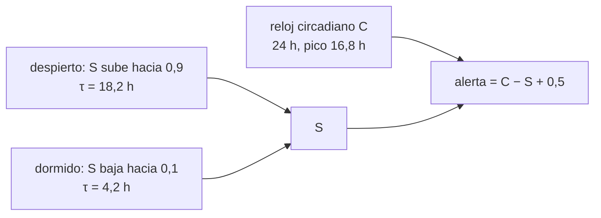

# B104-C17 — Gestión de fatiga

<!-- nav:top -->
[🏠 Programa](../../../../README.md) · [📚 Bloque B104](../../../tronco-comun/B104-astronautica-y-preparacion-de-astronautas.md) · [← Anterior: B104-C16 — Manejo de conflictos](../B104-C16-manejo-de-conflictos/CLASE.md) · [Siguiente: B104-C18 — Aislamiento y convivencia →](../B104-C18-aislamiento-y-convivencia/CLASE.md)
<!-- /nav -->

## 1. Ubicación, nivel y alcance

Clase 17 del bloque B104, nivel N3. La fatiga reduce la atención y aumenta los errores; en una nave se acumula por sueño corto, horarios desalineados y sobrecarga de trabajo. Aquí usas un modelo clásico de **dos procesos** (una presión de sueño que sube despierto y baja dormido, y un ritmo circadiano de 24 h) para comparar horarios de sueño de 8, 6 y 4 horas. Sigue a B104-C16 y prepara a B104-C18. Parámetros **ilustrativos**; **no es una pauta de sueño**.

## 2. Por qué esta clase existe

NASA reconoce la pérdida de sueño, la desincronización circadiana y la sobrecarga como un riesgo del vuelo. La decisión conceptual: **¿cuánta alerta se pierde en el trabajo diurno al acortar el sueño unas horas, y por qué el modelo no sustituye a la medición?**

## 3. Lo que podrás hacer al terminar

1. Describir los dos procesos (homeostático `S` y circadiano `C`).
2. Simular 14 días con tres horarios de sueño.
3. Calcular la alerta media y mínima en horario laboral.
4. Verificar la integración numérica con la solución exacta de un tramo de vigilia.
5. Relacionar el modelo con las cifras consultadas de sueño en vuelo.
6. Rotular que los parámetros son ilustrativos y que no se da una pauta de sueño.

La evidencia es la **curva de alerta con 8 h y 6 h de sueño** del ejercicio 12 (sección 20).

## 4. Con qué llegas y cómo comprobarlo

1. ¿Qué es un ritmo circadiano?
2. ¿Qué es una exponencial que satura?
3. ¿Qué es una constante de tiempo?
4. ¿Qué es la alerta?
5. ¿Qué es un modelo ilustrativo?

<details>
<summary>Ver respuestas</summary>

1. Un ciclo biológico de unas 24 horas. 2. Una curva que tiende a un valor límite, como `U − (U − S₀)e^(−t/τ)`. 3. El tiempo en que cae a 1/e. 4. La disposición a atender y reaccionar. 5. Uno con parámetros inventados.
</details>

Con cuatro o cinco aciertos, sigue; si no, repasa los prerrequisitos.

## 5. Un caso de contexto y casos de referencia

La página de riesgo de NASA sobre sueño y desincronización circadiana (consultada el 2026-11-10) indica que las tripulaciones duermen en promedio unas 6 h por noche en el transbordador y en la ISS, que cerca del 19 % de los episodios de sueño en órbita estuvo desalineado y que, en tierra, dormir unas 6 h por noche de forma crónica produce lapsos de atención similares a una noche sin dormir. Con el modelo ilustrativo (`τ` de vigilia 18,2 h y de sueño 4,2 h), la alerta media entre las 08 y las 20 h es 0,159 con 8 h de sueño (23:00–07:00), 0,095 con 6 h (00:00–06:00) y 0,007 con 4 h (01:00–05:00). Es el **ejemplo conductor**: el modelo y sus parámetros son **ilustrativos**.

## 6. Vocabulario

La **presión de sueño** `S` sube despierto y baja dormido. El **ritmo circadiano** `C` es una oscilación de 24 h. La **alerta** se modela como `C − S + 0,5`. La **deuda de sueño** es lo que se deja de dormir respecto de la necesidad. La **desincronización circadiana** es la desalineación entre el reloj interno y el horario.

## 7. Modelo mental



*Descripción textual:* la presión de sueño sube despierto y baja dormido; el ritmo circadiano la compensa o la agrava; la alerta es su diferencia.

Analogía: una batería que se descarga despierto y se recarga dormido mientras un interruptor circadiano da más o menos energía según la hora. Límite: una persona no es una batería; los parámetros varían por persona y por edad.

## 8. La explicación, paso a paso

### 8.1 Lo consultado

De la página de riesgo de NASA: sueño medio de unas 6 h por noche en transbordador e ISS, más corto en órbita que en entrenamiento o después de las misiones; 19 % de episodios desalineados (Flynn-Evans y colaboradores, 2015, citado en la página); en tierra, unas 6 h crónicas producen lapsos similares a una noche sin dormir (Van Dongen 2003; Belenky 2004, citados en la página); en misiones a Marte, el riesgo operativo es de 5×2 y el de salud a largo plazo de 4×2, «requiere mitigación»; la iluminación flexible es un contramedida prometedora aún no en uso. Se leyeron los primeros 100 000 de 110 457 caracteres.

### 8.2 El modelo

Despierto: `S(t) = 0,9 − (0,9 − S₀) e^(−t/18,2)`; dormido: `S(t) = 0,1 + (S₀ − 0,1) e^(−t/4,2)`. El circadiano es `C = 0,12 cos(2π(t − 16,8)/24)` y la alerta `A = C − S + 0,5`. Las constantes `18,2` y `4,2 h` son las que se asocian al modelo clásico, **no consultadas**; se rotulan ilustrativas. El laboratorio comprueba un tramo de vigilia de 16 h desde `S = 0,2`: 0,60940 exacta y numérica.

### 8.3 Tres horarios

| horario | sueño (h) | `S` al despertar | alerta media 08–20 h | alerta mínima |
|---|---|---|---|---|
| 23:00–07:00 | 8 | 0,175 | 0,159 | 0,036 |
| 00:00–06:00 | 6 | 0,233 | 0,095 | −0,010 |
| 01:00–05:00 | 4 | 0,702 | 0,007 | −0,072 |

A los 14 días el ciclo es estable (el cambio diario de `S` es nulo a esa precisión). Dormir menos deja una presión de sueño mayor al despertar y menos alerta durante el día.

### 8.4 Lectura

La alerta media cae de 0,159 a 0,095 al pasar de 8 a 6 horas, un 40 %: el modelo reproduce cualitativamente que un sueño medio de unas 6 h tiene costo. No es una predicción numérica ni sirve para decidir el horario de nadie.

### 8.5 Límites

Sin variación individual, sin siestas, sin cafeína, sin luz, sin sobrecarga de trabajo ni estrés, con un circadiano senoidal único. La literatura original del modelo no se consultó.

## 9. Magnitudes, símbolos y unidades

| Símbolo | Qué es | Unidad | Valor / nota |
|---|---|---|---|
| `S` | presión de sueño | — | 0,1 a 0,9 |
| `τ_v`, `τ_s` | constantes de vigilia y sueño | h | 18,2 y 4,2 (ilustrativas) |
| `C` | componente circadiano | — | ±0,12, pico a las 16,8 h |
| `A` | alerta | — | −0,072 a 0,159 |
| sueño | duración nocturna | h | 4, 6, 8 |

## 10. Convenciones y referencias

Tiempo en horas con paso de 1 min; 14 días; la alerta se mide entre las 08 y las 20 h del día 14; sin aleatoriedad. Tolerancias: integración numérica igual a la exacta (< 1e-9); alerta decreciente con menos sueño; `S` entre 0,1 y 0,9. Numpy 2.4.4, Python 3.12.9.

## 11. De dónde sale lo que afirmamos

| ID | Fuente | Localizador | Respalda | Estado |
|---|---|---|---|---|
| S1 | NASA Human Research Roadmap, riesgo de sueño, desincronización circadiana y sobrecarga — https://humanresearchroadmap.nasa.gov/Risks/risk.aspx?i=100 (consultada 2026-11-10; se leyeron los primeros 100 000 caracteres) | resumen del riesgo y evidencia | sueño medio de unas 6 h en transbordador e ISS; 19 % de episodios desalineados; efecto de 6 h crónicas en tierra; calificación de riesgo para Marte; iluminación flexible | Consultada |
| S2 | NASA, «Human Research Program: hazards» — https://www.nasa.gov/hrp/hazards/ (consultada 2026-11-10) | página de peligros | el aislamiento y el entorno cerrado son peligros del vuelo humano | Consultada |
| — | Relaciones estándar usadas en el laboratorio | — | las verifica el laboratorio | No consultada en una fuente concreta (las verifica el laboratorio) |

Límites: no se consultó el artículo original del modelo de dos procesos; sus constantes se usan como ilustrativas; las cifras de sueño y los estudios terrestres se citan tal como los reporta la página de NASA, sin leer los artículos.

## 12. Cómo ver el resultado

| horario | `S` al despertar | alerta media | alerta mínima |
|---|---|---|---|
| 23:00–07:00 (8 h) | 0,175 | 0,159 | 0,036 |
| 00:00–06:00 (6 h) | 0,233 | 0,095 | −0,010 |
| 01:00–05:00 (4 h) | 0,702 | 0,007 | −0,072 |

Descripción larga: con menos horas de sueño la presión de sueño al despertar sube y la alerta diurna baja.

## 13. Ejemplo trabajado: presión de sueño tras 16 horas despierto

**Paso 1 · Inicio.** `S₀ = 0,2`.

**Paso 2 · Exponencial.** `e^(−16/18,2) = 0,415`.

**Paso 3 · Valor.** `S = 0,9 − (0,9 − 0,2)·0,415 = 0,609`.

## 14. Distintas formas de describir el problema

**Por ecuación:** exponenciales por tramos. **Por curva:** `S`, `C` y alerta en 24 h. **Por tabla:** horario y alerta media. **Por contraste:** 8 h frente a 6 h.

## 15. Práctica guiada

**Ejercicio 1 · con los pasos indicados.** Calcula `S` tras 16 h despierto desde `S₀ = 0,2`. *Pasos:* `0,9 − 0,7 e^(−16/18,2)`.

<details><summary>Solución comentada</summary>

`0,609`.
</details>

**Ejercicio 2 · con una pista.** ¿Cuánto baja `S` en 8 h de sueño desde 0,7?

<details><summary>Solución comentada</summary>

`0,1 + 0,6 e^(−8/4,2) = 0,189`.
</details>

**Ejercicio 3 · casi autónomo.** ¿Cuánto vale el circadiano a las 16,8 h?

<details><summary>Solución comentada</summary>

`0,12` (el máximo).
</details>

## 16. Práctica autónoma, transferencia e integrador

**Ejercicio 4 · autónomo.** ¿Cuál es la alerta con `S = 0,3` y `C = 0,12`?

<details><summary>Solución comentada</summary>

`0,12 − 0,3 + 0,5 = 0,32`.
</details>

**Ejercicio 5 · autónomo.** ¿Qué porcentaje cae la alerta media de 8 h a 6 h de sueño?

<details><summary>Solución comentada</summary>

`(0,159 − 0,095)/0,159 = 40 %`.
</details>

**Ejercicio 6 · autónomo.** ¿Qué indica una alerta negativa?

<details><summary>Solución comentada</summary>

Que en el modelo la presión de sueño supera el componente circadiano más el nivel de base.
</details>

**Ejercicio 7 · autónomo.** ¿Por qué el ciclo se estabiliza en 14 días?

<details><summary>Solución comentada</summary>

Porque las exponenciales tienden a un ciclo periódico de 24 h.
</details>

**Ejercicio 8 · autónomo.** Compara el 6 h del modelo con el 6 h medio consultado.

<details><summary>Solución comentada</summary>

Coinciden en el orden de magnitud: las tripulaciones duermen unas 6 h en promedio según la página; el modelo muestra el costo cualitativo.
</details>

**Ejercicio 9 · transferencia.** Un turno exige estar despierto 20 h desde `S = 0,2`. ¿Qué `S` alcanza?

<details><summary>Solución comentada</summary>

`0,9 − 0,7 e^(−20/18,2) = 0,9 − 0,233 = 0,667`.
</details>

**Ejercicio 10 · transferencia.** ¿Cómo representarías en el modelo un periodo con horarios desalineados (19 % de los episodios)?

<details><summary>Solución comentada</summary>

Desplazando `C` respecto del horario de sueño en esos días.
</details>

**Ejercicio 11 · transferencia.** ¿Qué medirías en una persona para ajustar los parámetros?

<details><summary>Solución comentada</summary>

Alerta (por ejemplo tiempos de reacción), sueño y fase circadiana, durante varios días; el ajuste es individual.
</details>

**Ejercicio 12 · integrador.** Elabora tu *curva de alerta con 8 h y 6 h de sueño*: modelo, tabla, comparación con lo consultado, límites y qué es ilustrativo.

<details><summary>Solución comentada</summary>

Secciones 8.1–8.5 y la salida del laboratorio.
</details>

## 17. Laboratorio: modelo de dos procesos de sueño y alerta

El script [dos_procesos.py](dos_procesos.py) simula 14 días con tres horarios de sueño y calcula `S`, alerta media y mínima entre las 08 y las 20 h, y verifica un tramo de vigilia (**comprueba** la solución exacta, que menos sueño dé menos alerta y que `S` quede en 0,1–0,9). Tarda menos de 1 s.

**Datos:** parámetros **ilustrativos**; referencias de NASA **consultadas** (sueño medio y desalineación). Sin aleatoriedad. **Predice antes de ejecutar:** ¿En qué porcentaje cae la alerta media al pasar de 8 a 6 h de sueño? (Alrededor de 40 %.) **Ejecución del 2026-11-10 (Python 3.12.9):**

```text
Python 3.12.9; numpy 2.4.4
MODELO ILUSTRATIVO: tau_vigilia = 18,2 h; tau_sueno = 4,2 h; S entre 0,1 y 0,9; circadiano senoidal de 24 h; NO es una pauta de sueno

horario | sueno [h] | S al despertar | alerta media 08-20 h | alerta minima 08-20 h | cambio dia 13 a 14 de S [1e-4]
23:00-07:00          8           0.175                0.159                  0.036                       0.00
00:00-06:00          6           0.233                0.095                 -0.010                       0.00
01:00-05:00          4           0.702                0.007                 -0.072                       0.00

Tramo de vigilia de 16 h desde S = 0,2: exacta 0.60940; numerica 0.60940
Referencia consultada (NASA HRR): las tripulaciones duermen en promedio ~6 h por noche en Shuttle e ISS; ~19 % de los episodios de sueno en orbita estuvieron desalineados
Pruebas superadas.
```

```bash
python programa/clases/B104/B104-C17-gestion-de-fatiga/dos_procesos.py
```

**Límites:** un solo proceso homeostático y un solo circadiano, sin individualidad, siestas, luz ni estrés; no es una pauta de sueño.

## 18. Errores frecuentes y cómo corregirlos

**Usar el modelo como pauta de sueño.** Es ilustrativo (sección 21).

**Olvidar el circadiano.** La alerta depende de `C − S` (8.2).

**Tomar las constantes como consultadas.** No lo fueron (8.2).

**Creer que el modelo predice a una persona.** Los parámetros son individuales (8.5).

## 19. Cómo sabrás que vas bien

Tras la sección 8: ¿qué alerta esperabas con 6 h y cuál da la tabla? Si dudas, repasa el ejemplo 13. Tras el laboratorio: ¿qué comprueba? (ver la sección 17).

## 20. Qué entregas y cómo se evalúa

El producto es tu **curva de alerta con 8 h y 6 h de sueño** (ejercicio 12).

| Criterio | Inicial | En desarrollo | Logrado | Destacado |
|---|---|---|---|---|
| Conceptos | Confunde los términos | Parciales | Explica `S`, `C` y alerta | Explica por qué dormir poco baja la alerta diurna |
| Cálculo | Sin unidades | Con errores | Calcula con unidades y compara con el laboratorio | Resuelve casos nuevos |
| Numérico | Sin comprobar | Un caso | Compara con una segunda vía de cálculo | Interpreta las diferencias |
| Fuentes | Sin fuente | Sin fecha | Fuentes con fecha y estado | Declara lo sintético, lo ilustrativo y lo no consultado |
| Límites | No los nombra | Uno | Tres | Discute qué falta del modelo |

**Condiciones críticas (no se compensan con promedio):** rotular los parámetros como ilustrativos, no usar el modelo como pauta de sueño ni consejo médico y citar solo lo consultado.

## 21. Ética, seguridad y límites

Clase educativa: **no da consejo médico, de entrenamiento individual ni operativo** y no sustituye a los requisitos, procedimientos y estándares de ninguna agencia. **No** es una pauta de sueño ni de turnos: el sueño y los horarios de una tripulación los define su agencia con datos reales. Accesibilidad: tablas equivalentes a las gráficas, fórmulas en texto, ejercicios sin conexión.

## 22. Para cerrar y seguir

Con el modelo, pasar de 8 a 6 horas de sueño reduce la alerta diurna media de 0,159 a 0,095. Queda una pregunta: ¿cómo se vigila el ánimo de una tripulación durante meses?

**Glosario español–inglés.** fatiga · *fatigue*; presión de sueño · *sleep pressure*; ritmo circadiano · *circadian rhythm*; alerta · *alertness*; deuda de sueño · *sleep debt*.

**Continuidad.** [B104-C18](../B104-C18-aislamiento-y-convivencia/CLASE.md) estudia el aislamiento y el seguimiento del ánimo con una carta CUSUM.

**Referencias:** ver sección 11.

<!-- nav:bottom -->
---

[← Anterior: B104-C16 — Manejo de conflictos](../B104-C16-manejo-de-conflictos/CLASE.md) · [📚 Bloque B104](../../../tronco-comun/B104-astronautica-y-preparacion-de-astronautas.md) · [Siguiente: B104-C18 — Aislamiento y convivencia →](../B104-C18-aislamiento-y-convivencia/CLASE.md)
<!-- /nav -->
