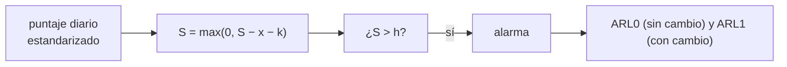

# B104-C18 — Aislamiento y convivencia

<!-- nav:top -->
[🏠 Programa](../../../../README.md) · [📚 Bloque B104](../../../tronco-comun/B104-astronautica-y-preparacion-de-astronautas.md) · [← Anterior: B104-C17 — Gestión de fatiga](../B104-C17-gestion-de-fatiga/CLASE.md) · [Siguiente: B104-C19 — Operaciones de retorno y reintegración →](../B104-C19-operaciones-de-retorno-y-reintegracion/CLASE.md)
<!-- /nav -->

## 1. Ubicación, nivel y alcance

Clase 18 del bloque B104, nivel N3. En un aislamiento largo conviene notar a tiempo un deterioro sostenido del ánimo sin disparar alarmas por cualquier mal día. Aquí usas una **carta CUSUM** sobre puntajes diarios sintéticos para medir su longitud media de carrera sin cambio (falsas alarmas) y su demora de detección. Sigue a B104-C17 y prepara a B104-C19 y B104-C20. Datos **sintéticos**; no son datos de Mars500 ni de personas.

## 2. Por qué esta clase existe

Un seguimiento demasiado sensible cansa por falsas alarmas; uno insensible llega tarde. La decisión central: **¿qué umbral permite detectar un deterioro de una desviación estándar en unos 8 días sin que haya más de una falsa alarma al año?**

## 3. Lo que podrás hacer al terminar

1. Describir la carta CUSUM inferior y sus parámetros `k` y `h`.
2. Medir por Monte Carlo la longitud media de carrera sin cambio (`ARL₀`) y con cambio.
3. Comparar con la aproximación de Siegmund.
4. Simular un escenario de 520 días con deterioro gradual en una persona de seis.
5. Interpretar la demora de detección y la probabilidad de falsa alarma.
6. Rotular que los datos son sintéticos y que no se evalúa a personas.

La evidencia es la **informe de monitoreo con ARL** del ejercicio 12 (sección 20).

## 4. Con qué llegas y cómo comprobarlo

1. ¿Qué es una desviación estándar?
2. ¿Qué es una suma acumulada?
3. ¿Qué es una falsa alarma?
4. ¿Qué es el valor esperado?
5. ¿Qué es un dato sintético?

<details>
<summary>Ver respuestas</summary>

1. Una medida de dispersión alrededor de la media. 2. Una suma que acumula valores sucesivos. 3. Una señal sin que haya un cambio real. 4. El promedio ponderado por probabilidades. 5. Un dato generado para el ejemplo.
</details>

Con cuatro o cinco aciertos, sigue; si no, repasa los prerrequisitos.

## 5. Un caso de contexto y casos de referencia

El estudio Mars500 de ESA (consultado el 2026-11-10) aisló a seis personas (tres rusas, dos europeas y una china) durante 520 días, entre junio de 2010 y el 4 de noviembre de 2011, tras un aislamiento de 105 días en 2009, para estudiar estrés, hormonas, inmunidad, sueño y ánimo. Con puntajes sintéticos estandarizados y una carta CUSUM inferior con `k = 0,5` y `h = 4`, la longitud media sin cambio es de 339,6 días (aproximación de Siegmund: 338,1); con un deterioro de una desviación estándar, la detección tarda 8,4 días (8,3) y con dos, 3,4 días (3,2). En 520 días con deterioro gradual desde el día 200, el 43,2 % de las simulaciones dio una falsa alarma antes del día 200. Es el **ejemplo conductor**: los datos son **sintéticos**.

## 6. Vocabulario

La **CUSUM** acumula desviaciones respecto de la media menos un margen `k`. El **umbral** `h` dispara la alarma. La **longitud media de carrera** (ARL) es el número esperado de observaciones hasta la alarma: `ARL₀` sin cambio, `ARL₁` con cambio. La **demora de detección** es el tiempo desde el cambio hasta la alarma.

## 7. Modelo mental



*Descripción textual:* cada día se acumula la desviación hacia abajo menos un margen; si la suma supera el umbral hay alarma, y se mide cuánto tarda con y sin deterioro.

Analogía: un acumulador que suma pequeños mal humor: un día malo se disipa, pero muchos días seguidos hacen saltar la alarma. Límite: el puntaje de ánimo real es multidimensional y subjetivo.

## 8. La explicación, paso a paso

### 8.1 Lo consultado

ESA, página de resumen del estudio Mars500 (2026-11-10): 520 días de aislamiento (junio de 2010–4 de noviembre de 2011) tras un aislamiento previo de 105 días en 2009; seis candidatos (tres rusos, dos europeos y un chino); objetivos: datos para preparar una misión a Marte, estudiar los efectos psicológicos y fisiológicos del confinamiento (estrés, hormonas, inmunidad, sueño y ánimo), probar suplementos dietéticos e informar contramedidas y selección. No se consultaron sus resultados.

### 8.2 La carta

`S_t = max(0, S_{t−1} − x_t − k)` con `k = 0,5` y alarma si `S_t > h = 4`. Con puntajes `N(0,1)`, el cambio de nivel se mide en desviaciones estándar.

### 8.3 Longitudes medias de carrera

| desplazamiento (σ) | ARL Monte Carlo (d) | aproximación de Siegmund (d) |
|---|---|---|
| 0,0 | 339,6 | 338,1 |
| 1,0 | 8,4 | 8,3 |
| 2,0 | 3,4 | 3,2 |

La aproximación es `(e^(−2Δb) + 2Δb − 1)/(2Δ²)` con `b = h + 1,166` y `Δ = δ − k`; para `δ = 0` se usa `Δ = −k`. La coincidencia valida el código.

### 8.4 Un escenario de 520 días

Seis personas es un caso; en una persona con deterioro gradual de 0,01 σ por día desde el día 200: 0,432 de las simulaciones dio una **falsa alarma antes del día 200** (esperable: `1 − e^(−200/339) = 0,445`), 0,568 detectó el deterioro y la demora mediana fue de 47 días. Un `ARL₀` de 339 días implica una falsa alarma cada año aproximadamente; con seis personas, más.

### 8.5 Límites

Datos independientes y gaussianos, un solo puntaje, sin estacionalidad ni efecto del retorno de la medición; una alarma no es un diagnóstico, solo una invitación a conversar. No se consultó ningún resultado de Mars500.

## 9. Magnitudes, símbolos y unidades

| Símbolo | Qué es | Unidad | Valor / nota |
|---|---|---|---|
| `k` | margen de la carta | σ | 0,5 |
| `h` | umbral de alarma | σ | 4 |
| `ARL₀` | carrera media sin cambio | d | 339,6 |
| `ARL₁` | carrera media con cambio de 1σ | d | 8,4 |
| deterioro | pendiente en el escenario | σ/d | 0,01 desde el día 200 |

## 10. Convenciones y referencias

Puntajes diarios estandarizados independientes N(0,1) con un descenso de media `−δ`; carta inferior; semilla 104 (1 500, 6 000 y 6 000 corridas, y 2 000 escenarios de 520 días). Tolerancias: ARL₀ dentro de 12 % de la aproximación; ARL₁ dentro de 6 %; ARL₀ mayor que 20 veces ARL₁. Numpy 2.4.4, Python 3.12.9.

## 11. De dónde sale lo que afirmamos

| ID | Fuente | Localizador | Respalda | Estado |
|---|---|---|---|---|
| S1 | ESA, «Mars500 study overview» — https://www.esa.int/Science_Exploration/Human_and_Robotic_Exploration/Mars500/Mars500_study_overview (consultada 2026-11-10) | página completa | 520 días, 6 candidatos, 2010–2011, tras 105 días en 2009; objetivos de estrés, hormonas, inmunidad, sueño y ánimo | Consultada |
| S2 | NASA, «Human Research Program: hazards» — https://www.nasa.gov/hrp/hazards/ (consultada 2026-11-10) | página de peligros | el aislamiento y confinamiento de grupos pequeños puede producir cambios de conducta | Consultada |
| — | Relaciones estándar usadas en el laboratorio | — | las verifica el laboratorio | No consultada en una fuente concreta (las verifica el laboratorio) |

Límites: no se consultaron los resultados del estudio Mars500 ni literatura sobre monitoreo psicológico; la carta CUSUM y la aproximación de Siegmund son estándar verificados por el laboratorio y no se consultaron.

## 12. Cómo ver el resultado

| desplazamiento (σ) | ARL Monte Carlo (d) | aproximación (d) |
|---|---|---|
| 0,0 | 339,6 | 338,1 |
| 1,0 | 8,4 | 8,3 |
| 2,0 | 3,4 | 3,2 |

Escenario de 520 días: falsa alarma antes del día 200, 0,432; detección tras el inicio, 0,568; demora mediana, 47 días. Descripción larga: un deterioro grande se detecta en pocos días, uno gradual en semanas, y hay falsas alarmas a lo largo de un año.

## 13. Ejemplo trabajado: una actualización de la carta

**Paso 1 · Estado.** `S = 1,2`.

**Paso 2 · Puntaje.** `x = −1,5` (un mal día).

**Paso 3 · Actualización.** `S = max(0, 1,2 − (−1,5) − 0,5) = 2,2`.

**Paso 4 · Decisión.** `2,2 < h = 4`: sin alarma.

## 14. Distintas formas de describir el problema

**Por recursión:** `S_t`. **Por ARL:** `ARL₀`, `ARL₁`. **Por aproximación:** Siegmund. **Por escenario:** falsa alarma y demora mediana.

## 15. Práctica guiada

**Ejercicio 1 · con los pasos indicados.** Actualiza `S = 1,2` con `x = −1,5` y `k = 0,5`. *Pasos:* `S − x − k`.

<details><summary>Solución comentada</summary>

`2,2`.
</details>

**Ejercicio 2 · con una pista.** Actualiza `S = 2,2` con `x = 0,3`.

<details><summary>Solución comentada</summary>

`max(0, 2,2 − 0,3 − 0,5) = 1,4`.
</details>

**Ejercicio 3 · casi autónomo.** ¿Cuántos días tarda, en promedio, en detectar un deterioro de 1σ?

<details><summary>Solución comentada</summary>

`8,4 d`.
</details>

## 16. Práctica autónoma, transferencia e integrador

**Ejercicio 4 · autónomo.** ¿Cada cuántos días hay una falsa alarma en promedio?

<details><summary>Solución comentada</summary>

`339,6 d`.
</details>

**Ejercicio 5 · autónomo.** ¿Qué probabilidad hay de una falsa alarma en 200 días con `ARL₀ = 339`?

<details><summary>Solución comentada</summary>

`1 − e^(−200/339) = 0,445`.
</details>

**Ejercicio 6 · autónomo.** ¿Por qué el CUSUM no dispara con un solo mal día?

<details><summary>Solución comentada</summary>

Porque cada día suma solo `−x − k`; un solo valor grande no alcanza `h = 4` salvo que sea de más de 4,5σ.
</details>

**Ejercicio 7 · autónomo.** ¿Qué pasa si se baja `h` a 3?

<details><summary>Solución comentada</summary>

El ARL₀ baja y las falsas alarmas aumentan; la detección es más rápida.
</details>

**Ejercicio 8 · autónomo.** ¿Qué indica una demora mediana de 47 días en el escenario gradual?

<details><summary>Solución comentada</summary>

Que un deterioro lento se detecta cuando acumula unas 0,47σ de descenso.
</details>

**Ejercicio 9 · transferencia.** Con seis personas monitoreadas por separado, ¿cuántas falsas alarmas esperas al año?

<details><summary>Solución comentada</summary>

Unas `6 · 365/339 ≈ 6,5`.
</details>

**Ejercicio 10 · transferencia.** ¿Qué haces ante una alarma?

<details><summary>Solución comentada</summary>

Tratarla como invitación a conversar y a medir mejor, no como diagnóstico; con apoyo profesional de la agencia.
</details>

**Ejercicio 11 · transferencia.** ¿Cómo ajustarías `h` para tener una falsa alarma por persona cada 2 años?

<details><summary>Solución comentada</summary>

Subiendo `h` hasta `ARL₀ ≈ 730`, p. ej. `h ≈ 4,8`.
</details>

**Ejercicio 12 · integrador.** Elabora tu *informe de monitoreo con ARL*: carta, tabla de ARL frente a Siegmund, escenario de 520 días, interpretación de las alarmas, límites y qué es sintético y consultado.

<details><summary>Solución comentada</summary>

Secciones 8.1–8.5 y la salida del laboratorio.
</details>

## 17. Laboratorio: seguimiento del ánimo con una carta CUSUM

El script [cusum.py](cusum.py) mide por Monte Carlo el ARL de una carta CUSUM, lo compara con la aproximación de Siegmund y simula 2 000 escenarios de 520 días (**comprueba** el ARL₀ y el ARL₁ frente a la aproximación y la relación entre ambos). Tarda unos 3 s. Tarda menos de 1 s.

**Datos:** puntajes **sintéticos** con semilla 104; **no** son datos de Mars500. **Predice antes de ejecutar:** ¿Cada cuántos días hay en promedio una falsa alarma con `k = 0,5` y `h = 4`? (Cada unos 340 días.) **Ejecución del 2026-11-10 (Python 3.12.9):**

```text
Python 3.12.9; numpy 2.4.4
DATOS SINTETICOS (semilla 104): puntajes de animo diarios estandarizados; baja de nivel = deterioro; k = 0,5; h = 4

desplazamiento [desv. est.] | ARL Monte Carlo [dias] | ARL aproximado de Siegmund [dias]
                        0.0                  339.6                          338.1
                        1.0                    8.4                            8.3
                        2.0                    3.4                            3.2

Escenario sintetico: 520 dias, deterioro gradual de 0,01 desv. est. por dia desde el dia 200 en 1 de 6 personas
  alarmas falsas antes del dia 200: 0.432; detecciones tras el inicio: 0.568; demora mediana desde el inicio: 47 dias
Pruebas superadas.
```

```bash
python programa/clases/B104/B104-C18-aislamiento-y-convivencia/cusum.py
```

**Límites:** datos independientes y gaussianos, un solo puntaje, deterioro lineal; no es una herramienta clínica ni de evaluación.

## 18. Errores frecuentes y cómo corregirlos

**Tratar la alarma como diagnóstico.** Es una invitación a conversar (8.5).

**Ignorar las falsas alarmas.** Calcula `ARL₀` (8.3).

**Subir la sensibilidad sin costo.** Cada reducción de `h` baja el ARL₀ (ejercicio 7).

**Presentar los datos como de Mars500.** Son sintéticos (sección 10).

## 19. Cómo sabrás que vas bien

Tras la sección 8: ¿qué ARL₀ esperabas y cuál da la tabla? Si dudas, repasa el ejemplo 13. Tras el laboratorio: ¿qué comprueba? (ver la sección 17).

## 20. Qué entregas y cómo se evalúa

El producto es tu **informe de monitoreo con ARL** (ejercicio 12).

| Criterio | Inicial | En desarrollo | Logrado | Destacado |
|---|---|---|---|---|
| Conceptos | Confunde los términos | Parciales | Explica CUSUM, ARL y demora | Explica el equilibrio entre falsas alarmas y demora |
| Cálculo | Sin unidades | Con errores | Calcula con unidades y compara con el laboratorio | Resuelve casos nuevos |
| Numérico | Sin comprobar | Un caso | Compara con una segunda vía de cálculo | Interpreta las diferencias |
| Fuentes | Sin fuente | Sin fecha | Fuentes con fecha y estado | Declara lo sintético, lo ilustrativo y lo no consultado |
| Límites | No los nombra | Uno | Tres | Discute qué falta del modelo |

**Condiciones críticas (no se compensan con promedio):** rotular los datos como sintéticos, no presentarlos como de Mars500 ni de personas, no tratar la alarma como diagnóstico y citar solo lo consultado.

## 21. Ética, seguridad y límites

Clase educativa: **no da consejo médico, de entrenamiento individual ni operativo** y no sustituye a los requisitos, procedimientos y estándares de ninguna agencia. La carta no diagnostica ni evalúa a nadie: es un ejercicio estadístico con datos inventados. Accesibilidad: tablas equivalentes a las gráficas, fórmulas en texto, ejercicios sin conexión.

## 22. Para cerrar y seguir

Con `k = 0,5` y `h = 4`, la carta detecta un deterioro de 1σ en unos 8 días y da una falsa alarma cada 340 días aproximadamente. Queda una pregunta: ¿cómo se vuelve a casa tras meses de misión?

**Glosario español–inglés.** carta CUSUM · *CUSUM chart*; longitud media de carrera · *average run length*; falsa alarma · *false alarm*; aislamiento · *isolation*; convivencia · *cohabitation*.

**Continuidad.** [B104-C19](../B104-C19-operaciones-de-retorno-y-reintegracion/CLASE.md) estudia las operaciones de retorno y la reintegración, empezando por el reingreso.

**Referencias:** ver sección 11.

<!-- nav:bottom -->
---

[← Anterior: B104-C17 — Gestión de fatiga](../B104-C17-gestion-de-fatiga/CLASE.md) · [📚 Bloque B104](../../../tronco-comun/B104-astronautica-y-preparacion-de-astronautas.md) · [Siguiente: B104-C19 — Operaciones de retorno y reintegración →](../B104-C19-operaciones-de-retorno-y-reintegracion/CLASE.md)
<!-- /nav -->
