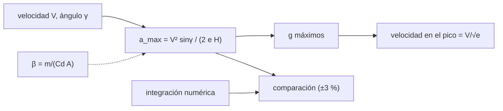

# B104-C19 — Operaciones de retorno y reintegración

<!-- nav:top -->
[🏠 Programa](../../../../README.md) · [📚 Bloque B104](../../../tronco-comun/B104-astronautica-y-preparacion-de-astronautas.md) · [← Anterior: B104-C18 — Aislamiento y convivencia](../B104-C18-aislamiento-y-convivencia/CLASE.md) · [Siguiente: B104-C20 — Misión tripulada simulada →](../B104-C20-mision-tripulada-simulada/CLASE.md)
<!-- /nav -->

## 1. Ubicación, nivel y alcance

Clase 19 del bloque B104, nivel N3. El retorno de una misión tiene dos partes: el **reingreso** (una desaceleración fuerte que la nave y las personas deben soportar) y la **reintegración** (aterrizaje, recuperación y readaptación a la gravedad terrestre). Aquí calculas la primera con la fórmula de Allen–Eggers y una integración numérica, y sitúas la segunda con lo consultado; no se tratan aspectos médicos. Sigue a B104-C15 y prepara a B104-C20. Datos **ilustrativos**; no es la predicción de ninguna nave.

## 2. Por qué esta clase existe

Un ángulo de entrada más empinado reduce el calentamiento total pero aumenta la desaceleración. La decisión central: **¿cuántos g máximos soporta la tripulación según el ángulo de entrada, y por qué ese máximo no depende de la masa de la nave?**

## 3. Lo que podrás hacer al terminar

1. Calcular la desaceleración máxima con la fórmula de Allen–Eggers.
2. Integrar numéricamente un reingreso balístico con atmósfera exponencial.
3. Comprobar que el máximo no depende del coeficiente balístico.
4. Calcular la velocidad en el pico (`V/√e`).
5. Ver el efecto del ángulo de entrada sobre los g máximos.
6. Situar la reintegración como una fase aparte y rotular los límites del modelo.

La evidencia es la **tabla de g máximos por ángulo** del ejercicio 12 (sección 20).

## 4. Con qué llegas y cómo comprobarlo

1. ¿Qué es una atmósfera exponencial?
2. ¿Qué es un coeficiente balístico?
3. ¿Qué es un ángulo de trayectoria?
4. ¿Qué es una aceleración en g?
5. ¿Qué es un modelo ilustrativo?

<details>
<summary>Ver respuestas</summary>

1. Una en que la densidad cae como `e^(−h/H)`. 2. `β = m/(C_d A)`: cuánta masa por área de arrastre. 3. El ángulo entre la trayectoria y el horizonte local. 4. La aceleración dividida por 9,80665 m/s². 5. Uno con parámetros inventados.
</details>

Con cuatro o cinco aciertos, sigue; si no, repasa los prerrequisitos.

## 5. Un caso de contexto y casos de referencia

Con `V = 7,8 km/s` (ilustrativa), altura de escala `H = 7,2 km` y atmósfera exponencial, la fórmula de Allen–Eggers `a_max = V² sin γ/(2 e H)` da 2,77 g con 1°, 4,15 g con 1,5°, 8,29 g con 3° y 22,06 g con 8°. La integración numérica da 8,53 g con 3° para `β = 400 kg/m²` y 8,54 g para `β = 800 kg/m²`: el máximo no depende de `β`. La velocidad en el pico es `V/√e = 4,73 km/s`. Es el **ejemplo conductor**: todo es **ilustrativo**.

## 6. Vocabulario

El **reingreso** es el paso por la atmósfera hacia el aterrizaje. El **ángulo de trayectoria** `γ` es la inclinación de la entrada. **Allen–Eggers** es la solución analítica de un reingreso balístico en atmósfera exponencial. La **reintegración** es la fase posterior al aterrizaje: recuperación, evaluación y readaptación.

## 7. Modelo mental



*Descripción textual:* la fórmula da el máximo en función de la velocidad y el ángulo, sin intervención del coeficiente balístico; la integración numérica la verifica; la velocidad en el pico es una fracción fija de la de entrada.

Analogía: frenar con un paracaídas que se abre en el aire cada vez más denso: da igual el peso del que cae, el instante de mayor frenado depende de la velocidad y del ángulo. Límite: una nave con sustentación controla el ángulo y reduce el pico.

## 8. La explicación, paso a paso

### 8.1 Lo consultado

La página de peligros de NASA (consultada el 2026-11-10) menciona que el cuerpo debe adaptarse a distintos niveles de gravedad «desde la ingravidez hasta la Luna, Marte y de vuelta a la Tierra»: eso sitúa la readaptación como parte del retorno. Nada más sobre reingreso se consultó; la fórmula y la atmósfera son modelos estándar verificados por el laboratorio.

### 8.2 Fórmula de Allen–Eggers

`a_max = V² sin γ/(2 e H)`. Con `V = 7 800 m/s`, `γ = 3°` y `H = 7 200 m`: `6,084e7 · 0,05234/(2 · 2,718 · 7 200) = 81,4 m/s² = 8,29 g`. No depende de `β`; el pico ocurre a `V/√e = 4,73 km/s`.

### 8.3 Integración numérica

Con `dV/dt = −ρV²/(2β) + g sin γ` y `dh/dt = −V sin γ`, desde 120 km de altura con paso de 10 ms:

| `γ` (°) | Allen–Eggers (g) | numérico `β = 400` (g) | numérico `β = 800` (g) |
|---|---|---|---|
| 1,0 | 2,77 | 2,84 | 2,84 |
| 1,5 | 4,15 | 4,26 | 4,26 |
| 2,0 | 5,53 | 5,68 | 5,69 |
| 3,0 | 8,29 | 8,53 | 8,54 |
| 5,0 | 13,81 | 14,21 | 14,24 |
| 8,0 | 22,06 | 22,72 | 22,76 |

La diferencia (hasta unos 3 %) viene de la gravedad que la fórmula no incluye. `β` cambia el máximo en menos del 0,5 %.

### 8.4 Lectura

El máximo crece casi proporcionalmente al seno del ángulo: `22,06/8,29 = 2,66 = sin 8°/sin 3°`. Una cápsula con sustentación o un reingreso con salto controla el ángulo efectivo; esa guía no se modela aquí.

### 8.5 La reintegración

Tras el aterrizaje vienen la recuperación, la evaluación y la readaptación a 1 g (NASA, página de peligros). Esta clase no trata aspectos médicos: la readaptación la gestiona la agencia con sus equipos. Límites: Tierra plana, trayectoria recta, sin calentamiento, sin sustentación, ángulo constante y atmósfera exponencial única.

## 9. Magnitudes, símbolos y unidades

| Símbolo | Qué es | Unidad | Valor / nota |
|---|---|---|---|
| `V` | velocidad de entrada | km/s | 7,8 (ilustrativa) |
| `γ` | ángulo de trayectoria | grados | 1 a 8 |
| `H` | altura de escala | km | 7,2 |
| `β` | coeficiente balístico | kg/m² | 400 y 800 |
| `a_max` | desaceleración máxima | g | 2,77 a 22,06 |

## 10. Convenciones y referencias

Tierra plana, atmósfera `ρ = 1,225 e^(−h/H)`, `g = 9,80665 m/s²` constante, ángulo de trayectoria constante, entrada desde 120 km; paso de 10 ms. Sin aleatoriedad. Tolerancias: numérico dentro de 20 % de la fórmula; `β` cambia el máximo menos de 5 %; fórmula a 3° igual a 8,29 ± 0,01 g. Numpy 2.4.4, Python 3.12.9.

## 11. De dónde sale lo que afirmamos

| ID | Fuente | Localizador | Respalda | Estado |
|---|---|---|---|---|
| S1 | NASA, «Human Research Program: hazards» — https://www.nasa.gov/hrp/hazards/ (consultada 2026-11-10) | página de peligros | el cuerpo debe adaptarse a niveles de gravedad distintos, de la ingravidez a la Luna, Marte y de vuelta a la Tierra | Consultada |
| — | Relaciones estándar usadas en el laboratorio | — | las verifica el laboratorio | No consultada en una fuente concreta (las verifica el laboratorio) |

Límites: no se consultó ningún documento de reingreso ni de readaptación; la fórmula de Allen–Eggers, la altura de escala y la velocidad de entrada son estándar o ilustrativas, verificadas solo por el laboratorio.

## 12. Cómo ver el resultado

| `γ` (°) | Allen–Eggers (g) | numérico `β = 400` (g) |
|---|---|---|
| 1,0 | 2,77 | 2,84 |
| 3,0 | 8,29 | 8,53 |
| 5,0 | 13,81 | 14,21 |
| 8,0 | 22,06 | 22,72 |

Velocidad en el pico: 4,73 km/s. Descripción larga: la desaceleración máxima crece con el seno del ángulo y no depende de `β`.

## 13. Ejemplo trabajado: desaceleración máxima a 3 grados

**Paso 1 · Numerador.** `V² sin γ = 6,084e7 · 0,05234 = 3,184e6`.

**Paso 2 · Denominador.** `2 e H = 2 · 2,718 · 7 200 = 39 143`.

**Paso 3 · Aceleración.** `3,184e6/39 143 = 81,3 m/s²`.

**Paso 4 · En g.** `81,3/9,807 = 8,29 g`.

## 14. Distintas formas de describir el problema

**Por fórmula:** `V² sinγ/(2eH)`. **Por tabla:** ángulo y g. **Por integración:** `dV/dt`. **Por proporción:** `sinγ₂/sinγ₁`.

## 15. Práctica guiada

**Ejercicio 1 · con los pasos indicados.** Calcula la velocidad en el pico con `V = 7,8 km/s`. *Pasos:* `V/√e`.

<details><summary>Solución comentada</summary>

`4,73 km/s`.
</details>

**Ejercicio 2 · con una pista.** Calcula `a_max` para `γ = 1,5°`. *Pista:* `V² sinγ/(2eH)/g`.

<details><summary>Solución comentada</summary>

`4,15 g`.
</details>

**Ejercicio 3 · casi autónomo.** ¿Cuántas veces mayor es `a_max` a 8° que a 3°?

<details><summary>Solución comentada</summary>

`sin 8°/sin 3° = 2,66`.
</details>

## 16. Práctica autónoma, transferencia e integrador

**Ejercicio 4 · autónomo.** ¿Cómo cambia `a_max` si `V` baja a la mitad (3,9 km/s)?

<details><summary>Solución comentada</summary>

A un cuarto (`∝ V²`): `2,07 g` a 3°.
</details>

**Ejercicio 5 · autónomo.** ¿Cómo cambia con `H = 8 km`?

<details><summary>Solución comentada</summary>

Por `7,2/8 = 0,9`: `7,46 g` a 3°.
</details>

**Ejercicio 6 · autónomo.** ¿Por qué `β` no cambia el máximo?

<details><summary>Solución comentada</summary>

Porque una mayor `β` retrasa el pico a menor altitud, donde la densidad compensa; el máximo queda igual.
</details>

**Ejercicio 7 · autónomo.** ¿De dónde viene la diferencia entre fórmula e integración?

<details><summary>Solución comentada</summary>

De la gravedad (`g sin γ`) que la fórmula no incluye.
</details>

**Ejercicio 8 · autónomo.** ¿En qué fase situarías la readaptación a la gravedad?

<details><summary>Solución comentada</summary>

En la reintegración, tras el aterrizaje.
</details>

**Ejercicio 9 · transferencia.** Un reingreso con sustentación puede reducir el ángulo efectivo. ¿Qué `γ` da 4 g en el modelo?

<details><summary>Solución comentada</summary>

`γ = asin(4·9,807·39 143/6,084e7) = 1,45°`.
</details>

**Ejercicio 10 · transferencia.** Un ángulo muy poco empinado reduce los g. ¿Qué riesgo introduce?

<details><summary>Solución comentada</summary>

Rebotar en la atmósfera o alargar el reingreso y el calentamiento total; hay un corredor de entrada.
</details>

**Ejercicio 11 · transferencia.** Un compañero afirma «una nave más pesada sufre menos g». ¿Cómo respondes con el modelo?

<details><summary>Solución comentada</summary>

El máximo no depende de `β`: a igual `V` y `γ`, los g máximos son los mismos (8,53 y 8,54 g).
</details>

**Ejercicio 12 · integrador.** Elabora tu *tabla de g máximos por ángulo*: seis ángulos con fórmula e integración, independencia de `β`, velocidad en el pico, la fase de reintegración, límites y qué es ilustrativo.

<details><summary>Solución comentada</summary>

Secciones 8.1–8.5 y la salida del laboratorio.
</details>

## 17. Laboratorio: desaceleración máxima de un reingreso balístico

El script [reingreso.py](reingreso.py) compara la fórmula de Allen–Eggers con una integración numérica para seis ángulos y dos coeficientes balísticos (**comprueba** el valor a 3°, la concordancia dentro del 20 %, la independencia de `β` y la proporcionalidad con el seno). Tarda unos 5 s. Tarda menos de 1 s.

**Datos:** velocidad, altura de escala y ángulos **ilustrativos**. Sin aleatoriedad. **Predice antes de ejecutar:** ¿Cuántos g máximos da un ángulo de 3° con `V = 7,8 km/s`? (Unos 8,3 g.) **Ejecución del 2026-11-10 (Python 3.12.9):**

```text
Python 3.12.9; numpy 2.4.4
MODELO ILUSTRATIVO: V = 7,8 km/s, H = 7,2 km, rho0 = 1,225 kg/m3, atmosfera exponencial, trayectoria casi recta; beta = masa/(Cd A)

angulo de entrada [grados] | g maximos (Allen-Eggers) | g maximos (numerico, beta = 400) | numerico, beta = 800 | velocidad en el pico [km/s]
                 1.0                     2.77                             2.84                   2.84                           4.73
                 1.5                     4.15                             4.26                   4.26                           4.73
                 2.0                     5.53                             5.68                   5.69                           4.73
                 3.0                     8.29                             8.53                   8.54                           4.73
                 5.0                    13.81                            14.21                  14.24                           4.73
                 8.0                    22.06                            22.72                  22.76                           4.73

Con 3 grados la desaceleracion maxima numerica difiere +2.8 % de la formula; beta no la cambia (400 -> 800: +0.2 %)
Sin datos de mision: ninguna salida de este modelo corresponde a una nave ni a un reingreso real
Pruebas superadas.
```

```bash
python programa/clases/B104/B104-C19-operaciones-de-retorno-y-reintegracion/reingreso.py
```

**Límites:** Tierra plana, ángulo constante, sin sustentación ni calentamiento, atmósfera exponencial única; no es la predicción de ninguna nave.

## 18. Errores frecuentes y cómo corregirlos

**Creer que la masa cambia el pico.** No lo cambia (8.2).

**Olvidar convertir a g.** Divide por 9,807 (ejemplo 13).

**Tomar la fórmula como exacta.** Es una aproximación (8.3).

**Mezclar reingreso y reintegración.** Son fases distintas (8.5).

## 19. Cómo sabrás que vas bien

Tras la sección 8: ¿cuántos g esperabas a 5° y cuántos da la tabla? Si dudas, repasa el ejemplo 13. Tras el laboratorio: ¿qué comprueba? (ver la sección 17).

## 20. Qué entregas y cómo se evalúa

El producto es tu **tabla de g máximos por ángulo** (ejercicio 12).

| Criterio | Inicial | En desarrollo | Logrado | Destacado |
|---|---|---|---|---|
| Conceptos | Confunde los términos | Parciales | Explica reingreso, ángulo y `β` | Explica por qué el pico no depende de la masa |
| Cálculo | Sin unidades | Con errores | Calcula con unidades y compara con el laboratorio | Resuelve casos nuevos |
| Numérico | Sin comprobar | Un caso | Compara con una segunda vía de cálculo | Interpreta las diferencias |
| Fuentes | Sin fuente | Sin fecha | Fuentes con fecha y estado | Declara lo sintético, lo ilustrativo y lo no consultado |
| Límites | No los nombra | Uno | Tres | Discute qué falta del modelo |

**Condiciones críticas (no se compensan con promedio):** rotular los valores como ilustrativos, no presentar la tabla como predicción de una nave ni dar consejo médico y citar solo lo consultado.

## 21. Ética, seguridad y límites

Clase educativa: **no da consejo médico, de entrenamiento individual ni operativo** y no sustituye a los requisitos, procedimientos y estándares de ninguna agencia. Los g calculados no son límites ni predicciones para ninguna persona ni nave; la readaptación y la recuperación las gestiona la agencia. Accesibilidad: tablas equivalentes a las gráficas, fórmulas en texto, ejercicios sin conexión.

## 22. Para cerrar y seguir

Con `V = 7,8 km/s`, 3° dan unos 8,3 g y 8° unos 22 g, sin importar la masa de la nave. Queda una pregunta: ¿cómo se integra todo lo aprendido en una misión completa simulada?

**Glosario español–inglés.** reingreso · *re-entry*; coeficiente balístico · *ballistic coefficient*; ángulo de trayectoria · *flight-path angle*; reintegración · *reintegration*; desaceleración · *deceleration*.

**Continuidad.** [B104-C20](../B104-C20-mision-tripulada-simulada/CLASE.md) integra los márgenes de todo el bloque en una misión tripulada simulada.

**Referencias:** ver sección 11.

<!-- nav:bottom -->
---

[← Anterior: B104-C18 — Aislamiento y convivencia](../B104-C18-aislamiento-y-convivencia/CLASE.md) · [📚 Bloque B104](../../../tronco-comun/B104-astronautica-y-preparacion-de-astronautas.md) · [Siguiente: B104-C20 — Misión tripulada simulada →](../B104-C20-mision-tripulada-simulada/CLASE.md)
<!-- /nav -->
