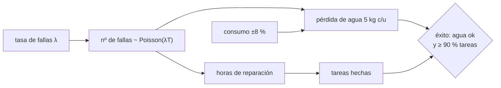

# B104-C20 — Misión tripulada simulada

<!-- nav:top -->
[🏠 Programa](../../../../README.md) · [📚 Bloque B104](../../../tronco-comun/B104-astronautica-y-preparacion-de-astronautas.md) · [← Anterior: B104-C19 — Operaciones de retorno y reintegración](../B104-C19-operaciones-de-retorno-y-reintegracion/CLASE.md) · [Siguiente: B104-C21 — Inventario, logística y estiba a bordo →](../B104-C21-inventario-logistica-y-estiba-a-bordo/CLASE.md)
<!-- /nav -->

## 1. Ubicación, nivel y alcance

Clase 20 del bloque B104, nivel N3. Una misión tripulada simulada (o analógica) ensaya en tierra una operación completa: tripulación, consumibles, fallas, tareas y comunicación. Aquí integras en una simulación Monte Carlo de 30 días los márgenes de las clases anteriores (agua, fallas con horas de reparación, tiempo de trabajo y tareas de ciencia) para estimar la probabilidad de éxito. Cierra el bloque junto a B104-C21 a C23. Todo es **sintético e ilustrativo**.

## 2. Por qué esta clase existe

Cada margen parece suficiente por separado, pero las fallas consumen a la vez agua y tiempo. La decisión central: **¿hasta qué tasa de fallas mantiene la misión una probabilidad de éxito alta, y cuál recurso se agota primero?**

## 3. Lo que podrás hacer al terminar

1. Plantear un modelo integrado con consumibles, fallas aleatorias y horas de tripulación.
2. Estimar por Monte Carlo la probabilidad de éxito según la tasa de fallas.
3. Identificar el recurso limitante.
4. Verificar la simulación con la probabilidad de no tener fallas, `e^(−λT)`.
5. Medir el margen medio de agua y la holgura de horas.
6. Rotular que la misión es analógica y sintética.

La evidencia es la **informe de misión simulada con margen** del ejercicio 12 (sección 20).

## 4. Con qué llegas y cómo comprobarlo

1. ¿Qué es un proceso de Poisson?
2. ¿Qué es una probabilidad de éxito?
3. ¿Qué es un margen?
4. ¿Qué es una distribución log-normal?
5. ¿Qué es un dato sintético?

<details>
<summary>Ver respuestas</summary>

1. Un proceso de eventos independientes a tasa constante. 2. La fracción de corridas que cumplen el criterio. 3. Un exceso deliberado sobre lo esperado. 4. Una distribución cuyo logaritmo es normal. 5. Un dato generado para el ejemplo.
</details>

Con cuatro o cinco aciertos, sigue; si no, repasa los prerrequisitos.

## 5. Un caso de contexto y casos de referencia

Misión sintética de 30 días con 4 personas, 330 kg de agua (consumo nominal de 300 kg con variación de 8 % diaria), 60 tareas de ciencia de 2 h y 234 h libres (30 % de 6,5 h por persona y día). Cada falla (tasa `λ` por día) cuesta 5 kg de agua y una reparación log-normal de mediana 6 h. El éxito exige agua suficiente y al menos el 90 % de las tareas. Con `λ = 0,05/d` el éxito es 0,995; con 0,10/d, 0,930; con 0,20/d, 0,523 (el agua se agota: margen medio 0,0 kg). La probabilidad de ninguna falla con 0,10/d es 0,0489 (teórica 0,0498). Es el **ejemplo conductor**: todo es **sintético** (semilla 104) e **ilustrativo**.

## 6. Vocabulario

Una misión **analógica** reproduce condiciones espaciales en tierra. Un **proceso de Poisson** da el número de fallas. El **recurso limitante** es el que se agota primero. La **holgura** es el exceso de horas sobre las tareas. El **criterio de éxito** combina condiciones (agua y ciencia).

## 7. Modelo mental



*Descripción textual:* la tasa de fallas determina cuántas ocurren; cada una consume horas y agua; junto con el consumo variable, determinan si se cumple el criterio de éxito.

Analogía: un viaje largo en auto con el tanque justo y neumáticos pinchables: cada pinchazo gasta tiempo y combustible, y solo importa cuál se acaba antes. Límite: aquí los recursos están acoplados por reglas inventadas.

## 8. La explicación, paso a paso

### 8.1 Qué se integra

De B104-C02: consumibles con margen (330 kg para 4 personas durante 30 días). De B104-C13 a C14: la necesidad de respuesta rápida. De B104-C17: una carga de horas de trabajo útiles de 6,5 h por persona y día (ilustrativa). De B104-C21 a C23: inventario, listas de comprobación y ejecución de experimentos. Lo consultado aquí es lo de cada clase; la integración es un ejercicio.

### 8.2 Modelo

Consumo: `4 · 2,5 · (1 + 0,08 ε)` kg/d (media 300 kg en 30 días). Fallas: `n ~ Poisson(λ · 30)`; cada una pierde 5 kg de agua y una reparación `LN(ln 6, 0,7)` h. Tiempo libre: `234 h − reparaciones`; tareas hechas: `libres/2 h`, hasta 60.

### 8.3 Resultados (50 000 corridas)

| `λ` (1/d) | P(éxito) | P(agua suficiente) | P(≥ 90 % tareas) | fallas medias | margen medio de agua (kg) |
|---|---|---|---|---|---|
| 0,00 | 1,000 | 1,000 | 1,000 | 0,00 | 30,0 |
| 0,05 | 0,995 | 0,995 | 1,000 | 1,50 | 22,5 |
| 0,10 | 0,930 | 0,930 | 1,000 | 3,00 | 15,0 |
| 0,20 | 0,523 | 0,524 | 0,995 | 5,99 | 0,0 |

El agua limita casi por sí sola: con 0,20/d, 6 fallas en promedio consumen 30 kg, todo el margen. El tiempo no limita: la holgura es de 114 h.

### 8.4 Verificación

`P(n = 0) = e^(−0,10·30) = 0,0498`; la simulación da 0,0489. Con 50 000 corridas, el error estadístico es de ±0,001.

### 8.5 Límites

Fallas independientes y del mismo tamaño, sin cascadas, sin consumos que cambien por fatiga o estrés, sin reabastecimiento ni abortos, y criterios de éxito inventados. Una misión analógica real tiene objetivos de investigación propios que esta clase no modela.

## 9. Magnitudes, símbolos y unidades

| Símbolo | Qué es | Unidad | Valor / nota |
|---|---|---|---|
| `λ` | tasa de fallas | 1/d | 0 a 0,20 |
| `T` | duración | d | 30 |
| agua cargada | con margen | kg | 330 |
| pérdida por falla | agua | kg | 5 (ilustrativa) |
| reparación | mediana log-normal | h | 6, σ_ln = 0,7 |
| horas libres | 30 % de 6,5 h × 4 × 30 | h | 234 |

## 10. Convenciones y referencias

Misión de 30 días y 4 personas; semilla 104 con 50 000 corridas por tasa; éxito si el agua alcanza y se hacen al menos 54 de 60 tareas. Tolerancias: P(sin fallas) simulada dentro de 0,005 de `e^(−λT)`; éxito decreciente con `λ`. Numpy 2.4.4, Python 3.12.9.

## 11. De dónde sale lo que afirmamos

| ID | Fuente | Localizador | Respalda | Estado |
|---|---|---|---|---|
| S1 | ESA, «Mars500 study overview» — https://www.esa.int/Science_Exploration/Human_and_Robotic_Exploration/Mars500/Mars500_study_overview (consultada 2026-11-10) | página completa | estudio de aislamiento de 520 días con seis personas, un ejemplo de misión analógica | Consultada |
| S2 | NASA, «Human Research Program: hazards» — https://www.nasa.gov/hrp/hazards/ (consultada 2026-11-10) | página de peligros | los cinco peligros del vuelo humano: radiación, aislamiento, distancia, gravedad y entorno hostil o cerrado | Consultada |
| — | Relaciones estándar usadas en el laboratorio | — | las verifica el laboratorio | No consultada en una fuente concreta (las verifica el laboratorio) |

Límites: de ESA solo se toma la descripción de Mars500 como ejemplo de misión analógica; los parámetros de la simulación son inventados y no se consultó ningún informe de una misión analógica.

## 12. Cómo ver el resultado

| `λ` (1/d) | P(éxito) | margen medio de agua (kg) |
|---|---|---|
| 0,00 | 1,000 | 30,0 |
| 0,05 | 0,995 | 22,5 |
| 0,10 | 0,930 | 15,0 |
| 0,20 | 0,523 | 0,0 |

Descripción larga: el éxito cae de 99,5 % a 52,3 % al pasar de 0,05 a 0,20 fallas por día; el agua es el recurso limitante.

## 13. Ejemplo trabajado: margen medio de agua con λ = 0,10

**Paso 1 · Fallas medias.** `0,10 · 30 = 3`.

**Paso 2 · Pérdida.** `3 · 5 = 15 kg`.

**Paso 3 · Margen.** `330 − 300 − 15 = 15 kg`.

## 14. Distintas formas de describir el problema

**Por fórmula:** margen `= carga − consumo − 5n`. **Por tabla:** tasa y éxito. **Por Poisson:** `e^(−λT)`. **Por recurso:** agua frente a horas.

## 15. Práctica guiada

**Ejercicio 1 · con los pasos indicados.** Calcula el consumo nominal de agua. *Pasos:* `4 · 2,5 · 30`.

<details><summary>Solución comentada</summary>

`300 kg`.
</details>

**Ejercicio 2 · con una pista.** ¿Qué margen nominal queda con 330 kg?

<details><summary>Solución comentada</summary>

`30 kg` (10 %).
</details>

**Ejercicio 3 · casi autónomo.** Calcula las fallas medias con `λ = 0,10/d`. *Pista:* `λT`.

<details><summary>Solución comentada</summary>

`3`.
</details>

## 16. Práctica autónoma, transferencia e integrador

**Ejercicio 4 · autónomo.** ¿Cuál es la probabilidad de ninguna falla?

<details><summary>Solución comentada</summary>

`e^−3 = 0,0498`.
</details>

**Ejercicio 5 · autónomo.** ¿Cuántas horas libres hay y cuánto necesita la ciencia?

<details><summary>Solución comentada</summary>

`234 h` y `120 h`: holgura `114 h`.
</details>

**Ejercicio 6 · autónomo.** ¿Cuántas fallas agotan el margen de 30 kg?

<details><summary>Solución comentada</summary>

`30/5 = 6`.
</details>

**Ejercicio 7 · autónomo.** ¿Por qué la misión falla casi siempre por agua y no por tareas?

<details><summary>Solución comentada</summary>

La pérdida de agua consume el margen con pocas fallas; las horas tienen una holgura de 114 h.
</details>

**Ejercicio 8 · autónomo.** ¿Qué indica un éxito de 0,523?

<details><summary>Solución comentada</summary>

En poco más de la mitad de las corridas se cumple el criterio.
</details>

**Ejercicio 9 · transferencia.** Se añaden 60 kg de agua (margen 90 kg). ¿Cómo cambia el éxito con 0,20/d?

<details><summary>Solución comentada</summary>

Se agotan con 18 fallas: la probabilidad de éxito sube a casi 1, a costa de 60 kg de masa.
</details>

**Ejercicio 10 · transferencia.** La reparación mediana sube de 6 a 20 h. ¿Qué recurso pasa a limitar?

<details><summary>Solución comentada</summary>

Las horas: tres fallas ya consumen 60 h de las 114 de holgura; con seis, se acerca al límite de tareas.
</details>

**Ejercicio 11 · transferencia.** ¿Qué agregarías para que la simulación sea más realista?

<details><summary>Solución comentada</summary>

Fallas en cascada, consumo dependiente de fatiga, reabastecimiento, abortos y tiempo de comunicación (B104-C08).
</details>

**Ejercicio 12 · integrador.** Elabora tu *informe de misión simulada con margen*: modelo, tabla de éxito por tasa de fallas, recurso limitante, verificación con Poisson, límites y qué es sintético, ilustrativo y consultado.

<details><summary>Solución comentada</summary>

Secciones 8.1–8.5 y la salida del laboratorio.
</details>

## 17. Laboratorio: misión analógica de 30 días

El script [mision.py](mision.py) simula 50 000 misiones de 30 días para cuatro tasas de fallas y calcula éxito, margen de agua y fallas medias (**comprueba** `P(sin fallas)` frente a `e^(−λT)` y que el éxito decrezca con `λ`). Tarda unos 3 s. Tarda menos de 1 s.

**Datos:** misión **sintética** con semilla 104 y parámetros **ilustrativos**. **Predice antes de ejecutar:** ¿Qué probabilidad de éxito esperas con 0,10 fallas por día? (Cerca de 0,93.) **Ejecución del 2026-11-10 (Python 3.12.9):**

```text
Python 3.12.9; numpy 2.4.4
DATOS SINTETICOS (semilla 104): mision analoga de 30 dias, 4 tripulantes; parametros ilustrativos

tasa de fallas [1/d] | P(exito) | P(agua suficiente) | P(>= 90 % de tareas) | fallas medias | margen medio de agua [kg]
              0.00      1.000              1.000                1.000           0.00                   30.0
              0.05      0.995              0.995                1.000           1.50                   22.5
              0.10      0.930              0.930                1.000           3.00                   15.0
              0.20      0.523              0.524                0.995           5.99                    0.0

P(ninguna falla) con 0,10/d: simulada 0.0489; teorica exp(-lambda T) = 0.0498
Horas libres sin fallas: 234 h para 120 h de tareas (holgura 114 h)
Pruebas superadas.
```

```bash
python programa/clases/B104/B104-C20-mision-tripulada-simulada/mision.py
```

**Límites:** fallas independientes e iguales, sin cascadas, reabastecimiento ni abortos; los criterios de éxito son inventados.

## 18. Errores frecuentes y cómo corregirlos

**Evaluar cada margen por separado.** Intégralos (8.3).

**Mirar solo el promedio.** Calcula la probabilidad de éxito (8.3).

**Ignorar el recurso limitante.** Identifícalo (8.3).

**Tomar la simulación como evaluación de misión real.** Es sintética (sección 21).

## 19. Cómo sabrás que vas bien

Tras la sección 8: ¿qué margen de agua esperabas con 0,10/d y cuál da la tabla? Si dudas, repasa el ejemplo 13. Tras el laboratorio: ¿qué comprueba? (ver la sección 17).

## 20. Qué entregas y cómo se evalúa

El producto es tu **informe de misión simulada con margen** (ejercicio 12).

| Criterio | Inicial | En desarrollo | Logrado | Destacado |
|---|---|---|---|---|
| Conceptos | Confunde los términos | Parciales | Explica recurso limitante y probabilidad de éxito | Explica cómo se acoplan los recursos |
| Cálculo | Sin unidades | Con errores | Calcula con unidades y compara con el laboratorio | Resuelve casos nuevos |
| Numérico | Sin comprobar | Un caso | Compara con una segunda vía de cálculo | Interpreta las diferencias |
| Fuentes | Sin fuente | Sin fecha | Fuentes con fecha y estado | Declara lo sintético, lo ilustrativo y lo no consultado |
| Límites | No los nombra | Uno | Tres | Discute qué falta del modelo |

**Condiciones críticas (no se compensan con promedio):** rotular la misión como sintética y analógica, no presentar los resultados como evaluación de ninguna misión real ni como consejo operativo y citar solo lo consultado.

## 21. Ética, seguridad y límites

Clase educativa: **no da consejo médico, de entrenamiento individual ni operativo** y no sustituye a los requisitos, procedimientos y estándares de ninguna agencia. La simulación no evalúa ninguna misión ni tripulación real. Accesibilidad: tablas equivalentes a las gráficas, fórmulas en texto, ejercicios sin conexión.

## 22. Para cerrar y seguir

Con 330 kg de agua y 5 kg perdidos por falla, la misión sintética tiene 93,0 % de éxito con 0,10 fallas por día y 52,3 % con 0,20. Queda una pregunta: ¿cómo se controla en detalle lo que se lleva y dónde se guarda?

**Glosario español–inglés.** misión analógica · *analog mission*; recurso limitante · *limiting resource*; proceso de Poisson · *Poisson process*; margen · *margin*; criterio de éxito · *success criterion*.

**Continuidad.** [B104-C21](../B104-C21-inventario-logistica-y-estiba-a-bordo/CLASE.md) trata el inventario, la logística y la estiba a bordo.

**Referencias:** ver sección 11.

<!-- nav:bottom -->
---

[← Anterior: B104-C19 — Operaciones de retorno y reintegración](../B104-C19-operaciones-de-retorno-y-reintegracion/CLASE.md) · [📚 Bloque B104](../../../tronco-comun/B104-astronautica-y-preparacion-de-astronautas.md) · [Siguiente: B104-C21 — Inventario, logística y estiba a bordo →](../B104-C21-inventario-logistica-y-estiba-a-bordo/CLASE.md)
<!-- /nav -->
