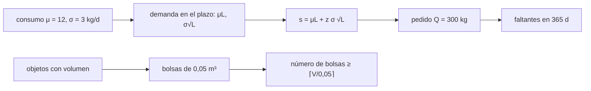

# B104-C21 — Inventario, logística y estiba a bordo

<!-- nav:top -->
[🏠 Programa](../../../../README.md) · [📚 Bloque B104](../../../tronco-comun/B104-astronautica-y-preparacion-de-astronautas.md) · [← Anterior: B104-C20 — Misión tripulada simulada](../B104-C20-mision-tripulada-simulada/CLASE.md) · [Siguiente: B104-C22 — Diseño y uso de listas de comprobación de cabina →](../B104-C22-diseno-y-uso-de-listas-de-comprobacion-de-cabina/CLASE.md)
<!-- /nav -->

## 1. Ubicación, nivel y alcance

Clase 21 del bloque B104, nivel N3 (clase añadida en la estructura `0.2.0`). Una nave tripulada consume y recibe suministros durante meses: hay que saber qué hay, cuánto queda, cuándo pedir más y dónde guardarlo. Aquí modelas el **inventario** de un consumible con plazo de reabastecimiento y variación del consumo, y la **estiba** de objetos en bolsas de volumen fijo. No repite B97-C19 (logística robótica de piezas): aquí el foco es el inventario y el volumen a bordo. Datos **sintéticos** (semilla 104).

## 2. Por qué esta clase existe

Quedarse sin un consumible a bordo no se arregla enviando a alguien a comprarlo. La decisión central: **¿con qué punto de reorden se pide para que el faltante sea raro, y cuánto volumen cuesta guardar lo pedido?**

## 3. Lo que podrás hacer al terminar

1. Calcular el punto de reorden con existencias de seguridad `μL + zσ√L`.
2. Simular un inventario con consumo variable y plazo de entrega.
3. Medir la probabilidad de faltante anual y los días de faltante.
4. Empaquetar objetos en bolsas de volumen fijo con primero el mayor que cabe.
5. Comparar el empaquetado con una cota inferior.
6. Rotular que consumo y objetos son sintéticos.

La evidencia es la **plan de inventario y estiba** del ejercicio 12 (sección 20).

## 4. Con qué llegas y cómo comprobarlo

1. ¿Qué es una existencia de seguridad?
2. ¿Qué es un plazo de entrega?
3. ¿Qué es la desviación estándar de una suma?
4. ¿Qué es una cota inferior?
5. ¿Qué es un dato sintético?

<details>
<summary>Ver respuestas</summary>

1. Una reserva para cubrir la variación de la demanda. 2. El tiempo entre pedir y recibir. 3. Para sumas independientes, `σ√n`. 4. Un valor que el óptimo no puede bajar. 5. Un dato generado para el ejemplo.
</details>

Con cuatro o cinco aciertos, sigue; si no, repasa los prerrequisitos.

## 5. Un caso de contexto y casos de referencia

Un consumible sintético con consumo medio de 12 kg/d y desviación de 3 kg/d, plazo de entrega de 14 días y pedidos de 300 kg. La demanda media durante el plazo es 168 kg y su desviación, `3√14 = 11,2 kg`. Con un punto de reorden de 168 kg el faltante ocurre en todas las repeticiones de 365 días (14,0 días de faltante en promedio); con 186,5 kg (95 % por ciclo), 88,9 % y 2,3 días; con 196,1 kg (2,5σ), 37,4 % y 0,5 días. En la estiba, 60 objetos de 1,063 m³ en total caben en 22 bolsas de 0,05 m³ (cota inferior 22; llenado de 96,6 %). Es el **ejemplo conductor**: todo es **sintético e ilustrativo**.

## 6. Vocabulario

El **punto de reorden** `s` es la existencia a la que se pide. Las **existencias de seguridad** cubren la variación. El **plazo de entrega** `L` es el tiempo hasta recibir. La **estiba** es la colocación de lo transportado. El **empaquetado en bolsas** minimiza el número de contenedores.

## 7. Modelo mental



*Descripción textual:* el consumo y el plazo definen la demanda durante la espera y con ella el punto de reorden; la simulación mide los faltantes; aparte, los objetos se empaquetan en bolsas y se compara con la cota inferior.

Analogía: la despensa de una casa en una isla: si el barco tarda dos semanas, pides cuando te quedan dos semanas de comida más un colchón. Límite: el colchón crece solo como la raíz del plazo, no como el plazo.

## 8. La explicación, paso a paso

### 8.1 Lo consultado

La página de NASA sobre la investigación en la ISS (consultada el 2026-11-10) solo indica que la estación orbita a más de 320 km y que la tripulación de la Expedición 75 es de 7 personas; no aporta datos de logística. La página de peligros de NASA indica que, a mayor distancia, es más difícil obtener suministros. Todo el modelo es sintético.

### 8.2 Punto de reorden

`s = μL + zσ√L`; con `μ = 12`, `L = 14`, `σ = 3`: `168 + 1,645 · 11,2 = 186,5 kg` para 95 % por ciclo.

### 8.3 Simulación

4 000 repeticiones de 365 días, pedido de 300 kg al caer a `s`, con un pedido a la vez:

| `s` (kg) | P(algún faltante en 365 d) | días de faltante (media) |
|---|---|---|
| 168,0 | 1,000 | 14,02 |
| 186,5 | 0,889 | 2,35 |
| 196,1 | 0,374 | 0,49 |

Un 95 % por ciclo no es un 95 % por año: hay unos 14,6 ciclos al año (`365/(300/12)`), y la existencia puede estar bajo `s` al pedir. La probabilidad anual de faltante es mucho mayor que la de un ciclo.

### 8.4 Estiba

60 objetos de 0,004 a 0,030 m³ (semilla 104). La cota inferior es `⌈1,063/0,05⌉ = 22` bolsas; el empaquetado de primero el mayor que cabe usa 22 (96,6 % de llenado), dentro de la garantía de `11/9 · óptimo + 1`.

### 8.5 Límites

Consumo normal sin tendencias, un solo consumible, sin falla del reabastecimiento, sin masa ni centro de gravedad en la estiba y sin accesibilidad. Una nave real lleva un inventario con trazabilidad de cada artículo.

## 9. Magnitudes, símbolos y unidades

| Símbolo | Qué es | Unidad | Valor / nota |
|---|---|---|---|
| `μ`, `σ` | consumo medio y desviación | kg/d | 12 y 3 |
| `L` | plazo de entrega | d | 14 |
| `Q` | tamaño del pedido | kg | 300 |
| `s` | punto de reorden | kg | 168 a 196,1 |
| bolsa | volumen | m³ | 0,05 |
| objetos | volumen total | m³ | 1,063 |

## 10. Convenciones y referencias

Consumo diario `N(12,3²)` truncado en 0; un pedido a la vez; semilla 104; 4 000 repeticiones de 365 días. Tolerancias: más existencias de seguridad, menos faltantes; empaquetado entre la cota inferior y `⌈11/9·LB⌉ + 1`; ninguna bolsa por encima de 0,05 m³. Numpy 2.4.4, Python 3.12.9.

## 11. De dónde sale lo que afirmamos

| ID | Fuente | Localizador | Respalda | Estado |
|---|---|---|---|---|
| S1 | NASA, «ISS research» — https://www.nasa.gov/missions/station/iss-research/ (consultada 2026-11-10) | página de investigación en la ISS | la estación orbita a más de 320 km y la tripulación de la Expedición 75 es de 7 personas | Consultada |
| S2 | NASA, «Human Research Program: hazards» — https://www.nasa.gov/hrp/hazards/ (consultada 2026-11-10) | página de peligros | a mayor distancia de la Tierra es más difícil obtener suministros | Consultada |
| — | Relaciones estándar usadas en el laboratorio | — | las verifica el laboratorio | No consultada en una fuente concreta (las verifica el laboratorio) |

Límites: no se consultó ningún dato de logística de la ISS; el consumo, el plazo, los pedidos y los volúmenes son sintéticos.

## 12. Cómo ver el resultado

| `s` (kg) | P(faltante en 365 d) | días de faltante |
|---|---|---|
| 168,0 | 1,000 | 14,02 |
| 186,5 | 0,889 | 2,35 |
| 196,1 | 0,374 | 0,49 |

Estiba: 22 bolsas (cota inferior 22), llenado 96,6 %. Descripción larga: subir el punto de reorden reduce el faltante, con un costo creciente de existencias.

## 13. Ejemplo trabajado: punto de reorden con 95 % por ciclo

**Paso 1 · Demanda en el plazo.** `12 · 14 = 168 kg`.

**Paso 2 · Desviación.** `3 · √14 = 11,2 kg`.

**Paso 3 · Reserva.** `1,645 · 11,2 = 18,5 kg`.

**Paso 4 · Punto de reorden.** `168 + 18,5 = 186,5 kg`.

## 14. Distintas formas de describir el problema

**Por fórmula:** `s = μL + zσ√L`. **Por tabla:** punto de reorden y faltantes. **Por cota:** `⌈V/0,05⌉`. **Por llenado:** `V/(bolsas·0,05)`.

## 15. Práctica guiada

**Ejercicio 1 · con los pasos indicados.** Calcula la demanda media en el plazo. *Pasos:* `μL`.

<details><summary>Solución comentada</summary>

`168 kg`.
</details>

**Ejercicio 2 · con una pista.** Calcula la desviación de la demanda en el plazo. *Pista:* `σ√L`.

<details><summary>Solución comentada</summary>

`3·3,742 = 11,2 kg`.
</details>

**Ejercicio 3 · casi autónomo.** Calcula `s` para 99 % por ciclo (`z = 2,326`).

<details><summary>Solución comentada</summary>

`168 + 2,326·11,2 = 194,1 kg`.
</details>

## 16. Práctica autónoma, transferencia e integrador

**Ejercicio 4 · autónomo.** ¿Cuántos días dura un pedido de 300 kg?

<details><summary>Solución comentada</summary>

`300/12 = 25 d`.
</details>

**Ejercicio 5 · autónomo.** ¿Cuántos ciclos hay en 365 días?

<details><summary>Solución comentada</summary>

`365/25 = 14,6`.
</details>

**Ejercicio 6 · autónomo.** ¿Por qué el faltante anual es mayor que el de un ciclo?

<details><summary>Solución comentada</summary>

Porque se repite en 14,6 ciclos y, al pedir, el inventario puede estar por debajo de `s`.
</details>

**Ejercicio 7 · autónomo.** Calcula la cota inferior de bolsas para 1,063 m³.

<details><summary>Solución comentada</summary>

`⌈1,063/0,05⌉ = 22`.
</details>

**Ejercicio 8 · autónomo.** Calcula el llenado con 22 bolsas.

<details><summary>Solución comentada</summary>

`1,063/(22·0,05) = 96,6 %`.
</details>

**Ejercicio 9 · transferencia.** El plazo sube a 28 días. ¿Cómo cambian `μL` y la reserva de seguridad?

<details><summary>Solución comentada</summary>

`μL = 336 kg`; la reserva `1,645·3·√28 = 26,1 kg`: crece como la raíz.
</details>

**Ejercicio 10 · transferencia.** Un artículo crítico no debe faltar nunca. ¿Qué haces además de subir `s`?

<details><summary>Solución comentada</summary>

Duplicar existencias (redundancia), repartirlas en dos lugares y reservar volumen y masa para ellas.
</details>

**Ejercicio 11 · transferencia.** La estiba debe dejar accesibles los artículos más usados. ¿Cómo modificas el empaquetado?

<details><summary>Solución comentada</summary>

Agrupar por frecuencia de uso, aceptando más bolsas a cambio de acceso rápido.
</details>

**Ejercicio 12 · integrador.** Elabora tu *plan de inventario y estiba*: consumo, plazo, punto de reorden, resultados de la simulación, empaquetado frente a la cota, límites y qué es sintético y consultado.

<details><summary>Solución comentada</summary>

Secciones 8.1–8.5 y la salida del laboratorio.
</details>

## 17. Laboratorio: punto de reorden y estiba

El script [inventario.py](inventario.py) simula 4 000 años de inventario para tres puntos de reorden y empaqueta 60 objetos en bolsas (**comprueba** que más reserva reduzca los faltantes, que el empaquetado respete su garantía y que ninguna bolsa supere su volumen). Tarda menos de 1 s.

**Datos:** consumo y objetos **sintéticos** con semilla 104; parámetros **ilustrativos**. **Predice antes de ejecutar:** ¿Cuántas bolsas de 0,05 m³ como mínimo necesitan 1,063 m³ de objetos? (22.) **Ejecución del 2026-11-10 (Python 3.12.9):**

```text
Python 3.12.9; numpy 2.4.4
DATOS SINTETICOS (semilla 104): consumo diario de un consumible con variacion; abastecimiento con plazo de 14 dias; parametros ilustrativos

Punto de reorden teorico para ~95 % sin faltante en el plazo: s = mu L + z sigma sqrt(L) = 168 + 18.5 = 186.5 kg
punto de reorden [kg] | P(algun faltante en 365 d) | dias con faltante (media)
               168.0                        1.000                     14.021
               186.5                        0.889                      2.347
               196.1                        0.374                      0.486

Estiba: 60 objetos, volumen total 1.063 m3; cota inferior 22 bolsas; empaquetado FFD usa 22 bolsas; llenado medio 96.6%
Pruebas superadas.
```

```bash
python programa/clases/B104/B104-C21-inventario-logistica-y-estiba-a-bordo/inventario.py
```

**Límites:** un consumible, consumo sin tendencia, un pedido a la vez, sin masa ni accesibilidad; no es un inventario de nave.

## 18. Errores frecuentes y cómo corregirlos

**Confundir 95 % por ciclo con 95 % por año.** Considera los ciclos (8.3).

**Olvidar la raíz del plazo.** La reserva crece con `√L` (ejercicio 9).

**Medir el llenado sin cota.** Compara con `⌈V/C⌉` (8.4).

**Presentar los datos como de una nave.** Son sintéticos (sección 10).

## 19. Cómo sabrás que vas bien

Tras la sección 8: ¿qué `s` esperabas y cuál da el cálculo? Si dudas, repasa el ejemplo 13. Tras el laboratorio: ¿qué comprueba? (ver la sección 17).

## 20. Qué entregas y cómo se evalúa

El producto es tu **plan de inventario y estiba** (ejercicio 12).

| Criterio | Inicial | En desarrollo | Logrado | Destacado |
|---|---|---|---|---|
| Conceptos | Confunde los términos | Parciales | Explica punto de reorden y reserva de seguridad | Explica por qué el faltante anual supera al del ciclo |
| Cálculo | Sin unidades | Con errores | Calcula con unidades y compara con el laboratorio | Resuelve casos nuevos |
| Numérico | Sin comprobar | Un caso | Compara con una segunda vía de cálculo | Interpreta las diferencias |
| Fuentes | Sin fuente | Sin fecha | Fuentes con fecha y estado | Declara lo sintético, lo ilustrativo y lo no consultado |
| Límites | No los nombra | Uno | Tres | Discute qué falta del modelo |

**Condiciones críticas (no se compensan con promedio):** rotular el consumo y los objetos como sintéticos, no presentar el plan como el inventario de una nave y citar solo lo consultado.

## 21. Ética, seguridad y límites

Clase educativa: **no da consejo médico, de entrenamiento individual ni operativo** y no sustituye a los requisitos, procedimientos y estándares de ninguna agencia. El plan no es el inventario de ninguna nave y no sirve para decidir logística real. Accesibilidad: tablas equivalentes a las gráficas, fórmulas en texto, ejercicios sin conexión.

## 22. Para cerrar y seguir

Con un punto de reorden de 186,5 kg, el faltante aún ocurre en el 88,9 % de los años sintéticos: 95 % por ciclo no basta. Queda una pregunta: ¿cómo se asegura la tripulación de ejecutar cada paso sin omitir ninguno?

**Glosario español–inglés.** inventario · *inventory*; punto de reorden · *reorder point*; existencias de seguridad · *safety stock*; estiba · *stowage*; plazo de entrega · *lead time*.

**Continuidad.** [B104-C22](../B104-C22-diseno-y-uso-de-listas-de-comprobacion-de-cabina/CLASE.md) estudia el diseño y el uso de listas de comprobación de cabina.

**Referencias:** ver sección 11.

<!-- nav:bottom -->
---

[← Anterior: B104-C20 — Misión tripulada simulada](../B104-C20-mision-tripulada-simulada/CLASE.md) · [📚 Bloque B104](../../../tronco-comun/B104-astronautica-y-preparacion-de-astronautas.md) · [Siguiente: B104-C22 — Diseño y uso de listas de comprobación de cabina →](../B104-C22-diseno-y-uso-de-listas-de-comprobacion-de-cabina/CLASE.md)
<!-- /nav -->
