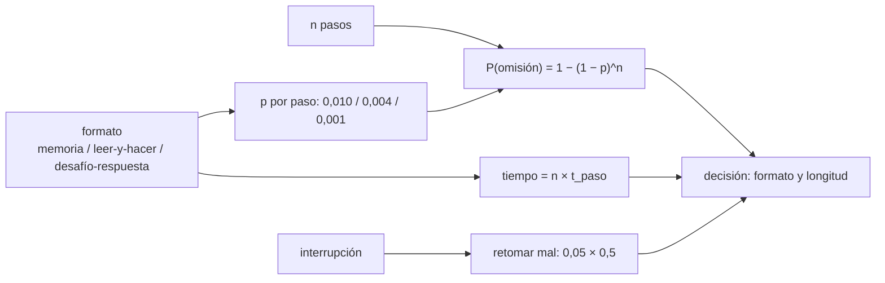

# B104-C22 — Diseño y uso de listas de comprobación de cabina

<!-- nav:top -->
[🏠 Programa](../../../../README.md) · [📚 Bloque B104](../../../tronco-comun/B104-astronautica-y-preparacion-de-astronautas.md) · [← Anterior: B104-C21 — Inventario, logística y estiba a bordo](../B104-C21-inventario-logistica-y-estiba-a-bordo/CLASE.md) · [Siguiente: B104-C23 — Ejecución de experimentos a bordo: procedimientos y registro →](../B104-C23-ejecucion-de-experimentos-a-bordo-procedimientos-y-registro/CLASE.md)
<!-- /nav -->

## 1. Ubicación, nivel y alcance

Clase 22 del bloque B104, nivel N3 (clase añadida en la estructura `0.2.0`). B104-C06 trata el entrenamiento de procedimientos en general; esta clase se centra en la **lista de comprobación de cabina**: cómo se diseña, cómo se ejecuta y cómo se verifica que cumple su función. Comparas tres formatos de ejecución (de memoria, leer y hacer, desafío y respuesta) por su probabilidad de omitir un paso y por su costo en tiempo, con **probabilidades ilustrativas**.

## 2. Por qué esta clase existe

Una lista larga con verificación a cada paso consume tiempo justo cuando hay poco. La decisión central: **¿qué formato y qué longitud de lista dan la menor probabilidad de omisión que el tiempo disponible permita, y qué hace una interrupción con todo eso?**

## 3. Lo que podrás hacer al terminar

1. Calcular la probabilidad de omitir al menos un paso en una lista de `n` pasos.
2. Comparar tres formatos de ejecución por probabilidad y por tiempo.
3. Estimar el efecto de acortar la lista a los elementos críticos.
4. Estimar el efecto de una interrupción.
5. Verificar la fórmula con una simulación.
6. Rotular que las probabilidades son ilustrativas y no medidas.

La evidencia es la **evaluación comparada de formatos de lista** del ejercicio 12 (sección 20).

## 4. Con qué llegas y cómo comprobarlo

1. ¿Qué es una lista de comprobación?
2. ¿Qué es la probabilidad del complemento?
3. ¿Qué es la independencia?
4. ¿Qué es una interrupción?
5. ¿Qué es un modelo ilustrativo?

<details>
<summary>Ver respuestas</summary>

1. Una secuencia de pasos que se verifican uno a uno. 2. `1 − p`. 3. Que un suceso no cambia la probabilidad de otro. 4. Una pausa que corta una tarea. 5. Uno con parámetros inventados.
</details>

Con cuatro o cinco aciertos, sigue; si no, repasa los prerrequisitos.

## 5. Un caso de contexto y casos de referencia

El informe NASA CR-177549 de Degani y Wiener (1991; consultado el 2026-11-10, solo el resumen) señala que la lista de comprobación se considera el fundamento de la estandarización y la seguridad en cabina, que ha recibido poco estudio de factores humanos y que su mal uso o no uso se cita a menudo como causa o factor contribuyente de accidentes; examina su propósito, formato, diseño, longitud y uso, y cierra con directrices de diseño. Con probabilidades ilustrativas de omisión por paso de 0,010 de memoria, 0,004 leyendo y haciendo y 0,001 con desafío y respuesta, una lista de 10 pasos falla con 0,0956, 0,0393 y 0,0100; una de 40 pasos, con 0,3310, 0,1481 y 0,0392, a costa de 160, 280 y 480 s. Es el **ejemplo conductor**: probabilidades y tiempos son **sintéticos e ilustrativos**.

## 6. Vocabulario

La **lista de comprobación** es una secuencia verificable de pasos. **Leer y hacer** (*read-do*) es leer cada paso y ejecutarlo. **Desafío y respuesta** (*challenge-response*) es que uno lee y otro verifica y responde. La **omisión** es no ejecutar un paso. La **interrupción** corta la secuencia y puede hacer retomar mal.

## 7. Modelo mental



*Descripción textual:* el formato fija la probabilidad de omitir un paso y el tiempo por paso; con la longitud de la lista dan la probabilidad de omisión y el tiempo total; las interrupciones añaden un riesgo propio; todo informa la decisión.

Analogía: verificar las puertas de una casa antes de salir: de memoria es rápido y falla más; revisarlas una a una con alguien que confirma es lento y casi no falla. Límite: en cabina la lista se usa bajo presión de tiempo y distracción.

## 8. La explicación, paso a paso

### 8.1 Lo consultado

Solo el resumen de Degani y Wiener (NTRS, 1991): la lista de comprobación es el fundamento de la estandarización y de la seguridad en cabina; recibió poco estudio de factores humanos; su mal uso o su no uso se cita como causa o factor de accidentes; el informe analiza propósito, formato, diseño, longitud y uso, el desarrollo desde la certificación hasta el cliente, el papel de las autoridades, fabricantes y compañías, y propone directrices de diseño. El informe completo y sus conclusiones **no se consultaron**.

### 8.2 Probabilidad de omisión

`P = 1 − (1 − p)^n`. Con `n = 10`: 0,0956 de memoria, 0,0393 leyendo y haciendo, 0,0100 con desafío y respuesta. Con `n = 40`: 0,3310, 0,1481 y 0,0392.

### 8.3 Tabla y tiempo

| formato | `n` | P fórmula | P Monte Carlo | tiempo (s) |
|---|---|---|---|---|
| de memoria | 10 | 0,0956 | 0,0967 | 40 |
| leer y hacer | 10 | 0,0393 | 0,0389 | 70 |
| desafío y respuesta | 10 | 0,0100 | 0,0096 | 120 |
| de memoria | 40 | 0,3310 | 0,3297 | 160 |
| leer y hacer | 40 | 0,1481 | 0,1484 | 280 |
| desafío y respuesta | 40 | 0,0392 | 0,0392 | 480 |

La simulación (400 000 listas por fila) coincide con la fórmula en menos de 0,004.

### 8.4 Longitud e interrupciones

Pasar de 40 pasos de memoria (0,331) a solo los 10 críticos con desafío y respuesta (0,0100) reduce la omisión en un factor de 33 y el tiempo de 160 a 120 s. Una interrupción con probabilidad 0,05 y 50 % de retomar mal agrega 0,025 de omisión: comparable con la de leer y hacer con 10 pasos (0,0393). Marcar el último paso hecho es una medida de diseño.

### 8.5 Límites

Probabilidades inventadas, errores independientes, sin gravedad distinta por paso, sin presión de tiempo ni estrés, y sin los demás tipos de error (por ejemplo, ejecutar mal un paso). Una lista real se valida con ensayos de tripulaciones.

## 9. Magnitudes, símbolos y unidades

| Símbolo | Qué es | Unidad | Valor / nota |
|---|---|---|---|
| `p` | omisión por paso | — | 0,010 / 0,004 / 0,001 |
| `n` | pasos de la lista | — | 10 y 40 |
| `t_paso` | tiempo por paso | s | 4 / 7 / 12 |
| `P` | omisión de al menos un paso | — | 0,0100 a 0,3310 |
| `p_int`, `p_mal` | interrupción y retomar mal | — | 0,05 y 0,5 |

## 10. Convenciones y referencias

Pasos independientes, errores solo de omisión, probabilidades por paso fijas; semilla 104 con 400 000 listas por fila. Tolerancias: |fórmula − Monte Carlo| < 0,004; omisión decreciente de memoria a leer-y-hacer a desafío-respuesta. Numpy 2.4.4, Python 3.12.9.

## 11. De dónde sale lo que afirmamos

| ID | Fuente | Localizador | Respalda | Estado |
|---|---|---|---|---|
| S1 | Degani y Wiener, *Human factors of flight-deck checklists: the normal checklist*, NASA CR-177549, 1991 — https://ntrs.nasa.gov/citations/19910017830 (consultada 2026-11-10; solo el resumen) | resumen del informe | la lista de comprobación como fundamento de estandarización y seguridad; poco estudio de factores humanos; mal uso o no uso como factor de accidentes; análisis de propósito, formato, diseño, longitud y uso; directrices de diseño | Consultada |
| — | Relaciones estándar usadas en el laboratorio | — | las verifica el laboratorio | No consultada en una fuente concreta (las verifica el laboratorio) |

Límites: el informe es de aviación comercial y solo se leyó el resumen; las probabilidades de omisión, los tiempos por paso y el efecto de las interrupciones son inventados; no se consultó ninguna lista de cabina de nave espacial.

## 12. Cómo ver el resultado

| formato | `n` | P(omisión) | tiempo (s) |
|---|---|---|---|
| de memoria | 40 | 0,3310 | 160 |
| leer y hacer | 40 | 0,1481 | 280 |
| desafío y respuesta | 40 | 0,0392 | 480 |
| desafío y respuesta | 10 | 0,0100 | 120 |

Descripción larga: acortar la lista a los pasos críticos reduce la omisión más que mejorar el formato de una lista larga.

## 13. Ejemplo trabajado: omisión de una lista de 10 pasos de memoria

**Paso 1 · Probabilidad de no omitir un paso.** `1 − 0,010 = 0,990`.

**Paso 2 · Los 10.** `0,990¹⁰ = 0,9044`.

**Paso 3 · Al menos una omisión.** `1 − 0,9044 = 0,0956`.

## 14. Distintas formas de describir el problema

**Por fórmula:** `1 − (1 − p)^n`. **Por tabla:** formato, longitud y probabilidad. **Por costo:** `n·t_paso`. **Por decisión:** menor omisión con el tiempo disponible.

## 15. Práctica guiada

**Ejercicio 1 · con los pasos indicados.** Calcula la omisión de 10 pasos leyendo y haciendo (`p = 0,004`). *Pasos:* `1 − 0,996¹⁰`.

<details><summary>Solución comentada</summary>

`0,0393`.
</details>

**Ejercicio 2 · con una pista.** ¿Cuánto dura una lista de 40 pasos con desafío y respuesta? *Pista:* `n·12`.

<details><summary>Solución comentada</summary>

`480 s = 8 min`.
</details>

**Ejercicio 3 · casi autónomo.** Calcula la omisión de 40 pasos de memoria.

<details><summary>Solución comentada</summary>

`1 − 0,99⁴⁰ = 0,331`.
</details>

## 16. Práctica autónoma, transferencia e integrador

**Ejercicio 4 · autónomo.** ¿Cuántas veces mayor es la omisión de memoria que con desafío y respuesta con 40 pasos?

<details><summary>Solución comentada</summary>

`0,331/0,0392 = 8,4`.
</details>

**Ejercicio 5 · autónomo.** ¿Cuánto tiempo extra cuesta el desafío y respuesta frente a leer y hacer con 40 pasos?

<details><summary>Solución comentada</summary>

`480 − 280 = 200 s`.
</details>

**Ejercicio 6 · autónomo.** ¿Cuánta omisión añade una interrupción con `p_int = 0,05` y `p_mal = 0,5`?

<details><summary>Solución comentada</summary>

`0,025`.
</details>

**Ejercicio 7 · autónomo.** ¿Qué ventaja tiene reducir la lista a 10 pasos críticos?

<details><summary>Solución comentada</summary>

Baja la omisión (0,0100) y el tiempo (120 s).
</details>

**Ejercicio 8 · autónomo.** ¿Qué diferencia hay entre una omisión y un paso mal ejecutado?

<details><summary>Solución comentada</summary>

La omisión es no ejecutarlo; mal ejecutado se hace pero con error; el modelo solo cuenta omisiones.
</details>

**Ejercicio 9 · transferencia.** Una emergencia da 5 min (300 s). ¿Qué formato elegirías para una lista de 40 pasos?

<details><summary>Solución comentada</summary>

Leer y hacer (280 s); el desafío y respuesta (480 s) no cabe, así que se acortaría la lista a los pasos críticos.
</details>

**Ejercicio 10 · transferencia.** ¿Cómo diseñarías la lista para resistir las interrupciones?

<details><summary>Solución comentada</summary>

Con marca del último paso hecho, pasos numerados y un punto de reinicio seguro; se valida con ensayos con interrupciones.
</details>

**Ejercicio 11 · transferencia.** Un estudio muestra `p = 0,02` por paso con una lista mal diseñada. ¿Qué pasa con 10 pasos?

<details><summary>Solución comentada</summary>

`1 − 0,98¹⁰ = 0,183`: casi el doble que de memoria; el formato no compensa un mal diseño.
</details>

**Ejercicio 12 · integrador.** Elabora tu *evaluación comparada de formatos de lista*: tabla de omisión y tiempo para dos longitudes, efecto de una interrupción, una recomendación con el tiempo disponible, límites y qué es ilustrativo y consultado.

<details><summary>Solución comentada</summary>

Secciones 8.1–8.5 y la salida del laboratorio.
</details>

## 17. Laboratorio: formatos de lista y probabilidad de omisión

El script [listas.py](listas.py) calcula y simula la omisión de listas de 10 y 40 pasos con tres formatos y estima el efecto de una interrupción (**comprueba** la fórmula frente a Monte Carlo y el orden de los formatos). Tarda menos de 1 s.

**Datos:** probabilidades y tiempos **ilustrativos** con semilla 104. **Predice antes de ejecutar:** ¿Cuál es la probabilidad de omitir al menos un paso en 40 pasos de memoria con `p = 0,01`? (Cerca de 0,33.) **Ejecución del 2026-11-10 (Python 3.12.9):**

```text
Python 3.12.9; numpy 2.4.4
MODELO ILUSTRATIVO (semilla 104): p de omitir un paso = 0,01 de memoria; 0,004 leer-y-hacer; 0,001 desafio-respuesta; tiempos por paso inventados

formato | pasos | P(al menos una omision) formula | Monte Carlo | tiempo de la lista [s]
de memoria              10                       0.0956       0.0967                 40
leer y hacer            10                       0.0393       0.0389                 70
desafio y respuesta     10                       0.0100       0.0096                120
de memoria              40                       0.3310       0.3297                160
leer y hacer            40                       0.1481       0.1484                280
desafio y respuesta     40                       0.0392       0.0392                480

Interrupcion (p = 0.05, retomar mal = 0.5): P(omision por interrupcion) = 0.0250; comparable con la de leer-y-hacer con 10 pasos (0.0393)
Lista de 40 pasos de memoria: 0.331; solo 10 criticos con desafio-respuesta: 0.0100
Pruebas superadas.
```

```bash
python programa/clases/B104/B104-C22-diseno-y-uso-de-listas-de-comprobacion-de-cabina/listas.py
```

**Límites:** solo omisiones independientes, probabilidades inventadas, sin estrés ni presión de tiempo; no valida ninguna lista de nave.

## 18. Errores frecuentes y cómo corregirlos

**Creer que una lista larga siempre es más segura.** Evalúa la longitud y el tiempo (8.4).

**Ignorar las interrupciones.** Incluye su efecto (8.4).

**Usar la misma `p` para todo formato.** Compara formatos (8.3).

**Presentar las probabilidades como medidas.** Son ilustrativas (sección 10).

## 19. Cómo sabrás que vas bien

Tras la sección 8: ¿qué omisión esperabas con 40 pasos leyendo y haciendo y cuál da la tabla? Si dudas, repasa el ejemplo 13. Tras el laboratorio: ¿qué comprueba? (ver la sección 17).

## 20. Qué entregas y cómo se evalúa

El producto es tu **evaluación comparada de formatos de lista** (ejercicio 12).

| Criterio | Inicial | En desarrollo | Logrado | Destacado |
|---|---|---|---|---|
| Conceptos | Confunde los términos | Parciales | Explica omisión, formato y longitud | Explica el compromiso entre seguridad y tiempo |
| Cálculo | Sin unidades | Con errores | Calcula con unidades y compara con el laboratorio | Resuelve casos nuevos |
| Numérico | Sin comprobar | Un caso | Compara con una segunda vía de cálculo | Interpreta las diferencias |
| Fuentes | Sin fuente | Sin fecha | Fuentes con fecha y estado | Declara lo sintético, lo ilustrativo y lo no consultado |
| Límites | No los nombra | Uno | Tres | Discute qué falta del modelo |

**Condiciones críticas (no se compensan con promedio):** rotular las probabilidades como ilustrativas, no presentar el modelo como validación de una lista de nave ni consejo operativo y citar solo lo consultado.

## 21. Ética, seguridad y límites

Clase educativa: **no da consejo médico, de entrenamiento individual ni operativo** y no sustituye a los requisitos, procedimientos y estándares de ninguna agencia. El modelo no valida ninguna lista de comprobación real: estas se prueban con tripulaciones y la agencia. Accesibilidad: tablas equivalentes a las gráficas, fórmulas en texto, ejercicios sin conexión.

## 22. Para cerrar y seguir

Con `p = 0,001` por paso, una lista de 40 pasos con desafío y respuesta omite al menos uno el 3,9 % de las veces y tarda 8 min; la de 10 pasos críticos, el 1,0 % y 2 min. Queda una pregunta: ¿cómo se ejecuta y registra el trabajo científico a bordo?

**Glosario español–inglés.** lista de comprobación · *checklist*; leer y hacer · *read-do*; desafío y respuesta · *challenge-response*; omisión · *omission*; interrupción · *interruption*.

**Continuidad.** [B104-C23](../B104-C23-ejecucion-de-experimentos-a-bordo-procedimientos-y-registro/CLASE.md) trata la ejecución de experimentos a bordo y el registro íntegro de los datos.

**Referencias:** ver sección 11.

<!-- nav:bottom -->
---

[← Anterior: B104-C21 — Inventario, logística y estiba a bordo](../B104-C21-inventario-logistica-y-estiba-a-bordo/CLASE.md) · [📚 Bloque B104](../../../tronco-comun/B104-astronautica-y-preparacion-de-astronautas.md) · [Siguiente: B104-C23 — Ejecución de experimentos a bordo: procedimientos y registro →](../B104-C23-ejecucion-de-experimentos-a-bordo-procedimientos-y-registro/CLASE.md)
<!-- /nav -->
