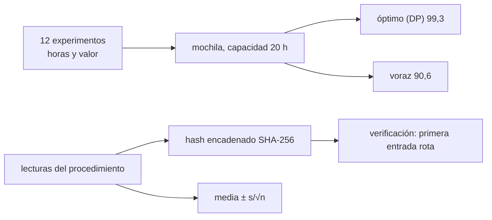

# B104-C23 — Ejecución de experimentos a bordo: procedimientos y registro

<!-- nav:top -->
[🏠 Programa](../../../../README.md) · [📚 Bloque B104](../../../tronco-comun/B104-astronautica-y-preparacion-de-astronautas.md) · [← Anterior: B104-C22 — Diseño y uso de listas de comprobación de cabina](../B104-C22-diseno-y-uso-de-listas-de-comprobacion-de-cabina/CLASE.md) · [Siguiente: B105-C01 — Respuesta cardiovascular a microgravedad →](../../../tronco-comun/B105-medicina-y-biologia-espacial.md#b105-c01)
<!-- /nav -->

## 1. Ubicación, nivel y alcance

Clase 23 del bloque B104, nivel N3 (clase añadida en la estructura `0.2.0`). B96-C10 planifica cargas útiles desde tierra; esta clase trata lo que hace la tripulación a bordo: **repartir las horas** entre experimentos, **ejecutar** un procedimiento y **registrar** lo hecho de forma que el dato sea íntegro y reproducible. Usas una mochila para asignar horas por valor, y un registro encadenado con hash para detectar ediciones. Todo es **sintético** (semilla 104).

## 2. Por qué esta clase existe

Las horas de tripulación son escasas y un dato sin registro fiable vale poco. La decisión central: **¿cómo repartir 20 horas entre experimentos para maximizar el valor y cómo asegurar que el registro de lo medido no se altere sin que se note?**

## 3. Lo que podrás hacer al terminar

1. Plantear la asignación de horas como un problema de mochila.
2. Resolverla exactamente con programación dinámica y compararla con una regla voraz.
3. Calcular la brecha de la regla voraz.
4. Construir un registro encadenado con SHA-256 y verificar su integridad.
5. Detectar la primera entrada editada.
6. Reportar una medición repetida con media, desviación e incertidumbre de la media.

La evidencia es la **plan de horas y registro íntegro** del ejercicio 12 (sección 20).

## 4. Con qué llegas y cómo comprobarlo

1. ¿Qué es un problema de mochila?
2. ¿Qué es una función hash?
3. ¿Qué es una desviación estándar muestral?
4. ¿Qué es la incertidumbre de la media?
5. ¿Qué es un dato sintético?

<details>
<summary>Ver respuestas</summary>

1. Elegir objetos con peso y valor para maximizar el valor sin pasar una capacidad. 2. Una función que da una huella de longitud fija de un texto. 3. Dispersión de una muestra con divisor `n − 1`. 4. `s/√n`. 5. Un dato generado para el ejemplo.
</details>

Con cuatro o cinco aciertos, sigue; si no, repasa los prerrequisitos.

## 5. Un caso de contexto y casos de referencia

Doce experimentos ficticios con horas de 2 a 8 y valor científico inventado; la capacidad es de 20 horas. La programación dinámica da un valor de 99,3 con los experimentos 0, 3, 5, 6 y 7 (20 h); la regla voraz por valor/hora da 90,6 con los experimentos 2, 3, 5, 6 y 7 (18 h): una brecha de 8,8 %. Un registro de cinco entradas con hash encadenado se verifica íntegro y, tras editar la entrada 2, se detecta la rotura en esa entrada. Cinco lecturas sintéticas dan media 5,0203, desviación 0,0477 e incertidumbre de la media 0,0213. Es el **ejemplo conductor**: todo es **sintético**.

## 6. Vocabulario

La **mochila** es el problema de elegir con una capacidad. La **programación dinámica** lo resuelve exactamente. Una **regla voraz** elige por una razón local. Un **hash encadenado** liga cada entrada a la anterior. La **incertidumbre de la media** `s/√n` resume la repetición de una medición.

## 7. Modelo mental



*Descripción textual:* los experimentos se asignan a las horas disponibles con una solución exacta y una voraz; las lecturas se registran en una cadena de hash que permite detectar ediciones y se resumen con su incertidumbre.

Analogía: llenar una maleta con límite de peso y llevar un cuaderno con las páginas numeradas y selladas: si alguien arranca o cambia una página, se nota. Límite: el hash detecta cambios, no garantiza que lo escrito sea verdad.

## 8. La explicación, paso a paso

### 8.1 Lo consultado

La página de investigación de NASA en la ISS (consultada el 2026-11-10) no entrega datos de horas de tripulación ni cantidad de experimentos; remite a una base de datos de investigaciones. Por eso las horas, los valores y los experimentos de la clase son sintéticos.

### 8.2 Asignación de horas

Con la tabla sintética (valor = `U(1,10) · horas^0,7`), el óptimo exacto selecciona 0, 3, 5, 6 y 7 (6 + 6 + 3 + 3 + 2 = 20 h) con valor 99,3. La regla voraz por valor/hora elige 2, 3, 5, 6 y 7 (4 + 6 + 3 + 3 + 2 = 18 h) con 90,6, y deja 2 h sin usar. La brecha de 8,8 % muestra que la razón valor/hora no basta cuando la capacidad es ajustada.

### 8.3 Registro encadenado

Cada entrada guarda `h_i = SHA-256(h_{i−1} + texto_i)`. Verificar es recalcular desde el inicio. Tras cambiar el texto de la entrada 2 sin rehacer la cadena, la verificación falla en la entrada 2 (cualquier cambio posterior también se detectaría). El hash no impide editar ni garantiza la veracidad; da evidencia de alteración.

### 8.4 Medición repetida

Cinco lecturas sintéticas de 5,00 ± 0,05: media 5,0203; desviación muestral 0,0477; incertidumbre de la media `0,0477/√5 = 0,0213`. Se registra con su unidad y su incertidumbre, nunca solo el promedio.

### 8.5 Límites

Valores y horas inventados, sin dependencias entre experimentos, sin prioridades de tierra, sin reprogramación por fallas, un solo operador y un hash sin firma ni marca de tiempo. En una operación real, el registro sigue los procedimientos de la agencia.

## 9. Magnitudes, símbolos y unidades

| Símbolo | Qué es | Unidad | Valor / nota |
|---|---|---|---|
| capacidad | horas de tripulación | h | 20 |
| horas | por experimento | h | 2 a 8 |
| valor | científico inventado | u. a. | 3,4 a 29,5 |
| `h_i` | hash de la entrada `i` | hex de 64 caracteres | SHA-256 |
| `s/√n` | incertidumbre de la media | unidad de la lectura | 0,0213 |

## 10. Convenciones y referencias

Horas enteras; valores en unidades arbitrarias; hash SHA-256 con el hash anterior como prefijo; semilla 104. Tolerancias: el óptimo exacto no es menor que el voraz; ambos respetan las 20 h; la cadena íntegra verifica con −1 y la editada con el índice 2. Numpy 2.4.4, Python 3.12.9.

## 11. De dónde sale lo que afirmamos

| ID | Fuente | Localizador | Respalda | Estado |
|---|---|---|---|---|
| S1 | NASA, «ISS research» — https://www.nasa.gov/missions/station/iss-research/ (consultada 2026-11-10) | página de investigación en la ISS | la página remite a una base de datos de experimentos y no da cifras de horas de tripulación | Consultada |
| — | Relaciones estándar usadas en el laboratorio | — | las verifica el laboratorio | No consultada en una fuente concreta (las verifica el laboratorio) |

Límites: no se consultó ningún dato de horas de tripulación ni de experimentos de la ISS; SHA-256 y la programación dinámica son estándar y verificados por el laboratorio, sin consultar sus especificaciones.

## 12. Cómo ver el resultado

| método | valor | experimentos | horas |
|---|---|---|---|
| óptimo (programación dinámica) | 99,3 | 0, 3, 5, 6, 7 | 20 |
| voraz por valor/hora | 90,6 | 2, 3, 5, 6, 7 | 18 |

Brecha del voraz: 8,8 %. Registro: íntegro (−1); tras editar la entrada 2, primera rotura en 2. Descripción larga: la solución exacta usa todas las horas y gana 8,7 puntos de valor.

## 13. Ejemplo trabajado: incertidumbre de la media de cinco lecturas

**Paso 1 · Media.** `5,0203`.

**Paso 2 · Desviación muestral.** `0,0477` (divisor `n − 1 = 4`).

**Paso 3 · Incertidumbre de la media.** `0,0477/√5 = 0,0213`.

**Paso 4 · Registro.** `5,020 ± 0,021` unidades (1σ).

## 14. Distintas formas de describir el problema

**Por tabla:** horas y valor. **Por método:** exacto frente a voraz. **Por hash:** `h_i`. **Por medición:** media ± `s/√n`.

## 15. Práctica guiada

**Ejercicio 1 · con los pasos indicados.** Suma el valor del conjunto óptimo (26,7; 29,5; 12,6; 16,8; 13,7). *Pasos:* suma.

<details><summary>Solución comentada</summary>

`99,3`.
</details>

**Ejercicio 2 · con una pista.** Suma las horas del conjunto voraz (4, 6, 3, 3, 2). *Pista:* suma.

<details><summary>Solución comentada</summary>

`18 h`.
</details>

**Ejercicio 3 · casi autónomo.** Calcula la brecha del voraz respecto del óptimo.

<details><summary>Solución comentada</summary>

`(99,3 − 90,6)/99,3 = 8,8 %`.
</details>

## 16. Práctica autónoma, transferencia e integrador

**Ejercicio 4 · autónomo.** ¿Por qué el voraz deja 2 horas sin usar?

<details><summary>Solución comentada</summary>

Porque ya no cabe ningún experimento restante con esas horas por su regla de orden.
</details>

**Ejercicio 5 · autónomo.** ¿Qué indica «−1» en la verificación?

<details><summary>Solución comentada</summary>

Que ninguna entrada está rota.
</details>

**Ejercicio 6 · autónomo.** ¿Por qué editar la entrada 2 rompe esa y las posteriores?

<details><summary>Solución comentada</summary>

Porque `h_2` cambia y las siguientes lo usan como prefijo.
</details>

**Ejercicio 7 · autónomo.** Calcula `s/√n` con `s = 0,0477` y `n = 5`.

<details><summary>Solución comentada</summary>

`0,0213`.
</details>

**Ejercicio 8 · autónomo.** ¿Qué no garantiza un hash encadenado?

<details><summary>Solución comentada</summary>

Que lo registrado sea verdadero ni quién lo escribió; solo que no se alteró después.
</details>

**Ejercicio 9 · transferencia.** Un experimento nuevo exige 4 h y vale 15. ¿Cómo lo evalúas?

<details><summary>Solución comentada</summary>

Valor/hora de 3,75; se compara con el óptimo recalculando la mochila con 13 elementos.
</details>

**Ejercicio 10 · transferencia.** Las horas de tierra cambian y hay que reprogramar. ¿Qué extiendes en el modelo?

<details><summary>Solución comentada</summary>

Prioridades y dependencias entre experimentos, y reasignar con la capacidad restante.
</details>

**Ejercicio 11 · transferencia.** Un compañero corrige una lectura mal anotada. ¿Cómo lo registras sin romper la cadena?

<details><summary>Solución comentada</summary>

Con una nueva entrada de corrección que referencia la original, sin editar la anterior.
</details>

**Ejercicio 12 · integrador.** Elabora tu *plan de horas y registro íntegro*: tabla de experimentos, óptimo y voraz, registro con hash, medición con incertidumbre, límites y qué es sintético y consultado.

<details><summary>Solución comentada</summary>

Secciones 8.1–8.5 y la salida del laboratorio.
</details>

## 17. Laboratorio: horas de tripulación y registro encadenado

El script [experimentos.py](experimentos.py) resuelve la mochila de 12 experimentos con programación dinámica y con una regla voraz, construye un registro encadenado con SHA-256 y calcula la incertidumbre de la media (**comprueba** que el óptimo no sea menor que el voraz, las 20 h y la detección de la edición). Tarda menos de 1 s.

**Datos:** experimentos y lecturas **sintéticos** con semilla 104; horas y valores **ilustrativos**. **Predice antes de ejecutar:** ¿Cuánto mejora el óptimo exacto al voraz en este ejemplo? (Alrededor de 9 %.) **Ejecución del 2026-11-10 (Python 3.12.9):**

```text
Python 3.12.9; numpy 2.4.4
DATOS SINTETICOS (semilla 104): 12 experimentos ficticios con horas de tripulacion y valor cientifico inventado; capacidad 20 h

experimento | horas | valor | valor por hora
          0     6   26.7           4.45
          1     7   18.4           2.63
          2     4   18.0           4.50
          3     6   29.5           4.92
          4     3    3.4           1.13
          5     3   12.6           4.20
          6     3   16.8           5.60
          7     2   13.7           6.85
          8     6   10.4           1.73
          9     4   14.1           3.52
         10     3    9.3           3.10
         11     7   13.2           1.89

Optimo (programacion dinamica): valor 99.3; experimentos [0, 3, 5, 6, 7]; horas 20
Voraz por valor/hora:           valor 90.6; experimentos [2, 3, 5, 6, 7]; horas 18
Brecha del voraz respecto del optimo: 8.8 %

Registro de 5 entradas; primer hash 027429d448653d8e...; ultimo d0c563bf4d255074...
Verificacion de la cadena integra: primera entrada rota = -1 (-1 = sin rotura)
Tras editar la entrada 2: primera entrada rota = 2
Lecturas: media 5.0203; desviacion tipica muestral 0.0477; incertidumbre de la media 0.0213
Pruebas superadas.
```

```bash
python programa/clases/B104/B104-C23-ejecucion-de-experimentos-a-bordo-procedimientos-y-registro/experimentos.py
```

**Límites:** sin dependencias entre experimentos, sin reprogramación, hash sin firma ni marca de tiempo; no describe experimentos reales.

## 18. Errores frecuentes y cómo corregirlos

**Elegir solo por valor/hora.** Resuelve la mochila (8.2).

**Editar un registro sin dejar rastro.** Añade una corrección (ejercicio 11).

**Reportar solo el promedio.** Incluye la incertidumbre (8.4).

**Creer que el hash garantiza veracidad.** Solo detecta alteraciones (8.3).

## 19. Cómo sabrás que vas bien

Tras la sección 8: ¿qué valor esperabas del óptimo y cuál da la tabla? Si dudas, repasa el ejemplo 13. Tras el laboratorio: ¿qué comprueba? (ver la sección 17).

## 20. Qué entregas y cómo se evalúa

El producto es tu **plan de horas y registro íntegro** (ejercicio 12).

| Criterio | Inicial | En desarrollo | Logrado | Destacado |
|---|---|---|---|---|
| Conceptos | Confunde los términos | Parciales | Explica mochila, hash encadenado e incertidumbre | Explica los límites del hash |
| Cálculo | Sin unidades | Con errores | Calcula con unidades y compara con el laboratorio | Resuelve casos nuevos |
| Numérico | Sin comprobar | Un caso | Compara con una segunda vía de cálculo | Interpreta las diferencias |
| Fuentes | Sin fuente | Sin fecha | Fuentes con fecha y estado | Declara lo sintético, lo ilustrativo y lo no consultado |
| Límites | No los nombra | Uno | Tres | Discute qué falta del modelo |

**Condiciones críticas (no se compensan con promedio):** rotular experimentos, horas y lecturas como sintéticos, no presentarlos como experimentos reales ni como consejo operativo y citar solo lo consultado.

## 21. Ética, seguridad y límites

Clase educativa: **no da consejo médico, de entrenamiento individual ni operativo** y no sustituye a los requisitos, procedimientos y estándares de ninguna agencia. El plan no es la programación de ningún experimento real y el registro de ejemplo no sustituye a los procedimientos de la agencia. Accesibilidad: tablas equivalentes a las gráficas, fórmulas en texto, ejercicios sin conexión.

## 22. Para cerrar y seguir

Con 20 h, el reparto exacto da un valor de 99,3 frente a 90,6 del voraz, y la cadena de hash delata una edición en la entrada 2. Con esto se cierra el bloque: de la historia de los vuelos al registro de un experimento a bordo, siempre con sus límites declarados.

**Glosario español–inglés.** mochila · *knapsack*; programación dinámica · *dynamic programming*; registro · *log*; función hash · *hash function*; incertidumbre de la media · *standard error of the mean*.

**Continuidad.** Con esta clase se cierra el bloque B104. La guía del bloque resume el recorrido completo.

**Referencias:** ver sección 11.

<!-- nav:bottom -->
---

[← Anterior: B104-C22 — Diseño y uso de listas de comprobación de cabina](../B104-C22-diseno-y-uso-de-listas-de-comprobacion-de-cabina/CLASE.md) · [📚 Bloque B104](../../../tronco-comun/B104-astronautica-y-preparacion-de-astronautas.md) · [Siguiente: B105-C01 — Respuesta cardiovascular a microgravedad →](../../../tronco-comun/B105-medicina-y-biologia-espacial.md#b105-c01)
<!-- /nav -->
