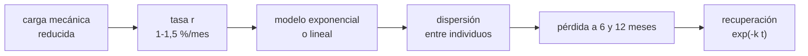

# B105-C02 — Pérdida de masa ósea

<!-- nav:top -->
[🏠 Programa](../../../../README.md) · [📚 Bloque B105](../../../tronco-comun/B105-medicina-y-biologia-espacial.md) · [← Anterior: B105-C01 — Respuesta cardiovascular a microgravedad](../B105-C01-respuesta-cardiovascular-a-microgravedad/CLASE.md) · [Siguiente: B105-C03 — Atrofia muscular →](../B105-C03-atrofia-muscular/CLASE.md)
<!-- /nav -->

## 1. Ubicación, nivel y alcance

Clase 2 del bloque B105. Nivel N3. Los huesos que soportan peso pierden densidad mineral en microgravedad porque desaparece buena parte de la carga mecánica. Aquí usas una tasa mensual publicada como entrada de un modelo exponencial, lo comparas con uno lineal, propagas la variación entre individuos (sintéticos) y modelas una recuperación posvuelo. La carga mecánica vuelve en [B105-C16](../B105-C16-contramedidas-de-ejercicio/CLASE.md) y la rehabilitación en [B105-C17](../B105-C17-rehabilitacion-posterior-al-vuelo/CLASE.md).

## 2. Por qué esta clase existe

Un porcentaje por mes parece simple, pero hay que decidir **cómo se acumula** (lineal o exponencial), **para quién vale** (promedio o individuo) y **qué recupera el cuerpo al volver**. La decisión central: **¿qué pérdida esperar a 6 y 12 meses, con qué dispersión y qué parte se recupera?**

## 3. Lo que podrás hacer al terminar

1. Calcular la pérdida acumulada con un modelo exponencial y uno lineal para una tasa mensual dada.
2. Explicar por qué una tasa promedio no describe a un individuo y cuantificar la dispersión.
3. Modelar la recuperación posvuelo con una semivida y calcular el tiempo hasta recuperar un porcentaje.
4. Expresar una pérdida en unidades de desviación estándar poblacional.
5. Rotular qué cifra es consultada (la tasa), qué es modelo y qué es sintético.
6. Reconocer que esto no es diagnóstico ni criterio de aptitud.

La evidencia es la **ficha de pérdida ósea con intervalo por tasa** del ejercicio 12 (sección 20).

## 4. Con qué llegas y cómo comprobarlo

1. ¿Qué es la densidad mineral ósea (BMD)?
2. ¿Qué es un cambio exponencial?
3. ¿Qué es una semivida?
4. ¿Qué es una desviación estándar?
5. ¿Qué es un dato sintético?

<details>
<summary>Ver respuestas</summary>

1. La masa de mineral por unidad de área (g/cm²) medida en un hueso. 2. Uno en que cada periodo multiplica el valor por un factor constante. 3. El tiempo en que una cantidad se reduce a la mitad. 4. Una medida de la dispersión de los datos alrededor de su media. 5. Un dato generado para el ejemplo, no medido.
</details>

Con cuatro o cinco aciertos, sigue; si no, repasa los prerrequisitos.

## 5. Un caso de contexto y casos de referencia

La NASA indica que los huesos que soportan peso pierden en promedio entre 1 % y 1,5 % de densidad mineral por mes en el espacio (consultada el 2026-11-10). Con `r = 1,25 %/mes`, una población **sintética** de 5.000 individuos (semilla 105, `r ~ N(1,25 %; 0,25 %)`) pierde a los 6 meses un 7,28 % de media (DE 1,40; percentiles 5/95: 4,96/9,59 %); el 2,7 % pierde más de 10 %. Es el **ejemplo conductor**: la tasa es la cifra consultada; la dispersión, la densidad inicial y la recuperación son **ilustrativas**.

## 6. Vocabulario

La **densidad mineral ósea** (BMD) se expresa en g/cm². El modelo **exponencial** es `BMD(t) = BMD₀ (1 − r)^t` y el **lineal** `BMD₀ (1 − r t)`, con `t` en meses. La **semivida de recuperación** `T½` da la constante `k = ln 2/T½`. La **desviación estándar** mide la dispersión. La NASA señala que la pérdida puede no recuperarse por completo y que no reporta mayor riesgo de fractura (página consultada).

## 7. Modelo mental



*Descripción textual:* la carga mecánica reducida fija una tasa mensual; un modelo de acumulación y la dispersión entre individuos dan la pérdida a 6 y 12 meses; tras el vuelo, la pérdida decae con una constante de recuperación.

Analogía: una cuenta de ahorro con retiros proporcionales; cada mes se retira un porcentaje del saldo actual, no del inicial. Límite: el hueso tiene zonas que se comportan distinto y la tasa depende del sitio y de las contramedidas.

## 8. La explicación, paso a paso

### 8.1 Pérdida acumulada

Con `r = 1 %/mes` y 6 meses, `1 − 0,99⁶ = 5,85 %` (lineal: 6,00 %). Con `r = 1,25 %`: 7,27 % (lineal 7,50 %) a 6 meses y 14,01 % (lineal 15,00 %) a 12. Con `r = 1,5 %`: 8,67 % a 6 meses y 16,59 % a 12.

### 8.2 Exponencial frente a lineal

El exponencial da menos pérdida acumulada que el lineal porque cada mes se pierde una fracción del saldo restante; a 12 meses la diferencia es 0,99 puntos con `r = 1,25 %`. A 1 mes coinciden.

### 8.3 De la tasa promedio al individuo

Con 5.000 individuos sintéticos, la pérdida a 6 meses es 7,28 ± 1,40 %. La fracción con más de 5 % es 0,947 y con más de 10 %, 0,027. Una tasa promedio no dice qué le pasa a una persona concreta. La pérdida media equivale a 0,61 DE de la densidad inicial poblacional (0,12 g/cm², ilustrativa).

### 8.4 Recuperación

Con semivida de 6 meses (ilustrativa), una pérdida de 7,27 % queda en 3,63 % a los 6 meses, 1,82 % a los 12 y 0,45 % a los 24. El 90 % de la pérdida se recupera en `T½·log₂10 = 19,9` meses. La NASA indica que puede no recuperarse del todo: este modelo es optimista por construcción y solo sirve para ejercitar el cálculo.

## 9. Magnitudes, símbolos y unidades

| Símbolo | Qué es | Unidad | Valor / nota |
|---|---|---|---|
| `r` | tasa mensual de pérdida | %/mes | 1 a 1,5 (NASA, consultada) |
| `t` | tiempo | meses | 6; 12 |
| `BMD` | densidad mineral ósea | g/cm² | 1,00 (inicial, ilustrativa) |
| `T½` | semivida de recuperación | meses | 6 (ilustrativa) |
| `k` | constante de recuperación | 1/mes | `ln 2/6 = 0,1155` |

## 10. Convenciones y referencias

Pérdida relativa a la densidad inicial individual; `t` en meses desde el inicio de la exposición. Datos sintéticos con semilla 105; `BMD₀ ~ N(1,00; 0,12)` y `r ~ N(1,25 %; 0,25 %)` ilustrativos. Tolerancias del laboratorio: pérdida a 6 meses con `r = 1 %` = 5,85 ± 0,01 %; media poblacional entre 6,5 y 8,0 %; recuperación a una semivida = 0,5. Numpy 2.4.4, Python 3.12.9.

## 11. De dónde sale lo que afirmamos

| ID | Fuente | Localizador | Respalda | Estado |
|---|---|---|---|---|
| 1 | NASA, «Human body in space» (Human Research Program), resumen de la página por WebFetch | https://www.nasa.gov/hrp/bodyinspace/ (consultada el 2026-11-10) | pérdida promedio de 1 % a 1,5 % de densidad mineral por mes en huesos que soportan peso; puede no recuperarse del todo; no se reporta mayor riesgo de fractura | Consultada (resumen de la página) |
| — | Modelos exponencial, lineal y de recuperación; estadística descriptiva | — | las verifica el laboratorio | No consultada en una fuente concreta (las verifica el laboratorio) |

Límites: solo se consultó el resumen de la página de la NASA; no se consultaron estudios por sitio óseo (cadera, columna) ni literatura de contramedidas; la dispersión, la densidad inicial y la semivida son elecciones didácticas.

## 12. Cómo ver el resultado

Descripción: la tabla de 8.1 y la salida del laboratorio muestran la pérdida por tasa y duración, la dispersión poblacional y la recuperación. Equivalente textual: más tasa y más meses implican más pérdida; con recuperación, la pérdida se reduce a la mitad cada 6 meses.

## 13. Ejemplo trabajado: pérdida a 6 meses con r = 1,25 %

**Paso 1 · Factor mensual.** `1 − 0,0125 = 0,9875`.

**Paso 2 · Seis meses.** `0,9875⁶ = 0,9273`.

**Paso 3 · Pérdida.** `1 − 0,9273 = 7,27 %`; con `BMD₀ = 1,00 g/cm²`, quedan 0,9273 g/cm².

**Paso 4 · Recuperación.** A los 6 meses del vuelo queda `7,27·0,5 = 3,63 %`.

## 14. Distintas formas de describir el problema

**Por tasa:** %/mes. **Por saldo:** `(1 − r)^t`. **Por población:** media y percentiles. **Por tiempo de recuperación:** semivida. **Por tabla:** pérdida por duración.

## 15. Práctica guiada

**Ejercicio 1 · con los pasos indicados.** Calcula la pérdida a 3 meses con `r = 1 %/mes` (exponencial). *Pasos:* `1 − 0,99³`.

<details><summary>Solución comentada</summary>

`1 − 0,9703 = 2,97 %`.
</details>

**Ejercicio 2 · con una pista.** Calcula la pérdida a 12 meses con `r = 1,5 %/mes`. *Pista:* `0,985¹²`.

<details><summary>Solución comentada</summary>

`1 − 0,8341 = 16,59 %`.
</details>

**Ejercicio 3 · casi autónomo.** Con `BMD₀ = 1,00 g/cm²` y `r = 1,25 %/mes`, ¿qué densidad hay a los 6 meses y cuánto se perdió en g/cm²?

<details><summary>Solución comentada</summary>

`0,9273 g/cm²`; se perdieron `0,0727 g/cm²`.
</details>

## 16. Práctica autónoma, transferencia e integrador

**Ejercicio 4 · autónomo.** ¿Cuál es la diferencia entre el modelo lineal y el exponencial a 12 meses con `r = 1,25 %`?

<details><summary>Solución comentada</summary>

`15,00 − 14,01 = 0,99` puntos porcentuales.
</details>

**Ejercicio 5 · autónomo.** Con semivida de 6 meses, ¿qué fracción de la pérdida queda a los 18 meses?

<details><summary>Solución comentada</summary>

`0,5³ = 12,5 %`.
</details>

**Ejercicio 6 · autónomo.** ¿Por qué «1 % a 1,5 % por mes» no predice la pérdida de una persona concreta?

<details><summary>Solución comentada</summary>

Es un promedio; la variación entre individuos (DE 1,40 puntos a 6 meses en la población sintética) hace que algunos pierdan más de 10 % y otros menos de 5 %.
</details>

**Ejercicio 7 · autónomo.** Calcula el tiempo hasta recuperar el 90 % de la pérdida con semivida de 6 meses.

<details><summary>Solución comentada</summary>

`6·log₂10 = 19,9` meses.
</details>

**Ejercicio 8 · autónomo.** ¿Cuántos meses tarda en perderse el 10 % con `r = 1,25 %/mes`?

<details><summary>Solución comentada</summary>

`ln 0,9/ln 0,9875 = 8,4` meses.
</details>

**Ejercicio 9 · transferencia.** **Hipótesis (no es dato):** si la tasa fuera proporcional a la carga que falta, `r = 1,25 %·(1 − g/g₀)`, ¿qué `r` daría la gravedad lunar (`g/g₀ = 0,165`)?

<details><summary>Solución comentada</summary>

`1,25·0,835 = 1,04 %/mes`. Es una hipótesis didáctica; no se consultó ninguna tasa para gravedad parcial.
</details>

**Ejercicio 10 · transferencia.** La NASA indica que no reporta mayor riesgo de fractura aunque haya pérdida de densidad. ¿Qué cuidado de lectura sugiere?

<details><summary>Solución comentada</summary>

Densidad y fractura son magnitudes distintas; no se debe convertir una pérdida de BMD en un riesgo de fractura sin datos que lo respalden.
</details>

**Ejercicio 11 · transferencia.** Con una tripulación sintética de 4 personas, ¿cuál es el error estándar de la pérdida media a 6 meses y su intervalo aproximado de 95 %?

<details><summary>Solución comentada</summary>

`1,40/√4 = 0,70`; intervalo `± 1,96·0,70 = ± 1,37` puntos.
</details>

**Ejercicio 12 · integrador.** Elabora tu *ficha de pérdida ósea con intervalo por tasa*: tasa consultada con fuente y fecha, modelo, pérdida a 6 y 12 meses, dispersión, recuperación y lista de qué es sintético.

<details><summary>Solución comentada</summary>

Secciones 8.1–8.4 y la salida del laboratorio.
</details>

## 17. Laboratorio: pérdida de densidad mineral ósea y recuperación

El script [hueso.py](hueso.py) calcula la pérdida exponencial y lineal para tres tasas, simula 5.000 individuos sintéticos y modela la recuperación (**comprueba** la pérdida del 5,85 % con `r = 1 %`, que el exponencial pierde menos que el lineal, que la media poblacional está entre 6,5 y 8,0 % y la semivida).

**Datos:** tasa **consultada** (NASA, 2026-11-10); dispersión, `BMD₀` y recuperación **ilustrativas**; población **sintética** (semilla 105). **Predice antes de ejecutar:** ¿Qué modelo da menos pérdida a 12 meses, el exponencial o el lineal? (El exponencial.) **Ejecución del 2026-11-10 (Python 3.12.9):**

```text
Python 3.12.9; numpy 2.4.4
DATOS: tasa 1 %-1.5 % por mes consultada (NASA, 2026-11-10); BMD0, DE y recuperacion SINTETICOS/ILUSTRATIVOS; poblacion semilla 105
Perdida acumulada exponencial / lineal [%] por tasa mensual y duracion:
  r = 1.00 %/mes    1 m:  1.00/ 1.00    3 m:  2.97/ 3.00    6 m:  5.85/ 6.00   12 m: 11.36/12.00
  r = 1.25 %/mes    1 m:  1.25/ 1.25    3 m:  3.70/ 3.75    6 m:  7.27/ 7.50   12 m: 14.01/15.00
  r = 1.50 %/mes    1 m:  1.50/ 1.50    3 m:  4.43/ 4.50    6 m:  8.67/ 9.00   12 m: 16.59/18.00
Poblacion sintetica a 6 meses: perdida media 7.28 % (DE 1.40); percentiles 5/95 = 4.96/9.59 %
  fraccion con perdida > 10 % a 6 meses = 0.0272; con perdida > 5 % = 0.947
Recuperacion ilustrativa (semivida 6 meses) de una perdida de 7.27 % de BMD0 a los 6 meses:
  t =  0 meses tras el vuelo: perdida restante  7.27 %
  t =  6 meses tras el vuelo: perdida restante  3.63 %
  t = 12 meses tras el vuelo: perdida restante  1.82 %
  t = 24 meses tras el vuelo: perdida restante  0.45 %
Tiempo hasta recuperar el 90 % de la perdida (modelo) = 19.9 meses
Perdida media expresada en DE poblacionales (0.12 g/cm2): 0.61
Pruebas superadas.
```

```bash
python programa/clases/B105/B105-C02-perdida-de-masa-osea/hueso.py
```

**Límites:** una sola tasa para todo el esqueleto, sin remodelado, sin sitios específicos, sin contramedidas y con recuperación idealizada; no es diagnóstico ni predicción individual.

## 18. Errores frecuentes y cómo corregirlos

**Sumar tasas mensuales como si fueran lineales.** Usa `(1 − r)^t` (8.2).

**Aplicar el promedio a una persona.** Informa la dispersión (8.3).

**Convertir pérdida de densidad en riesgo de fractura.** Son magnitudes distintas (vocabulario).

**Presentar la recuperación modelada como dato.** Es ilustrativa (8.4).

## 19. Cómo sabrás que vas bien

Tras la sección 8: ¿calculas la pérdida a 6 meses y su dispersión? Si dudas, repasa el ejemplo 13. Tras el laboratorio: ¿qué comprueba? (ver la sección 17).

## 20. Qué entregas y cómo se evalúa

El producto es tu **ficha de pérdida ósea con intervalo por tasa** (ejercicio 12).

| Criterio | Inicial | En desarrollo | Logrado | Destacado |
|---|---|---|---|---|
| Conceptos | Confunde las magnitudes | Parciales | Explica tasa, modelo y dispersión | Explica los límites del promedio y de la recuperación |
| Cálculo | Sin unidades | Con errores | Calcula con unidades y tolerancias | Calcula casos nuevos |
| Numérico | Sin comprobar | Un caso | Compara con la verdad del generador | Interpreta la sensibilidad |
| Fuentes | Sin fuente | Sin fecha | Cita solo lo consultado, con fecha | Rotula lo sintético y lo no consultado |
| Límites | No los nombra | Uno | Tres | Discute qué falta del modelo |

**Condiciones críticas (no se compensan con promedio):** rotular los datos como sintéticos; no presentar un resultado simulado como observado; no dar consejo médico ni operativo; citar solo lo consultado.

## 21. Ética, seguridad y límites

Clase **educativa**: no es consejo médico, no sustituye la formación, la licencia ni la supervisión de profesionales, y no contiene dosis, tratamientos ni procedimientos para aplicar a una persona real. La tasa es un promedio publicado y no sirve para valorar el hueso de una persona; esa valoración exige mediciones clínicas y profesionales. Accesibilidad: tablas equivalentes a las gráficas, fórmulas en texto, ejercicios sin conexión.

## 22. Para cerrar y seguir

Con la tasa de 1,25 %/mes, la pérdida a 6 meses es 7,27 % (7,28 ± 1,40 % en la población sintética) y se recupera a un ritmo supuesto. Queda una pregunta: ¿qué pasa con el músculo?

**Glosario español–inglés.** densidad mineral ósea · *bone mineral density*; semivida · *half-life*; pérdida ósea · *bone loss*; remodelado · *remodeling*.

**Continuidad.** [B105-C03](../B105-C03-atrofia-muscular/CLASE.md) estudia la atrofia muscular.

**Referencias:** ver sección 11.

<!-- nav:bottom -->
---

[← Anterior: B105-C01 — Respuesta cardiovascular a microgravedad](../B105-C01-respuesta-cardiovascular-a-microgravedad/CLASE.md) · [📚 Bloque B105](../../../tronco-comun/B105-medicina-y-biologia-espacial.md) · [Siguiente: B105-C03 — Atrofia muscular →](../B105-C03-atrofia-muscular/CLASE.md)
<!-- /nav -->
