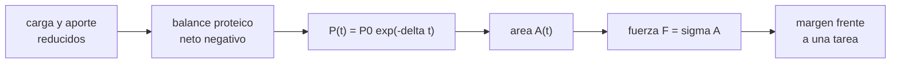

# B105-C03 — Atrofia muscular

<!-- nav:top -->
[🏠 Programa](../../../../README.md) · [📚 Bloque B105](../../../tronco-comun/B105-medicina-y-biologia-espacial.md) · [← Anterior: B105-C02 — Pérdida de masa ósea](../B105-C02-perdida-de-masa-osea/CLASE.md) · [Siguiente: B105-C04 — Sistema vestibular →](../B105-C04-sistema-vestibular/CLASE.md)
<!-- /nav -->

## 1. Ubicación, nivel y alcance

Clase 3 del bloque B105. Nivel N3. El músculo se mantiene por un balance entre síntesis y degradación de proteína y por la carga que recibe. Aquí modelas la pérdida como un balance neto negativo proporcional a la reserva, conviertes área en fuerza máxima y comparas con y sin una contramedida simulada. Se relaciona con [B105-C02](../B105-C02-perdida-de-masa-osea/CLASE.md) (misma carga mecánica) y con [B105-C16](../B105-C16-contramedidas-de-ejercicio/CLASE.md).

## 2. Por qué esta clase existe

Sin carga y sin aporte adecuado, el músculo se pierde más rápido que en la Tierra. La decisión central: **¿cuánta área y cuánta fuerza quedan tras 30, 90 y 180 días, y cuánto cambia una contramedida?**

## 3. Lo que podrás hacer al terminar

1. Resolver `dP/dt = −δ P` y calcular el área y la fuerza con unidades.
2. Convertir sección transversal en fuerza máxima con una tensión específica.
3. Estimar `δ` por ajuste log-lineal de mediciones ruidosas.
4. Comparar poblaciones sintéticas con y sin contramedida y dar su dispersión.
5. Calcular el margen de fuerza frente a una tarea que exige una fuerza dada.
6. Rotular qué es sintético y no dar consejo médico ni de entrenamiento.

La evidencia es la **ficha de atrofia con balance proteico** del ejercicio 12 (sección 20).

## 4. Con qué llegas y cómo comprobarlo

1. ¿Qué es una ecuación `dP/dt = −δ P`?
2. ¿Qué es una sección transversal muscular?
3. ¿Qué es la tensión específica?
4. ¿Qué es un ajuste log-lineal?
5. ¿Qué es un dato sintético?

<details>
<summary>Ver respuestas</summary>

1. Una decaída exponencial con constante `δ`. 2. El área del músculo en un corte perpendicular a sus fibras (cm²). 3. La fuerza máxima por unidad de área (N/cm²). 4. Una regresión lineal de `ln y` frente a `t`. 5. Un dato generado para el ejemplo, no medido.
</details>

Con cuatro o cinco aciertos, sigue; si no, repasa los prerrequisitos.

## 5. Un caso de contexto y casos de referencia

Un músculo grande de 70 cm² con tensión específica de 25 N/cm² (ambos **ilustrativos**) desarrolla 1.750 N. Con `δ = 0,0030/día`, el área baja a 64,0 cm² a los 30 días, 53,4 a los 90 y 40,8 a los 180 (fuerza 1.019,8 N). Con la mitad de `δ` (contramedida simulada) la fuerza a 180 días es 1.335,9 N. En una población **sintética** de 5.000 (semilla 105, `δ ~ N(0,0030; 0,0010)`) la pérdida a 90 días es 23,45 ± 6,85 % sin contramedida y 12,59 ± 3,91 % con ella. La NASA señala de forma cualitativa que, sin dieta ni ejercicio adecuados, el músculo se pierde más rápido en microgravedad (consultada el 2026-11-10).

## 6. Vocabulario

La **atrofia** es la pérdida de masa o de sección de un músculo. El **balance proteico** es síntesis menos degradación. La **tensión específica** `σ` es la fuerza por área, y la **fuerza máxima** es `F = σ A`. La **contramedida** es una intervención que reduce la pérdida (aquí, `δ/2`, ilustrativa).

## 7. Modelo mental



*Descripción textual:* la carga y el aporte reducidos dejan un balance proteico negativo; la reserva decae de forma exponencial, el área baja y la fuerza máxima con ella, y se compara con lo que exige una tarea.

Analogía: un depósito con una fuga proporcional al nivel. Límite: el músculo pierde fuerza también por factores neurales que el modelo no incluye.

## 8. La explicación, paso a paso

### 8.1 La reserva y el área

`P(t) = P₀ e^{−δ t}` y `A = A₀ e^{−δ t}` con `A₀ = 70 cm²`. Con `δ = 0,0030/día`: 64,0 cm² a 30 días (−8,6 %), 53,4 a 90 y 40,8 a 180.

### 8.2 De área a fuerza

`F = σ A`: 1.750 N al inicio y 1.019,8 N a 180 días (−41,7 %). La fuerza depende en este modelo solo del área.

### 8.3 Con y sin contramedida

Con `δ/2 = 0,0015/día` el área a 180 días es 53,4 cm² y la fuerza 1.335,9 N. En la población sintética, la pérdida a 90 días baja de 23,45 % (p5–p95: 11,65–34,27 %) a 12,59 % (6,01–18,93 %): 10,85 puntos menos en media. La contramedida es una suposición del modelo, no una prescripción.

### 8.4 Estimar `δ`

Con seis mediciones sintéticas (`t = 0, 15, 30, 45, 60, 90` días) y 1 % de ruido, la pendiente de `ln A` frente a `t` da `δ = 0,00297/día` (verdad 0,00300). El ajuste log-lineal recupera la constante con un error de 1 %.

## 9. Magnitudes, símbolos y unidades

| Símbolo | Qué es | Unidad | Valor / nota |
|---|---|---|---|
| `P` | reserva de proteína muscular | relativa | `P₀` = 1 |
| `δ` | tasa neta de pérdida | 1/día | 0,0030 (ilustrativa) |
| `A` | sección transversal | cm² | 70 (inicial, ilustrativa) |
| `σ` | tensión específica | N/cm² | 25 (ilustrativa) |
| `F` | fuerza máxima | N | 1.750 (inicial) |

## 10. Convenciones y referencias

Tiempo en días desde el inicio de la exposición; `A` proporcional a `P`; `F = σ A`. Datos sintéticos con semilla 105; todos los parámetros **ilustrativos**. Tolerancias: `A(30 d)` con `δ = 0,0030` = 63,96 ± 0,05 cm²; media con contramedida menor que sin ella; `δ` ajustada dentro de 0,0005 de la verdad. Numpy 2.4.4, Python 3.12.9.

## 11. De dónde sale lo que afirmamos

| ID | Fuente | Localizador | Respalda | Estado |
|---|---|---|---|---|
| 1 | NASA, «Human body in space» (Human Research Program), resumen de la página por WebFetch | https://www.nasa.gov/hrp/bodyinspace/ (consultada el 2026-11-10) | sin dieta ni ejercicio adecuados el músculo se pierde más rápido en microgravedad que en la Tierra (cualitativo) | Consultada (resumen de la página; sin cifras) |
| — | Decaída exponencial, `F = σ A` y ajuste log-lineal | — | las verifica el laboratorio | No consultada en una fuente concreta (las verifica el laboratorio) |

Límites: la fuente es cualitativa; `δ`, `A₀` y `σ` son elecciones didácticas y no se compararon con mediciones de tripulantes ni con literatura de atrofia por músculo.

## 12. Cómo ver el resultado

Descripción: el laboratorio imprime el área y la fuerza por `δ`, la pérdida poblacional con y sin contramedida y el ajuste de `δ`. Equivalente textual: la mitad de `δ` reduce la pérdida a 90 días de 23,5 % a 12,6 %.

## 13. Ejemplo trabajado: fuerza a 180 días

**Paso 1 · Exponente.** `δ t = 0,0030·180 = 0,54`.

**Paso 2 · Área.** `70·e^{−0,54} = 40,8 cm²`.

**Paso 3 · Fuerza.** `25·40,8 = 1.020 N`.

**Paso 4 · Margen.** Frente a una tarea que exige 1.000 N, el margen es `1.020/1.000 − 1 = 2 %`.

## 14. Distintas formas de describir el problema

**Por ecuación:** `dP/dt = −δ P`. **Por área:** `A(t)`. **Por fuerza:** `σ A`. **Por población:** media y percentiles. **Por ajuste:** pendiente de `ln A`.

## 15. Práctica guiada

**Ejercicio 1 · con los pasos indicados.** Calcula el área a 30 días con `δ = 0,0030/día`. *Pasos:* `70 e^{−0,09}`.

<details><summary>Solución comentada</summary>

`63,96 cm²`.
</details>

**Ejercicio 2 · con una pista.** ¿Qué fuerza máxima da un área de 70 cm² con 25 N/cm²? *Pista:* `F = σ A`.

<details><summary>Solución comentada</summary>

`1.750 N`.
</details>

**Ejercicio 3 · casi autónomo.** ¿Qué fracción se pierde a 90 días con `δ = 0,0030`?

<details><summary>Solución comentada</summary>

`1 − e^{−0,27} = 23,7 %`.
</details>

## 16. Práctica autónoma, transferencia e integrador

**Ejercicio 4 · autónomo.** Calcula la semivida del área con `δ = 0,0030/día`.

<details><summary>Solución comentada</summary>

`ln 2/0,0030 = 231` días.
</details>

**Ejercicio 5 · autónomo.** ¿Qué `δ` produce una pérdida del 10 % en 30 días?

<details><summary>Solución comentada</summary>

`−ln 0,9/30 = 0,00351/día`.
</details>

**Ejercicio 6 · autónomo.** ¿Por qué el modelo subestima la pérdida de fuerza si hay pérdida neural?

<details><summary>Solución comentada</summary>

Porque la fuerza depende también de la activación; el modelo solo incluye el área.
</details>

**Ejercicio 7 · autónomo.** Con contramedida (`δ/2`), ¿qué pérdida hay a 90 días con `δ = 0,0030`?

<details><summary>Solución comentada</summary>

`1 − e^{−0,135} = 12,6 %`.
</details>

**Ejercicio 8 · autónomo.** Si el área baja de 70 a 63,96 cm² en 30 días, ¿cuál es `δ`?

<details><summary>Solución comentada</summary>

`ln(70/63,96)/30 = 0,0030/día`.
</details>

**Ejercicio 9 · transferencia.** Una tarea exige 1.000 N. ¿Cuánto margen queda a 180 días con `δ = 0,0030` y con `δ = 0,0015`?

<details><summary>Solución comentada</summary>

`1.019,8` → 2 % de margen; `1.335,9` → 34 %.
</details>

**Ejercicio 10 · transferencia.** La media poblacional de pérdida a 90 días (23,45 %) es menor que la del caso medio (23,7 %). ¿Por qué?

<details><summary>Solución comentada</summary>

La función `1 − e^{−δt}` es cóncava: por la desigualdad de Jensen, la media de la función es menor que la función de la media.
</details>

**Ejercicio 11 · transferencia.** Una tripulación sintética de 4 personas: ¿cuál es el error estándar de la pérdida media sin contramedida (DE 6,85)?

<details><summary>Solución comentada</summary>

`6,85/√4 = 3,4` puntos porcentuales.
</details>

**Ejercicio 12 · integrador.** Elabora tu *ficha de atrofia con balance proteico*: modelo, `δ` con su origen, área y fuerza a 30, 90 y 180 días, comparación con contramedida simulada, dispersión y lista de qué es sintético.

<details><summary>Solución comentada</summary>

Secciones 8.1–8.4 y la salida del laboratorio.
</details>

## 17. Laboratorio: atrofia como balance de proteína

El script [musculo.py](musculo.py) calcula el área y la fuerza con dos valores de `δ`, simula 5.000 individuos sintéticos con y sin contramedida y ajusta `δ` a mediciones ruidosas (**comprueba** el área de 63,96 cm² a 30 días, que la contramedida reduce la pérdida media y que `δ` se recupera dentro de 0,0005).

**Datos:** todo **sintético** (semilla 105); la única fuente consultada es cualitativa. **Predice antes de ejecutar:** ¿Cuánto debería bajar la pérdida media si `δ` se reduce a la mitad? (Casi a la mitad.) **Ejecución del 2026-11-10 (Python 3.12.9):**

```text
Python 3.12.9; numpy 2.4.4
DATOS SINTETICOS (semilla 105): delta, A0 y sigma ilustrativos; la unica cifra consultada es cualitativa (NASA, 2026-11-10)
delta = 0.0030/dia: area a 30/90/180 dias =  64.0,  53.4,  40.8 cm2; fuerza a 180 d = 1019.8 N (inicial 1750.0 N)
delta = 0.0015/dia: area a 30/90/180 dias =  66.9,  61.2,  53.4 cm2; fuerza a 180 d = 1335.9 N (inicial 1750.0 N)
sin contramedida             perdida a 90 dias: media 23.45 %, DE  6.85, p5-p95 = 11.65-34.27 %
con contramedida (delta/2)   perdida a 90 dias: media 12.59 %, DE  3.91, p5-p95 =  6.01-18.93 %
Reduccion media de la perdida por la contramedida simulada = 10.85 puntos porcentuales (n = 5000)
Ajuste log-lineal de 6 mediciones sinteticas con 1 % de ruido: delta = 0.00297/dia (verdad 0.00300)
Pruebas superadas.
```

```bash
python programa/clases/B105/B105-C03-atrofia-muscular/musculo.py
```

**Límites:** reserva única, sin distinción de fibras, sin factores neurales, sin dieta explícita y con contramedida como factor multiplicativo; no es una prescripción de ejercicio.

## 18. Errores frecuentes y cómo corregirlos

**Confundir pérdida de área con pérdida de fuerza.** Usa `F = σ A` y declara qué más influye (8.2).

**Promediar `δ` y aplicar la función.** Promedia la función (ejercicio 10).

**Tomar la contramedida simulada como recomendación.** Es una hipótesis del modelo (8.3).

**Presentar los datos sintéticos como de tripulantes.** Se rotulan (sección 10).

## 19. Cómo sabrás que vas bien

Tras la sección 8: ¿calculas el área y la fuerza a un tiempo dado? Si dudas, repasa el ejemplo 13. Tras el laboratorio: ¿qué comprueba? (ver la sección 17).

## 20. Qué entregas y cómo se evalúa

El producto es tu **ficha de atrofia con balance proteico** (ejercicio 12).

| Criterio | Inicial | En desarrollo | Logrado | Destacado |
|---|---|---|---|---|
| Conceptos | Confunde las magnitudes | Parciales | Explica balance, área y fuerza | Explica los factores que el modelo omite |
| Cálculo | Sin unidades | Con errores | Calcula con unidades y tolerancias | Calcula casos nuevos |
| Numérico | Sin comprobar | Un caso | Compara con la verdad del generador | Interpreta la sensibilidad |
| Fuentes | Sin fuente | Sin fecha | Cita solo lo consultado, con fecha | Rotula lo sintético y lo no consultado |
| Límites | No los nombra | Uno | Tres | Discute qué falta del modelo |

**Condiciones críticas (no se compensan con promedio):** rotular los datos como sintéticos; no presentar un resultado simulado como observado; no dar consejo médico ni operativo; citar solo lo consultado.

## 21. Ética, seguridad y límites

Clase **educativa**: no es consejo médico, no sustituye la formación, la licencia ni la supervisión de profesionales, y no contiene dosis, tratamientos ni procedimientos para aplicar a una persona real. No hay aquí prescripción de ejercicio ni de dieta; el entrenamiento de una persona real lo diseñan profesionales. Accesibilidad: tablas equivalentes a las gráficas, fórmulas en texto, ejercicios sin conexión.

## 22. Para cerrar y seguir

Con `δ = 0,0030/día`, el área baja a 53,4 cm² a 90 días y la fuerza a 1.019,8 N a 180; con la mitad de `δ`, la pérdida a 90 días se reduce de 23,45 % a 12,59 % en la población sintética. Queda una pregunta: ¿cómo siente el cuerpo su posición y su movimiento?

**Glosario español–inglés.** atrofia · *atrophy*; balance proteico · *protein balance*; tensión específica · *specific tension*; contramedida · *countermeasure*.

**Continuidad.** [B105-C04](../B105-C04-sistema-vestibular/CLASE.md) estudia el sistema vestibular.

**Referencias:** ver sección 11.

<!-- nav:bottom -->
---

[← Anterior: B105-C02 — Pérdida de masa ósea](../B105-C02-perdida-de-masa-osea/CLASE.md) · [📚 Bloque B105](../../../tronco-comun/B105-medicina-y-biologia-espacial.md) · [Siguiente: B105-C04 — Sistema vestibular →](../B105-C04-sistema-vestibular/CLASE.md)
<!-- /nav -->
