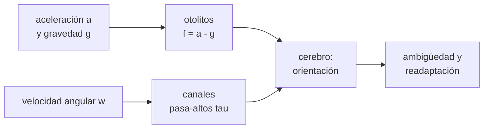

# B105-C04 — Sistema vestibular

<!-- nav:top -->
[🏠 Programa](../../../../README.md) · [📚 Bloque B105](../../../tronco-comun/B105-medicina-y-biologia-espacial.md) · [← Anterior: B105-C03 — Atrofia muscular](../B105-C03-atrofia-muscular/CLASE.md) · [Siguiente: B105-C05 — Cambios de visión →](../B105-C05-cambios-de-vision/CLASE.md)
<!-- /nav -->

## 1. Ubicación, nivel y alcance

Clase 4 del bloque B105. Nivel N3. El sistema vestibular es un sensor de movimiento del oído interno: los otolitos miden fuerza específica y los canales semicirculares, velocidad angular. Aquí lo tratas como un problema de ingeniería de sensores: qué mide cada uno, qué ambigüedad tiene en la Tierra y qué cambia en caída libre. El control motor asociado se estudia en [B105-C25](../B105-C25-adaptacion-sensoriomotora-y-control-motor-en-microgravedad/CLASE.md).

## 2. Por qué esta clase existe

En la Tierra el cerebro usa la gravedad como referencia de «abajo». En caída libre esa referencia desaparece y el sensor sigue midiendo, pero su señal significa otra cosa. La decisión central: **¿qué señal da cada sensor en la Tierra y en órbita, y cuánto dura la percepción de una rotación constante?**

## 3. Lo que podrás hacer al terminar

1. Calcular la fuerza específica `f = a − g` que mide un acelerómetro de otolitos.
2. Explicar la ambigüedad inclinación–traslación y calcular un ángulo equivalente.
3. Modelar un canal semicircular como filtro pasa-altos con constante `τ` y simular su respuesta.
4. Calcular el tiempo en que la percepción cae a un porcentaje de la velocidad real.
5. Comprobar una integración numérica con la solución analítica.
6. Rotular el modelo como didáctico y no dar consejo médico.

La evidencia es la **ficha vestibular con la respuesta simulada** del ejercicio 12 (sección 20).

## 4. Con qué llegas y cómo comprobarlo

1. ¿Qué es la fuerza específica?
2. ¿Qué es un filtro pasa-altos?
3. ¿Qué es una constante de tiempo?
4. ¿Qué es la caída libre?
5. ¿Qué es un dato sintético?

<details>
<summary>Ver respuestas</summary>

1. La aceleración medida por un acelerómetro: `a − g`. 2. Uno que deja pasar los cambios rápidos y atenúa lo constante. 3. El tiempo en que una respuesta decae a `1/e` (37 %). 4. El movimiento bajo la sola gravedad, sin peso aparente. 5. Un dato generado para el ejemplo, no medido.
</details>

Con cuatro o cinco aciertos, sigue; si no, repasa los prerrequisitos.

## 5. Un caso de contexto y casos de referencia

Un acelerómetro lateral en la cabeza mide `f = a − g sen θ`. En la Tierra, inclinar 10° da −1,703 m/s², y una traslación de 1,70 m/s² da 1,700: casi la misma señal (equivalen a 9,98°). En órbita, la inclinación da 0 y la traslación sigue dando 1,70. Un canal con `τ = 5 s` (ilustrativo) percibe una rotación constante de 60 °/s como 22,09 °/s a los 5 s y 8,12 °/s a los 10 s; cae al 10 % en 11,51 s. Es el **ejemplo conductor**: todo es **sintético/ilustrativo**; no se consultó ninguna medición vestibular.

## 6. Vocabulario

Los **otolitos** (utrículo y sáculo) detectan la fuerza específica. Los **canales semicirculares** detectan la velocidad angular. La **ambigüedad inclinación–traslación** surge porque `f` mezcla gravedad y aceleración. El **filtro pasa-altos** de primer orden `τ dw_p/dt = −w_p + τ dw/dt` describe el canal. La NASA señala que pasar de la ingravidez a la gravedad afecta la orientación espacial, el equilibrio y la coordinación, y que algunos tripulantes sufren mareo espacial (página consultada el 2026-11-10).

## 7. Modelo mental



*Descripción textual:* los otolitos miden `a − g` y los canales la velocidad angular filtrada; el cerebro combina ambas señales para estimar la orientación, y cuando cambia `g` la combinación debe readaptarse.

Analogía: un teléfono con acelerómetro en la mano; inclinarlo o empujarlo da lecturas parecidas. Límite: el cerebro usa además la vista, la propiocepción y los canales para resolver la ambigüedad.

## 8. La explicación, paso a paso

### 8.1 Qué mide el otolito

`f = a_lat − g sen θ`. En la Tierra, con `a = 0` y `θ = 10°`: `f = −1,703 m/s²`; con `θ = 30°`: `−4,905`. Una traslación de 1,70 m/s² sin inclinar da `+1,700`: el sensor no distingue el signo ni el origen sin más información.

### 8.2 La ambigüedad

Una traslación de 1,70 m/s² equivale a una inclinación de `arcsen(1,70/9,81) = 9,98°`. Para resolverlo, el cerebro usa los canales (una inclinación implica una rotación previa) y otros sentidos.

### 8.3 En caída libre

En órbita la cabeza y el entorno caen juntos: el término `g` desaparece de `f`. Una inclinación da `f = 0` y solo una traslación da señal. La referencia de «abajo» se pierde y debe readaptarse (el control motor, en B105-C25).

### 8.4 El canal como filtro

Una rotación constante de 60 °/s desde `t = 0` se percibe como `60 e^{−t/τ}`. Con `τ = 5 s`: 22,09 °/s a 5 s, 8,12 a 10, 2,98 a 15 y 0,15 a 30 s. La integración de Euler (`dt = 0,01 s`) coincide con la analítica dentro de 0,02 °/s. Cae al 10 % en `τ ln 10 = 11,51 s`.

## 9. Magnitudes, símbolos y unidades

| Símbolo | Qué es | Unidad | Valor / nota |
|---|---|---|---|
| `f` | fuerza específica | m/s² | −1,703 (10° en la Tierra) |
| `a` | aceleración de la cabeza | m/s² | 1,70 (ejemplo) |
| `g` | gravedad efectiva | m/s² | 9,81 (Tierra); 0 (órbita, efectiva) |
| `θ` | inclinación | grados | 10; 30 |
| `τ` | constante del canal | s | 5 (ilustrativa) |
| `w` | velocidad angular | °/s | 60 |

## 10. Convenciones y referencias

Eje lateral positivo hacia la derecha de la cabeza; `θ` positivo hacia ese lado. Datos sintéticos/ilustrativos; la `τ` de 5 s es una elección didáctica. Euler con `dt = 0,01 s`. Tolerancias del laboratorio: `f(10°) = −1,703 ± 0,01`; ángulo equivalente `9,98 ± 0,05°`; percepción a 10 s dentro de 0,5 °/s de la analítica. Numpy 2.4.4, Python 3.12.9.

## 11. De dónde sale lo que afirmamos

| ID | Fuente | Localizador | Respalda | Estado |
|---|---|---|---|---|
| 1 | NASA, «Human body in space» (Human Research Program), resumen de la página por WebFetch | https://www.nasa.gov/hrp/bodyinspace/ (consultada el 2026-11-10) | el paso entre ingravidez y gravedad afecta orientación, equilibrio y coordinación; existe mareo espacial (cualitativo) | Consultada (resumen de la página) |
| — | Fuerza específica, filtro pasa-altos de primer orden | — | las verifica el laboratorio | No consultada en una fuente concreta (las verifica el laboratorio) |

Límites: no se consultó literatura vestibular; la constante de 5 s, los ejes y la ausencia de canales verticales y de ruido son elecciones didácticas.

## 12. Cómo ver el resultado

Descripción: la tabla de fuerza específica en dos gravedades y la tabla de percepción frente al tiempo. Equivalente textual: en órbita la inclinación no produce señal otolítica y el canal olvida una rotación constante en pocos tiempos `τ`.

## 13. Ejemplo trabajado: percepción de una rotación constante

**Paso 1 · Modelo.** `w_p(t) = 60 e^{−t/5}`.

**Paso 2 · A 10 s.** `60·e^{−2} = 8,12 °/s`.

**Paso 3 · Fracción.** `8,12/60 = 13,5 %` de la velocidad real.

**Paso 4 · Contraste.** Es lo que el canal informa; los otolitos no lo corrigen sin gravedad que los oriente.

## 14. Distintas formas de describir el problema

**Por sensor:** otolito y canal. **Por ecuación:** `f = a − g`; pasa-altos. **Por ángulo:** ambigüedad. **Por tiempo:** `τ`. **Por tabla:** percepción frente a `t`.

## 15. Práctica guiada

**Ejercicio 1 · con los pasos indicados.** Calcula `f` para una inclinación de 20° en la Tierra con `a = 0`. *Pasos:* `−9,81 sen 20°`.

<details><summary>Solución comentada</summary>

`−3,355 m/s²`.
</details>

**Ejercicio 2 · con una pista.** ¿Qué traslación imita una inclinación de 15°? *Pista:* `g sen 15°`.

<details><summary>Solución comentada</summary>

`9,81·0,2588 = 2,539 m/s²`.
</details>

**Ejercicio 3 · casi autónomo.** ¿Qué velocidad angular percibe el canal a 2,5 s de una rotación de 60 °/s con `τ = 5 s`?

<details><summary>Solución comentada</summary>

`60 e^{−0,5} = 36,4 °/s`.
</details>

## 16. Práctica autónoma, transferencia e integrador

**Ejercicio 4 · autónomo.** ¿En cuánto tiempo la percepción cae a la mitad?

<details><summary>Solución comentada</summary>

`τ ln 2 = 3,47 s`.
</details>

**Ejercicio 5 · autónomo.** ¿Qué percibe el canal a los 20 s?

<details><summary>Solución comentada</summary>

`60 e^{−4} = 1,10 °/s`.
</details>

**Ejercicio 6 · autónomo.** ¿Por qué en órbita la inclinación de la cabeza no da señal otolítica?

<details><summary>Solución comentada</summary>

Porque cabeza y entorno están en caída libre: `a = g` y `f = a − g = 0`.
</details>

**Ejercicio 7 · autónomo.** En la Tierra, ¿por qué una traslación de 1,70 m/s² puede confundirse con una inclinación de 10°?

<details><summary>Solución comentada</summary>

Porque `f` vale lo mismo (en módulo) en ambos casos; el cerebro usa otras señales para desambiguar.
</details>

**Ejercicio 8 · autónomo.** En una centrífuga de radio 2 m a `ω = 2 rad/s`, ¿qué aceleración centrípeta siente un sensor en el borde?

<details><summary>Solución comentada</summary>

`ω² r = 4·2 = 8 m/s²` (0,82 g).
</details>

**Ejercicio 9 · transferencia.** Al detenerse tras girar a velocidad constante, el canal informa una rotación en sentido contrario. ¿Por qué?

<details><summary>Solución comentada</summary>

Porque el filtro pasa-altos responde al cambio de velocidad: el escalón negativo produce una señal de signo opuesto que decae con `τ`.
</details>

**Ejercicio 10 · transferencia.** ¿Qué error tiene Euler con `dt = 0,01 s` y `τ = 5 s`? ¿Cómo se reduce?

<details><summary>Solución comentada</summary>

A los 5 s da 22,09 frente a 22,07 °/s de la analítica (0,02 °/s); el error de Euler es proporcional a `dt`: se reduce con un paso menor o con un método de orden superior.
</details>

**Ejercicio 11 · transferencia.** Si `τ` real fuera 6 s en lugar de 5, ¿cómo cambia el tiempo al 10 %?

<details><summary>Solución comentada</summary>

`6·ln 10 = 13,8 s` frente a 11,5 s.
</details>

**Ejercicio 12 · integrador.** Elabora tu *ficha vestibular con la respuesta simulada*: sensores, `f` en la Tierra y en órbita, ángulo equivalente, respuesta del canal y lista de qué es ilustrativo.

<details><summary>Solución comentada</summary>

Secciones 8.1–8.4 y la salida del laboratorio.
</details>

## 17. Laboratorio: otolitos, canales semicirculares y la ambigüedad inclinación–traslación

El script [vestibular.py](vestibular.py) calcula la fuerza específica en dos gravedades, el ángulo equivalente de una traslación y simula un canal pasa-altos con Euler frente a la solución analítica (**comprueba** `f(10°) = −1,703`, el ángulo equivalente de 9,98° y la coincidencia de Euler con la analítica a 10 s).

**Datos:** todo **sintético/ilustrativo**; no hay mediciones. **Predice antes de ejecutar:** ¿Qué señal otolítica da una inclinación de 30° en órbita? (Cero.) **Ejecución del 2026-11-10 (Python 3.12.9):**

```text
Python 3.12.9; numpy 2.4.4
DATOS SINTETICOS/ILUSTRATIVOS: no hay mediciones; tau = 5 s y los angulos son de ensenanza
Fuerza especifica lateral f = a - g sin(theta) [m/s2]:
  caso                         Tierra (g = 9.81)   Orbita (g efectiva = 0)
  inclinacion 10 grados, a = 0     -1.703               0.000
  traslacion a = 1.70, sin inclinar    1.700               1.700
  inclinacion 30 grados, a = 0     -4.905               0.000
Ambiguedad: una traslacion de 1.70 m/s2 equivale en la Tierra a una inclinacion de 9.98 grados
  t =  0.0 s: velocidad angular percibida =   0.00 grados/s (verdad 60) ; analitica  60.00
  t =  5.0 s: velocidad angular percibida =  22.09 grados/s (verdad 60) ; analitica  22.07
  t = 10.0 s: velocidad angular percibida =   8.12 grados/s (verdad 60) ; analitica   8.12
  t = 15.0 s: velocidad angular percibida =   2.98 grados/s (verdad 60) ; analitica   2.99
  t = 30.0 s: velocidad angular percibida =   0.15 grados/s (verdad 60) ; analitica   0.15
Tiempo hasta que la percepcion cae al 10 % de la velocidad real = 11.51 s
Pruebas superadas.
```

```bash
python programa/clases/B105/B105-C04-sistema-vestibular/vestibular.py
```

**Límites:** un solo eje, sin canales verticales, sin ruido neural, sin integración con la vista y con constante supuesta; no valida ni diagnostica ningún trastorno.

## 18. Errores frecuentes y cómo corregirlos

**Creer que el otolito mide la inclinación directamente.** Mide `a − g` (8.1).

**Creer que el canal mide velocidad constante.** Es un pasa-altos: lo constante se atenúa (8.4).

**Tomar `τ = 5 s` como valor medido.** Es ilustrativo (sección 10).

**Dar consejo médico sobre mareo espacial.** Está fuera de esta clase.

## 19. Cómo sabrás que vas bien

Tras la sección 8: ¿calculas `f` y la respuesta del canal? Si dudas, repasa el ejemplo 13. Tras el laboratorio: ¿qué comprueba? (ver la sección 17).

## 20. Qué entregas y cómo se evalúa

El producto es tu **ficha vestibular con la respuesta simulada** (ejercicio 12).

| Criterio | Inicial | En desarrollo | Logrado | Destacado |
|---|---|---|---|---|
| Conceptos | Confunde las magnitudes | Parciales | Explica `f = a − g` y el pasa-altos | Explica la ambigüedad y su resolución |
| Cálculo | Sin unidades | Con errores | Calcula con unidades y tolerancias | Calcula casos nuevos |
| Numérico | Sin comprobar | Un caso | Compara con la verdad del generador | Interpreta la sensibilidad |
| Fuentes | Sin fuente | Sin fecha | Cita solo lo consultado, con fecha | Rotula lo sintético y lo no consultado |
| Límites | No los nombra | Uno | Tres | Discute qué falta del modelo |

**Condiciones críticas (no se compensan con promedio):** rotular los datos como sintéticos; no presentar un resultado simulado como observado; no dar consejo médico ni operativo; citar solo lo consultado.

## 21. Ética, seguridad y límites

Clase **educativa**: no es consejo médico, no sustituye la formación, la licencia ni la supervisión de profesionales, y no contiene dosis, tratamientos ni procedimientos para aplicar a una persona real. No se valora ni se trata a nadie; el diagnóstico y el manejo del mareo o del desequilibrio corresponden a profesionales. Accesibilidad: tablas equivalentes a las gráficas, fórmulas en texto, ejercicios sin conexión.

## 22. Para cerrar y seguir

En la Tierra una inclinación de 10° y una traslación de 1,70 m/s² dan señales casi idénticas; en órbita, la inclinación no da señal. El canal olvida una rotación constante en 11,5 s al 10 %. Queda una pregunta: ¿qué le pasa al ojo y a la vista?

**Glosario español–inglés.** otolito · *otolith*; canal semicircular · *semicircular canal*; fuerza específica · *specific force*; pasa-altos · *high-pass*.

**Continuidad.** [B105-C05](../B105-C05-cambios-de-vision/CLASE.md) estudia los cambios de visión.

**Referencias:** ver sección 11.

<!-- nav:bottom -->
---

[← Anterior: B105-C03 — Atrofia muscular](../B105-C03-atrofia-muscular/CLASE.md) · [📚 Bloque B105](../../../tronco-comun/B105-medicina-y-biologia-espacial.md) · [Siguiente: B105-C05 — Cambios de visión →](../B105-C05-cambios-de-vision/CLASE.md)
<!-- /nav -->
