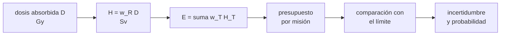

# B105-C06 — Radiación ionizante y exposición

<!-- nav:top -->
[🏠 Programa](../../../../README.md) · [📚 Bloque B105](../../../tronco-comun/B105-medicina-y-biologia-espacial.md) · [← Anterior: B105-C05 — Cambios de visión](../B105-C05-cambios-de-vision/CLASE.md) · [Siguiente: B105-C07 — Dosimetría personal →](../B105-C07-dosimetria-personal/CLASE.md)
<!-- /nav -->

## 1. Ubicación, nivel y alcance

Clase 6 del bloque B105. Nivel N3. La radiación ionizante es un riesgo de largo plazo de la exploración tripulada. Aquí distingues dosis absorbida, equivalente y efectiva, calculas la dosis efectiva como suma ponderada y comparas un presupuesto de misión **sintético** con un límite de carrera citado de un resumen de la NASA, con su incertidumbre. El instrumento se trata en [B105-C07](../B105-C07-dosimetria-personal/CLASE.md); el entorno de radiación del hábitat, en el bloque de hábitats.

## 2. Por qué esta clase existe

La dosis no se «lee»: se calcula a partir de una dosis absorbida, de factores de calidad y de ponderación, y esos factores tienen incertidumbre. La decisión central: **¿qué fracción del límite de carrera consume una misión y con qué probabilidad lo supera una secuencia de misiones?**

## 3. Lo que podrás hacer al terminar

1. Convertir dosis absorbida en dosis equivalente (`H = w_R D`) y esta en dosis efectiva (`E = Σ w_T H_T`).
2. Verificar que los factores de ponderación de tejido suman 1.
3. Calcular un presupuesto de dosis por día y por misión y compararlo con un límite.
4. Propagar la incertidumbre del factor de calidad con una distribución lognormal.
5. Calcular la probabilidad de superar un límite tras varias misiones.
6. Rotular qué cifra es consultada, cuál es modelo y cuál sintética, sin dar consejo operativo.

La evidencia es la **ficha de exposición con presupuesto de dosis** del ejercicio 12 (sección 20).

## 4. Con qué llegas y cómo comprobarlo

1. ¿Qué es un gray (Gy)?
2. ¿Qué es un sievert (Sv)?
3. ¿Qué es un factor de ponderación?
4. ¿Qué es una distribución lognormal?
5. ¿Qué es un dato sintético?

<details>
<summary>Ver respuestas</summary>

1. La energía absorbida por kilogramo: 1 Gy = 1 J/kg. 2. La unidad de dosis equivalente o efectiva: gray ponderado por efecto biológico. 3. Un número que escala una dosis según el tipo de radiación o el tejido. 4. Una cuyo logaritmo es normal; siempre positiva. 5. Un dato generado para el ejemplo, no medido.
</details>

Con cuatro o cinco aciertos, sigue; si no, repasa los prerrequisitos.

## 5. Un caso de contexto y casos de referencia

Una misión **sintética** de 180 días con dosis absorbida de 0,30 mGy/día y factor de calidad medio `Q = 2,5` da 0,75 mSv/día y 135 mSv. Frente a un límite de carrera de 600 mSv (un resumen de la NASA, consultado por búsqueda el 2026-11-10; el estándar no se abrió) es el 22,5 %. Con una incertidumbre lognormal de `Q` (σ = 0,30), la misión da 135 mSv (p5–p95: 79–212) y la probabilidad de superar 600 mSv con 3 misiones es 0,0725 y con 4, 0,3061. Es el **ejemplo conductor**: las tasas y el factor son **ilustrativos**; los límites son citados; no describen ninguna misión real.

## 6. Vocabulario

La **dosis absorbida** `D` (Gy = J/kg) es energía por masa. La **dosis equivalente** `H_T = w_R D_T` (Sv) pondera por el tipo de radiación. La **dosis efectiva** `E = Σ w_T H_T` (Sv) pondera por tejido; sus factores los fija la ICRP en su Publicación 103 (2007), página consultada el 2026-11-10 en resumen. El **límite de carrera** de 600 mSv y el de un **evento de partículas solares** (SPE) de 250 mSv son los citados en un resumen de la NASA.

## 7. Modelo mental



*Descripción textual:* la dosis absorbida se pondera por radiación y por tejido para dar la dosis efectiva; se acumula en un presupuesto de misión, se compara con un límite y se acompaña de su incertidumbre.

Analogía: una cuenta en la que cada gasto se multiplica por un tipo de cambio según la moneda; la dosis efectiva es el total convertido. Límite: los tipos de cambio (factores) son convenciones de protección radiológica, no medidas biológicas exactas.

## 8. La explicación, paso a paso

### 8.1 Magnitudes

`D` en Gy (J/kg), `H_T = w_R D_T` y `E = Σ w_T H_T`, ambas en Sv. Los factores de tejido que usa el laboratorio (recordados por el autor y **no consultados en la tabla de la fuente**) suman `1,00`: 0,12 (pulmón, estómago, colon, médula roja, mama), 0,08 (gónadas), 0,04 (vejiga, esófago, hígado, tiroides), 0,01 (superficie ósea, cerebro, glándulas salivales, piel) y 0,12 (resto).

### 8.2 Presupuesto de misión

`H = 0,30 mGy/día·2,5 = 0,75 mSv/día`; 180 días: 135 mSv. Con dosis de órgano entre 0,8 y 1,2 de la de referencia, la dosis efectiva sintética es 134,0 mSv (frente a 135,0 uniforme).

### 8.3 Comparación con un límite

Un resumen de la NASA indica un límite de carrera de 600 mSv basado en un riesgo de muerte inducida por exposición (REID) de 3 % con 95 % de confianza, y un límite de SPE de 250 mSv. La misión consume el 22,5 % del límite de carrera; con 0,75 mSv/día se alcanzan 600 mSv en 800 días (4,44 misiones de 180 días). El SPE de 250 mSv equivale al 41,7 % del límite de carrera.

### 8.4 Incertidumbre del factor de calidad

Con `Q` lognormal (media 2,5; σ = 0,30), la misión da 135 mSv con p5–p95 de 79–212. Probabilidad de superar 600 mSv: 1 misión 0,0000; 2 misiones 0,0028; 3 misiones 0,0725; 4 misiones 0,3061. La probabilidad crece rápido cuando la media se acerca al límite.

## 9. Magnitudes, símbolos y unidades

| Símbolo | Qué es | Unidad | Valor / nota |
|---|---|---|---|
| `D` | dosis absorbida | Gy (mGy) | 0,30 mGy/día (ilustrativa) |
| `w_R`, `Q` | factor de radiación / de calidad | — | 2,5 (ilustrativo) |
| `H` | dosis equivalente | Sv (mSv) | 0,75 mSv/día |
| `w_T` | factor de tejido | — | suma 1,00 |
| `E` | dosis efectiva | Sv (mSv) | 135 mSv (180 d) |
| límite de carrera | dosis efectiva | mSv | 600 (resumen NASA) |

## 10. Convenciones y referencias

Dosis en mSv; el factor de calidad `Q` representa la media de la mezcla y se trata como lognormal de media 2,5 y σ = 0,30. Datos sintéticos con semilla 105 (20.000 realizaciones). Los límites son citados de un resumen y la revisión vigente del estándar puede ser otra. Tolerancias del laboratorio: suma de `w_T` = 1 exacta; `H` de misión = 135 mSv; media lognormal dentro de 3 mSv de 135. Numpy 2.4.4, Python 3.12.9.

## 11. De dónde sale lo que afirmamos

| ID | Fuente | Localizador | Respalda | Estado |
|---|---|---|---|---|
| 1 | ICRP, Publicación 103 (2007), página de la publicación, resumen por WebFetch | https://www.icrp.org/publication.asp?id=ICRP%20Publication%20103 (consultada el 2026-11-10) | existencia y año de las Recomendaciones de 2007; actualiza los factores de ponderación de radiación y tejido para la dosis efectiva (la tabla no se consultó) | Consultada (resumen de la página; sin la tabla de factores) |
| 2 | Resumen de la NASA sobre el estándar NASA-STD-3001 Vol. 1 (informe técnico de radiación), obtenido por búsqueda web | búsqueda web del 2026-11-10; el PDF del estándar no se abrió | límite de carrera 600 mSv de dosis efectiva; base de 3 % de REID con 95 % de confianza; límite de SPE 250 mSv | Consultada solo por resumen de búsqueda; las revisiones citadas difieren; verificar el estándar vigente |
| — | Factores `w_T` y `w_R`, lognormal y aritmética de dosis | — | los verifica el laboratorio | No consultados en una fuente concreta (las verifica el laboratorio) |

Límites: el estándar NASA-STD-3001 y la tabla de la ICRP no se abrieron; la página de riesgos de radiación de la NASA devolvió 404 y no se consultó; los factores `w_T` provienen de la memoria del autor y solo se verificó su suma; la tasa de dosis, `Q` y la duración son ilustrativas.

## 12. Cómo ver el resultado

Descripción: la salida del laboratorio da el presupuesto por día y por misión, el porcentaje del límite y las probabilidades por número de misiones. Equivalente textual: 135 mSv por misión; 4 misiones sintéticas superan 600 mSv con probabilidad 0,31.

## 13. Ejemplo trabajado: presupuesto de una misión de 180 días

**Paso 1 · Dosis equivalente diaria.** `0,30 mGy·2,5 = 0,75 mSv`.

**Paso 2 · Misión.** `0,75·180 = 135 mSv`.

**Paso 3 · Fracción del límite.** `135/600 = 22,5 %`.

**Paso 4 · Misiones hasta el límite.** `600/135 = 4,44`.

## 14. Distintas formas de describir el problema

**Por magnitud:** Gy, Sv. **Por fórmula:** `E = Σ w_T H_T`. **Por tiempo:** mSv/día. **Por fracción:** % del límite. **Por probabilidad:** `P(>600 mSv)`.

## 15. Práctica guiada

**Ejercicio 1 · con los pasos indicados.** ¿Qué dosis equivalente produce una dosis absorbida de 0,5 mGy con `w_R = 2`? *Pasos:* `H = w_R D`.

<details><summary>Solución comentada</summary>

`1,0 mSv`.
</details>

**Ejercicio 2 · con una pista.** Si solo pulmón y estómago reciben 10 mSv (resto 0), ¿cuánto es `E`? *Pista:* suma ponderada.

<details><summary>Solución comentada</summary>

`0,12·10 + 0,12·10 = 2,4 mSv`.
</details>

**Ejercicio 3 · casi autónomo.** ¿Qué dosis acumula una misión de 90 días a 0,75 mSv/día?

<details><summary>Solución comentada</summary>

`67,5 mSv`.
</details>

## 16. Práctica autónoma, transferencia e integrador

**Ejercicio 4 · autónomo.** ¿En cuántos días se llega a 250 mSv a 0,75 mSv/día?

<details><summary>Solución comentada</summary>

`250/0,75 = 333` días.
</details>

**Ejercicio 5 · autónomo.** Verifica que los `w_T` suman 1.

<details><summary>Solución comentada</summary>

`5·0,12 + 0,08 + 4·0,04 + 4·0,01 + 0,12 = 0,60 + 0,08 + 0,16 + 0,04 + 0,12 = 1,00`.
</details>

**Ejercicio 6 · autónomo.** ¿Por qué la dosis efectiva no se mide directamente?

<details><summary>Solución comentada</summary>

Porque es una cantidad de protección calculada con factores convencionales sobre un fantoma de referencia; se estima a partir de mediciones de dosis absorbida y de modelos.
</details>

**Ejercicio 7 · autónomo.** Con `μ = −σ²/2`, ¿cuál es la media de `e^X`, `X ~ N(μ, σ²)` y por qué se usó?

<details><summary>Solución comentada</summary>

`exp(μ + σ²/2) = 1`: así `Q` conserva la media 2,5 mientras varía.
</details>

**Ejercicio 8 · autónomo.** Tres misiones de 180 días a 135 mSv cada una: ¿qué fracción de 600 mSv y cuántos días de margen quedan a 0,75 mSv/día?

<details><summary>Solución comentada</summary>

`405/600 = 67,5 %`; margen `195 mSv = 260 días`.
</details>

**Ejercicio 9 · transferencia.** Si un blindaje redujera a la mitad la tasa de dosis, ¿cuántas misiones de 180 días cabrían en 600 mSv?

<details><summary>Solución comentada</summary>

`600/67,5 = 8,9` misiones (hipótesis didáctica).
</details>

**Ejercicio 10 · transferencia.** ¿Cuánta energía absorbe en total un cuerpo de 70 kg con 0,30 mGy al día?

<details><summary>Solución comentada</summary>

`0,30·10⁻³ J/kg·70 kg = 0,021 J`.
</details>

**Ejercicio 11 · transferencia.** El resumen NASA describe el límite como universal para todas las edades y sexos. ¿Qué implica para el cálculo del laboratorio?

<details><summary>Solución comentada</summary>

Que se compara con un único número; no hay ajuste por edad ni sexo. El resumen no se pudo contrastar con el estándar.
</details>

**Ejercicio 12 · integrador.** Elabora tu *ficha de exposición con presupuesto de dosis*: magnitudes, presupuesto por día y misión, fracción del límite con su fuente y fecha, incertidumbre de `Q`, probabilidad por número de misiones y lista de qué es sintético.

<details><summary>Solución comentada</summary>

Secciones 8.1–8.4 y la salida del laboratorio.
</details>

## 17. Laboratorio: dosis efectiva y presupuesto de dosis de una misión sintética

El script [dosis.py](dosis.py) verifica los factores de tejido, calcula el presupuesto de dosis de una misión sintética y propaga la incertidumbre de `Q` para varias misiones (**comprueba** la suma de `w_T` = 1, los 135 mSv de la misión y que la media lognormal está dentro de 3 mSv).

**Datos:** tasa, `Q`, duración y dispersión **ilustrativos**; límites **citados** de un resumen (2026-11-10); población **sintética** (semilla 105). **Predice antes de ejecutar:** ¿Qué ocurre con la probabilidad de superar 600 mSv al pasar de 3 a 4 misiones? (Crece mucho, de 0,07 a 0,31.) **Ejecución del 2026-11-10 (Python 3.12.9):**

```text
Python 3.12.9; numpy 2.4.4
DATOS SINTETICOS/ILUSTRATIVOS: tasa 0.30 mGy/dia, Q = 2.5, mision 180 d; limites 600 y 250 mSv de un resumen NASA (2026-11-10); pesos w_T no consultados
Suma de los w_T = 1.00 (debe ser 1.00)
Dosis equivalente de referencia: 0.75 mSv/dia; en 180 dias = 135 mSv
Dosis efectiva con dosis de organo variables entre 0.8 y 1.2 de la de referencia: E = 134.0 mSv (uniforme = 135.0 mSv)
Fraccion del limite de carrera de 600 mSv = 22.5 %; misiones de 180 d hasta el limite = 4.44
Dias hasta 600 mSv = 800; fraccion de 250 mSv de un SPE sobre el limite de carrera = 41.7 %
Incertidumbre de Q lognormal (sigma 0.30): mision 135 mSv (p5-p95: 79-212); P(>600 mSv en una mision) = 0.0000
  1 mision(es) de 180 d: media   135 mSv; P(superar 600 mSv) = 0.0000
  2 mision(es) de 180 d: media   270 mSv; P(superar 600 mSv) = 0.0028
  3 mision(es) de 180 d: media   405 mSv; P(superar 600 mSv) = 0.0725
  4 mision(es) de 180 d: media   540 mSv; P(superar 600 mSv) = 0.3061
Pruebas superadas.
```

```bash
python programa/clases/B105/B105-C06-radiacion-ionizante-y-exposicion/dosis.py
```

**Límites:** una sola tasa constante, sin eventos solares, sin geometría de blindaje ni de órgano, sin ajuste por edad ni sexo; no es un cálculo de riesgo individual ni operativo.

## 18. Errores frecuentes y cómo corregirlos

**Mezclar Gy y Sv.** El gray es energía por masa; el sievert está ponderado (8.1).

**Usar el límite como meta o como margen aceptable.** Es un tope citado, no un objetivo (sección 21).

**Olvidar la incertidumbre de `Q`.** Informa percentiles (8.4).

**Tomar los factores del laboratorio como los de la ICRP.** Solo se verificó su suma; la tabla no se consultó.

## 19. Cómo sabrás que vas bien

Tras la sección 8: ¿calculas `E` y la fracción del límite? Si dudas, repasa el ejemplo 13. Tras el laboratorio: ¿qué comprueba? (ver la sección 17).

## 20. Qué entregas y cómo se evalúa

El producto es tu **ficha de exposición con presupuesto de dosis** (ejercicio 12).

| Criterio | Inicial | En desarrollo | Logrado | Destacado |
|---|---|---|---|---|
| Conceptos | Confunde las magnitudes | Parciales | Distingue `D`, `H` y `E` | Explica la incertidumbre y el carácter convencional de los factores |
| Cálculo | Sin unidades | Con errores | Calcula con unidades y tolerancias | Calcula casos nuevos |
| Numérico | Sin comprobar | Un caso | Compara con la verdad del generador | Interpreta la sensibilidad |
| Fuentes | Sin fuente | Sin fecha | Cita solo lo consultado, con fecha | Rotula lo sintético y lo no consultado |
| Límites | No los nombra | Uno | Tres | Discute qué falta del modelo |

**Condiciones críticas (no se compensan con promedio):** rotular los datos como sintéticos; no presentar un resultado simulado como observado; no dar consejo médico ni operativo; citar solo lo consultado.

## 21. Ética, seguridad y límites

Clase **educativa**: no es consejo médico, no sustituye la formación, la licencia ni la supervisión de profesionales, y no contiene dosis, tratamientos ni procedimientos para aplicar a una persona real. Los límites se citan de un resumen y pueden haber cambiado de revisión; la protección radiológica de una persona real la gestionan los profesionales y las normas vigentes de su agencia. Accesibilidad: tablas equivalentes a las gráficas, fórmulas en texto, ejercicios sin conexión.

## 22. Para cerrar y seguir

Con 0,75 mSv/día, una misión de 180 días consume el 22,5 % de 600 mSv; con incertidumbre de `Q`, cuatro misiones sintéticas superan el límite con probabilidad 0,31. Queda una pregunta: ¿cómo se mide la dosis que recibe una persona y con qué error?

**Glosario español–inglés.** dosis absorbida · *absorbed dose*; dosis equivalente · *equivalent dose*; dosis efectiva · *effective dose*; factor de ponderación · *weighting factor*.

**Continuidad.** [B105-C07](../B105-C07-dosimetria-personal/CLASE.md) estudia la dosimetría personal.

**Referencias:** ver sección 11.

<!-- nav:bottom -->
---

[← Anterior: B105-C05 — Cambios de visión](../B105-C05-cambios-de-vision/CLASE.md) · [📚 Bloque B105](../../../tronco-comun/B105-medicina-y-biologia-espacial.md) · [Siguiente: B105-C07 — Dosimetría personal →](../B105-C07-dosimetria-personal/CLASE.md)
<!-- /nav -->
